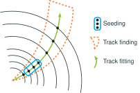
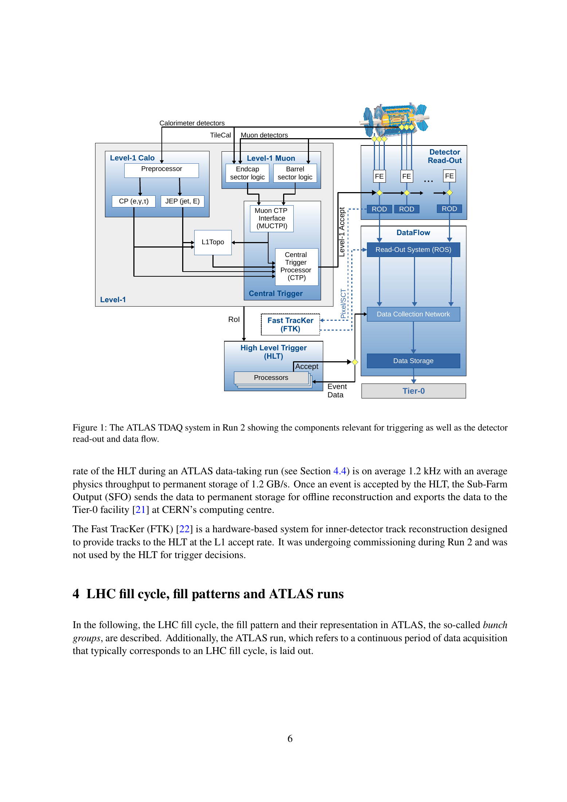

# Figure and slide asset catalogue

Use [original assets](SOURCES.md#retrieved-upstream-material) where verified. The table below provides a complete fallback by slide. Image names encode lecture/page/object position; [embedded-images.json](embedded-images.json) records hashes. Repeated objects are intentional so every slide has traceable provenance.

## Selected original diagrams

ATLAS: arXiv:2007.12539, PDF page 6 (printed page 6); full source page retained without a crop. Neufeld original DAQ source pages [16](figures/neufeld-daq-16.png), [17](figures/neufeld-daq-17.png), [18](figures/neufeld-daq-18.png), [19](figures/neufeld-daq-19.png).

## Original mass-spectrum plot

[LHCb Figure 1, original publisher PDF page 4](figures/lhcb-xib-figure1-page.png) contains the 7/8 TeV and 13 TeV mass spectra. The middle-left panel corresponds to the L09 p22 example. Original vector source: [PRD 99 052006](originals/lhcb-xib-mass-2019.pdf), CC BY 4.0. No numerical data table was recovered.

## All source slides

| Slide | Preview | Embedded image objects |
|---|---|---|
| L07 p1 | [Preview](pages/L07-01.jpg) | No raster image objects; inspect preview for vector/text content |
| L07 p2 | [Preview](pages/L07-02.jpg) | No raster image objects; inspect preview for vector/text content |
| L07 p3 | [Preview](pages/L07-03.jpg) | No raster image objects; inspect preview for vector/text content |
| L07 p4 | [Preview](pages/L07-04.jpg) | [1](embedded/L07-p04-00-Im1.png) |
| L07 p5 | [Preview](pages/L07-05.jpg) | [1](embedded/L07-p05-00-Im2.png), [2](embedded/L07-p05-01-Im3.png) |
| L07 p6 | [Preview](pages/L07-06.jpg) | [1](embedded/L07-p06-00-Im4.png), [2](embedded/L07-p06-01-Im5.png) |
| L07 p7 | [Preview](pages/L07-07.jpg) | [1](embedded/L07-p07-00-Im6.png), [2](embedded/L07-p07-01-Im7.png) |
| L07 p8 | [Preview](pages/L07-08.jpg) | [1](embedded/L07-p08-00-Im8.png), [2](embedded/L07-p08-01-Im9.png) |
| L07 p9 | [Preview](pages/L07-09.jpg) | No raster image objects; inspect preview for vector/text content |
| L07 p10 | [Preview](pages/L07-10.jpg) | [1](embedded/L07-p10-00-Im10.png), [2](embedded/L07-p10-01-Im11.png) |
| L07 p11 | [Preview](pages/L07-11.jpg) | [1](embedded/L07-p11-00-Im12.png), [2](embedded/L07-p11-01-Im13.png) |
| L07 p12 | [Preview](pages/L07-12.jpg) | No raster image objects; inspect preview for vector/text content |
| L07 p13 | [Preview](pages/L07-13.jpg) | [1](embedded/L07-p13-00-Im14.png), [2](embedded/L07-p13-01-Im15.png) |
| L07 p14 | [Preview](pages/L07-14.jpg) | [1](embedded/L07-p14-00-Im16.png), [2](embedded/L07-p14-01-Im17.png) |
| L07 p15 | [Preview](pages/L07-15.jpg) | [1](embedded/L07-p15-00-Im18.png), [2](embedded/L07-p15-01-Im19.png) |
| L07 p16 | [Preview](pages/L07-16.jpg) | [1](embedded/L07-p16-00-Im20.png) |
| L07 p17 | [Preview](pages/L07-17.jpg) | [1](embedded/L07-p17-00-Im21.png) |
| L07 p18 | [Preview](pages/L07-18.jpg) | [1](embedded/L07-p18-00-Im22.png), [2](embedded/L07-p18-01-Im23.png), [3](embedded/L07-p18-02-Im24.png) |
| L07 p19 | [Preview](pages/L07-19.jpg) | [1](embedded/L07-p19-00-Im25.png), [2](embedded/L07-p19-01-Im26.png) |
| L07 p20 | [Preview](pages/L07-20.jpg) | [1](embedded/L07-p20-00-Im27.png), [2](embedded/L07-p20-01-Im28.png) |
| L07 p21 | [Preview](pages/L07-21.jpg) | [1](embedded/L07-p21-00-Im29.png) |
| L08 p1 | [Preview](pages/L08-01.jpg) | [1](embedded/L08-p01-00-Image2.jpg), [2](embedded/L08-p01-01-Image3.jpg), [3](embedded/L08-p01-02-Image4.jpg) |
| L08 p2 | [Preview](pages/L08-02.jpg) | [1](embedded/L08-p02-00-Image6.jp2), [2](embedded/L08-p02-01-Image8.jpg) |
| L08 p3 | [Preview](pages/L08-03.jpg) | [1](embedded/L08-p03-00-Image6.jp2), [2](embedded/L08-p03-01-Image9.jpg), [3](embedded/L08-p03-02-Image10.jpg), [4](embedded/L08-p03-03-Image11.jpg), [5](embedded/L08-p03-04-Image12.jpg), [6](embedded/L08-p03-05-Image13.jpg), [7](embedded/L08-p03-06-Image14.jpg), [8](embedded/L08-p03-07-Image15.jpg), [9](embedded/L08-p03-08-Image16.jpg), [10](embedded/L08-p03-09-Image17.jpg), [11](embedded/L08-p03-10-Image18.jpg), [12](embedded/L08-p03-11-Image19.jpg), [13](embedded/L08-p03-12-Image20.jpg), [14](embedded/L08-p03-13-Image21.jp2) |
| L08 p4 | [Preview](pages/L08-04.jpg) | [1](embedded/L08-p04-00-Image6.jp2), [2](embedded/L08-p04-01-Image22.jpg), [3](embedded/L08-p04-02-Image23.jpg), [4](embedded/L08-p04-03-Image24.jp2), [5](embedded/L08-p04-04-Image25.jpg), [6](embedded/L08-p04-05-Image26.jp2) |
| L08 p5 | [Preview](pages/L08-05.jpg) | [1](embedded/L08-p05-00-Image6.jp2), [2](embedded/L08-p05-01-Image27.jpg), [3](embedded/L08-p05-02-Image28.jpg) |
| L08 p6 | [Preview](pages/L08-06.jpg) | [1](embedded/L08-p06-00-Image6.jp2), [2](embedded/L08-p06-01-Image29.jpg) |
| L08 p7 | [Preview](pages/L08-07.jpg) | [1](embedded/L08-p07-00-Image6.jp2), [2](embedded/L08-p07-01-Image30.jpg) |
| L08 p8 | [Preview](pages/L08-08.jpg) | [1](embedded/L08-p08-00-Image6.jp2), [2](embedded/L08-p08-01-Image31.jpg) |
| L08 p9 | [Preview](pages/L08-09.jpg) | [1](embedded/L08-p09-00-Image6.jp2), [2](embedded/L08-p09-01-Image32.jpg), [3](embedded/L08-p09-02-Image33.jpg) |
| L08 p10 | [Preview](pages/L08-10.jpg) | [1](embedded/L08-p10-00-Image6.jp2), [2](embedded/L08-p10-01-Image34.jpg), [3](embedded/L08-p10-02-Image35.jpg), [4](embedded/L08-p10-03-Image36.jpg) |
| L08 p11 | [Preview](pages/L08-11.jpg) | [1](embedded/L08-p11-00-Image6.jp2), [2](embedded/L08-p11-01-Image37.jpg) |
| L08 p12 | [Preview](pages/L08-12.jpg) | [1](embedded/L08-p12-00-Image6.jp2), [2](embedded/L08-p12-01-Image38.jpg) |
| L08 p13 | [Preview](pages/L08-13.jpg) | [1](embedded/L08-p13-00-Image6.jp2) |
| L08 p14 | [Preview](pages/L08-14.jpg) | [1](embedded/L08-p14-00-Image6.jp2), [2](embedded/L08-p14-01-Image40.jpg) |
| L08 p15 | [Preview](pages/L08-15.jpg) | [1](embedded/L08-p15-00-Image6.jp2), [2](embedded/L08-p15-01-Image41.jpg), [3](embedded/L08-p15-02-Image42.jpg) |
| L08 p16 | [Preview](pages/L08-16.jpg) | [1](embedded/L08-p16-00-Image6.jp2), [2](embedded/L08-p16-01-Image45.jpg) |
| L08 p17 | [Preview](pages/L08-17.jpg) | [1](embedded/L08-p17-00-Image6.jp2), [2](embedded/L08-p17-01-Image46.jpg) |
| L08 p18 | [Preview](pages/L08-18.jpg) | [1](embedded/L08-p18-00-Image6.jp2), [2](embedded/L08-p18-01-Image47.jpg) |
| L08 p19 | [Preview](pages/L08-19.jpg) | [1](embedded/L08-p19-00-Image6.jp2), [2](embedded/L08-p19-01-Image48.jpg) |
| L09 p1 | [Preview](pages/L09-01.jpg) | [1](embedded/L09-p01-00-Image2.jpg), [2](embedded/L09-p01-01-Image3.jpg), [3](embedded/L09-p01-02-Image4.jpg) |
| L09 p2 | [Preview](pages/L09-02.jpg) | [1](embedded/L09-p02-00-Image6.jp2), [2](embedded/L09-p02-01-Image8.jpg) |
| L09 p3 | [Preview](pages/L09-03.jpg) | [1](embedded/L09-p03-00-Image6.jp2), [2](embedded/L09-p03-01-Image11.jpg), [3](embedded/L09-p03-02-Image12.jpg) |
| L09 p4 | [Preview](pages/L09-04.jpg) | [1](embedded/L09-p04-00-Image6.jp2), [2](embedded/L09-p04-01-Image13.jpg) |
| L09 p5 | [Preview](pages/L09-05.jpg) | [1](embedded/L09-p05-00-Image6.jp2), [2](embedded/L09-p05-01-Image14.jpg) |
| L09 p6 | [Preview](pages/L09-06.jpg) | [1](embedded/L09-p06-00-Image6.jp2), [2](embedded/L09-p06-01-Image15.jpg) |
| L09 p7 | [Preview](pages/L09-07.jpg) | [1](embedded/L09-p07-00-Image6.jp2), [2](embedded/L09-p07-01-Image16.jpg), [3](embedded/L09-p07-02-Image17.jpg), [4](embedded/L09-p07-03-Image18.jpg) |
| L09 p8 | [Preview](pages/L09-08.jpg) | [1](embedded/L09-p08-00-Image6.jp2), [2](embedded/L09-p08-01-Image8.jpg) |
| L09 p9 | [Preview](pages/L09-09.jpg) | [1](embedded/L09-p09-00-Image6.jp2), [2](embedded/L09-p09-01-Image19.jp2), [3](embedded/L09-p09-02-Image20.jpg), [4](embedded/L09-p09-03-Image21.jpg), [5](embedded/L09-p09-04-Image22.jpg), [6](embedded/L09-p09-05-Image23.jp2) |
| L09 p10 | [Preview](pages/L09-10.jpg) | [1](embedded/L09-p10-00-Image6.jp2), [2](embedded/L09-p10-01-Image24.jpg), [3](embedded/L09-p10-02-Image25.jpg), [4](embedded/L09-p10-03-Image29.jpg) |
| L09 p11 | [Preview](pages/L09-11.jpg) | [1](embedded/L09-p11-00-Image6.jp2), [2](embedded/L09-p11-01-Image33.jpg) |
| L09 p12 | [Preview](pages/L09-12.jpg) | [1](embedded/L09-p12-00-Image6.jp2), [2](embedded/L09-p12-01-Image34.jpg), [3](embedded/L09-p12-02-Image35.jpg), [4](embedded/L09-p12-03-Image36.jpg), [5](embedded/L09-p12-04-Image37.jpg), [6](embedded/L09-p12-05-Image38.jpg), [7](embedded/L09-p12-06-Image39.jpg) |
| L09 p13 | [Preview](pages/L09-13.jpg) | [1](embedded/L09-p13-00-Image6.jp2), [2](embedded/L09-p13-01-Image41.jpg), [3](embedded/L09-p13-02-Image42.jpg) |
| L09 p14 | [Preview](pages/L09-14.jpg) | [1](embedded/L09-p14-00-Image6.jp2), [2](embedded/L09-p14-01-Image43.jpg), [3](embedded/L09-p14-02-Image44.jpg) |
| L09 p15 | [Preview](pages/L09-15.jpg) | [1](embedded/L09-p15-00-Image6.jp2), [2](embedded/L09-p15-01-Image45.jpg) |
| L09 p16 | [Preview](pages/L09-16.jpg) | [1](embedded/L09-p16-00-Image6.jp2), [2](embedded/L09-p16-01-Image46.jpg), [3](embedded/L09-p16-02-Image47.jpg) |
| L09 p17 | [Preview](pages/L09-17.jpg) | [1](embedded/L09-p17-00-Image6.jp2), [2](embedded/L09-p17-01-Image48.jpg), [3](embedded/L09-p17-02-Image49.jpg) |
| L09 p18 | [Preview](pages/L09-18.jpg) | [1](embedded/L09-p18-00-Image6.jp2), [2](embedded/L09-p18-01-Image50.jpg), [3](embedded/L09-p18-02-Image51.jpg), [4](embedded/L09-p18-03-Image52.jp2), [5](embedded/L09-p18-04-Image53.jpg), [6](embedded/L09-p18-05-Image54.jp2) |
| L09 p19 | [Preview](pages/L09-19.jpg) | [1](embedded/L09-p19-00-Image6.jp2), [2](embedded/L09-p19-01-Image55.jpg), [3](embedded/L09-p19-02-Image56.jpg) |
| L09 p20 | [Preview](pages/L09-20.jpg) | [1](embedded/L09-p20-00-Image6.jp2), [2](embedded/L09-p20-01-Image57.jpg), [3](embedded/L09-p20-02-Image58.jpg), [4](embedded/L09-p20-03-Image59.jp2), [5](embedded/L09-p20-04-Image60.jp2), [6](embedded/L09-p20-05-Image61.jp2), [7](embedded/L09-p20-06-Image62.jp2) |
| L09 p21 | [Preview](pages/L09-21.jpg) | [1](embedded/L09-p21-00-Image6.jp2), [2](embedded/L09-p21-01-Image63.jpg), [3](embedded/L09-p21-02-Image64.jpg), [4](embedded/L09-p21-03-Image65.jp2) |
| L09 p22 | [Preview](pages/L09-22.jpg) | [1](embedded/L09-p22-00-Image6.jp2), [2](embedded/L09-p22-01-Image66.jp2), [3](embedded/L09-p22-02-Image67.jpg), [4](embedded/L09-p22-03-Image68.jpg) |
| L09 p23 | [Preview](pages/L09-23.jpg) | [1](embedded/L09-p23-00-Image6.jp2), [2](embedded/L09-p23-01-Image69.jp2), [3](embedded/L09-p23-02-Image70.jp2), [4](embedded/L09-p23-03-Image71.jp2), [5](embedded/L09-p23-04-Image72.jp2), [6](embedded/L09-p23-05-Image73.jp2), [7](embedded/L09-p23-06-Image74.jp2) |
