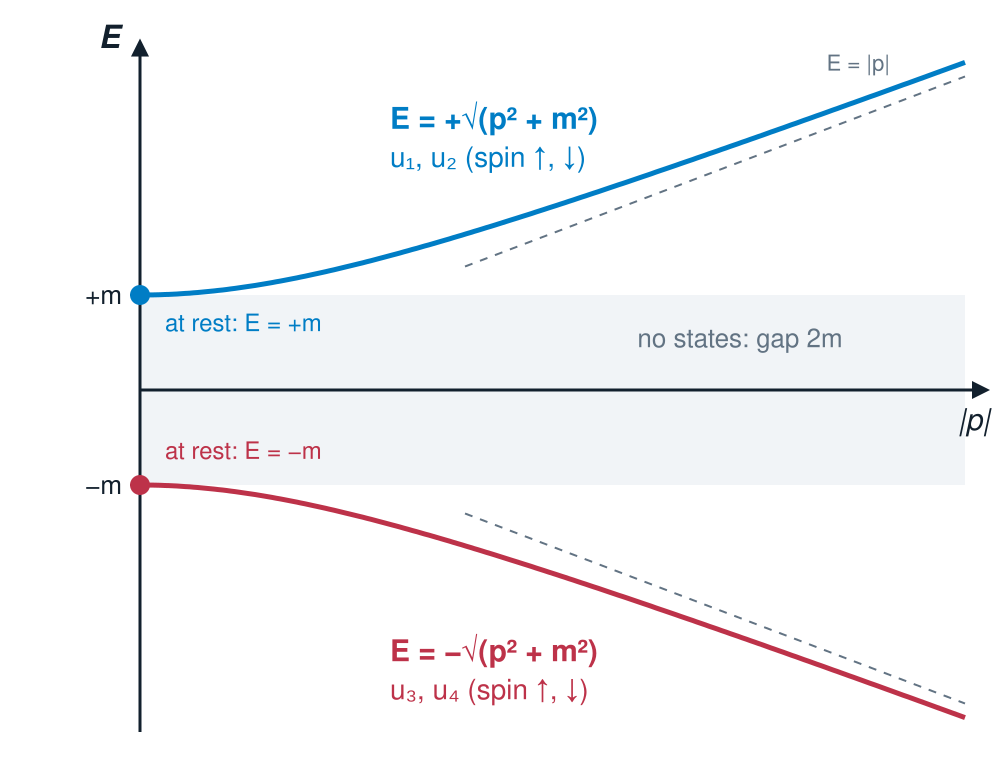
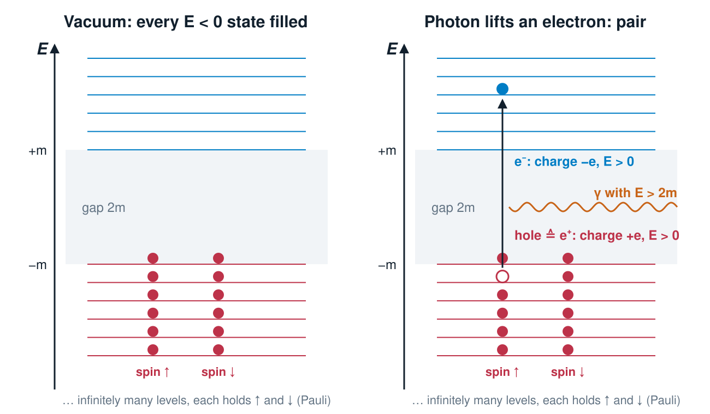
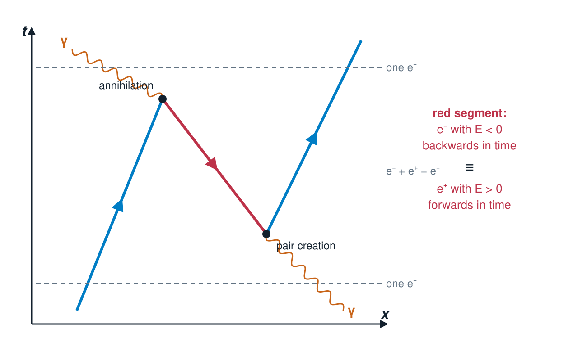

## Lecture 10 {.title-card}

:::: {.slide-body}

::: {.subtitle}
The Dirac Equation
:::

Mikhail Mikhasenko · KT1 · Winter semester 2026/27 · Thomson, Chapter 4

::::

::: {.notes}
Blackboard lecture; these slides complement the board and follow Thomson's conventions (Dirac–Pauli representation, metric (+,−,−,−), normalization to 2E particles per unit volume). Budget: QM and linear-algebra reminder 0–20 min; quiz 20–30; equations of motion 30–40; Dirac's idea and notation 40–60; solutions and normalization 60–80; antiparticles 80–90.
:::

## Today in four questions

:::: {.slide-body}

1. **Equations of motion:** what is the equation that tells a fermion how to move?
2. **Notation:** how do we read $(i\gamma^\mu\partial_\mu-m)\psi=0$ symbol by symbol?
3. **Solutions:** what are the four solutions $u_1,\dots,u_4$, and how are they normalized?
4. **Antiparticles:** what do the negative-energy solutions mean?

::::

::: {.notes}
1 minute. Return to this list at each section boundary.
:::

## Recap: quantum mechanics {.section-title}

:::: {.slide-body}

Operators, wave functions, currents — and a little linear algebra

::: {.subtle}
Lecture 3 · Thomson Sec. 2.3
:::

::::

## Measurements become operators

:::: {.slide-body}

A free particle is a **plane wave**:
$$\psi(\mathbf x,t)=N\,e^{i(\mathbf p\cdot\mathbf x-Et)}$$

Derivatives pull out the energy and momentum:
$$\hat E=i\frac{\partial}{\partial t},\qquad\hat{\mathbf p}=-i\nabla\qquad\Rightarrow\qquad\hat E\psi=E\psi,\quad\hat{\mathbf p}\psi=\mathbf p\,\psi$$

Put an energy–momentum relation into operators and you get a **wave equation**:
$$E=\frac{\mathbf p^2}{2m}\quad\longrightarrow\quad i\frac{\partial\psi}{\partial t}=\hat H\psi=-\frac{1}{2m}\nabla^2\psi$$

::: {.take-home}
Today: the same trick with the **relativistic** relation $E^2=\mathbf p^2+m^2$.
:::

::::

::: {.notes}
Natural units, ħ = c = 1. The Schrödinger equation is first order in time and second order in space: not symmetric between t and x, so it cannot be Lorentz covariant.
:::

## Probability density, current and continuity

:::: {.slide-body}

$$\rho=\psi^*\psi,\qquad\mathbf j=\frac{1}{2im}\big(\psi^*\nabla\psi-\psi\nabla\psi^*\big)$$

$$\boxed{\;\frac{\partial\rho}{\partial t}+\nabla\cdot\mathbf j=0\;}$$

Integrated over a volume $V$: probability inside changes only by the **flux through the surface**,
$$\frac{d}{dt}\int_V\rho\,d^3x=-\oint_{\partial V}\mathbf j\cdot d\mathbf S$$

Plane wave: $\rho=|N|^2$ (particles per volume), $\mathbf j=|N|^2\,\mathbf p/m=\rho\,\mathbf v$.

::: {.check}
In four-vector language: $j^\mu=(\rho,\mathbf j)$ and the continuity equation is $\partial_\mu j^\mu=0$. We will need a **positive** $\rho$.
:::

::::

::: {.notes}
The continuity equation follows from the Schrödinger equation and its complex conjugate. For any new wave equation we must re-derive ρ and j, and check that ρ ≥ 0. This is exactly where the Klein–Gordon equation fails.
:::

## Eigenvalues, eigenstates and degeneracy

:::: {.slide-body}

$$\hat A\,\phi_n=a_n\,\phi_n$$

- $a_n$: a **possible result** of measuring $A$; $\phi_n$: the state with a sharp value.
- Hermitian operators ($\hat A^\dagger=\hat A$) have **real** eigenvalues and orthogonal eigenstates.
- **Degeneracy:** several independent eigenstates with the **same** eigenvalue. Another quantum number is hiding — often a symmetry.
- Operators that commute, $[\hat A,\hat B]=0$, have **common eigenstates**: label states by both.

::: {.take-home}
Example today: for each energy the Dirac equation has **two** solutions. The hidden quantum number is **spin**.
:::

::::

::: {.notes}
Hydrogen: energy depends only on n; degeneracy in l, m_l and spin. Free particle: each momentum p is degenerate in spin.
:::

## Linear algebra: when does $A\,x=0$ have a solution?

:::: {.slide-body}

::::: {.two-col}
::: {.rule}
[Homogeneous system]{.rule-head}

$A$ is an $n\times n$ matrix.

$\det A\neq0$: only $x=0$.

$\det A=0$: non-trivial solutions exist.

Number of independent solutions:
$$n-\operatorname{rank}A$$
:::

::: {.rule}
[Eigenvalue problem]{.rule-head}

$$A\,x=\lambda x\iff(A-\lambda\mathbb 1)\,x=0$$

Non-trivial $x$ only if
$$\det(A-\lambda\mathbb 1)=0$$

Degeneracy of $\lambda$ = $n-\operatorname{rank}(A-\lambda\mathbb 1)$.
:::
:::::

::: {.take-home}
Today, $A=\not p-m$ is $4\times4$. $\det A=0$ fixes $E$; $\operatorname{rank}A=2$ gives **two** spinors per energy.
:::

::::

::: {.notes}
Quick 2×2 example on the board: A = [[1,1],[1,1]] has det 0, rank 1, so one independent solution x = (1,−1). The rank counts independent equations; n − rank counts free parameters.
:::

## Name a quantity — what is it good for? {.quiz-slide}

:::: {.slide-body}

::::: {.card-grid}
::: {.qcard}
[$\hat H$]{.sym}

::: {.use .fragment}
Generates time evolution, $i\partial_t\psi=\hat H\psi$. Eigenvalues: energies.
:::
:::

::: {.qcard}
[$\hat{\mathbf p}=-i\nabla$]{.sym}

::: {.use .fragment}
Momentum. Eigenstates: plane waves $e^{i\mathbf p\cdot\mathbf x}$.
:::
:::

::: {.qcard}
[$\psi(\mathbf x,t)$]{.sym}

::: {.use .fragment}
Probability amplitude. Interferes; only $|\psi|^2$ is observed.
:::
:::

::: {.qcard}
[$\rho=|\psi|^2$]{.sym}

::: {.use .fragment}
Probability (particle) density. Must be $\ge0$.
:::
:::

::: {.qcard .orange}
[$\mathbf j$]{.sym}

::: {.use .fragment}
Probability current from the spatial derivatives of $\psi$: $\mathbf j=\frac{1}{2im}(\psi^*\nabla\psi-\psi\nabla\psi^*)$. Enters the continuity equation.
:::
:::

::: {.qcard .orange}
[$\partial_t\rho+\nabla\!\cdot\!\mathbf j=0$]{.sym}

::: {.use .fragment}
Continuity: probability is conserved locally.
:::
:::

::: {.qcard .green}
[$\det(A-\lambda\mathbb 1)=0$]{.sym}

::: {.use .fragment}
Characteristic equation: gives the eigenvalues.
:::
:::

::: {.qcard .green}
[$n-\operatorname{rank}A$]{.sym}

::: {.use .fragment}
Number of independent solutions of $Ax=0$: the degeneracy.
:::
:::
:::::

::::

::: {.notes}
10 minutes. Students in a row: each names one quantity and says what it is good for; reveal the card answer after the answer. Add more on the board if they come up (commutator, expectation value, normalization).
:::

## 1 · Equations of motion {.section-title}

:::: {.slide-body}

Physics laws tell a system **how to evolve**

::: {.subtle}
Classical mechanics · Maxwell · the Standard Model fields
:::

::::

## Classical mechanics: one function, all the motion

:::: {.slide-body}

::::: {.two-col}
::: {.rule}
[Lagrangian]{.rule-head}

$$L(q,\dot q)=T-V=\frac{m\dot x^2}{2}-V(x)$$

Action $S=\int L\,dt$ is stationary, $\delta S=0$.
:::

::: {.rule}
[Equation of motion]{.rule-head}

$$\frac{d}{dt}\frac{\partial L}{\partial\dot q}-\frac{\partial L}{\partial q}=0$$

$$\Rightarrow\quad m\ddot x=-\frac{dV}{dx}$$
:::
:::::

::: {.take-home}
Initial conditions + equation of motion = the **whole future** of the system.
:::

::::

::: {.notes}
The Lagrangian determines a set of differential equations; solving them evolves the system. The same logic carries over to fields: a Lagrangian density gives the field equations. Here we take a shortcut and write the field equation directly.
:::

## Maxwell's equations: how light moves

:::: {.slide-body}

::::: {.two-col}
::: {.rule}
[Four equations]{.rule-head}

Natural Heaviside–Lorentz units, $\varepsilon_0=\mu_0=c=1$:
$$\nabla\cdot\mathbf E=\rho,\qquad\nabla\cdot\mathbf B=0$$
$$\nabla\times\mathbf E=-\frac{\partial\mathbf B}{\partial t},\qquad\nabla\times\mathbf B=\mathbf j+\frac{\partial\mathbf E}{\partial t}$$
:::

::: {.rule}
[In vacuum: a wave]{.rule-head}

$$\left(\frac{\partial^2}{\partial t^2}-\nabla^2\right)\mathbf E=0$$

Waves travel at speed $1$, i.e. $c$.

Covariant form: $\partial_\mu F^{\mu\nu}=j^\nu$.
:::
:::::

::: {.take-home}
The **photon** has an equation of motion. What is the equation for the **electron**?
:::

::::

::: {.notes}
Take the curl of Faraday's law and use Ampère's law with ρ = j = 0. In SI units the speed is 1/√(μ₀ε₀) = c: Maxwell's numerical observation that light is an electromagnetic wave.
:::

## Which of these solve Maxwell's equations?

:::: {.slide-body}

::::: {.card-grid .three}
::: {.qcard}
[A WhatsApp message arriving on your phone]{.sym}

::: {.use .fragment}
Microwaves, ~2–5 GHz, from antenna to antenna.

[Yes]{.verdict .yes}
:::
:::

::: {.qcard .orange}
[The flash of lightning in a thunderstorm]{.sym}

::: {.use .fragment}
Visible light, ~500 THz, an electromagnetic wave.

[Yes]{.verdict .yes}
:::
:::

::: {.qcard .red}
[The thunder that follows]{.sym}

::: {.use .fragment}
A pressure wave in air, ~340 m/s: equations of fluid dynamics, not Maxwell.

[No]{.verdict .no}
:::
:::
:::::

::: {.check}
The delay between flash and thunder ≈ 3 s per km: light is ~10⁶ times faster than sound.
:::

::::

::: {.notes}
Ask before revealing. Thunder is caused by electromagnetism (heating by the discharge), but the sound wave itself obeys hydrodynamics. Point: each kind of wave has its own equation of motion.
:::

## Fundamental fields and their equations of motion

:::: {.slide-body}

::: {.compare-table}
| Field | Spin | Equation of motion | Examples |
|----------------|--------|------------------------------------------------|----------------------------|
| Scalar | 0 | Klein–Gordon: $(\partial_\mu\partial^\mu+m^2)\,\phi=0$ | Higgs, (pions) |
| **Fermion** | **½** | **Dirac:** $(i\gamma^\mu\partial_\mu-m)\,\psi=0$ | **e, μ, τ, ν, quarks** |
| Massless vector | 1 | Maxwell: $\partial_\mu F^{\mu\nu}=j^\nu$ | photon, gluons |
| Massive vector | 1 | Proca: $\partial_\mu F^{\mu\nu}+m^2A^\nu=0$ | W, Z |
| Non-relativistic | — | Schrödinger: $i\partial_t\psi=\hat H\psi$ | atoms, nuclei |
:::

::: {.take-home}
All matter particles of the Standard Model are **fermions**: today's equation describes all of them.
:::

::::

::: {.notes}
Pions are composite but at low energy behave as spin-0 fields. Gluons obey non-abelian generalizations of Maxwell's equations. Schrödinger is the low-energy limit for all of them.
:::

## Why not Klein–Gordon for the electron?

:::: {.slide-body}

$$E^2=\mathbf p^2+m^2\quad\longrightarrow\quad-\frac{\partial^2\phi}{\partial t^2}=-\nabla^2\phi+m^2\phi\iff(\partial_\mu\partial^\mu+m^2)\,\phi=0$$

Plane wave $\phi=N e^{i(\mathbf p\cdot\mathbf x-Et)}$ works, with $E=\pm\sqrt{\mathbf p^2+m^2}$.

Three problems in 1927:

1. **Second order in time:** we need $\phi$ and $\partial_t\phi$ at $t=0$ — not like Schrödinger.
2. **Density** $\rho=i(\phi^*\partial_t\phi-\phi\,\partial_t\phi^*)=2|N|^2E$ is **negative** for $E<0$.
3. **No spin:** a single component cannot describe the electron's two spin states.

::: {.take-home}
Dirac's goal (1928): an equation **first order** in $\partial_t$ — and so, for relativity, first order in $\nabla$ too.
:::

::::

::: {.notes}
The derivation of ρ and j for KG is in the backup. Negative energies will survive in Dirac's equation; negative densities will not.
:::

## 2 · Dirac's idea {.section-title}

:::: {.slide-body}

An equation **first order** in $\partial_t$ and $\nabla$

::: {.subtle}
Thomson Ch. 4 · counting components · γ matrices
:::

::::

## Counting the components of $\psi$

:::: {.slide-body}

::::: {.two-col}
::: {.rule}
[Degrees of freedom]{.rule-head}

Spin ½: **2** states, ↑ and ↓.

Relativity: **2** signs of energy, $E=\pm\sqrt{\mathbf p^2+m^2}$.

$$2\times2=4\quad\Rightarrow\quad\psi=\begin{pmatrix}\psi_1\\\psi_2\\\psi_3\\\psi_4\end{pmatrix}$$
:::

::: {.rule}
[Coefficients become matrices]{.rule-head}

First order in $\partial_t,\partial_x,\partial_y,\partial_z$: four coefficients $\gamma^0,\gamma^1,\gamma^2,\gamma^3$.

Acting on a 4-component $\psi$: each $\gamma^\mu$ is a $4\times4$ **matrix**.

Requirement: every solution obeys $E^2=\mathbf p^2+m^2$.
:::
:::::

::: {.take-home}
$\psi$ is a four-component **spinor**, not a four-vector: its components count spin and energy sign, not $t,x,y,z$.
:::

::::

::: {.notes}
As on the board: count degrees of freedom first, then explain each symbol. Dirac's original route via α and β, and the argument that 4×4 is the smallest size, are in the backup.
:::

## The γ matrices

:::: {.slide-body}

The condition that gives $E^2=\mathbf p^2+m^2$:
$$\gamma^\mu\gamma^\nu+\gamma^\nu\gamma^\mu=2g^{\mu\nu}\qquad\Rightarrow\qquad(\gamma^0)^2=1,\quad(\gamma^k)^2=-1,\quad\gamma^\mu\gamma^\nu=-\gamma^\nu\gamma^\mu\ (\mu\neq\nu)$$

**Dirac–Pauli representation**, built from $2\times2$ blocks: $I$ is the identity, $\sigma_k$ the Pauli matrices,
$$\gamma^0=\begin{pmatrix}I&0\\0&-I\end{pmatrix},\qquad\gamma^k=\begin{pmatrix}0&\sigma_k\\-\sigma_k&0\end{pmatrix},\qquad\sigma_x=\begin{pmatrix}0&1\\1&0\end{pmatrix},\ \sigma_y=\begin{pmatrix}0&-i\\i&0\end{pmatrix},\ \sigma_z=\begin{pmatrix}1&0\\0&-1\end{pmatrix}$$

Check: $(\gamma^k)^2=\begin{pmatrix}-\sigma_k^2&0\\0&-\sigma_k^2\end{pmatrix}=-1\ \checkmark\qquad\gamma^0\gamma^k+\gamma^k\gamma^0=\begin{pmatrix}0&\sigma_k\\\sigma_k&0\end{pmatrix}+\begin{pmatrix}0&-\sigma_k\\-\sigma_k&0\end{pmatrix}=0\ \checkmark$

::: {.check}
The choice is not unique: any $U\gamma^\mu U^{-1}$ works too. Physics does not depend on the representation; Thomson uses this one.
:::

::::

::: {.notes}
Uses σ_k² = 1. The anticommutator guarantees (γ^μ p_μ)² = p², which is how E² = p² + m² comes out (see the slide on p̸ − m in block form). The chiral (Weyl) representation is in the backup.
:::

## Covariant form of the equation

:::: {.slide-body}

Written out, with one matrix per derivative:
$$i\gamma^0\frac{\partial\psi}{\partial t}+i\gamma^1\frac{\partial\psi}{\partial x}+i\gamma^2\frac{\partial\psi}{\partial y}+i\gamma^3\frac{\partial\psi}{\partial z}-m\psi=0$$

::: {.eq-box}
$$(i\gamma^\mu\partial_\mu-m)\,\psi=0$$
:::

First order in **all four** coordinates: $t$ and $\mathbf x$ on equal footing, as relativity requires.

::::

::: {.notes}
The equation looks Lorentz covariant; proving that ψ transforms properly (as a spinor) is beyond this course.
:::

## 3 · Reading the Dirac equation {.section-title}

:::: {.slide-body}

What each symbol means

::: {.subtle}
Indices · contraction · γ matrices · plane waves · $\not p$
:::

::::

## The Dirac equation

:::: {.slide-body}

::: {.eq-big}
$$(i\gamma^\mu\partial_\mu-m)\,\psi=0$$
:::

::: {.history}
[1928]{.yr}

P. A. M. Dirac, “The quantum theory of the electron”, Proc. R. Soc. A **117**, 610.

[1931]{.yr}

Dirac predicts the “anti-electron”.

[1932]{.yr}

C. D. Anderson finds the positron in cosmic rays (Nobel 1936).

[1995]{.yr}

Memorial stone in Westminster Abbey: $i\gamma\cdot\partial\psi=m\psi$.
:::

::::

::: {.notes}
Dirac shared the 1933 Nobel prize with Schrödinger. The Westminster Abbey stone carries the equation in the compact form iγ·∂ψ = mψ. In 1930 Dirac first tried to identify the holes with protons; Oppenheimer and Weyl showed the hole must have the electron mass.
:::

## Anatomy of the equation

:::: {.slide-body}

::: {.eq-box}
$$(i\gamma^\mu\partial_\mu-m)\,\psi=0$$
:::

::::: {.anatomy}
::: {}
[$\gamma^\mu$]{.tag}
Four $4\times4$ matrices, $\mu=0,1,2,3$. The index labels **which matrix**.
:::

::: {}
[$\partial_\mu$]{.tag}
Four derivatives $\dfrac{\partial}{\partial x^\mu}=(\partial_t,\partial_x,\partial_y,\partial_z)$.
:::

::: {}
[$\gamma^\mu\partial_\mu$]{.tag}
Repeated index, one up, one down: **sum** over $\mu$. A $4\times4$ matrix of derivatives.
:::

::: {}
[$m$]{.tag}
Mass, multiplying the $4\times4$ identity (not written).
:::

::: {}
[$\psi$]{.tag}
Four-component **spinor**: a column $(\psi_1,\psi_2,\psi_3,\psi_4)^T$ of functions of $x$.
:::

::: {}
[$=0$]{.tag}
A column of zeros: **four** coupled first-order equations.
:::
:::::

::::

::: {.notes}
Stress that μ on γ^μ is a label of the matrix, not a row/column index; the spinor indices (1–4) are hidden in matrix multiplication. Upper μ on γ contracts with lower μ on ∂.
:::

## Upper and lower indices

:::: {.slide-body}

::::: {.two-col}
::: {.rule}
[Contravariant: index up]{.rule-head}

$$x^\mu=(t,x,y,z),\qquad p^\mu=(E,\mathbf p)$$

$$\partial^\mu=\frac{\partial}{\partial x_\mu}=\left(\frac{\partial}{\partial t},-\nabla\right)$$
:::

::: {.rule}
[Covariant: index down]{.rule-head}

$$x_\mu=(t,-x,-y,-z),\qquad p_\mu=(E,-\mathbf p)$$

$$\partial_\mu=\frac{\partial}{\partial x^\mu}=\left(\frac{\partial}{\partial t},+\nabla\right)$$
:::
:::::

**Contraction:** $a^\mu b_\mu=a^0b^0-\mathbf a\cdot\mathbf b$, a Lorentz scalar. For example $p\cdot x=p^\mu x_\mu=Et-\mathbf p\cdot\mathbf x$.

::: {.take-home}
A derivative **with respect to** an upper-index coordinate carries a **lower** index: $\partial_\mu$ has $+\nabla$.
:::

::::

::: {.notes}
Metric g = diag(1,−1,−1,−1) lowers indices. ∂_μ x^ν = δ_μ^ν confirms that ∂_μ is covariant. A frequent sign mistake: ∂^μ has −∇.
:::

## Feynman slash notation

:::: {.slide-body}

For any four-vector $a$:
$$\not a\equiv\gamma^\mu a_\mu=\gamma^0a^0-\gamma^1a^1-\gamma^2a^2-\gamma^3a^3=\gamma^0a^0-\boldsymbol\gamma\cdot\mathbf a$$

For the derivative (index already down):
$$\not{\partial}\equiv\gamma^\mu\partial_\mu=\gamma^0\partial_t+\gamma^1\partial_x+\gamma^2\partial_y+\gamma^3\partial_z$$

::: {.eq-box}
$$(i\not{\partial}-m)\,\psi=0$$
:::

::: {.check}
$\not a$ is a $4\times4$ matrix, not a number. Its square is a number: $\not a\not a=a^\mu a^\nu\gamma_\mu\gamma_\nu=\tfrac12 a^\mu a^\nu\{\gamma_\mu,\gamma_\nu\}=a^2$.
:::

::::

::: {.notes}
The minus signs in \not a come from lowering the index of a. For ∂ the index is already down, so all signs are plus.
:::

## The γ matrices explicitly

:::: {.slide-body .smallmath}

::::: {.two-col}
::: {}
$$\gamma^0=\begin{pmatrix}1&0&0&0\\0&1&0&0\\0&0&-1&0\\0&0&0&-1\end{pmatrix},\qquad\gamma^1=\begin{pmatrix}0&0&0&1\\0&0&1&0\\0&-1&0&0\\-1&0&0&0\end{pmatrix}$$

$$\gamma^2=\begin{pmatrix}0&0&0&-i\\0&0&i&0\\0&i&0&0\\-i&0&0&0\end{pmatrix},\qquad\gamma^3=\begin{pmatrix}0&0&1&0\\0&0&0&-1\\-1&0&0&0\\0&1&0&0\end{pmatrix}$$
:::

::: {}
**Block form** (Thomson):
$$\gamma^0=\begin{pmatrix}I&0\\0&-I\end{pmatrix},\qquad\gamma^k=\begin{pmatrix}0&\sigma_k\\-\sigma_k&0\end{pmatrix}$$

$\gamma^0$ is hermitian, the $\gamma^k$ are **anti**-hermitian:
$$\gamma^{0\dagger}=\gamma^0,\qquad\gamma^{k\dagger}=-\gamma^k$$

Compact: $\gamma^{\mu\dagger}=\gamma^0\gamma^\mu\gamma^0$.
:::
:::::

::::

::: {.notes}
Block form and explicit entries agree. Students can check (γ^1)² = −1 by multiplying the explicit 4×4 matrix.
:::

## Four coupled equations, written out

:::: {.slide-body .mid}

$$\begin{pmatrix}i\partial_t-m&0&i\partial_z&i\partial_x+\partial_y\\0&i\partial_t-m&i\partial_x-\partial_y&-i\partial_z\\-i\partial_z&-i\partial_x-\partial_y&-i\partial_t-m&0\\-i\partial_x+\partial_y&i\partial_z&0&-i\partial_t-m\end{pmatrix}\begin{pmatrix}\psi_1\\\psi_2\\\psi_3\\\psi_4\end{pmatrix}=\begin{pmatrix}0\\0\\0\\0\end{pmatrix}$$

In blocks, with $\boldsymbol\sigma\cdot\nabla=\sigma_x\partial_x+\sigma_y\partial_y+\sigma_z\partial_z$:
$$\begin{pmatrix}(i\partial_t-m)\,I&i\,\boldsymbol\sigma\cdot\nabla\\-i\,\boldsymbol\sigma\cdot\nabla&-(i\partial_t+m)\,I\end{pmatrix}\begin{pmatrix}\psi_A\\\psi_B\end{pmatrix}=0$$

::: {.take-home}
Every component obeys a first-order equation, but they are **coupled** through the spatial derivatives.
:::

::::

::: {.notes}
Upper block row from γ^0 = diag(I,−I) times i∂_t and the off-diagonal γ^k blocks. Show one row on the board in full: (i∂_t − m)ψ₁ + i∂_zψ₃ + (i∂_x + ∂_y)ψ₄ = 0.
:::

## Plane waves: derivatives become momenta

:::: {.slide-body}

Free particle:
$$\psi(x)=u(p)\,e^{-ip\cdot x}=u(p)\,e^{i(\mathbf p\cdot\mathbf x-Et)}$$

$u(p)$: a **constant** four-component spinor; the $x$-dependence is all in the phase.

$$i\partial_\mu\,e^{-ip\cdot x}=p_\mu\,e^{-ip\cdot x}:\qquad i\partial_t\to E,\qquad-i\nabla\to\mathbf p$$

::: {.eq-box}
$$(\gamma^\mu p_\mu-m)\,u=(\not p-m)\,u=0$$
:::

::: {.take-home}
A differential equation in $x,t$ has become an **algebraic** $4\times4$ problem in $E,\mathbf p$: $A\,u=0$ with $A=\not p-m$.
:::

::::

::: {.notes}
Exactly the linear-algebra question from the reminder: when does Au = 0 have non-trivial solutions, and how many?
:::

## $\not p-m$ in block form

:::: {.slide-body}

$$\not p=\gamma^0E-\boldsymbol\gamma\cdot\mathbf p=\begin{pmatrix}E\,I&-\boldsymbol\sigma\cdot\mathbf p\\\boldsymbol\sigma\cdot\mathbf p&-E\,I\end{pmatrix},\qquad\boldsymbol\sigma\cdot\mathbf p=\begin{pmatrix}p_z&p_x-ip_y\\p_x+ip_y&-p_z\end{pmatrix}$$

Split $u=\begin{pmatrix}u_A\\u_B\end{pmatrix}$ into two two-component pieces:

$$\begin{pmatrix}(E-m)\,I&-\boldsymbol\sigma\cdot\mathbf p\\\boldsymbol\sigma\cdot\mathbf p&-(E+m)\,I\end{pmatrix}\begin{pmatrix}u_A\\u_B\end{pmatrix}=0$$

Determinant, using $(\boldsymbol\sigma\cdot\mathbf p)^2=|\mathbf p|^2\,I$:
$$\det(\not p-m)=\left(E^2-|\mathbf p|^2-m^2\right)^2=(p^2-m^2)^2$$

::: {.take-home}
Solutions exist only **on the mass shell** $E^2=\mathbf p^2+m^2$ — and the root is **double**.
:::

::::

::: {.notes}
For commuting blocks, det[[A,B],[C,D]] = det(AD − BC). Here AD − BC = −(E² − m²)I + (σ·p)² = −(E² − p² − m²)I. Also directly: (p̸ − m)(p̸ + m) = p² − m².
:::

## 4 · Solutions {.section-title}

:::: {.slide-body}

At rest, in motion, and how many particles per volume

::: {.subtle}
Thomson Ch. 4
:::

::::

## A particle at rest: $\mathbf p=0$

:::: {.slide-body}

$$\not p-m=\begin{pmatrix}E-m&0&0&0\\0&E-m&0&0\\0&0&-E-m&0\\0&0&0&-E-m\end{pmatrix}$$

::::: {.two-col}
::: {.rule}
[$E=+m$]{.rule-head}

Rank 2 → **2** solutions:
$$u_1=\begin{pmatrix}1\\0\\0\\0\end{pmatrix},\quad u_2=\begin{pmatrix}0\\1\\0\\0\end{pmatrix},\qquad\psi\propto e^{-imt}$$
:::

::: {.rule}
[$E=-m$]{.rule-head}

Rank 2 → **2** solutions:
$$u_3=\begin{pmatrix}0\\0\\1\\0\end{pmatrix},\quad u_4=\begin{pmatrix}0\\0\\0\\1\end{pmatrix},\qquad\psi\propto e^{+imt}$$
:::
:::::

::::

::: {.notes}
Normalization omitted here (it is √(2m)). The doubling within each sign is spin: u₁ and u₂ are eigenstates of S_z = ½ diag(σ_z, σ_z) with +½ and −½. The negative-energy solutions cannot be avoided: the 4×4 problem always has four.
:::

## The spectrum: two branches, each doubly degenerate {.landmark}

::: {.slide-refs}
Original figure
:::

:::: {.slide-body}

::::: {.picture-layout}
::: {.picture-copy}
$$E=\pm\sqrt{\mathbf p^2+m^2}$$

Each branch: **two** spin states.

Between $-m$ and $+m$: **no** states.

::: {.check}
Classically we would just drop $E<0$. Why can't quantum mechanics?
:::
:::

::: {.picture-visual}

:::
:::::

::::

::: {.notes}
Answer (later): interactions (e.g. emitting a photon) can cause transitions to lower energy. Nothing stops an electron from falling into the E < 0 states and radiating forever. We return to this in section 5.
:::

## A moving particle: the two block equations

:::: {.slide-body}

$$(E-m)\,u_A=(\boldsymbol\sigma\cdot\mathbf p)\,u_B,\qquad(\boldsymbol\sigma\cdot\mathbf p)\,u_A=(E+m)\,u_B$$

::::: {.two-col}
::: {.rule}
[Choose $u_A$, find $u_B$]{.rule-head}

$$u_B=\frac{\boldsymbol\sigma\cdot\mathbf p}{E+m}\,u_A$$

$u_A=(1,0)^T$ or $(0,1)^T$ → $u_1,u_2$, good for $E>0$.
:::

::: {.rule}
[Choose $u_B$, find $u_A$]{.rule-head}

$$u_A=\frac{\boldsymbol\sigma\cdot\mathbf p}{E-m}\,u_B$$

$u_B=(1,0)^T$ or $(0,1)^T$ → $u_3,u_4$, good for $E<0$.
:::
:::::

Consistency: $u_A=\dfrac{(\boldsymbol\sigma\cdot\mathbf p)^2}{(E-m)(E+m)}u_A=\dfrac{\mathbf p^2}{E^2-m^2}\,u_A$ ✓ on the mass shell.

::::

::: {.notes}
Two free choices for u_A and two for u_B: four solutions in total, matching n − rank = 4 − 2 for each energy sign.
:::

## The four Dirac spinors

:::: {.slide-body}

$$u_1=N\begin{pmatrix}1\\0\\\dfrac{p_z}{E+m}\\\dfrac{p_x+ip_y}{E+m}\end{pmatrix},\quad u_2=N\begin{pmatrix}0\\1\\\dfrac{p_x-ip_y}{E+m}\\\dfrac{-p_z}{E+m}\end{pmatrix},\quad u_3=N\begin{pmatrix}\dfrac{p_z}{E-m}\\\dfrac{p_x+ip_y}{E-m}\\1\\0\end{pmatrix},\quad u_4=N\begin{pmatrix}\dfrac{p_x-ip_y}{E-m}\\\dfrac{-p_z}{E-m}\\0\\1\end{pmatrix}$$

::::: {.two-col}
::: {}
$u_1,u_2$: $E=+\sqrt{\mathbf p^2+m^2}$.

$u_3,u_4$: $E=-\sqrt{\mathbf p^2+m^2}$.
:::

::: {}
Why not $u_1$ with $E<0$? At $\mathbf p\to0$, $E+m\to0$: it **blows up**. $u_3$ with $E>0$ blows up likewise.
:::
:::::

::: {.take-home}
Non-relativistic limit: small/large components $=\dfrac{|\mathbf p|}{|E|+m}\approx\dfrac{v}{2}$. At rest, $u_1\dots u_4$ reduce to the unit vectors.
:::

::::

::: {.notes}
Each spinor is a solution only for one sign of E. In atoms v ≈ α ≈ 1/137, so the lower components of an electron are about 0.4% of the upper ones: the Schrödinger–Pauli two-component description is very good.
:::

## Spinor explorer {.demo-slide}

:::: {.slide-body}

::: {.widget data-src="widgets/spinor.html" data-poster="widgets/spinor-poster.png" data-alt="Interactive Dirac spinor explorer: components of u1 to u4 and v1, v2 versus momentum and angle, with normalization and a numerical check of the Dirac equation"}
:::

::::

::: {.notes}
3 minutes. Start with u₁ at |p| = 0: only one component. Increase |p|: the lower pair grows, and at |p| = 5m it is almost as large as the upper pair (ultra-relativistic). Switch to u₃: E < 0. Rotate θ to show how the spin structure mixes components. The numerical check multiplies by (p̸ − m) independently of the formulas.
:::

## The Dirac current: $\rho\geq0$ at last

:::: {.slide-body}

Adjoint spinor $\bar\psi\equiv\psi^\dagger\gamma^0$. It obeys the **adjoint equation**
$$i\,\partial_\mu\bar\psi\,\gamma^\mu+m\bar\psi=0$$

$\bar\psi\times$(Dirac) + (adjoint)$\times\psi$:
$$i\,\bar\psi\gamma^\mu\partial_\mu\psi+i\,(\partial_\mu\bar\psi)\gamma^\mu\psi=i\,\partial_\mu(\bar\psi\gamma^\mu\psi)=0$$

::: {.eq-box}
$$j^\mu=\bar\psi\gamma^\mu\psi,\qquad\partial_\mu j^\mu=0$$
:::

$$\rho=j^0=\bar\psi\gamma^0\psi=\psi^\dagger\gamma^0\gamma^0\psi=\psi^\dagger\psi=\sum_{i=1}^4|\psi_i|^2\ \geq0$$

::::

::: {.notes}
Hermitian conjugate of the Dirac equation, with γ^{k†} = −γ^k, then multiply by γ^0 from the right. The full derivation is in the backup. The density is positive for both signs of energy: Dirac fixed the KG density problem.
:::

## Normalization: $2E$ particles per unit volume

:::: {.slide-body}

Thomson's convention: $\rho=\psi^\dagger\psi=u^\dagger u=2E$. For $u_1$:
$$u_1^\dagger u_1=N^2\left[1+\frac{p_z^2+p_x^2+p_y^2}{(E+m)^2}\right]=N^2\,\frac{(E+m)^2+\mathbf p^2}{(E+m)^2}=N^2\,\frac{2E}{E+m}$$

::: {.eq-box}
$$N=\sqrt{E+m}$$
:::

::::: {.two-col}
::: {}
**Why $2E$?** A boost contracts the volume by $\gamma$, so the density grows as $\gamma=E/m$. $\rho\propto E$ keeps the normalization **Lorentz invariant**.
:::

::: {}
**Bonus:** the full current is
$$j^\mu=\bar u\gamma^\mu u=2p^\mu$$
density $2E$, flux $2\mathbf p$.
:::
:::::

::::

::: {.notes}
Thomson Ch. 3–4. For u₃, u₄ the same with |E|: N = √(|E| + m). Used E² − m² = p², so (E + m)² + p² = 2E(E + m). The spinor explorer shows u†u = 2|E| numerically.
:::

## 5 · Antiparticles {.section-title}

:::: {.slide-body}

What do the $E<0$ solutions mean?

::: {.subtle}
Dirac sea (1930) · Feynman–Stückelberg (1941, 1949) · Thomson Ch. 4
:::

::::

## The negative-energy problem

:::: {.slide-body}

- The four solutions form a **complete set**: any state, e.g. a localized electron, needs all four. We cannot just drop $u_3,u_4$.
- An electron with $E=+m$ could emit a photon and **fall** into $E<0$ states — and keep falling, radiating without end.
- Hydrogen atoms would be **unstable**. They are not.

::: {.take-home}
Two ways out: **fill** the negative-energy states (Dirac), or **reinterpret** them (Stückelberg, Feynman).
:::

::::

::: {.notes}
The spectrum has no bottom: E → −∞ as |p| → ∞. A single-particle relativistic wave equation cannot be the whole story; the consistent answer is quantum field theory. Both interpretations survive as useful pictures.
:::

## Interpretation 1: the Dirac sea {.landmark}

::: {.slide-refs}
Original figure
:::

:::: {.slide-body}

::::: {.picture-layout}
::: {.picture-copy}
Vacuum = all $E<0$ states **filled**. Pauli forbids a second electron there.

A photon with $E_\gamma>2m$ lifts one electron up.

The **hole** behaves as charge $+e$, energy $+|E|$, momentum $-\mathbf p$.

Pair creation: $\gamma\to e^-e^+$; an electron falling into a hole: **annihilation**.
:::

::: {.picture-visual}

:::
:::::

::::

::: {.notes}
Missing negative charge −e looks like +e; missing energy −|E| looks like +|E|; missing momentum p looks like −p. In matter, pair production needs a nucleus to absorb recoil (a free photon cannot create a massive pair alone).
:::

## The Dirac sea: success and trouble

:::: {.slide-body}

::::: {.two-col}
::: {.rule}
[Success]{.rule-head}

Predicts a particle with the electron's mass and **opposite charge** (1931).

Anderson sees it in a cloud chamber (1932).

Explains pair creation with threshold $2m$ and annihilation.
:::

::: {.rule}
[Trouble]{.rule-head}

The vacuum carries **infinite** negative charge and energy.

Relies on the Pauli principle: no explanation for **boson** antiparticles, e.g. $\pi^+$ and $\pi^-$.

Not a one-particle theory any more.
:::
:::::

::: {.take-home}
The hole picture is a useful image — semiconductors use it every day — but not the final answer.
:::

::::

::: {.notes}
In 1930 Dirac first proposed that holes are protons. Their mass would then have to equal the electron mass — Weyl and Oppenheimer pointed this out — so Dirac predicted a new particle in 1931. In semiconductors, holes in the valence band behave as positive carriers: a real, finite "Dirac sea".
:::

## Interpretation 2: Feynman–Stückelberg

:::: {.slide-body}

A negative-energy solution carries the phase
$$e^{-iEt}=e^{-i(-E)(-t)}$$

A particle with energy $-E$ going **backwards** in time has the same phase as one with energy $+E$ going **forwards**.

::: {.statement-box}
$E<0$ electron, backwards in time $\;\equiv\;$ $E>0$ positron, forwards in time
:::

Emitting an $E<0$ electron ≡ **absorbing** an $E>0$ positron, and vice versa. No sea needed; works for bosons too.

::::

::: {.notes}
Stückelberg 1941, Feynman 1949 ("The theory of positrons", Phys. Rev. 76, 749). Conservation: emitting energy −E is the same bookkeeping as absorbing +E. Charge also flips: a −e current flowing backwards is a +e current flowing forwards.
:::

## One world line, three particles {.landmark}

::: {.slide-refs}
Original figure, after Feynman (1949)
:::

:::: {.slide-body}

::::: {.picture-layout}
::: {.picture-copy}
Follow the line: it zig-zags in time.

Read **time slices**: before, one $e^-$; in between, $e^-$, $e^+$ and $e^-$; afterwards, one $e^-$.

The backward segment **is** the positron.

::: {.check}
Where does energy conservation hold at the two vertices?
:::
:::

::: {.picture-visual}

:::
:::::

::::

::: {.notes}
Lower vertex: a photon creates an e⁺e⁻ pair. Upper vertex: the positron annihilates with the original electron into a photon. This is the picture behind the arrow conventions of Feynman diagrams: antifermion lines carry arrows against time.
:::

## Antiparticle spinors $v$

:::: {.slide-body}

Take $u_{3,4}$ with $E<0$, momentum $\mathbf p$, and relabel by the **physical** values $-E>0$, $-\mathbf p$:
$$\psi=u_{3,4}(-\mathbf p,-E)\,e^{-i(-E t+\mathbf p\cdot\mathbf x)}=v(p)\,e^{+ip\cdot x}$$

::::: {.two-col}
::: {}
$$v_1=N\begin{pmatrix}\dfrac{p_x-ip_y}{E+m}\\\dfrac{-p_z}{E+m}\\0\\1\end{pmatrix},\qquad v_2=N\begin{pmatrix}\dfrac{p_z}{E+m}\\\dfrac{p_x+ip_y}{E+m}\\1\\0\end{pmatrix}$$
:::

::: {}
$v_1(p)=u_4(-\mathbf p,-E)$

$v_2(p)=u_3(-\mathbf p,-E)$

$E>0$, $N=\sqrt{E+m}$

$$(\not p+m)\,v=0$$
:::
:::::

**Antiparticle operators** that give the physical values: $\hat E^{(v)}=-i\dfrac{\partial}{\partial t}$, $\quad\hat{\mathbf p}^{(v)}=+i\nabla$.

::::

::: {.notes}
Thomson Ch. 4. Insert ψ = v e^{+ip·x} into the Dirac equation: iγ^μ∂_μ brings down −p_μ, so (−p̸ − m)v = 0. Check with the explorer: v₁ and v₂ pass the (p̸ + m) test with E > 0.
:::

## Particles and antiparticles side by side

:::: {.slide-body}

::: {.compare-table}
| | Particle | Antiparticle |
|----------------------|---------------------------------------|---------------------------------------|
| Wave function | $\psi=u(p)\,e^{-ip\cdot x}$ | $\psi=v(p)\,e^{+ip\cdot x}$ |
| Spinor equation | $(\not p-m)\,u=0$ | $(\not p+m)\,v=0$ |
| Energy, momentum | $\hat E=i\partial_t$, $\hat{\mathbf p}=-i\nabla$ | $\hat E^{(v)}=-i\partial_t$, $\hat{\mathbf p}^{(v)}=+i\nabla$ |
| Spinors | $u_1,u_2$, $E>0$ | $v_1,v_2$, $E>0$ |
| Normalization | $u^\dagger u=2E$, $N=\sqrt{E+m}$ | $v^\dagger v=2E$, $N=\sqrt{E+m}$ |
| At rest | $u_1=\sqrt{2m}\,(1,0,0,0)^T$ | $v_1=\sqrt{2m}\,(0,0,0,1)^T$ |
:::

::: {.take-home}
From now on: **only positive energies**. $u_1,u_2$ for fermions, $v_1,v_2$ for antifermions.
:::

::::

::: {.notes}
These are the four spinors used in every Feynman-diagram calculation in Thomson, starting with e⁺e⁻ → μ⁺μ⁻ in Chapter 6.
:::

## Two interpretations compared

:::: {.slide-body}

::: {.compare-table}
| | Dirac sea | Feynman–Stückelberg |
|----------------|----------------------------------------|--------------------------------------------|
| $E<0$ state | filled; a **hole** is the antiparticle | backwards in time; read as an antiparticle forwards |
| Vacuum | infinite sea of electrons | empty |
| Bosons | does not work (no Pauli) | works |
| Legacy | positron prediction, pair creation, holes in solids | Feynman diagrams, $v$ spinors |
:::

::: {.take-home}
Modern view (QFT): $\psi$ is a field operator that **annihilates** particles with $u\,e^{-ip\cdot x}$ and **creates** antiparticles with $v\,e^{+ip\cdot x}$.
:::

::::

::: {.notes}
Both lead to the same physical predictions at the level of this course. We use the Feynman–Stückelberg language because it gives the Feynman rules directly.
:::

## Summary {.section-title}

## Take-home messages

:::: {.slide-body}

- Dirac wanted a relativistic equation **first order** in $\partial_t$ and $\nabla$.
- 2 spin states × 2 energy signs: $\psi$ is a 4-component spinor, the $\gamma^\mu$ are **4×4 matrices**. $\{\gamma^\mu,\gamma^\nu\}=2g^{\mu\nu}$.
- $(i\gamma^\mu\partial_\mu-m)\psi=0$; plane waves turn it into $(\not p-m)u=0$, a linear-algebra problem.
- $\det(\not p-m)=(p^2-m^2)^2$, rank 2: two spin states for each sign of $E$ → $u_1,\dots,u_4$.
- Conserved current $j^\mu=\bar\psi\gamma^\mu\psi$ with $\rho=\psi^\dagger\psi\geq0$; normalization $u^\dagger u=2E$, $N=\sqrt{E+m}$.
- $E<0$ solutions describe **antiparticles**: $v_{1,2}$, $\psi=v\,e^{+ip\cdot x}$, $(\not p+m)v=0$.

::::

## Exit questions

:::: {.slide-body}

1. How many components does $\psi$ have? Is it a four-vector?
2. Which two degrees of freedom do the four components of $\psi$ count?
3. Write out $\gamma^\mu\partial_\mu$ and $\gamma^\mu p_\mu$. Where do the minus signs appear?
4. For a particle at rest, how many independent solutions have $E=+m$? Which linear-algebra quantity tells you?
5. An electron moves with $v=0.1$. Estimate the size of the lower components of $u_1$ relative to the upper ones.
6. What is the physical energy of the state $\psi=v\,e^{+ip\cdot x}$, and which operator measures it?

::::

::: {.notes}
Answers: (1) four; no, it is a spinor — it transforms differently under boosts. (2) Spin (↑, ↓) and the sign of the energy (particle, antiparticle). (3) γ^μ∂_μ = γ^0∂_t + γ·∇; γ^μp_μ = γ^0E − γ·p: the minus comes from lowering the index of p. (4) Two; n − rank(p̸ − m) = 4 − 2. (5) |p|/(E + m) ≈ v/2 = 0.05. (6) E > 0, measured by Ê^(v) = −i∂_t.
:::

## Next time and reading

:::: {.slide-body}

**Reading:** Thomson, *Modern Particle Physics*, Chapter 4.

**Next:** spin and helicity of Dirac particles, then the first Feynman-diagram calculation in QED.

::: {.check}
Try at home: show that $u_1$ at rest is an eigenstate of $\hat S_z=\tfrac12\begin{pmatrix}\sigma_z&0\\0&\sigma_z\end{pmatrix}$ with eigenvalue $+\tfrac12$, and $u_2$ with $-\tfrac12$.
:::

::::

## Thank you {.section-title}

:::: {.slide-body}

Questions?

::::

## Backup {.section-title visibility="uncounted"}

## Backup · A Hamiltonian linear in $\hat{\mathbf p}$ {visibility="uncounted"}

:::: {.slide-body}

Try
$$\hat H\psi=(\boldsymbol\alpha\cdot\hat{\mathbf p}+\beta m)\,\psi\qquad\iff\qquad i\frac{\partial\psi}{\partial t}=\left(-i\alpha_x\frac{\partial}{\partial x}-i\alpha_y\frac{\partial}{\partial y}-i\alpha_z\frac{\partial}{\partial z}+\beta m\right)\psi$$

Each solution must also obey $E^2=\mathbf p^2+m^2$. Apply $\hat H$ twice:
$$\hat H^2=\sum_i\alpha_i^2\,\hat p_i^2+\sum_{i<j}(\alpha_i\alpha_j+\alpha_j\alpha_i)\,\hat p_i\hat p_j+\sum_i(\alpha_i\beta+\beta\alpha_i)\,\hat p_i\,m+\beta^2m^2$$

This equals $\hat{\mathbf p}^2+m^2$ only if

$$\alpha_x^2=\alpha_y^2=\alpha_z^2=\beta^2=1,\qquad\alpha_i\alpha_j+\alpha_j\alpha_i=0\ (i\neq j),\qquad\alpha_i\beta+\beta\alpha_i=0$$

::: {.take-home}
Numbers cannot **anticommute**. $\alpha_i$ and $\beta$ are **matrices**, and $\psi$ is a **column** of components.
:::

::::

::: {.notes}
Order matters in the cross terms: we cannot write 2α_iα_j. The four objects must square to one and anticommute pairwise.
:::

## Backup · Why four components? {visibility="uncounted"}

:::: {.slide-body}

::::: {.two-col}
::: {.rule}
[Properties]{.rule-head}

$\hat H$ hermitian $\Rightarrow$ $\alpha_i,\beta$ hermitian.

$\alpha_i^2=1$ $\Rightarrow$ eigenvalues $\pm1$.

Traceless:
$$\operatorname{tr}\alpha_i=\operatorname{tr}(\alpha_i\beta\beta)=\operatorname{tr}(\beta\alpha_i\beta)=-\operatorname{tr}(\alpha_i\beta\beta)$$
so $\operatorname{tr}\alpha_i=0$: equal numbers of $+1$ and $-1$.
:::

::: {.rule}
[Dimension]{.rule-head}

Traceless with eigenvalues $\pm1$: dimension $n$ is **even**.

$n=2$: only **three** anticommuting matrices — the Pauli matrices $\sigma_x,\sigma_y,\sigma_z$.

We need **four**: $\alpha_x,\alpha_y,\alpha_z,\beta$.

Smallest choice: $n=4$.
:::
:::::

::: {.take-home}
$\psi$ has **four** components. It is a **spinor**, not a four-vector.
:::

::::

::: {.notes}
Cyclic property of the trace in the second step, anticommutation in the third. The four components will turn out to be 2 spin states × 2 signs of energy.
:::

## Backup · Klein–Gordon density and current {visibility="uncounted"}

:::: {.slide-body}

$\phi^*\times$(KG) $-\ \phi\times$(KG)$^*$:
$$\phi^*\frac{\partial^2\phi}{\partial t^2}-\phi\frac{\partial^2\phi^*}{\partial t^2}=\phi^*\nabla^2\phi-\phi\nabla^2\phi^*$$
$$\frac{\partial}{\partial t}\Big(\phi^*\partial_t\phi-\phi\,\partial_t\phi^*\Big)+\nabla\cdot\Big(-\phi^*\nabla\phi+\phi\nabla\phi^*\Big)=0$$

Multiply by $i$:
$$\rho=i\left(\phi^*\partial_t\phi-\phi\,\partial_t\phi^*\right),\qquad\mathbf j=-i\left(\phi^*\nabla\phi-\phi\nabla\phi^*\right)$$

Plane wave $N e^{-ip\cdot x}$: $\rho=2|N|^2E$, $\mathbf j=2|N|^2\mathbf p$, i.e. $j^\mu=2|N|^2p^\mu$. Negative for $E<0$.

::::

::: {.notes}
The time derivative in ρ comes from the second-order time derivative in the equation. Factor i makes ρ real.
:::

## Backup · Adjoint equation and current, step by step {visibility="uncounted"}

:::: {.slide-body}

Dirac: $\;i\gamma^0\partial_0\psi+i\gamma^k\partial_k\psi-m\psi=0$

Hermitian conjugate, with $\gamma^{0\dagger}=\gamma^0$, $\gamma^{k\dagger}=-\gamma^k$:
$$-i\,\partial_0\psi^\dagger\gamma^0+i\,\partial_k\psi^\dagger\gamma^k-m\psi^\dagger=0$$

Multiply by $\gamma^0$ from the right; use $\gamma^k\gamma^0=-\gamma^0\gamma^k$:
$$-i\,\partial_0\bar\psi\gamma^0-i\,\partial_k\bar\psi\gamma^k-m\bar\psi=0\quad\iff\quad i\,\partial_\mu\bar\psi\,\gamma^\mu+m\bar\psi=0$$

Then $\bar\psi\cdot$(Dirac) $+$ (adjoint)$\cdot\psi$ $=i\,\partial_\mu(\bar\psi\gamma^\mu\psi)=0$.

::::

::: {.notes}
Thomson Ch. 4. The ψ̄ = ψ†γ^0 combination is needed because ψ†γ^μψ alone is not a four-vector.
:::

## Backup · γ-matrix toolkit {visibility="uncounted"}

:::: {.slide-body}

$$\{\gamma^\mu,\gamma^\nu\}=2g^{\mu\nu},\qquad(\gamma^0)^2=1,\qquad(\gamma^k)^2=-1,\qquad\gamma^{\mu\dagger}=\gamma^0\gamma^\mu\gamma^0$$

$$\gamma^5\equiv i\gamma^0\gamma^1\gamma^2\gamma^3=\begin{pmatrix}0&I\\I&0\end{pmatrix}\ \text{(Dirac–Pauli)},\qquad(\gamma^5)^2=1,\qquad\{\gamma^5,\gamma^\mu\}=0$$

$$\not a\not b+\not b\not a=2\,a\cdot b,\qquad\not a\not a=a^2,\qquad(\not p-m)(\not p+m)=p^2-m^2$$

$$\bar u\gamma^\mu u=2p^\mu,\qquad\bar u u=2m,\qquad\bar v v=-2m$$

::::

::: {.notes}
γ^5 appears with chirality and the weak interaction (Thomson Ch. 6 and 11). ūu = u†γ^0u = N²(1 − p²/(E+m)²) = 2m.
:::

## Backup · Chiral (Weyl) representation {visibility="uncounted"}

:::: {.slide-body}

$$\gamma^0=\begin{pmatrix}0&I\\I&0\end{pmatrix},\qquad\gamma^k=\begin{pmatrix}0&\sigma_k\\-\sigma_k&0\end{pmatrix},\qquad\gamma^5=\begin{pmatrix}-I&0\\0&I\end{pmatrix}$$

Same anticommutation relations, so the same physics. Related to Dirac–Pauli by a unitary transformation.

Here $\psi=(\psi_L,\psi_R)^T$: the upper and lower pairs are the **left-** and **right-handed chiral** components, which decouple for $m=0$.

Useful for massless or ultra-relativistic fermions and for the weak interaction.

::::

::: {.notes}
Thomson Ch. 6. Dirac–Pauli is convenient near rest (diagonal γ^0); chiral is convenient at high energy (diagonal γ^5).
:::

## Backup · Spin comes out of the equation {visibility="uncounted"}

:::: {.slide-body}

Orbital angular momentum is **not** conserved by $\hat H=\boldsymbol\alpha\cdot\hat{\mathbf p}+\beta m$:
$$[\hat H,\hat{\mathbf L}]=-i\,\boldsymbol\alpha\times\hat{\mathbf p}$$

Define $\hat{\mathbf S}=\tfrac12\boldsymbol\Sigma$, $\;\boldsymbol\Sigma=\begin{pmatrix}\boldsymbol\sigma&0\\0&\boldsymbol\sigma\end{pmatrix}$. Then $[\hat H,\hat{\mathbf S}]=+i\,\boldsymbol\alpha\times\hat{\mathbf p}$ and
$$[\hat H,\hat{\mathbf L}+\hat{\mathbf S}]=0$$

$\hat{\mathbf S}^2=\tfrac34$: spin $s=\tfrac12$. Dirac particles carry spin ½ **automatically**.

In a magnetic field, the non-relativistic limit gives the Pauli equation with $g=2$ (QED corrections: $g-2\approx0.00232$).

::::

::: {.notes}
Spin is not an extra assumption: it is required for total angular momentum conservation. The g = 2 prediction was one of the great early successes of the Dirac equation.
:::

## Backup · References {.references visibility="uncounted"}

:::: {.slide-body}

M. Thomson, *Modern Particle Physics*, Cambridge University Press (2013), Chapter 4.

P. A. M. Dirac, “The quantum theory of the electron”, Proc. R. Soc. Lond. A **117** (1928) 610.

P. A. M. Dirac, “A theory of electrons and protons”, Proc. R. Soc. Lond. A **126** (1930) 360.

P. A. M. Dirac, “Quantised singularities in the electromagnetic field”, Proc. R. Soc. Lond. A **133** (1931) 60.

C. D. Anderson, “The positive electron”, Phys. Rev. **43** (1933) 491.

E. C. G. Stückelberg, Helv. Phys. Acta **14** (1941) 588.

R. P. Feynman, “The theory of positrons”, Phys. Rev. **76** (1949) 749.

All figures in this lecture are original.

::::
