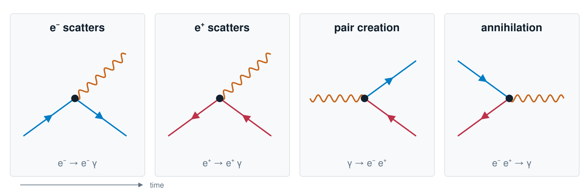
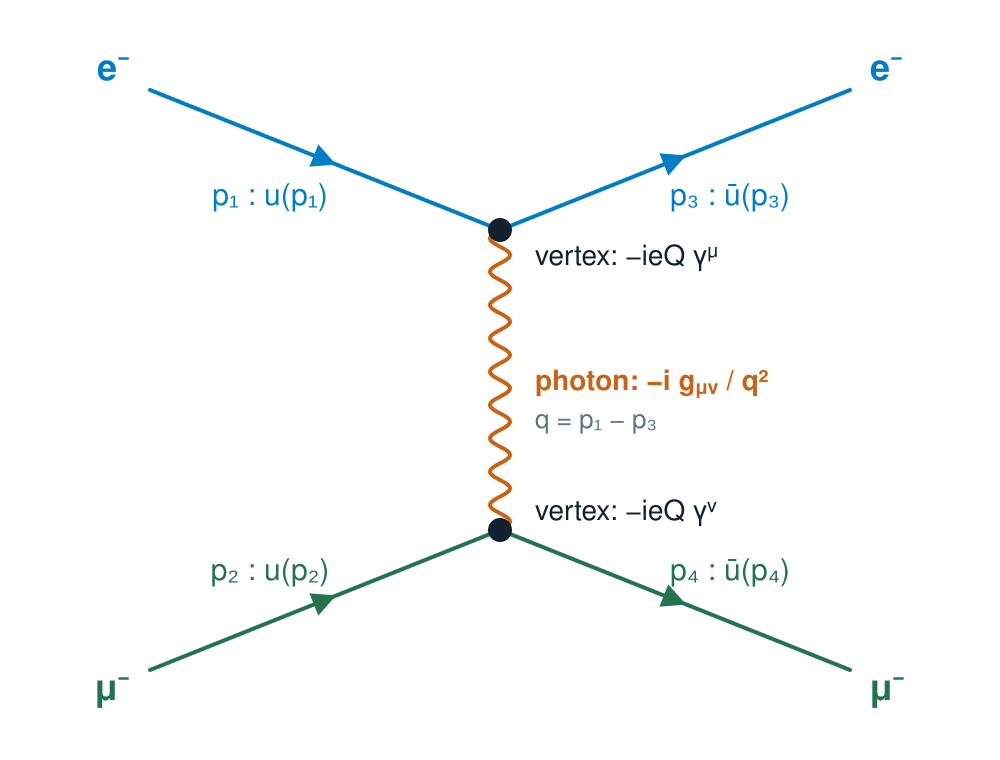
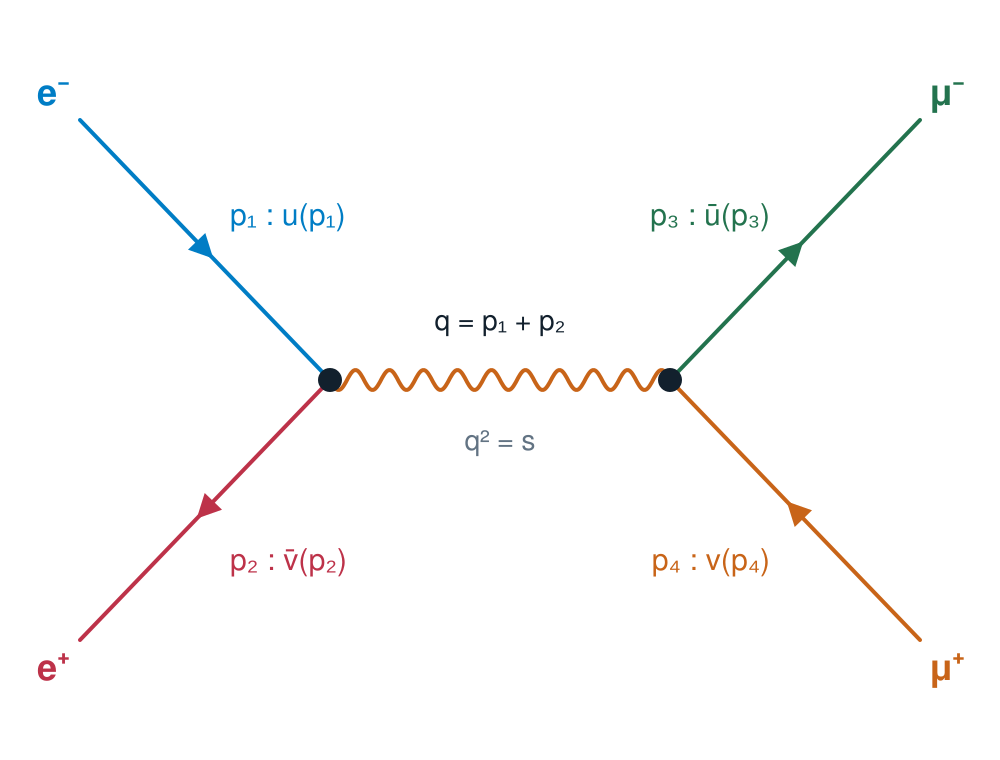
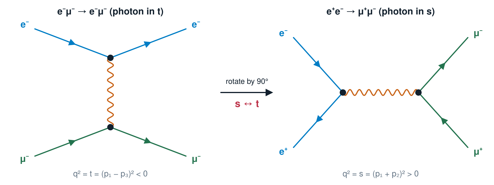
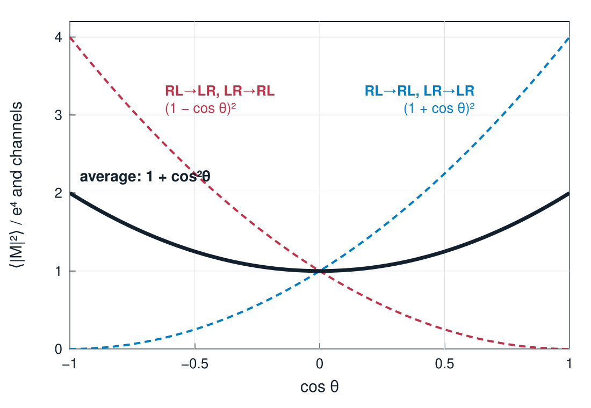
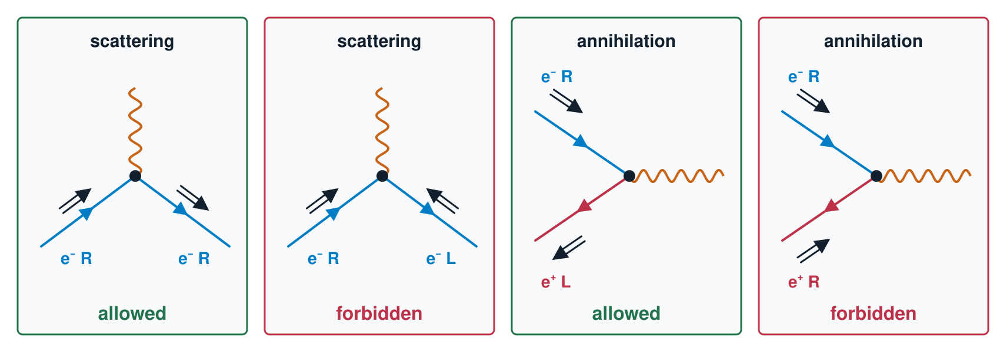
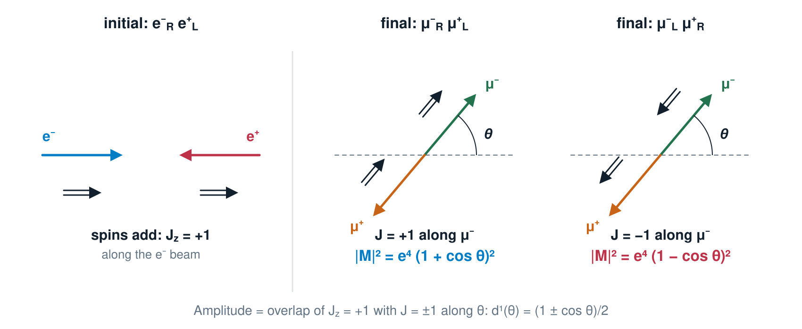
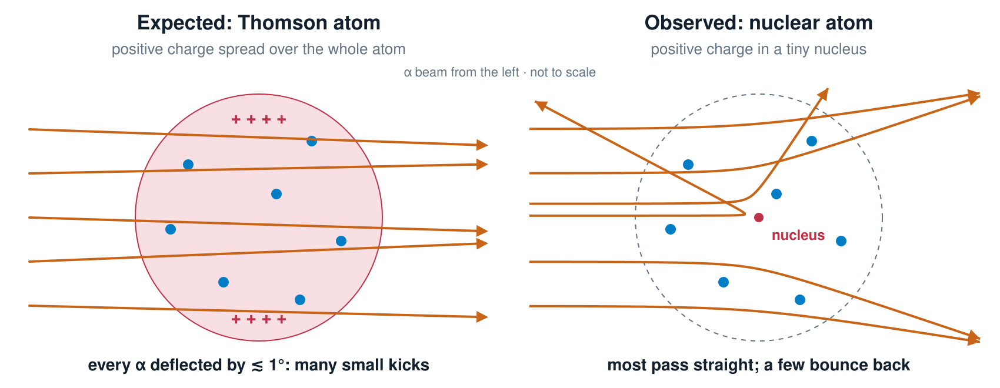
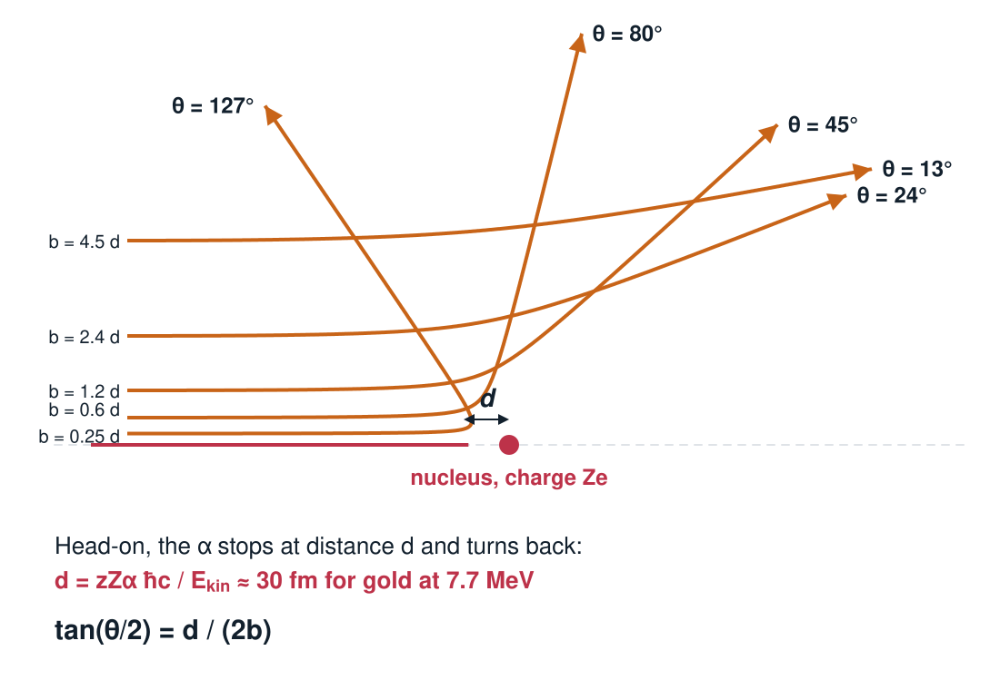
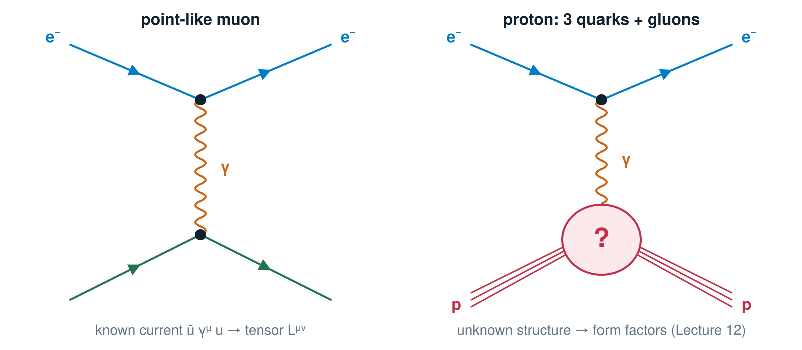

## Lecture 11 {.title-card}

:::: {.slide-body}

::: {.subtitle}
Feynman Rules and the Trace Technique
:::

Mikhail Mikhasenko · KT1 · Winter semester 2026/27 · Thomson, Chapters 5–6

::::

::: {.notes}
Blackboard lecture with companion slides; Thomson's conventions (metric (+,−,−,−), spinors normalized to 2E, Dirac–Pauli representation unless stated). Budget: recap 0–8 min; Feynman rules 8–30; spin sums and traces 30–53; cross sections 53–67; helicity 67–79; Rutherford bridge and exit 79–90.
:::

## Today in four questions

:::: {.slide-body}

1. **Rules:** how does a Feynman diagram turn into a number $\mathcal M$?
2. **Algebra:** how do we sum $|\mathcal M|^2$ over spins without ever writing a spinor?
3. **Cross sections:** what does QED predict for $e^-\mu^-\to e^-\mu^-$ and $e^+e^-\to\mu^+\mu^-$?
4. **Helicity:** why do the angular distributions look the way they do?

::: {.take-home}
One process carries us through the lecture: $e^-\mu^-\to e^-\mu^-$, scattering off a **point-like** target. Next lecture the target becomes a proton.
:::

::::

::: {.notes}
1 minute. Return to this list at each section boundary.
:::

## Recap {.section-title}

:::: {.slide-body}

What we take from Lecture 10 and Lecture 4

::: {.subtle}
Dirac spinors · currents · cross sections
:::

::::

## The toolkit from last time {.quiz-slide}

:::: {.slide-body}

::::: {.card-grid}
::: {.qcard}
[$(\not p-m)\,u=0$]{.sym}

::: {.use .fragment}
Dirac equation for a plane wave $\psi=u\,e^{-ip\cdot x}$. Two solutions $u_{1,2}$: two spin states.
:::
:::

::: {.qcard}
[$v(p)$]{.sym}

::: {.use .fragment}
Antiparticle spinor, $\psi=v\,e^{+ip\cdot x}$, $(\not p+m)\,v=0$.
:::
:::

::: {.qcard}
[$\bar\psi=\psi^\dagger\gamma^0$]{.sym}

::: {.use .fragment}
Adjoint spinor: a **row**. $\bar u u=2m$ is a Lorentz scalar.
:::
:::

::: {.qcard}
[$j^\mu=\bar\psi\gamma^\mu\psi$]{.sym}

::: {.use .fragment}
Conserved four-current, $\partial_\mu j^\mu=0$; $\rho=\psi^\dagger\psi\geq0$.
:::
:::

::: {.qcard .orange}
[$u^\dagger u=2E$]{.sym}

::: {.use .fragment}
Normalization: $2E$ particles per unit volume, Lorentz invariant.
:::
:::

::: {.qcard .orange}
[$\{\gamma^\mu,\gamma^\nu\}=2g^{\mu\nu}$]{.sym}

::: {.use .fragment}
Defines the $\gamma$ matrices. Gives $\not a\not a=a^2$. **Today: all trace theorems follow from it.**
:::
:::

::: {.qcard .green}
[$\not a=\gamma^\mu a_\mu$]{.sym}

::: {.use .fragment}
Slash: a $4\times4$ matrix built from a four-vector, $\gamma^0a^0-\boldsymbol\gamma\cdot\mathbf a$.
:::
:::

::: {.qcard .green}
[$\mathcal M$]{.sym}

::: {.use .fragment}
Lorentz-invariant matrix element. Rates and cross sections need $|\mathcal M|^2$.
:::
:::
:::::

::::

::: {.notes}
5 minutes. Students name the meaning before the card is revealed. The last card is the bridge to today: we know how to use |M|² (Lecture 4) but not yet how to compute M.
:::

## From |ℳ|² to a cross section

:::: {.slide-body}

::: {.eq-box}
$$d\sigma=\frac{1}{J}\,\langle|\mathcal M|^2\rangle\,d\Phi$$
:::

Flux × dynamics × phase space (Lecture 4). Today: the dynamics, $\langle|\mathcal M|^2\rangle$.

::::: {.two-col .wide-left}
::: {.rule}
[Lorentz invariant]{.rule-head}

$$J=4\sqrt{(p_1\cdot p_2)^2-m_1^2m_2^2}$$

$$d\Phi=(2\pi)^4\delta^4(p_1+p_2-p_3-p_4)\,\frac{d^3p_3}{(2\pi)^32E_3}\,\frac{d^3p_4}{(2\pi)^32E_4}$$
:::

::: {.rule}
[CM frame, $2\to2$]{.rule-head}

$$J=4\,p_i^*\sqrt s$$

$$d\Phi=\frac{p_f^*}{16\pi^2\sqrt s}\,d\Omega^*$$
:::
:::::

$$\frac{d\sigma}{d\Omega^*}=\frac{1}{4p_i^*\sqrt s}\cdot\frac{p_f^*}{16\pi^2\sqrt s}\,\langle|\mathcal M|^2\rangle=\frac{1}{64\pi^2s}\,\frac{p_f^*}{p_i^*}\,\langle|\mathcal M|^2\rangle$$

::::

::: {.notes}
Write dσ = (1/J)⟨|M|²⟩dΦ on the board and keep it there for the whole lecture; section 3 plugs into it. Lecture 4 called the flux factor F. J, M and dΦ are each Lorentz invariant; only the evaluation of J and dΦ uses the CM frame. Elastic scattering at E ≫ m: p_f* = p_i*. ⟨|M|²⟩ is the spin-averaged squared matrix element, defined in section 2.
:::

## 1 · Feynman rules for QED {.section-title}

:::: {.slide-body}

From a picture to an amplitude

::: {.subtle}
Thomson Ch. 5
:::

::::

## A force is an exchange

:::: {.slide-body}

Non-relativistic scattering off a potential (Born): the amplitude is the **Fourier transform** of $V(\mathbf r)$,
$$f(\mathbf q)\propto\int V(\mathbf r)\,e^{i\mathbf q\cdot\mathbf r}\,d^3r\equiv\tilde V(\mathbf q),\qquad\mathbf q=\mathbf p_i-\mathbf p_f$$

::::: {.two-col}
::: {.rule}
[Coulomb]{.rule-head}

$$V=\frac{\alpha}{r}\quad\longrightarrow\quad\tilde V=\frac{4\pi\alpha}{|\mathbf q|^2}$$

Rutherford: $\dfrac{d\sigma}{d\Omega}\propto\dfrac{1}{|\mathbf q|^4}\propto\dfrac{1}{\sin^4(\theta/2)}$
:::

::: {.rule}
[Yukawa]{.rule-head}

$$V=\frac{g^2}{4\pi}\frac{e^{-mr}}{r}\quad\longrightarrow\quad\tilde V=\frac{g^2}{|\mathbf q|^2+m^2}$$

Exchange of a particle of mass $m$: range $1/m$.
:::
:::::

::: {.take-home}
Relativistically $|\mathbf q|^2\to-q^2$: the **propagator** $\dfrac{1}{q^2-m^2}$. For the photon, $m=0$: $\;\dfrac{1}{q^2}$.
:::

::::

::: {.notes}
Lecture 3 introduced momentum transfer and resolution. Thomson Ch. 5 derives the propagator from the two time orderings of the exchange; both together give 1/(q² − m²), which is Lorentz invariant (backup). For a static source q⁰ = 0 and −q² = |q|².
:::

## The QED vertex: charge times current

:::: {.slide-body}

Classical electrodynamics: a current in a potential has interaction energy density $\;-\,j^\mu A_\mu=-(\rho\,\phi-\mathbf j\cdot\mathbf A)$.

Quantum: the charge current of a Dirac particle is $\;eQ\,\bar\psi\gamma^\mu\psi$. The photon couples to it at a point:

::: {.eq-box}
$$\text{vertex factor:}\qquad -ieQ\,\gamma^\mu$$
:::

::::: {.anatomy}
::: {}
[$e$]{.tag}
Coupling, $e^2=4\pi\alpha$, $\alpha\approx\tfrac1{137}$. One factor per vertex.
:::

::: {}
[$Q$]{.tag}
Charge in units of $e$: $Q_e=Q_\mu=-1$, $Q_u=+\tfrac23$. **Neutral → no coupling.**
:::

::: {}
[$\gamma^\mu$]{.tag}
Sits **between** two spinors. Index $\mu$ connects to the photon.
:::
:::::

::::

::: {.notes}
The vertex conserves charge, momentum and fermion number (one arrow in, one arrow out). The photon couples only to electric charge: neutrinos do not interact electromagnetically. The factor −i is a convention that makes −iM the product of all factors. Thomson writes the vertex for the electron as ieγ^μ, i.e. Q = −1.
:::

## One vertex, four processes

::: {.slide-refs}
Original figure
:::

:::: {.slide-body}

::: {.wide-figure style="--fig-h:520px"}
{fig-alt="Four Feynman diagrams with the same QED vertex: an electron emitting a photon, a positron emitting a photon, a photon converting to an electron–positron pair, and an electron–positron pair annihilating into a photon"}
:::

::: {.take-home}
Arrow **along** time: particle. Arrow **against** time: antiparticle (Feynman–Stückelberg, Lecture 10). One rule covers all four.
:::

::::

::: {.notes}
None of the four is a real process for free particles: energy–momentum conservation forbids e → eγ with all three on the mass shell. They occur as pieces of bigger diagrams, where at least one line is internal (virtual).
:::

## Feynman rules for QED

:::: {.slide-body .compare-table}

| Diagram element | Factor in $-i\mathcal M$ |
|---|---|
| incoming fermion · outgoing fermion | $u(p)$ · $\bar u(p)$ |
| incoming antifermion · outgoing antifermion | $\bar v(p)$ · $v(p)$ |
| incoming photon · outgoing photon | $\varepsilon_\mu(p)$ · $\varepsilon^*_\mu(p)$ |
| vertex | $-ieQ\,\gamma^\mu$ |
| internal photon | $\dfrac{-ig_{\mu\nu}}{q^2}$ |
| internal fermion | $\dfrac{i(\not q+m)}{q^2-m^2}$ |
| every vertex | four-momentum conservation fixes $q$ |

::::

::: {.notes}
Thomson Ch. 5. Closed loops add an integral over the loop momentum and a factor −1 for fermion loops: not needed at lowest order. Internal fermion propagators appear in e⁺e⁻ → γγ and Compton scattering.
:::

## Writing ℳ line by line {.landmark}

::: {.slide-refs}
Original figure
:::

:::: {.slide-body}

::::: {.picture-layout}
::: {.picture-copy}
Start at the **end** of the arrow, write down the factors walking **against** it:

$$\big[\bar u(p_3)\,\gamma^\mu\,u(p_1)\big]$$

A row × matrix × column: one **number** for each $\mu$.

Then the photon $-ig_{\mu\nu}/q^2$, then the muon line.
:::

::: {.picture-visual}

:::
:::::

::::

::: {.notes}
The order matters because spinors and γ matrices do not commute: ū is a row, u a column. Momentum labels: e⁻(p₁) μ⁻(p₂) → e⁻(p₃) μ⁻(p₄), q = p₁ − p₃ = p₄ − p₂.
:::

## e⁻μ⁻ → e⁻μ⁻: current × propagator × current

:::: {.slide-body}

$$-i\mathcal M=\big[\bar u(p_3)\,(-ieQ_e\gamma^\mu)\,u(p_1)\big]\;\frac{-ig_{\mu\nu}}{q^2}\;\big[\bar u(p_4)\,(-ieQ_\mu\gamma^\nu)\,u(p_2)\big]$$

::: {.eq-box .long}
$$\mathcal M=-\frac{e^2}{q^2}\;j_e^{\nu}\,J_{\nu},\qquad j_e^\nu=\bar u(p_3)\gamma^\nu u(p_1),\quad J^\nu=\bar u(p_4)\gamma^\nu u(p_2)$$
:::

::::: {.two-col}
::: {}
$j_e$: electron current, $J$: muon current. Each is a four-vector of numbers; $g_{\mu\nu}$ contracts them into a Lorentz scalar.
:::

::: {}
$q^2=(p_1-p_3)^2=t<0$: the photon is **spacelike** (virtual). Small $|q^2|$ → large $\mathcal M$.
:::
:::::

::::

::: {.notes}
Signs: (−i)³ e² Q_eQ_μ /q² with Q_eQ_μ = +1 gives −iM = i e²/q² (…), so M = −e²/q² j·j. The overall sign drops out of |M|². Compare Coulomb: product of two charge densities times 1/|q|².
:::

## e⁺e⁻ → μ⁺μ⁻: the same pieces

::: {.slide-refs}
Original figure
:::

:::: {.slide-body}

::::: {.picture-layout}
::: {.picture-copy}
$$\mathcal M=-\frac{e^2}{s}\,\big[\bar v(p_2)\gamma^\mu u(p_1)\big]\,\big[\bar u(p_3)\gamma_\mu v(p_4)\big]$$

Now $q=p_1+p_2$, $\;q^2=s>0$: **timelike** photon.

The $e^+$ line: arrow points **into** the past, so $\bar v(p_2)$ sits on the left.
:::

::: {.picture-visual}

:::
:::::

::::

::: {.notes}
Follow the electron line backwards: arrow ends at the e⁺ external leg, so we start with v̄(p₂), then γ^μ, then u(p₁). For the muon line: ū(p₃) γ_μ v(p₄).
:::

## How many diagrams at lowest order? {.quiz-slide}

:::: {.slide-body}

::::: {.card-grid .three}
::: {.qcard}
[$e^+e^-\to\mu^+\mu^-$]{.sym}

::: {.use .fragment}
**One**: $s$-channel annihilation.
:::
:::

::: {.qcard}
[$e^-\mu^-\to e^-\mu^-$]{.sym}

::: {.use .fragment}
**One**: $t$-channel exchange. $e$ and $\mu$ are distinguishable.
:::
:::

::: {.qcard .orange}
[$e^-e^-\to e^-e^-$ (Møller)]{.sym}

::: {.use .fragment}
**Two**: $t$ and $u$. Identical fermions: relative minus sign.
:::
:::

::: {.qcard .orange}
[$e^+e^-\to e^+e^-$ (Bhabha)]{.sym}

::: {.use .fragment}
**Two**: $s$ (annihilation) and $t$ (scattering).
:::
:::

::: {.qcard .green}
[$e^+e^-\to\gamma\gamma$]{.sym}

::: {.use .fragment}
**Two**: an electron propagator in $t$ and in $u$.
:::
:::

::: {.qcard .red}
[$\gamma\gamma\to\gamma\gamma$]{.sym}

::: {.use .fragment}
**None** at tree level: photons carry no charge. First in a fermion loop, $\propto\alpha^2$ in $\mathcal M$.
:::
:::
:::::

::::

::: {.notes}
4 minutes. Ask students to draw them on paper first. Light-by-light scattering was observed by ATLAS and CMS in ultra-peripheral Pb–Pb collisions (2017–2019).
:::

## Counting powers of α

:::: {.slide-body}

Each vertex brings $e=\sqrt{4\pi\alpha}$:

$$\text{2 vertices:}\quad\mathcal M\propto e^2\propto\alpha,\qquad\sigma\propto|\mathcal M|^2\propto\alpha^2\approx5\times10^{-5}$$

Every additional photon costs another factor $\alpha\approx\tfrac1{137}$ in the rate.

::: {.take-home}
Lowest-order diagrams give QED predictions at the **percent level**. Higher orders (loops) give the rest: $g-2$ to $10^{-12}$.
:::

::::

::: {.notes}
This is why perturbation theory works in QED and fails for the strong interaction at low energies, where α_s ~ 1 (Lecture 17: running coupling).
:::

## 2 · Spin sums and the trace technique {.section-title}

:::: {.slide-body}

Never write a spinor again

::: {.subtle}
Thomson Ch. 6
:::

::::

## We do not measure spins

:::: {.slide-body}

Unpolarized beams, a detector that does not see helicity: **average** over initial spins, **sum** over final spins.

::: {.eq-box}
$$\langle|\mathcal M|^2\rangle=\frac{1}{(2s_1+1)(2s_2+1)}\sum_{\text{spins}}|\mathcal M|^2=\frac14\sum_{s_1,s_2,s_3,s_4}|\mathcal M|^2$$
:::

::::: {.two-col}
::: {.rule}
[Option A: helicity amplitudes]{.rule-head}

Write explicit spinors, compute all $2^4=16$ amplitudes, add $|\mathcal M|^2$.

Physical insight (section 4), lots of algebra.
:::

::: {.rule}
[Option B: traces]{.rule-head}

Use completeness of the spinors: the sum turns into a **trace** of $\gamma$ matrices.

No spinor is ever written.
:::
:::::

::::

::: {.notes}
Thomson Ch. 6 does option A for e⁺e⁻ → μ⁺μ⁻; only 4 of the 16 helicity combinations survive at high energy. Option B (Casimir's trick) is the standard method.
:::

## Complex conjugate: reverse the sandwich

:::: {.slide-body}

A current is a number; its complex conjugate is its Hermitian conjugate:
$$\big[\bar u(p_3)\gamma^\mu u(p_1)\big]^*=\big[u^\dagger(p_3)\gamma^0\gamma^\mu u(p_1)\big]^\dagger=u^\dagger(p_1)\,\gamma^{\mu\dagger}\gamma^0\,u(p_3)$$

With $\gamma^{\mu\dagger}=\gamma^0\gamma^\mu\gamma^0$ and $(\gamma^0)^2=1$:

::: {.eq-box}
$$\big[\bar u(p_3)\gamma^\mu u(p_1)\big]^*=\bar u(p_1)\gamma^\mu u(p_3)$$
:::

So
$$|\mathcal M|^2=\frac{e^4}{q^4}\,\big[\bar u_3\gamma^\mu u_1\big]\big[\bar u_1\gamma^\nu u_3\big]\;\big[\bar u_4\gamma_\mu u_2\big]\big[\bar u_2\gamma_\nu u_4\big]$$

::::

::: {.notes}
γ^{μ†} = γ^0γ^μγ^0 is in the Lecture 10 backup (γ toolkit): γ^0 is Hermitian, γ^k anti-Hermitian. Shorthand u_i = u(p_i). The electron and muon factors separate: this is why the result factorizes into two tensors.
:::

## Completeness relations

:::: {.slide-body}

Sum over the two spin states of a **column times a row** ($4\times4$ matrix):

::: {.eq-box}
$$\sum_{s=1,2}u_s(p)\,\bar u_s(p)=\not p+m,\qquad\sum_{s=1,2}v_s(p)\,\bar v_s(p)=\not p-m$$
:::

::::: {.two-col}
::: {.rule}
[Check at rest]{.rule-head}

$u_1=\sqrt{2m}\,(1,0,0,0)^T$, $u_2=\sqrt{2m}\,(0,1,0,0)^T$:
$$u_1\bar u_1+u_2\bar u_2=2m\,\mathrm{diag}(1,1,0,0)$$
$$\not p+m=m\gamma^0+m=2m\,\mathrm{diag}(1,1,0,0)\ ✓$$
:::

::: {.rule}
[Meaning]{.rule-head}

$\dfrac{\not p+m}{2m}$ is the **projector** onto positive-energy solutions: it squares to itself and has rank 2.

The result is Lorentz covariant, so the check at rest is enough.
:::
:::::

::::

::: {.notes}
Projector: (p̸ + m)² = p² + 2mp̸ + m² = 2m(p̸ + m) on the mass shell. ū = u†γ^0 and γ^0 = diag(1,1,−1,−1), so ū₁ = √(2m)(1,0,0,0) at rest. Same check for v at rest: v₁ = √(2m)(0,0,0,1)ᵀ, v₂ = √(2m)(0,0,1,0)ᵀ give Σvv̄ = Σvv†γ⁰ = −2m diag(0,0,1,1) = m(γ⁰ − 1) = p̸ − m.
:::

## A spin sum becomes a trace

:::: {.slide-body}

Write the spinor indices $a,b,c,d=1\dots4$ explicitly (sum over repeated indices):

$$\sum_{s_1,s_3}\big[\bar u_3\gamma^\mu u_1\big]\big[\bar u_1\gamma^\nu u_3\big]=\sum_{s_1,s_3}\bar u_{3a}\,\gamma^\mu_{ab}\,u_{1b}\;\bar u_{1c}\,\gamma^\nu_{cd}\,u_{3d}$$

Move the numbers around and use completeness for $u_{1b}\bar u_{1c}$ and $u_{3d}\bar u_{3a}$:

$$=\big(\not p_3+m\big)_{da}\,\gamma^\mu_{ab}\,\big(\not p_1+m\big)_{bc}\,\gamma^\nu_{cd}$$

::: {.eq-box}
$$=\operatorname{Tr}\big[(\not p_3+m)\,\gamma^\mu\,(\not p_1+m)\,\gamma^\nu\big]$$
:::

::: {.take-home}
A fermion line, squared and summed over spins, closes into a **trace**: four-by-four matrices only, no spinors.
:::

::::

::: {.notes}
The trick: each spinor component is just a complex number, so the order of the factors in the product can be changed freely once indices are written. Index d at the end and a at the start make a closed loop: that is the trace.
:::

## Trace theorems

:::: {.slide-body}

::::: {.two-col}
::: {.rule}
[From $\{\gamma^\mu,\gamma^\nu\}=2g^{\mu\nu}$]{.rule-head}

$$\operatorname{Tr}\mathbb 1=4$$

$$\operatorname{Tr}(\text{odd number of }\gamma)=0$$

$$\operatorname{Tr}(\gamma^\mu\gamma^\nu)=4g^{\mu\nu}$$

$$\operatorname{Tr}(\gamma^\mu\gamma^\nu\gamma^\rho\gamma^\sigma)=4\big(g^{\mu\nu}g^{\rho\sigma}-g^{\mu\rho}g^{\nu\sigma}+g^{\mu\sigma}g^{\nu\rho}\big)$$
:::

::: {.rule}
[With slashes]{.rule-head}

$$\operatorname{Tr}(\not a\not b)=4\,a\cdot b$$

$$\operatorname{Tr}(\not a\not b\not c\not d)=4\big[(a\cdot b)(c\cdot d)-(a\cdot c)(b\cdot d)+(a\cdot d)(b\cdot c)\big]$$

$$g^{\mu\nu}g_{\mu\nu}=4,\qquad\gamma^\mu\gamma_\mu=4$$
:::
:::::

::: {.check}
Proof of the second-to-last line on the left, using only cyclicity: $\operatorname{Tr}(\gamma^\mu\gamma^\nu)=\tfrac12\operatorname{Tr}\{\gamma^\mu,\gamma^\nu\}=g^{\mu\nu}\operatorname{Tr}\mathbb 1=4g^{\mu\nu}$.
:::

::::

::: {.notes}
Four γ: anticommute γ^μ to the right through the other three (three anticommutators, alternating signs), then use cyclicity. Proofs in the backup. The odd-trace theorem needs one extra matrix, γ⁵ (backup only).
:::

## The lepton tensor {.landmark}

:::: {.slide-body}

For an electron line $k\to k'$ (spin-averaged initial, summed final):
$$L^{\mu\nu}\equiv\frac12\operatorname{Tr}\big[(\not k'+m)\,\gamma^\mu\,(\not k+m)\,\gamma^\nu\big]$$

Expand: the $m^1$ terms have **three** $\gamma$'s → 0.
$$=\tfrac12\operatorname{Tr}(\not k'\gamma^\mu\not k\gamma^\nu)+\tfrac12m^2\operatorname{Tr}(\gamma^\mu\gamma^\nu)=2\big[k'^\mu k^\nu-(k'\cdot k)g^{\mu\nu}+k'^\nu k^\mu\big]+2m^2g^{\mu\nu}$$

::: {.eq-box}
$$L^{\mu\nu}=2\big[k^\mu k'^\nu+k^\nu k'^\mu-(k\cdot k'-m^2)\,g^{\mu\nu}\big]$$
:::

::: {.take-home}
Symmetric, built from the electron momenta only, and $q_\mu L^{\mu\nu}=0$ (current conservation). **The same tensor returns in Lectures 12 and 13.**
:::

::::

::: {.notes}
The ½ is the spin average for the incoming electron (Thomson's convention: the ¼ in ⟨|M|²⟩ is split as ½ · ½ between the two lines). Check q_μL^{μν} = 0 with q = k − k': q·k = m² − k·k', q·k' = k·k' − m². This is gauge invariance in disguise.
:::

## Contracting two tensors

:::: {.slide-body}

$$\langle|\mathcal M|^2\rangle=\frac{e^4}{q^4}\,L_e^{\mu\nu}\,L^{\text{muon}}_{\mu\nu},\qquad k=p_1,\;k'=p_3,\;p=p_2,\;p'=p_4$$

Contraction rules: $(k^\mu k'^\nu)(p_\mu p'_\nu)=(k\cdot p)(k'\cdot p')$, $\;g^{\mu\nu}p_\mu p'_\nu=p\cdot p'$, $\;g^{\mu\nu}g_{\mu\nu}=4$.

::: {.eq-box .long}
$$\begin{aligned}\langle|\mathcal M|^2\rangle=\dfrac{8e^4}{(p_1-p_3)^4}\Big[&(p_1\cdot p_2)(p_3\cdot p_4)+(p_1\cdot p_4)(p_2\cdot p_3)\\&-m_\mu^2\,p_1\cdot p_3-m_e^2\,p_2\cdot p_4+2m_e^2m_\mu^2\Big]\end{aligned}$$
:::

::: {.check}
Exact to lowest order in $\alpha$, any energy, any frame. We will use it in the **lab frame** for $e^-p$ next time.
:::

::::

::: {.notes}
Board: L_e·L_muon = 4[A·B − b A·g − a B·g + 4ab] with A^{μν} = k^μk'^ν + k^νk'^μ, a = k·k' − m², etc. The a, b terms collapse to −2m²p·p' − 2M²k·k' + 4m²M². Do this on the board; it is the only long step.
:::

## The recipe

:::: {.slide-body .compare-table}

| Step | What you do | For $e^-\mu^-\to e^-\mu^-$ |
|---|---|---|
| 1 · Draw | all lowest-order diagrams | one $t$-channel photon |
| 2 · Write | $-i\mathcal M$ from the rules | $-\dfrac{e^2}{q^2}\,j_e\cdot J$ |
| 3 · Square | $\mathcal M^*$: reverse each sandwich | two closed fermion lines |
| 4 · Sum spins | $u\bar u\to\not p+m$, $v\bar v\to\not p-m$ | two traces: $L_e^{\mu\nu}$, $L^{\text{muon}}_{\mu\nu}$ |
| 5 · Trace | trace theorems → dot products | $\langle|\mathcal M|^2\rangle$ |
| 6 · Kinematics | dot products → $s,t,u$ or angles | next section |

::::

::: {.notes}
This recipe is all that is needed for every tree-level QED process, and with different vertex factors also for the weak interaction.
:::

## 3 · Cross sections for standard processes {.section-title}

:::: {.slide-body}

From $\langle|\mathcal M|^2\rangle$ to something you can measure

::: {.subtle}
Thomson Ch. 6
:::

::::

## Mandelstam variables at high energy

:::: {.slide-body}

$$s=(p_1+p_2)^2,\qquad t=(p_1-p_3)^2,\qquad u=(p_1-p_4)^2$$

For $E\gg m$, all $p_i^2\approx0$:

::::: {.two-col}
::: {.rule}
[Dot products]{.rule-head}

$$p_1\cdot p_2=p_3\cdot p_4=\frac s2$$
$$p_1\cdot p_3=p_2\cdot p_4=-\frac t2$$
$$p_1\cdot p_4=p_2\cdot p_3=-\frac u2$$

$s+t+u=0$
:::

::: {.rule}
[Centre-of-mass frame]{.rule-head}

$\theta$: angle between $\mathbf p_1$ and $\mathbf p_3$.

$$t=-\frac s2(1-\cos\theta)$$
$$u=-\frac s2(1+\cos\theta)$$
:::
:::::

::::

::: {.notes}
Recall Lecture 3–4. The identities follow from (p₁ + p₂)² = 2p₁·p₂ for massless particles, and similar. t → 0 is forward scattering, u → 0 backward scattering.
:::

## e⁻μ⁻ → e⁻μ⁻ at high energy

::: {.slide-refs}
Original figure
:::

:::: {.slide-body}

::::: {.picture-layout}
::: {.picture-copy}
Drop the masses:

$$\langle|\mathcal M|^2\rangle=2e^4\,\frac{s^2+u^2}{t^2}$$

$$\frac{d\sigma}{d\Omega^*}=\frac{\alpha^2}{2s}\,\frac{4+(1+\cos\theta)^2}{(1-\cos\theta)^2}$$

Forward peak $\propto1/\theta^4$: **Rutherford** again, from $1/q^4$.
:::

::: {.picture-visual}

:::
:::::

::::

::: {.notes}
Insert the dot products: 8e⁴/t² [(s/2)² + (u/2)²] = 2e⁴(s² + u²)/t². With e⁴ = 16π²α² and 1/(64π²s): dσ/dΩ = α²(s² + u²)/(2st²). The total cross section diverges at θ → 0: the Coulomb field has infinite range. In practice a minimum angle (or screening) cuts it off. The dashed channels are explained in section 4.
:::

## Crossing: rotate the diagram

::: {.slide-refs}
Original figure
:::

:::: {.slide-body}

::: {.wide-figure style="--fig-h:420px"}
{fig-alt="Left: t-channel diagram of electron–muon scattering. Right: the same diagram rotated by 90 degrees, s-channel electron–positron annihilation into muons. The rotation exchanges s and t"}
:::

An incoming particle with $p$ ↔ an outgoing antiparticle with $-p$. The traces are the **same** functions of the momenta:

::: {.eq-box}
$$\langle|\mathcal M|^2\rangle_{e^+e^-\to\mu^+\mu^-}=2e^4\,\frac{t^2+u^2}{s^2}$$
:::

::::

::: {.notes}
Crossing symmetry: swap s ↔ t in ⟨|M|²⟩ (up to an overall sign for each crossed fermion, which cancels here). Check by doing the e⁺e⁻ traces directly: Tr[(p̸₂ − m)γ^μ(p̸₁ + m)γ^ν] gives the same structure with p₃ → −p₂.
:::

## e⁺e⁻ → μ⁺μ⁻ at high energy

::: {.slide-refs}
Original figure
:::

:::: {.slide-body}

::::: {.picture-layout}
::: {.picture-copy}
The standard candle. In the CM frame, $\dfrac{t^2+u^2}{s^2}=\tfrac12(1+\cos^2\theta)$:

$$\frac{d\sigma}{d\Omega}=\frac{\alpha^2}{4s}\,(1+\cos^2\theta)$$

::: {.eq-box}
$$\sigma=\frac{4\pi\alpha^2}{3s}$$
:::

$\sigma\approx\dfrac{86.9\ \text{nb}}{s\,[\text{GeV}^2]}$: $\;0.87$ nb at $\sqrt s=10$ GeV.
:::

::: {.picture-visual}

:::
:::::

::::

::: {.notes}
∫(1 + cos²θ) dΩ = 2π(2 + 2/3) = 16π/3. Conversion (ħc)² = 0.3894 mb GeV². PETRA, √s = 35 GeV: about 71 pb. Every other e⁺e⁻ cross section is quoted relative to this one, e.g. R = σ(e⁺e⁻ → hadrons)/σ(e⁺e⁻ → μ⁺μ⁻) = N_c Σ Q_q², which counts quark colours (Lecture 16). Near the Z pole (√s ≈ 91 GeV) the weak interaction takes over.
:::

## Standard QED processes at a glance

:::: {.slide-body .compare-table}

| Process | Diagrams | $\langle|\mathcal M|^2\rangle$, $E\gg m$ |
|---|---|---|
| $e^+e^-\to\mu^+\mu^-$ | $s$ | $2e^4\,\dfrac{t^2+u^2}{s^2}$ |
| $e^-\mu^-\to e^-\mu^-$ | $t$ | $2e^4\,\dfrac{s^2+u^2}{t^2}$ |
| $e^+e^-\to e^+e^-$ (Bhabha) | $s+t$ | $2e^4\left[\dfrac{s^2+u^2}{t^2}+\dfrac{2u^2}{st}+\dfrac{t^2+u^2}{s^2}\right]$ |
| $e^-e^-\to e^-e^-$ (Møller) | $t+u$ | $2e^4\left[\dfrac{s^2+u^2}{t^2}+\dfrac{2s^2}{tu}+\dfrac{s^2+t^2}{u^2}\right]$ |

::: {.take-home}
Two diagrams: $|\mathcal M_1+\mathcal M_2|^2$ has an **interference** term. Bhabha at small angles measures the **luminosity** at $e^+e^-$ colliders.
:::

::::

::: {.notes}
Bhabha = s-channel + t-channel; its interference term 2u²/(st). Møller follows from Bhabha by crossing s ↔ u. The small-angle Bhabha rate is huge and calculable, which is why LEP and Belle II use it for luminosity (Lecture 4).
:::

## QED cross-section explorer {.demo-slide}

:::: {.slide-body}

::: {.widget data-src="widgets/qed-xsec.html" data-poster="widgets/qed-xsec-poster.png" data-alt="Interactive QED cross-section explorer: angular distributions of e+e− to mu+mu− and e− mu− to e− mu− with helicity channels, Mandelstam variables and total cross section versus centre-of-mass energy"}
:::

::::

::: {.notes}
3 minutes. Start with e⁺e⁻ → μ⁺μ⁻: only the average, then switch on the channels: (1 ± cos θ)² add to 1 + cos²θ. Move √s: σ falls as 1/s. Switch to eμ: log scale, forward peak; the opposite-helicity channel vanishes backwards. Use it to lead into section 4.
:::

## 4 · Helicity {.section-title}

:::: {.slide-body}

Why the angular distributions look the way they do

::: {.subtle}
Thomson Ch. 4 and 6
:::

::::

## Helicity: spin along the motion

:::: {.slide-body}

$$\hat h=\frac{\boldsymbol\Sigma\cdot\hat{\mathbf p}}{2},\qquad\boldsymbol\Sigma=\begin{pmatrix}\boldsymbol\sigma&0\\0&\boldsymbol\sigma\end{pmatrix},\qquad h=\pm\tfrac12$$

::::: {.two-col}
::: {.rule}
[A good quantum number]{.rule-head}

$[\hat H,\hat h]=0$ for a free particle in **any** direction. $\hat S_z$ commutes with $\hat H$ only for $\mathbf p\parallel z$.

Label the two spin states by helicity: **R** ($h=+\tfrac12$), **L** ($h=-\tfrac12$).
:::

::: {.rule}
[But frame dependent]{.rule-head}

For $m>0$, overtake the particle: $\hat{\mathbf p}$ flips, the spin does not → R becomes L (Sheet 6).

For $m=0$ (or $E\gg m$) nobody can overtake it: helicity is **fixed**.
:::
:::::

::::

::: {.notes}
Sheet 6, class problem 1: the massless Dirac equation splits into σ·p ψ_{R,L} = ±E ψ_{R,L}. Helicity eigenstates for E ≫ m are in the backup.
:::

## The current does not mix the handedness

:::: {.slide-body}

Chiral representation (Lecture 10 backup): $\psi=\begin{pmatrix}\psi_L\\\psi_R\end{pmatrix}$, with $\sigma^\mu=(1,\boldsymbol\sigma)$, $\bar\sigma^\mu=(1,-\boldsymbol\sigma)$:

::::: {.two-col .bigmath}
::: {.rule}
[Vector current: no mixing]{.rule-head}

$$\bar\psi\gamma^\mu\psi=\psi_L^\dagger\,\bar\sigma^\mu\,\psi_L+\psi_R^\dagger\,\sigma^\mu\,\psi_R$$
:::

::: {.rule}
[Mass term: mixes]{.rule-head}

$$\bar\psi\psi=\psi_L^\dagger\psi_R+\psi_R^\dagger\psi_L$$
:::
:::::

::: {.statement-box}
For $E\gg m$, handedness = helicity, and the QED vertex **preserves** it.
:::

::::

::: {.notes}
In the chiral representation γ^0γ^0 = 1 and γ^0γ^k = diag(−σ_k, σ_k): block diagonal, so the current never connects L with R. γ^0 itself is off-diagonal, so the mass term does. The corrections are of order m/E. Subtlety: for antiparticles the helicity is opposite to the chiral label, so e⁻_R annihilates with e⁺_L.
:::

## Helicity at the vertex

::: {.slide-refs}
Original figure
:::

:::: {.slide-body}

::: {.wide-figure style="--fig-h:560px"}
{fig-alt="Four QED vertices for massless fermions: an electron keeps its helicity in scattering (allowed), flipping it is forbidden; an e− R annihilates with an e+ L (allowed) but not with an e+ R (forbidden)"}
:::

::: {.take-home}
Scattering: the fermion keeps its helicity. Annihilation: $e^-$ and $e^+$ have **opposite** helicities, so their spins **add** to $\pm1$ along the beam: the photon's spin.
:::

::::

::: {.notes}
Open arrows: spin; line arrows: fermion flow. Of the 16 helicity combinations in e⁺e⁻ → μ⁺μ⁻ only 4 survive: RL → RL, RL → LR, LR → RL, LR → LR.
:::

## Why 1 + cos²θ? {.landmark}

::: {.slide-refs}
Original figure
:::

:::: {.slide-body}

::: {.wide-figure style="--fig-h:560px"}
{fig-alt="Initial state e− R e+ L with total spin projection plus one along the beam; two final states with mu− R mu+ L and mu− L mu+ R, with angular momentum plus and minus one along the mu− direction, giving (1 plus cos theta) squared and (1 minus cos theta) squared"}
:::

$$\langle|\mathcal M|^2\rangle=\tfrac14\,e^4\big[2(1+\cos\theta)^2+2(1-\cos\theta)^2\big]=e^4\,(1+\cos^2\theta)\ ✓$$

::::

::: {.notes}
The amplitude is the rotation matrix d¹_{λλ'}(θ) between J_z = +1 along the beam and J = ±1 along the outgoing μ⁻: (1 ± cos θ)/2. RL → LR vanishes at θ = 0 (would require J_z = +1 → −1 along the same axis). Exactly what the trace calculation gave, now with a picture.
:::

## And e⁻μ⁻ → e⁻μ⁻: no backward scattering

:::: {.slide-body}

::::: {.two-col .bigmath}
::: {.rule}
[Same helicities: RR, LL]{.rule-head}

Spins **opposite** along the beam: $J_z=0$. Any angle allowed:
$$|\mathcal M|^2=4e^4\,\frac{s^2}{t^2}$$
:::

::: {.rule}
[Opposite: RL, LR]{.rule-head}

Spins **add**: $J_z=\pm1$. Backward scattering would flip it:
$$|\mathcal M|^2=4e^4\,\frac{u^2}{t^2}\propto(1+\cos\theta)^2\to0$$
:::
:::::

$$\tfrac14\big[2\cdot4s^2+2\cdot4u^2\big]\frac{e^4}{t^2}=2e^4\,\frac{s^2+u^2}{t^2}\ ✓$$

::: {.take-home}
Lecture 12: a **spinless** target cannot absorb the spin flip, so backward scattering of a relativistic electron is suppressed: the **Mott** factor $\cos^2(\theta/2)$.
:::

::::

::: {.notes}
The dashed curves on the eμ plot. In CM, u = −s(1 + cos θ)/2, so u²/t² ∝ (1 + cos θ)²/(1 − cos θ)². Mott: the electron must keep its helicity, and at θ = π that requires a spin flip of ΔJ_z = 1 that a spin-0 target cannot provide.
:::

## Helicity today, chirality with the weak interaction

:::: {.slide-body}

::: {.statement-box}
For $m=0$: helicity = chirality. The matrix that separates $\psi_L$ from $\psi_R$ is called $\gamma^5$.
:::

- QED (today): **vector** coupling $\gamma^\mu$ treats L and R the same.
- Weak interaction (later): the $W$ couples **only** to $\psi_L$, through $\gamma^\mu(1-\gamma^5)$. Parity is violated.
- Then: $\gamma^5$ algebra, chiral projectors, and why $\pi^+\to e^+\nu_e$ is $10^4$ times rarer than $\pi^+\to\mu^+\nu_\mu$.

::::

::: {.notes}
Deliberately no γ⁵ algebra today. Sheet 6 problem 1(b) asks what the left-handedness of neutrinos says about mirror symmetry: this is the hook for the weak lecture.
:::

## Bridge: what if the muon is a proton? {.section-title}

:::: {.slide-body}

Back to Rutherford: from point-like targets to structure

::: {.subtle}
Lecture 4 · Lecture 6 · Lecture 12 · Thomson Ch. 7
:::

::::

## Rutherford scattering: the experiment

:::: {.slide-body}

::::: {.two-col}
::: {.rule}
[What was measured]{.rule-head}

Geiger and Marsden, Manchester, 1909–1913.

$\alpha$ particles of a few MeV from a radioactive source hit a thin metal foil (gold, platinum).

A zinc-sulfide screen flashes for each $\alpha$ (Lecture 6). Count flashes by eye, under a microscope, at each angle $\theta$:
$$N(\theta)\propto\frac{d\sigma}{d\Omega}$$
:::

::: {.rule}
[Expected vs observed]{.rule-head}

**Expected** (Thomson atom): fields are weak everywhere. Each atom deflects by much less than $1^\circ$; many small kicks add up to $\sim1^\circ$. Large angles: essentially never.

**Observed:** about **1 in 8000** $\alpha$ turned by more than $90^\circ$ (1909).

Later (1913): $N(\theta)\propto1/\sin^4(\theta/2)$ from $5^\circ$ to $150^\circ$.
:::
:::::

::: {.take-home}
A large deflection needs a strong force: the positive charge must be concentrated in a tiny volume.
:::

::::

::: {.notes}
3 minutes. Most students met this in their first physics course; ask what they remember before showing the slide. The "many small kicks" picture is exactly the Gaussian core of multiple Coulomb scattering from Lecture 6; the Rutherford tail of that distribution is the single hard scattering. Lecture 4 has the closest-approach estimate.
:::

## Two pictures of the atom

::: {.slide-refs}
Original figure
:::

:::: {.slide-body}

::: {.wide-figure style="--fig-h:560px"}
{fig-alt="Left: Thomson atom with positive charge spread over the atom; alpha particles pass with tiny deflections. Right: nuclear atom with a tiny positive nucleus; most alpha particles pass straight, a few close ones are deflected strongly or bounce back"}
:::

::: {.take-home}
Rutherford (1911): positive charge and almost all the mass sit in a **nucleus** at least $10^4$ times smaller than the atom. One hard collision, not many soft ones.
:::

::::

::: {.notes}
The electrons (blue) are too light to deflect an α noticeably: like a bowling ball hitting ping-pong balls.
:::

## One hard collision {.landmark}

::: {.slide-refs}
Original figure
:::

:::: {.slide-body}

::::: {.picture-layout}
::: {.picture-copy}
Coulomb repulsion bends the $\alpha$ on a **hyperbola**; the heavy nucleus stays at rest.

Small impact parameter $b$ → large angle $\theta$.

$$\frac{d\sigma}{d\Omega}=\left(\frac{d}{4}\right)^2\frac{1}{\sin^4(\theta/2)}\propto\frac{1}{|\mathbf q|^4}$$

$|\mathbf q|=2p\sin(\theta/2)$: momentum transfer.

::: {.check}
$1/|\mathbf q|^4$ is the photon propagator squared: the forward peak of $e^-\mu^-\to e^-\mu^-$.
:::
:::

::: {.picture-visual}

:::
:::::

::::

::: {.notes}
Derivation on the board if time: particles with impact parameter below b are deflected by more than θ, so σ(>θ) = πb² with b = (d/2)cot(θ/2); differentiate with dΩ = 2π sinθ dθ. Large θ ⇔ small b ⇔ large |q|: back-scattering probes the shortest distances, down to d ≈ 30 fm for gold at 7.7 MeV. The gold nucleus (R ≈ 7 fm) is never touched, so Rutherford saw a point charge. Electrons of hundreds of MeV get closer: deviations from 1/q⁴ then measure the size (Lecture 12).
:::

## Replace the muon tensor

::: {.slide-refs}
Original figure
:::

:::: {.slide-body}

::: {.wide-figure style="--fig-h:470px"}
{fig-alt="Left: electron–muon scattering via one photon with a point-like muon vertex. Right: electron–proton scattering, where the photon hits a blob representing the unknown proton structure"}
:::

$$\langle|\mathcal M|^2\rangle=\frac{e^4}{q^4}\,L_e^{\mu\nu}\;\underbrace{L^{\text{muon}}_{\mu\nu}}_{\text{known}}\quad\longrightarrow\quad\frac{e^4}{q^4}\,L_e^{\mu\nu}\;\underbrace{W_{\mu\nu}}_{\text{unknown}}$$

::: {.take-home}
Rutherford is the point-like limit: the same $1/q^4$. Lecture 12 adds the electron's **spin** (Mott) and the target's **size** (form factors): deviations from $1/q^4$ measure structure.
:::

::::

::: {.notes}
Resolution: a photon with |q| probes distances ~ 1/|q| (Lecture 3). Low Q² sees the charge radius; high Q² resolves quarks (Lecture 13, deep inelastic scattering, same L_e with a different W).
:::

## Summary {.section-title}

## Take-home messages

:::: {.slide-body}

- Feynman rules: spinor on each external fermion, $-ieQ\gamma^\mu$ at each vertex, $-ig_{\mu\nu}/q^2$ for the photon; read fermion lines **backwards**.
- $e^-\mu^-\to e^-\mu^-$: $\mathcal M=-\dfrac{e^2}{q^2}\,j_e\cdot J$, current × propagator × current.
- Spin sums: $\sum u\bar u=\not p+m$, $\sum v\bar v=\not p-m$ turn $|\mathcal M|^2$ into **traces**; all trace theorems follow from $\{\gamma^\mu,\gamma^\nu\}=2g^{\mu\nu}$.
- Lepton tensor $L^{\mu\nu}=2[k^\mu k'^\nu+k^\nu k'^\mu-(k\cdot k'-m^2)g^{\mu\nu}]$: reused for $e^-p$.
- $e^+e^-\to\mu^+\mu^-$: $\dfrac{d\sigma}{d\Omega}=\dfrac{\alpha^2}{4s}(1+\cos^2\theta)$, $\;\sigma=\dfrac{4\pi\alpha^2}{3s}$. Crossing $s\leftrightarrow t$ gives $e^-\mu^-$.
- At high energy QED conserves helicity; angular momentum explains $(1\pm\cos\theta)^2$.

::::

## Exit questions

:::: {.slide-body}

1. Write $-i\mathcal M$ for $e^+e^-\to\mu^+\mu^-$. Which spinor stands on the left of the electron line, and why?
2. Evaluate $\operatorname{Tr}(\gamma^\mu\gamma_\mu)$ and $\operatorname{Tr}(\not p\not p)$ for $p^2=m^2$.
3. Why do the terms linear in $m$ drop out of $L^{\mu\nu}$?
4. Estimate $\sigma(e^+e^-\to\mu^+\mu^-)$ at $\sqrt s=10.58$ GeV (Belle II).
5. Why is $e^-_Re^+_R\to\gamma^*\to\mu^+\mu^-$ forbidden at high energy?
6. Which feature of the diagram makes $e^-\mu^-\to e^-\mu^-$ peak in the forward direction?

::::

::: {.notes}
Answers: (1) v̄(p₂): following the electron arrow backwards, it ends on the incoming positron. (2) Tr(γ^μγ_μ) = Tr(4·1) = 16; Tr(p̸p̸) = 4p² = 4m². (3) They contain an odd number (three) of γ matrices. (4) 86.9 nb / 111.9 ≈ 0.78 nb. (5) The vector current couples e⁻_R only to e⁺_L; equivalently J_z = 0 cannot make a spin-1 photon along the beam with these helicities. (6) The photon propagator 1/t: t → 0 for θ → 0 (long-range Coulomb force).
:::

## Next time and reading

:::: {.slide-body}

**Reading:** Thomson, *Modern Particle Physics*, Chapters 5 and 6.

**Next (Tue 24 Nov):** elastic electron–proton scattering. Rutherford → Mott → Rosenbluth, form factors and the size of the proton.

::: {.check}
Try at home: use the trace theorems to show $\operatorname{Tr}\big[(\not p_2-m)\gamma^\mu(\not p_1+m)\gamma^\nu\big]=4\big[p_2^\mu p_1^\nu+p_2^\nu p_1^\mu-(p_1\cdot p_2+m^2)g^{\mu\nu}\big]$, the electron tensor for $e^+e^-$ annihilation.
:::

::::

## Thank you {.section-title}

:::: {.slide-body}

Questions?

::::

## Backup {.section-title visibility="uncounted"}

## Backup · Two time orderings, one propagator {visibility="uncounted"}

:::: {.slide-body}

Exchange of a particle $X$ of mass $m_X$ between $a\to c$ and $b\to d$. Second-order perturbation theory has two time orderings: $a$ emits and $b$ absorbs, or $b$ emits and $a$ absorbs. With $E_X^2=\mathbf q^2+m_X^2$ and $q^0=E_a-E_c=E_d-E_b$:

$$\mathcal M=\frac{g_ag_b}{2E_X}\left(\frac{1}{q^0-E_X}-\frac{1}{q^0+E_X}\right)=\frac{g_ag_b}{(q^0)^2-E_X^2}=\frac{g_ag_b}{q^2-m_X^2}$$

::: {.take-home}
Neither ordering alone is Lorentz invariant; their **sum** is. The propagator is the sum over both directions of time.
:::

::::

::: {.notes}
Thomson Ch. 5, with the 2E normalization giving the 1/(2E_X). Sign conventions for M are irrelevant here.
:::

## Backup · Proofs of the trace theorems {visibility="uncounted"}

:::: {.slide-body}

**Two γ.** $\operatorname{Tr}(\gamma^\mu\gamma^\nu)=\operatorname{Tr}(2g^{\mu\nu}-\gamma^\nu\gamma^\mu)=8g^{\mu\nu}-\operatorname{Tr}(\gamma^\mu\gamma^\nu)$ (cyclicity) $\Rightarrow4g^{\mu\nu}$.

**Four γ.** Move $\gamma^\mu$ to the right, one anticommutator at a time:
$$\gamma^\mu\gamma^\nu\gamma^\rho\gamma^\sigma=2g^{\mu\nu}\gamma^\rho\gamma^\sigma-2g^{\mu\rho}\gamma^\nu\gamma^\sigma+2g^{\mu\sigma}\gamma^\nu\gamma^\rho-\gamma^\nu\gamma^\rho\gamma^\sigma\gamma^\mu$$
Take the trace; the last term equals the left side by cyclicity:
$$2\operatorname{Tr}(\gamma^\mu\gamma^\nu\gamma^\rho\gamma^\sigma)=8\big(g^{\mu\nu}g^{\rho\sigma}-g^{\mu\rho}g^{\nu\sigma}+g^{\mu\sigma}g^{\nu\rho}\big)$$

**Odd number.** With $\gamma^5=i\gamma^0\gamma^1\gamma^2\gamma^3$, $(\gamma^5)^2=1$, $\{\gamma^5,\gamma^\mu\}=0$ (Lecture 10 backup):
$$\operatorname{Tr}(\gamma^{\mu_1}\cdots\gamma^{\mu_n})=\operatorname{Tr}(\gamma^5\gamma^5\gamma^{\mu_1}\cdots\gamma^{\mu_n})=(-1)^n\operatorname{Tr}(\gamma^5\gamma^{\mu_1}\cdots\gamma^{\mu_n}\gamma^5)=(-1)^n\operatorname{Tr}(\gamma^{\mu_1}\cdots\gamma^{\mu_n})$$

::::

::: {.notes}
The only appearance of γ⁵ in this lecture, as a tool. Its physics comes with the weak interaction.
:::

## Backup · Contracting the two lepton tensors {visibility="uncounted"}

:::: {.slide-body}

Write $L_e=2[A-a\,g]$, $L^{\text{muon}}=2[B-b\,g]$ with $A^{\mu\nu}=k^\mu k'^\nu+k^\nu k'^\mu$, $a=k\cdot k'-m^2$, and $B$, $b$ likewise with $p,p',M$.

$$A\cdot B=2\big[(k\cdot p)(k'\cdot p')+(k\cdot p')(k'\cdot p)\big],\qquad A\cdot g=2\,k\cdot k',\qquad B\cdot g=2\,p\cdot p',\qquad g\cdot g=4$$

$$\begin{aligned}L_e\cdot L^{\text{muon}}&=4\big[A\cdot B-a\,B\cdot g-b\,A\cdot g+4ab\big]\\&=8\big[(k\cdot p)(k'\cdot p')+(k\cdot p')(k'\cdot p)-M^2\,k\cdot k'-m^2\,p\cdot p'+2m^2M^2\big]\end{aligned}$$

::: {.check}
Use $k\cdot k'=a+m^2$ and $p\cdot p'=b+M^2$ to simplify $-2b\,k\cdot k'-2a\,p\cdot p'+4ab$.
:::

::::

## Backup · Helicity spinors for E ≫ m {visibility="uncounted"}

:::: {.slide-body}

Dirac–Pauli representation, momentum along $(\theta,\phi)$, $c=\cos\frac\theta2$, $s=\sin\frac\theta2$:

$$u_\uparrow=\sqrt E\begin{pmatrix}c\\e^{i\phi}s\\c\\e^{i\phi}s\end{pmatrix},\qquad u_\downarrow=\sqrt E\begin{pmatrix}-s\\e^{i\phi}c\\s\\-e^{i\phi}c\end{pmatrix}$$

Upper pair: eigenvector of $\boldsymbol\sigma\cdot\hat{\mathbf p}$ with $\pm1$. Lower pair $=\pm$ upper pair, since $\boldsymbol\sigma\cdot\mathbf p/(E+m)\to\boldsymbol\sigma\cdot\hat{\mathbf p}$.

::: {.check}
Insert these into $\bar u_\uparrow(p_3)\gamma^\mu u_\downarrow(p_1)$: every component vanishes. This is helicity conservation, by brute force.
:::

::::

::: {.notes}
Thomson Ch. 4 and 6. With these one computes the four surviving helicity amplitudes for e⁺e⁻ → μ⁺μ⁻ (Thomson Ch. 6).
:::

## Backup · References {.references visibility="uncounted"}

:::: {.slide-body}

M. Thomson, *Modern Particle Physics*, Cambridge University Press (2013), Chapters 5 and 6.

R. P. Feynman, “Space-time approach to quantum electrodynamics”, Phys. Rev. **76** (1949) 769.

H. J. Bhabha, “The scattering of positrons by electrons with exchange on Dirac's hole theory”, Proc. R. Soc. Lond. A **154** (1936) 195.

C. Møller, “Zur Theorie des Durchgangs schneller Elektronen durch Materie”, Ann. Phys. **406** (1932) 531.

All figures in this lecture are original.

::::
