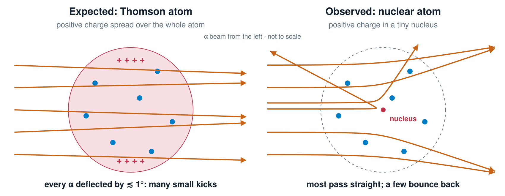
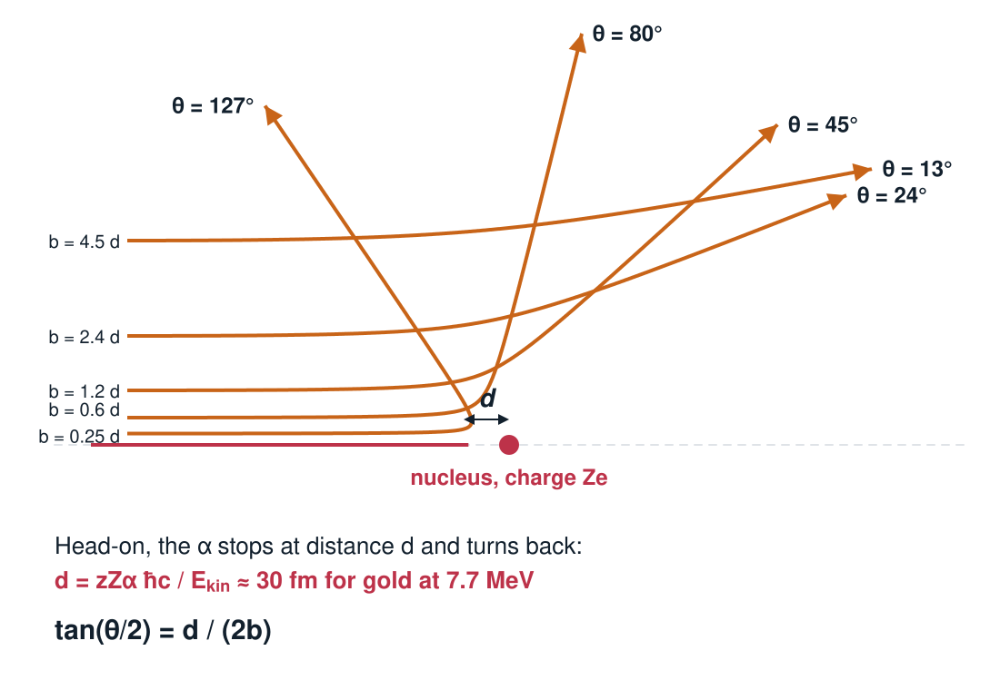

## Lecture 12 {.title-card}

:::: {.slide-body}

::: {.subtitle}
Helicity and Elastic Scattering
:::

Mikhail Mikhasenko · KT1 · Winter semester 2026/27 · Thomson, Chapters 6–7

::::

::: {.notes}
Draft. Opens with the material from Lecture 11 that was not reached on 20 Nov (diagram counting, helicity, the Rutherford bridge); section 3 on elastic e⁻p scattering and form factors is still to be written. Budget: recap 0–10 min; helicity 10–25; Rutherford bridge 25–40; elastic scattering and form factors 40–90.
:::

## Today in three questions

:::: {.slide-body}

1. **Helicity:** why do the QED angular distributions look the way they do?
2. **Rutherford:** what did the first scattering experiment see, and how does it connect to $e^-\mu^-\to e^-\mu^-$?
3. **Structure:** what changes when the point-like muon becomes a proton?

::::

## Recap {.section-title}

:::: {.slide-body}

What we take from Lecture 11

::: {.subtle}
Feynman rules · traces · standard processes
:::

::::

## How many diagrams at lowest order? {.quiz-slide}

:::: {.slide-body}

::::: {.card-grid .three}
::: {.qcard}
[$e^+e^-\to\mu^+\mu^-$]{.sym}

::: {.use .fragment}
**One**: $s$-channel annihilation.
:::
:::

::: {.qcard}
[$e^-\mu^-\to e^-\mu^-$]{.sym}

::: {.use .fragment}
**One**: $t$-channel exchange. $e$ and $\mu$ are distinguishable.
:::
:::

::: {.qcard .orange}
[$e^-e^-\to e^-e^-$ (Møller)]{.sym}

::: {.use .fragment}
**Two**: $t$ and $u$. Identical fermions: relative minus sign.
:::
:::

::: {.qcard .orange}
[$e^+e^-\to e^+e^-$ (Bhabha)]{.sym}

::: {.use .fragment}
**Two**: $s$ (annihilation) and $t$ (scattering).
:::
:::

::: {.qcard .green}
[$e^+e^-\to\gamma\gamma$]{.sym}

::: {.use .fragment}
**Two**: an electron propagator in $t$ and in $u$.
:::
:::

::: {.qcard .red}
[$\gamma\gamma\to\gamma\gamma$]{.sym}

::: {.use .fragment}
**None** at tree level: photons carry no charge. First in a fermion loop, $\propto\alpha^2$ in $\mathcal M$.
:::
:::
:::::

::::

::: {.notes}
4 minutes. Ask students to draw them on paper first. Light-by-light scattering was observed by ATLAS and CMS in ultra-peripheral Pb–Pb collisions (2017–2019).
:::

## 1 · Helicity {.section-title}

:::: {.slide-body}

Why the angular distributions look the way they do

::: {.subtle}
Thomson Ch. 4 and 6
:::

::::

## Helicity: spin along the motion

:::: {.slide-body}

$$\hat h=\frac{\boldsymbol\Sigma\cdot\hat{\mathbf p}}{2},\qquad\boldsymbol\Sigma=\begin{pmatrix}\boldsymbol\sigma&0\\0&\boldsymbol\sigma\end{pmatrix},\qquad h=\pm\tfrac12$$

::::: {.two-col}
::: {.rule}
[A good quantum number]{.rule-head}

$[\hat H,\hat h]=0$ for a free particle in **any** direction. $\hat S_z$ commutes with $\hat H$ only for $\mathbf p\parallel z$.

Label the two spin states by helicity: **R** ($h=+\tfrac12$), **L** ($h=-\tfrac12$).
:::

::: {.rule}
[But frame dependent]{.rule-head}

For $m>0$, overtake the particle: $\hat{\mathbf p}$ flips, the spin does not → R becomes L (Sheet 6).

For $m=0$ (or $E\gg m$) nobody can overtake it: helicity is **fixed**.
:::
:::::

::::

::: {.notes}
Sheet 6, class problem 1: the massless Dirac equation splits into σ·p ψ_{R,L} = ±E ψ_{R,L}. Helicity eigenstates for E ≫ m are in the backup.
:::

## The current does not mix the handedness

:::: {.slide-body}

Chiral representation (Lecture 10 backup): $\psi=\begin{pmatrix}\psi_L\\\psi_R\end{pmatrix}$, with $\sigma^\mu=(1,\boldsymbol\sigma)$, $\bar\sigma^\mu=(1,-\boldsymbol\sigma)$:

::::: {.two-col .bigmath}
::: {.rule}
[Vector current: no mixing]{.rule-head}

$$\bar\psi\gamma^\mu\psi=\psi_L^\dagger\,\bar\sigma^\mu\,\psi_L+\psi_R^\dagger\,\sigma^\mu\,\psi_R$$
:::

::: {.rule}
[Mass term: mixes]{.rule-head}

$$\bar\psi\psi=\psi_L^\dagger\psi_R+\psi_R^\dagger\psi_L$$
:::
:::::

::: {.statement-box}
For $E\gg m$, handedness = helicity, and the QED vertex **preserves** it.
:::

::::

::: {.notes}
In the chiral representation γ^0γ^0 = 1 and γ^0γ^k = diag(−σ_k, σ_k): block diagonal, so the current never connects L with R. γ^0 itself is off-diagonal, so the mass term does. The corrections are of order m/E. Subtlety: for antiparticles the helicity is opposite to the chiral label, so e⁻_R annihilates with e⁺_L.
:::

## Helicity at the vertex

::: {.slide-refs}
Original figure
:::

:::: {.slide-body}

::: {.wide-figure style="--fig-h:560px"}
{fig-alt="Four QED vertices for massless fermions: an electron keeps its helicity in scattering (allowed), flipping it is forbidden; an e− R annihilates with an e+ L (allowed) but not with an e+ R (forbidden)"}
:::

::: {.take-home}
Scattering: the fermion keeps its helicity. Annihilation: $e^-$ and $e^+$ have **opposite** helicities, so their spins **add** to $\pm1$ along the beam: the photon's spin.
:::

::::

::: {.notes}
Open arrows: spin; line arrows: fermion flow. Of the 16 helicity combinations in e⁺e⁻ → μ⁺μ⁻ only 4 survive: RL → RL, RL → LR, LR → RL, LR → LR.
:::

## Why 1 + cos²θ? {.landmark}

::: {.slide-refs}
Original figure
:::

:::: {.slide-body}

::: {.wide-figure style="--fig-h:560px"}
{fig-alt="Initial state e− R e+ L with total spin projection plus one along the beam; two final states with mu− R mu+ L and mu− L mu+ R, with angular momentum plus and minus one along the mu− direction, giving (1 plus cos theta) squared and (1 minus cos theta) squared"}
:::

$$\langle|\mathcal M|^2\rangle=\tfrac14\,e^4\big[2(1+\cos\theta)^2+2(1-\cos\theta)^2\big]=e^4\,(1+\cos^2\theta)\ ✓$$

::::

::: {.notes}
The amplitude is the rotation matrix d¹_{λλ'}(θ) between J_z = +1 along the beam and J = ±1 along the outgoing μ⁻: (1 ± cos θ)/2. RL → LR vanishes at θ = 0 (would require J_z = +1 → −1 along the same axis). Exactly what the trace calculation gave, now with a picture.
:::

## And e⁻μ⁻ → e⁻μ⁻: no backward scattering

:::: {.slide-body}

::::: {.two-col .bigmath}
::: {.rule}
[Same helicities: RR, LL]{.rule-head}

Spins **opposite** along the beam: $J_z=0$. Any angle allowed:
$$|\mathcal M|^2=4e^4\,\frac{s^2}{t^2}$$
:::

::: {.rule}
[Opposite: RL, LR]{.rule-head}

Spins **add**: $J_z=\pm1$. Backward scattering would flip it:
$$|\mathcal M|^2=4e^4\,\frac{u^2}{t^2}\propto(1+\cos\theta)^2\to0$$
:::
:::::

$$\tfrac14\big[2\cdot4s^2+2\cdot4u^2\big]\frac{e^4}{t^2}=2e^4\,\frac{s^2+u^2}{t^2}\ ✓$$

::: {.take-home}
Later today: a **spinless** target cannot absorb the spin flip, so backward scattering of a relativistic electron is suppressed: the **Mott** factor $\cos^2(\theta/2)$.
:::

::::

::: {.notes}
The dashed curves on the eμ plot of Lecture 11. In CM, u = −s(1 + cos θ)/2, so u²/t² ∝ (1 + cos θ)²/(1 − cos θ)². Mott: the electron must keep its helicity, and at θ = π that requires a spin flip of ΔJ_z = 1 that a spin-0 target cannot provide.
:::

## Helicity today, chirality with the weak interaction

:::: {.slide-body}

::: {.statement-box}
For $m=0$: helicity = chirality. The matrix that separates $\psi_L$ from $\psi_R$ is called $\gamma^5$.
:::

- QED (today): **vector** coupling $\gamma^\mu$ treats L and R the same.
- Weak interaction (later): the $W$ couples **only** to $\psi_L$, through $\gamma^\mu(1-\gamma^5)$. Parity is violated.
- Then: $\gamma^5$ algebra, chiral projectors, and why $\pi^+\to e^+\nu_e$ is $10^4$ times rarer than $\pi^+\to\mu^+\nu_\mu$.

::::

::: {.notes}
Deliberately no γ⁵ algebra today. Sheet 6 problem 1(b) asks what the left-handedness of neutrinos says about mirror symmetry: this is the hook for the weak lecture.
:::

## 2 · Bridge: what if the muon is a proton? {.section-title}

:::: {.slide-body}

Back to Rutherford: from point-like targets to structure

::: {.subtle}
Lecture 4 · Lecture 6 · Thomson Ch. 7
:::

::::

## Rutherford scattering: the experiment

:::: {.slide-body}

::::: {.two-col}
::: {.rule}
[What was measured]{.rule-head}

Geiger and Marsden, Manchester, 1909–1913.

$\alpha$ particles of a few MeV from a radioactive source hit a thin metal foil (gold, platinum).

A zinc-sulfide screen flashes for each $\alpha$ (Lecture 6). Count flashes by eye, under a microscope, at each angle $\theta$:
$$N(\theta)\propto\frac{d\sigma}{d\Omega}$$
:::

::: {.rule}
[Expected vs observed]{.rule-head}

**Expected** (Thomson atom): fields are weak everywhere. Each atom deflects by much less than $1^\circ$; many small kicks add up to $\sim1^\circ$. Large angles: essentially never.

**Observed:** about **1 in 8000** $\alpha$ turned by more than $90^\circ$ (1909).

Later (1913): $N(\theta)\propto1/\sin^4(\theta/2)$ from $5^\circ$ to $150^\circ$.
:::
:::::

::: {.take-home}
A large deflection needs a strong force: the positive charge must be concentrated in a tiny volume.
:::

::::

::: {.notes}
3 minutes. Most students met this in their first physics course; ask what they remember before showing the slide. The "many small kicks" picture is exactly the Gaussian core of multiple Coulomb scattering from Lecture 6; the Rutherford tail of that distribution is the single hard scattering. Lecture 4 has the closest-approach estimate.
:::

## Two pictures of the atom

::: {.slide-refs}
Original figure
:::

:::: {.slide-body}

::: {.wide-figure style="--fig-h:560px"}
{fig-alt="Left: Thomson atom with positive charge spread over the atom; alpha particles pass with tiny deflections. Right: nuclear atom with a tiny positive nucleus; most alpha particles pass straight, a few close ones are deflected strongly or bounce back"}
:::

::: {.take-home}
Rutherford (1911): positive charge and almost all the mass sit in a **nucleus** at least $10^4$ times smaller than the atom. One hard collision, not many soft ones.
:::

::::

::: {.notes}
The electrons (blue) are too light to deflect an α noticeably: like a bowling ball hitting ping-pong balls.
:::

## One hard collision {.landmark}

::: {.slide-refs}
Original figure
:::

:::: {.slide-body}

::::: {.picture-layout}
::: {.picture-copy}
Coulomb repulsion bends the $\alpha$ on a **hyperbola**; the heavy nucleus stays at rest.

Small impact parameter $b$ → large angle $\theta$.

$$\frac{d\sigma}{d\Omega}=\left(\frac{d}{4}\right)^2\frac{1}{\sin^4(\theta/2)}\propto\frac{1}{|\mathbf q|^4}$$

$|\mathbf q|=2p\sin(\theta/2)$: momentum transfer.

::: {.check}
$1/|\mathbf q|^4$ is the photon propagator squared: the forward peak of $e^-\mu^-\to e^-\mu^-$.
:::
:::

::: {.picture-visual}

:::
:::::

::::

::: {.notes}
Derivation on the board if time: particles with impact parameter below b are deflected by more than θ, so σ(>θ) = πb² with b = (d/2)cot(θ/2); differentiate with dΩ = 2π sinθ dθ. Large θ ⇔ small b ⇔ large |q|: back-scattering probes the shortest distances, down to d ≈ 30 fm for gold at 7.7 MeV. The gold nucleus (R ≈ 7 fm) is never touched, so Rutherford saw a point charge. Electrons of hundreds of MeV get closer: deviations from 1/q⁴ then measure the size (section 3).
:::

## Replace the muon tensor

::: {.slide-refs}
Original figure
:::

:::: {.slide-body}

::: {.wide-figure style="--fig-h:470px"}
{fig-alt="Left: electron–muon scattering via one photon with a point-like muon vertex. Right: electron–proton scattering, where the photon hits a blob representing the unknown proton structure"}
:::

$$\langle|\mathcal M|^2\rangle=\frac{e^4}{q^4}\,L_e^{\mu\nu}\;\underbrace{L^{\text{muon}}_{\mu\nu}}_{\text{known}}\quad\longrightarrow\quad\frac{e^4}{q^4}\,L_e^{\mu\nu}\;\underbrace{W_{\mu\nu}}_{\text{unknown}}$$

::: {.take-home}
Rutherford is the point-like limit: the same $1/q^4$. Next: the electron's **spin** (Mott) and the target's **size** (form factors): deviations from $1/q^4$ measure structure.
:::

::::

::: {.notes}
Resolution: a photon with |q| probes distances ~ 1/|q| (Lecture 3). Low Q² sees the charge radius; high Q² resolves quarks (Lecture 13, deep inelastic scattering, same L_e with a different W).
:::

## 3 · Elastic electron–proton scattering {.section-title}

:::: {.slide-body}

Mott, Rosenbluth, form factors and the size of the proton

::: {.subtle}
Thomson Ch. 7
:::

::::

::: {.notes}
To be drafted.
:::

## Summary {.section-title}

## Take-home messages

:::: {.slide-body}

- At high energy QED conserves helicity; angular momentum explains $(1\pm\cos\theta)^2$.
- Rutherford is the point-like limit, $d\sigma/d\Omega\propto1/|\mathbf q|^4$: the photon propagator squared.
- For a proton, the known muon tensor becomes an unknown $W_{\mu\nu}$: deviations from $1/q^4$ measure structure.

::::

## Exit questions

:::: {.slide-body}

1. Why is $e^-_Re^+_R\to\gamma^*\to\mu^+\mu^-$ forbidden at high energy?
2. Why can Rutherford's $\alpha$ particles not see the size of the gold nucleus?

::::

::: {.notes}
Answers: (1) The vector current couples e⁻_R only to e⁺_L; equivalently, J_z = 0 along the beam cannot make the spin-1 photon with these helicities. (2) Closest approach d ≈ 30 fm for 7.7 MeV α on gold, larger than R ≈ 7 fm: the α never touches the nucleus.
:::

## Thank you {.section-title}

:::: {.slide-body}

Questions?

::::

## Backup {.section-title visibility="uncounted"}

## Backup · Helicity spinors for E ≫ m {visibility="uncounted"}

:::: {.slide-body}

Dirac–Pauli representation, momentum along $(\theta,\phi)$, $c=\cos\frac\theta2$, $s=\sin\frac\theta2$:

$$u_\uparrow=\sqrt E\begin{pmatrix}c\\e^{i\phi}s\\c\\e^{i\phi}s\end{pmatrix},\qquad u_\downarrow=\sqrt E\begin{pmatrix}-s\\e^{i\phi}c\\s\\-e^{i\phi}c\end{pmatrix}$$

Upper pair: eigenvector of $\boldsymbol\sigma\cdot\hat{\mathbf p}$ with $\pm1$. Lower pair $=\pm$ upper pair, since $\boldsymbol\sigma\cdot\mathbf p/(E+m)\to\boldsymbol\sigma\cdot\hat{\mathbf p}$.

::: {.check}
Insert these into $\bar u_\uparrow(p_3)\gamma^\mu u_\downarrow(p_1)$: every component vanishes. This is helicity conservation, by brute force.
:::

::::

::: {.notes}
Thomson Ch. 4 and 6. With these one computes the four surviving helicity amplitudes for e⁺e⁻ → μ⁺μ⁻ (Thomson Ch. 6).
:::

## Backup · References {.references visibility="uncounted"}

:::: {.slide-body}

M. Thomson, *Modern Particle Physics*, Cambridge University Press (2013), Chapters 4, 6 and 7.

E. Rutherford, “The scattering of α and β particles by matter and the structure of the atom”, Phil. Mag. **21** (1911) 669.

H. Geiger and E. Marsden, “The laws of deflexion of α particles through large angles”, Phil. Mag. **25** (1913) 604.

All figures in this lecture are original.

::::
