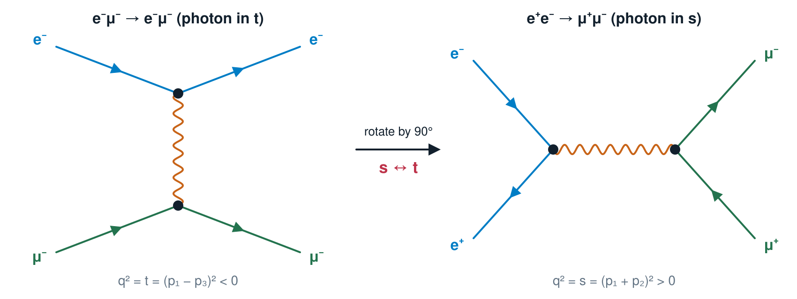
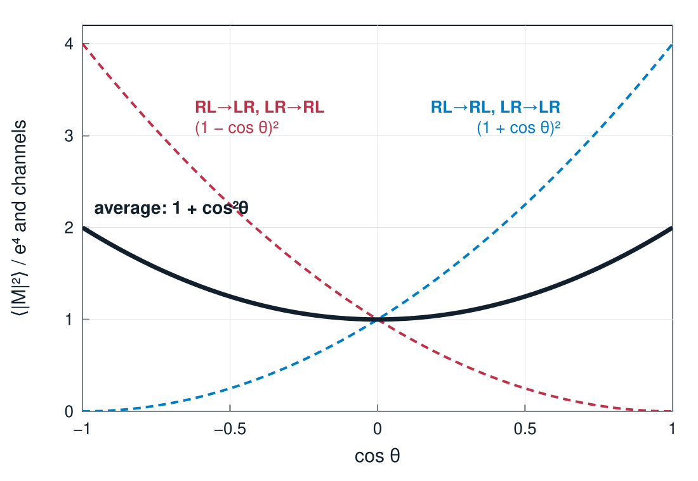
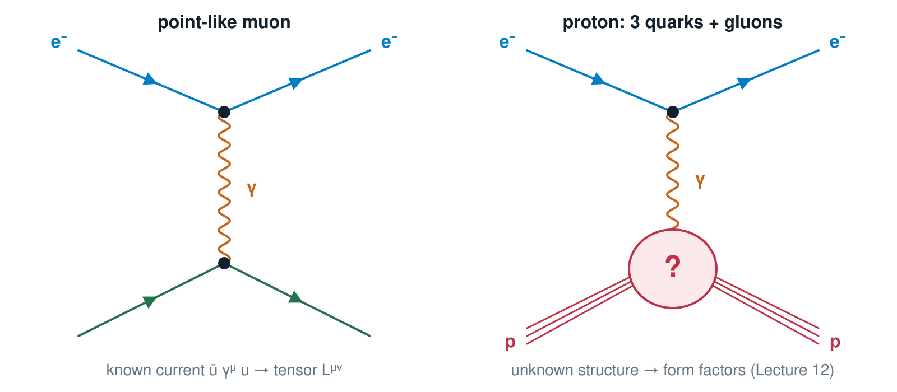
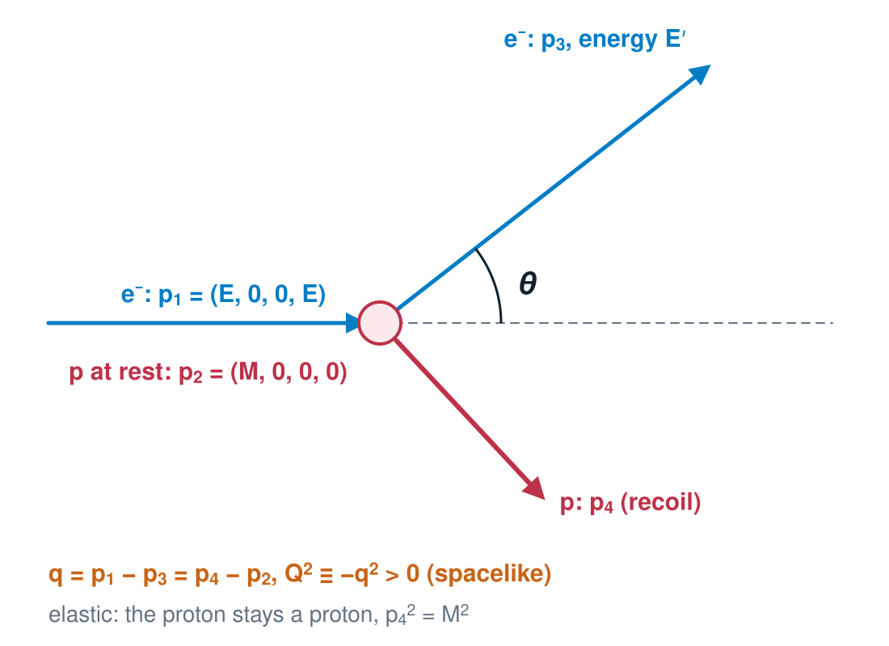
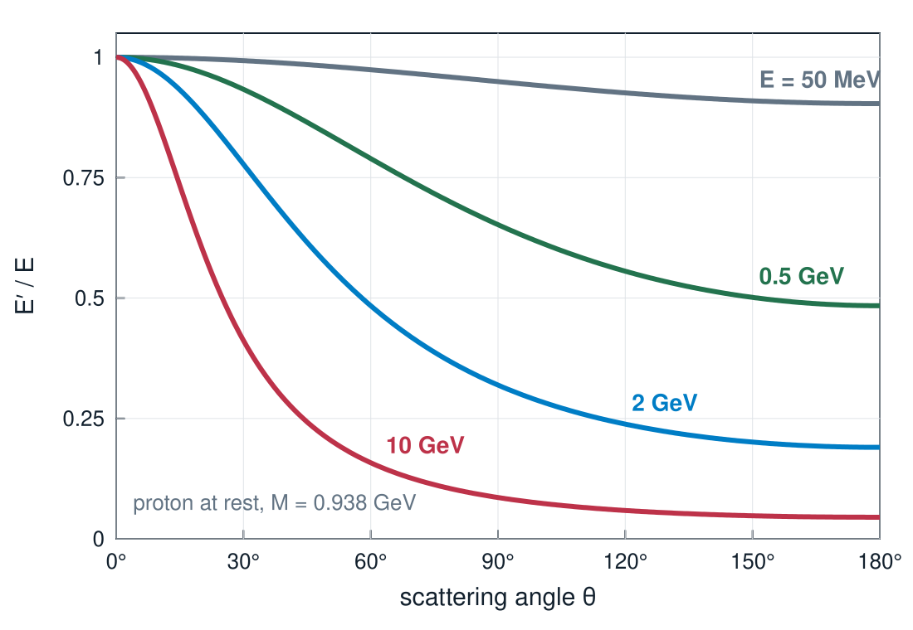
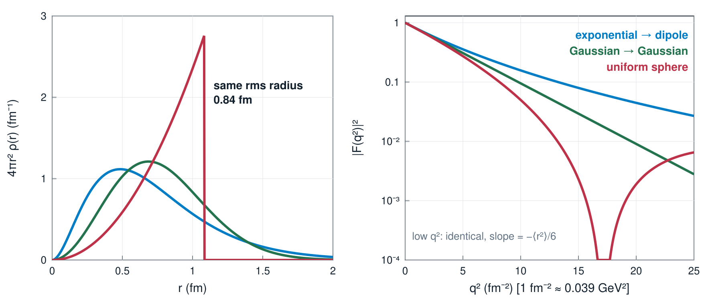
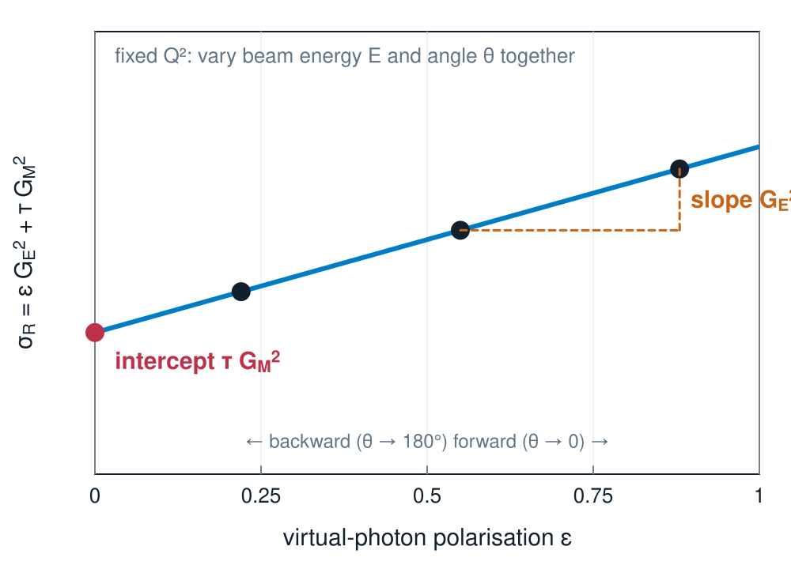
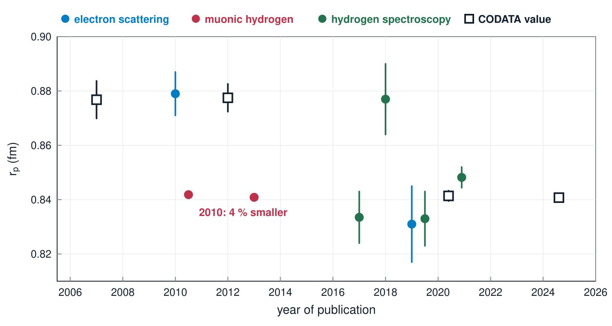
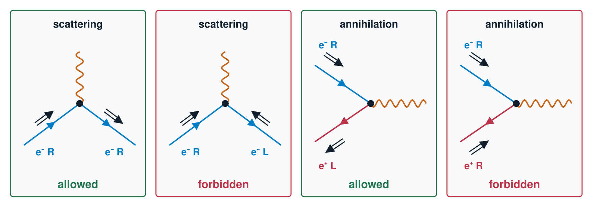
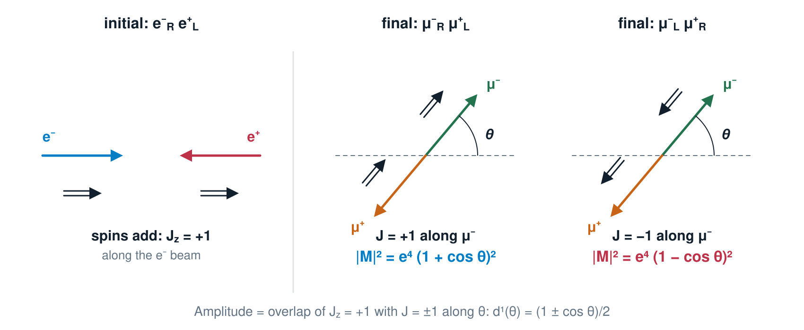

## Lecture 12 {.title-card}

:::: {.slide-body}

::: {.subtitle}
Helicity and the Size of the Proton
:::

Mikhail Mikhasenko · KT1 · Winter semester 2026/27 · Thomson, Chapters 6–7

::::

::: {.notes}
Draft. Opens by finishing Lecture 11 section 3, which was not reached on 20 Nov (tensor contraction, Mandelstam variables, eμ and ee → μμ, crossing, standard processes), then helicity as a concept, a quiz on Lecture 11, and the Rutherford bridge; the helicity structure of the QED vertex is in the backup. Then elastic e⁻p scattering, organised around one question: how big is the proton? Budget (tight): motivation 0–4 min; recap: Lecture 11 cross sections 4–22 (board: the contraction); spin and helicity with the widget 22–30; quiz 30–35; Rutherford and Mott 35–47; elastic kinematics and the Dirac proton 47–56 (board); form factors and the radius 56–70 (board + demo); G_E, G_M and Rosenbluth 70–79; the proton radius puzzle 79–86; summary 86–90. If late, skip "Recoil in numbers", "Same radius, different shapes", the details of the Dirac-proton slide and the "How many diagrams" quiz (the table answers it). Three board derivations have priority: Q² and E′(θ), the form factor as a Fourier transform, and the radius from the slope.
:::

## How big is the proton?

:::: {.slide-body}

::: {.statement-box}
2010: electrons say $r_p=0.877$ fm. Muonic hydrogen says $0.842$ fm.
:::

A 4 % disagreement, five standard deviations. Who is right, and how does one measure the size of something $10^{-15}$ m across?

::: {.pipeline}
$\mathcal M\;\longrightarrow\;\langle|\mathcal M|^2\rangle\;\longrightarrow\;\dfrac{d\sigma}{d\Omega}\;\longrightarrow\;F(Q^2)\;\longrightarrow\;r_p$
:::

::::

::: {.notes}
2 minutes. The opening question returns at the end of the lecture (section 4). The first arrow is Lecture 11; the recap completes the next two, the lecture adds the last two.
:::

## Today in three questions

:::: {.slide-body}

1. **Spin and helicity:** what is the spin of a moving particle, and why project it on the momentum?
2. **Rutherford and Mott:** what did the first scattering experiment see, and what changes for a relativistic electron with spin?
3. **Structure:** how does the cross section measure the size of the proton?

::::

## Recap {.section-title}

:::: {.slide-body}

Finishing Lecture 11: from traces to cross sections

::: {.subtle}
Thomson Ch. 6
:::

::::

## Contracting two tensors

:::: {.slide-body}

$$\langle|\mathcal M|^2\rangle=\frac{e^4}{q^4}\,L_e^{\mu\nu}\,L^{\text{muon}}_{\mu\nu},\qquad k=p_1,\;k'=p_3,\;p=p_2,\;p'=p_4$$

Contraction rules: $(k^\mu k'^\nu)(p_\mu p'_\nu)=(k\cdot p)(k'\cdot p')$, $\;g^{\mu\nu}p_\mu p'_\nu=p\cdot p'$, $\;g^{\mu\nu}g_{\mu\nu}=4$.

::: {.eq-box .long}
$$\begin{aligned}\langle|\mathcal M|^2\rangle=\dfrac{8e^4}{(p_1-p_3)^4}\Big[&(p_1\cdot p_2)(p_3\cdot p_4)+(p_1\cdot p_4)(p_2\cdot p_3)\\&-m_\mu^2\,p_1\cdot p_3-m_e^2\,p_2\cdot p_4+2m_e^2m_\mu^2\Big]\end{aligned}$$
:::

::: {.check}
Exact to lowest order in $\alpha$, any energy, any frame. We will use it in the **lab frame** for $e^-p$ later today.
:::

::::

::: {.notes}
Board: L_e·L_muon = 4[A·B − b A·g − a B·g + 4ab] with A^{μν} = k^μk'^ν + k^νk'^μ, a = k·k' − m², etc. The a, b terms collapse to −2m²p·p' − 2M²k·k' + 4m²M². Do this on the board; it is the only long step.
:::

## The recipe

:::: {.slide-body .compare-table}

| Step | What you do | For $e^-\mu^-\to e^-\mu^-$ |
|---|---|---|
| 1 · Draw | all lowest-order diagrams | one $t$-channel photon |
| 2 · Write | $-i\mathcal M$ from the rules | $-\dfrac{e^2}{q^2}\,j_e\cdot J$ |
| 3 · Square | $\mathcal M^*$: reverse each sandwich | two closed fermion lines |
| 4 · Sum spins | $u\bar u\to\not p+m$, $v\bar v\to\not p-m$ | two traces: $L_e^{\mu\nu}$, $L^{\text{muon}}_{\mu\nu}$ |
| 5 · Trace | trace theorems → dot products | $\langle|\mathcal M|^2\rangle$ |
| 6 · Kinematics | dot products → $s,t,u$ or angles | next section |

::::

::: {.notes}
This recipe is all that is needed for every tree-level QED process, and with different vertex factors also for the weak interaction.
:::

## Mandelstam variables at high energy

:::: {.slide-body}

$$s=(p_1+p_2)^2,\qquad t=(p_1-p_3)^2,\qquad u=(p_1-p_4)^2$$

For $E\gg m$, all $p_i^2\approx0$:

::::: {.two-col}
::: {.rule}
[Dot products]{.rule-head}

$$p_1\cdot p_2=p_3\cdot p_4=\frac s2$$
$$p_1\cdot p_3=p_2\cdot p_4=-\frac t2$$
$$p_1\cdot p_4=p_2\cdot p_3=-\frac u2$$

$s+t+u=0$
:::

::: {.rule}
[Centre-of-mass frame]{.rule-head}

$\theta$: angle between $\mathbf p_1$ and $\mathbf p_3$.

$$t=-\frac s2(1-\cos\theta)$$
$$u=-\frac s2(1+\cos\theta)$$
:::
:::::

::::

::: {.notes}
Recall Lecture 3–4. The identities follow from (p₁ + p₂)² = 2p₁·p₂ for massless particles, and similar. t → 0 is forward scattering, u → 0 backward scattering.
:::

## e⁻μ⁻ → e⁻μ⁻ at high energy

::: {.slide-refs}
Original figure
:::

:::: {.slide-body}

::::: {.picture-layout}
::: {.picture-copy}
Drop the masses:

$$\langle|\mathcal M|^2\rangle=2e^4\,\frac{s^2+u^2}{t^2}$$

$$\frac{d\sigma}{d\Omega^*}=\frac{\alpha^2}{2s}\,\frac{4+(1+\cos\theta)^2}{(1-\cos\theta)^2}$$

Forward peak $\propto1/\theta^4$: **Rutherford** again, from $1/q^4$.
:::

::: {.picture-visual}

:::
:::::

::::

::: {.notes}
Insert the dot products: 8e⁴/t² [(s/2)² + (u/2)²] = 2e⁴(s² + u²)/t². With e⁴ = 16π²α² and 1/(64π²s): dσ/dΩ = α²(s² + u²)/(2st²). The total cross section diverges at θ → 0: the Coulomb field has infinite range. In practice a minimum angle (or screening) cuts it off. The dashed channels are explained with helicity in the next section.
:::

## Crossing: rotate the diagram

::: {.slide-refs}
Original figure
:::

:::: {.slide-body}

::: {.wide-figure style="--fig-h:420px"}
{fig-alt="Left: t-channel diagram of electron–muon scattering. Right: the same diagram rotated by 90 degrees, s-channel electron–positron annihilation into muons. The rotation exchanges s and t"}
:::

An incoming particle with $p$ ↔ an outgoing antiparticle with $-p$. The traces are the **same** functions of the momenta:

::: {.eq-box}
$$\langle|\mathcal M|^2\rangle_{e^+e^-\to\mu^+\mu^-}=2e^4\,\frac{t^2+u^2}{s^2}$$
:::

::::

::: {.notes}
Crossing symmetry: swap s ↔ t in ⟨|M|²⟩ (up to an overall sign for each crossed fermion, which cancels here). Check by doing the e⁺e⁻ traces directly: Tr[(p̸₂ − m)γ^μ(p̸₁ + m)γ^ν] gives the same structure with p₃ → −p₂.
:::

## e⁺e⁻ → μ⁺μ⁻ at high energy

::: {.slide-refs}
Original figure
:::

:::: {.slide-body}

::::: {.picture-layout}
::: {.picture-copy}
The standard candle. In the CM frame, $\dfrac{t^2+u^2}{s^2}=\tfrac12(1+\cos^2\theta)$:

$$\frac{d\sigma}{d\Omega}=\frac{\alpha^2}{4s}\,(1+\cos^2\theta)$$

::: {.eq-box}
$$\sigma=\frac{4\pi\alpha^2}{3s}$$
:::

$\sigma\approx\dfrac{86.9\ \text{nb}}{s\,[\text{GeV}^2]}$: $\;0.87$ nb at $\sqrt s=10$ GeV.
:::

::: {.picture-visual}

:::
:::::

::::

::: {.notes}
∫(1 + cos²θ) dΩ = 2π(2 + 2/3) = 16π/3. Conversion (ħc)² = 0.3894 mb GeV². PETRA, √s = 35 GeV: about 71 pb. Every other e⁺e⁻ cross section is quoted relative to this one, e.g. R = σ(e⁺e⁻ → hadrons)/σ(e⁺e⁻ → μ⁺μ⁻) = N_c Σ Q_q², which counts quark colours (Lecture 16). Near the Z pole (√s ≈ 91 GeV) the weak interaction takes over.
:::

## How many diagrams at lowest order? {.quiz-slide}

:::: {.slide-body}

::::: {.card-grid .three}
::: {.qcard}
[$e^+e^-\to\mu^+\mu^-$]{.sym}

::: {.use .fragment}
**One**: $s$-channel annihilation.
:::
:::

::: {.qcard}
[$e^-\mu^-\to e^-\mu^-$]{.sym}

::: {.use .fragment}
**One**: $t$-channel exchange. $e$ and $\mu$ are distinguishable.
:::
:::

::: {.qcard .orange}
[$e^-e^-\to e^-e^-$ (Møller)]{.sym}

::: {.use .fragment}
**Two**: $t$ and $u$. Identical fermions: relative minus sign.
:::
:::

::: {.qcard .orange}
[$e^+e^-\to e^+e^-$ (Bhabha)]{.sym}

::: {.use .fragment}
**Two**: $s$ (annihilation) and $t$ (scattering).
:::
:::

::: {.qcard .green}
[$e^+e^-\to\gamma\gamma$]{.sym}

::: {.use .fragment}
**Two**: an electron propagator in $t$ and in $u$.
:::
:::

::: {.qcard .red}
[$\gamma\gamma\to\gamma\gamma$]{.sym}

::: {.use .fragment}
**None** at tree level: photons carry no charge. First in a fermion loop, $\propto\alpha^2$ in $\mathcal M$.
:::
:::
:::::

::::

::: {.notes}
4 minutes. Ask students to draw them on paper first. Light-by-light scattering was observed by ATLAS and CMS in ultra-peripheral Pb–Pb collisions (2017–2019).
:::

## Standard QED processes at a glance

:::: {.slide-body .compare-table}

| Process | Diagrams | $\langle|\mathcal M|^2\rangle$, $E\gg m$ |
|---|---|---|
| $e^+e^-\to\mu^+\mu^-$ | $s$ | $2e^4\,\dfrac{t^2+u^2}{s^2}$ |
| $e^-\mu^-\to e^-\mu^-$ | $t$ | $2e^4\,\dfrac{s^2+u^2}{t^2}$ |
| $e^+e^-\to e^+e^-$ (Bhabha) | $s+t$ | $2e^4\left[\dfrac{s^2+u^2}{t^2}+\dfrac{2u^2}{st}+\dfrac{t^2+u^2}{s^2}\right]$ |
| $e^-e^-\to e^-e^-$ (Møller) | $t+u$ | $2e^4\left[\dfrac{s^2+u^2}{t^2}+\dfrac{2s^2}{tu}+\dfrac{s^2+t^2}{u^2}\right]$ |

::: {.take-home}
Two diagrams: $|\mathcal M_1+\mathcal M_2|^2$ has an **interference** term. Bhabha at small angles measures the **luminosity** at $e^+e^-$ colliders.
:::

::::

::: {.notes}
Bhabha = s-channel + t-channel; its interference term 2u²/(st). Møller follows from Bhabha by crossing s ↔ u. The small-angle Bhabha rate is huge and calculable, which is why LEP and Belle II use it for luminosity (Lecture 4).
:::

## QED cross-section explorer {.demo-slide}

:::: {.slide-body}

::: {.widget data-src="widgets/qed-xsec.html" data-poster="widgets/qed-xsec-poster.png" data-alt="Interactive QED cross-section explorer: angular distributions of e+e− to mu+mu− and e− mu− to e− mu− with helicity channels, Mandelstam variables and total cross section versus centre-of-mass energy"}
:::

::::

::: {.notes}
3 minutes. Start with e⁺e⁻ → μ⁺μ⁻: only the average, then switch on the channels: (1 ± cos θ)² add to 1 + cos²θ. Move √s: σ falls as 1/s. Switch to eμ: log scale, forward peak; the opposite-helicity channel vanishes backwards. The helicity channels are explained in the next section.
:::

## 1 · Spin and helicity {.section-title}

:::: {.slide-body}

What is the spin of a moving particle?

::: {.subtle}
Lecture 10 · Thomson Ch. 4
:::

::::

## Spin and helicity explorer {.demo-slide}

:::: {.slide-body}

::: {.widget data-src="widgets/spinor-helicity.html" data-poster="widgets/spinor-helicity-poster.png" data-alt="Interactive Dirac spinor explorer: the four-component particle spinor in the canonical or the helicity basis for a given Lorentz factor and momentum direction, with a 3D sketch (z and x horizontal, y vertical) of the momentum and the spin expectation value, and buttons for the four basis states"}
:::

::::

::: {.notes}
6 minutes. Particles only (u spinors). Canonical basis: u = √(E+m) (χ, σ·p χ/(E+m)), χ = χ₁(1,0) + χ₂(0,1), spin quantised along z. Helicity basis: u = √(E+m) Σ_λ a_λ (χ_λ(p̂), 2λ|p|/(E+m) χ_λ(p̂)) with σ·p̂ χ_± = ±χ_±, so σ·p acts as the number 2λ|p|. Same spinor, different coefficients: switching the basis button converts χ₁, χ₂ ↔ a₊, a₋ and the numbers on the right do not change. Demo: (1) S_z = +½, move θ: the spin stays along z, h = ½ cos θ. (2) h = +½: the spin follows p. (3) Raise γ: lower components → ±upper for helicity states (massless limit). (4) χ = (1, 1) without 1/√2: normalisation warning. Axes: z and x horizontal (beam along z), y vertical. The orange arrow is ⟨½σ⟩ in χ, the rest-frame spin.
:::

## Helicity: spin along the motion

:::: {.slide-body}

$$\hat h=\frac{\boldsymbol\Sigma\cdot\hat{\mathbf p}}{2},\qquad\boldsymbol\Sigma=\begin{pmatrix}\boldsymbol\sigma&0\\0&\boldsymbol\sigma\end{pmatrix},\qquad h=\pm\tfrac12$$

::::: {.two-col}
::: {.rule}
[A good quantum number]{.rule-head}

$[\hat H,\hat h]=0$ for a free particle in **any** direction. $\hat S_z$ commutes with $\hat H$ only for $\mathbf p\parallel z$.

Label the two spin states by helicity: **R** ($h=+\tfrac12$), **L** ($h=-\tfrac12$).
:::

::: {.rule}
[But frame dependent]{.rule-head}

For $m>0$, overtake the particle: $\hat{\mathbf p}$ flips, the spin does not → R becomes L (Sheet 6).

For $m=0$ (or $E\gg m$) nobody can overtake it: helicity is **fixed**.
:::
:::::

::::

::: {.notes}
Sheet 6, class problem 1: the massless Dirac equation splits into σ·p ψ_{R,L} = ±E ψ_{R,L}. Helicity eigenstates for E ≫ m are in the backup.
:::

## Quiz: Lecture 11 in six questions {.quiz-slide}

:::: {.slide-body}

::::: {.card-grid .three}
::: {.qcard}
[$\sum_s u\bar u=\;?\quad\sum_s v\bar v=\;?$]{.sym}

::: {.use .fragment}
$\not p+m$ and $\not p-m$: a spin sum becomes a **trace**.
:::
:::

::: {.qcard}
[$\operatorname{Tr}(\gamma^\mu\gamma_\mu)$, $\;\operatorname{Tr}(\not p\not p)$]{.sym}

::: {.use .fragment}
$16$ and $4p^2=4m^2$, from $\{\gamma^\mu,\gamma^\nu\}=2g^{\mu\nu}$.
:::
:::

::: {.qcard}
[Why no $m^1$ terms in $L^{\mu\nu}$?]{.sym}

::: {.use .fragment}
They contain **three** $\gamma$ matrices: the trace of an odd number vanishes.
:::
:::

::: {.qcard .orange}
[$e^+e^-\to\mu^+\mu^-$: which spinor on the left of the electron line?]{.sym}

::: {.use .fragment}
$\bar v(p_2)$: read the line **backwards**, it ends on the incoming positron.
:::
:::

::: {.qcard .orange}
[$\sigma(e^+e^-\to\mu^+\mu^-)$ at $\sqrt s=10.58$ GeV?]{.sym}

::: {.use .fragment}
$86.9\ \text{nb}/111.9\approx0.78$ nb (Belle II).
:::
:::

::: {.qcard .green}
[Why does $e^-\mu^-\to e^-\mu^-$ peak forward?]{.sym}

::: {.use .fragment}
The propagator $1/t$: $t\to0$ for $\theta\to0$. Long-range Coulomb force, **Rutherford** next.
:::
:::
:::::

::::

::: {.notes}
5 minutes. Built from the Lecture 11 take-home messages and exit questions. Let students answer in pairs, then reveal card by card. The last card leads straight into Rutherford.
:::

## 2 · Bridge: what if the muon is a proton? {.section-title}

:::: {.slide-body}

Back to Rutherford: from point-like targets to structure

::: {.subtle}
Lecture 4 · Lecture 6 · Thomson Ch. 7
:::

::::

## Rutherford scattering: the experiment

:::: {.slide-body}

::::: {.two-col}
::: {.rule}
[What was measured]{.rule-head}

Geiger and Marsden, Manchester, 1909–1913.

$\alpha$ particles of a few MeV from a radioactive source hit a thin metal foil (gold, platinum).

A zinc-sulfide screen flashes for each $\alpha$ (Lecture 6). Count flashes by eye, under a microscope, at each angle $\theta$:
$$N(\theta)\propto\frac{d\sigma}{d\Omega}$$
:::

::: {.rule}
[Expected vs observed]{.rule-head}

**Expected** (Thomson atom): fields are weak everywhere. Each atom deflects by much less than $1^\circ$; many small kicks add up to $\sim1^\circ$. Large angles: essentially never.

**Observed:** about **1 in 8000** $\alpha$ turned by more than $90^\circ$ (1909).

Later (1913): $N(\theta)\propto1/\sin^4(\theta/2)$ from $5^\circ$ to $150^\circ$.
:::
:::::

::: {.take-home}
A large deflection needs a strong force: the positive charge must be concentrated in a tiny volume.
:::

::::

::: {.notes}
3 minutes. Most students met this in their first physics course; ask what they remember before showing the slide. The "many small kicks" picture is exactly the Gaussian core of multiple Coulomb scattering from Lecture 6; the Rutherford tail of that distribution is the single hard scattering. Lecture 4 has the closest-approach estimate.
:::

## Two pictures of the atom

::: {.slide-refs}
Original figure
:::

:::: {.slide-body}

::: {.wide-figure style="--fig-h:560px"}
{fig-alt="Left: Thomson atom with positive charge spread over the atom; alpha particles pass with tiny deflections. Right: nuclear atom with a tiny positive nucleus; most alpha particles pass straight, a few close ones are deflected strongly or bounce back"}
:::

::: {.take-home}
Rutherford (1911): positive charge and almost all the mass sit in a **nucleus** at least $10^4$ times smaller than the atom. One hard collision, not many soft ones.
:::

::::

::: {.notes}
The electrons (blue) are too light to deflect an α noticeably: like a bowling ball hitting ping-pong balls.
:::

## One hard collision {.landmark}

::: {.slide-refs}
Original figure
:::

:::: {.slide-body}

::::: {.picture-layout}
::: {.picture-copy}
Coulomb repulsion bends the $\alpha$ on a **hyperbola**; the heavy nucleus stays at rest.

Small impact parameter $b$ → large angle $\theta$.

$$\frac{d\sigma}{d\Omega}=\left(\frac{d}{4}\right)^2\frac{1}{\sin^4(\theta/2)}\propto\frac{1}{|\mathbf q|^4}$$

$|\mathbf q|=2p\sin(\theta/2)$: momentum transfer.

::: {.check}
$1/|\mathbf q|^4$ is the photon propagator squared: the forward peak of $e^-\mu^-\to e^-\mu^-$.
:::
:::

::: {.picture-visual}

:::
:::::

::::

::: {.notes}
Derivation on the board if time: particles with impact parameter below b are deflected by more than θ, so σ(>θ) = πb² with b = (d/2)cot(θ/2); differentiate with dΩ = 2π sinθ dθ. Large θ ⇔ small b ⇔ large |q|: back-scattering probes the shortest distances, down to d ≈ 30 fm for gold at 7.7 MeV. The gold nucleus (R ≈ 7 fm) is never touched, so Rutherford saw a point charge. Electrons of hundreds of MeV get closer: deviations from 1/q⁴ then measure the size (section 3).
:::

## Electrons have spin: Mott scattering

:::: {.slide-body}

::::: {.two-col}
::: {.rule}
[Rutherford: no spin]{.rule-head}

Charge $z=1$, momentum $p$, velocity $\beta$, static nucleus $Ze$:
$$\left(\frac{d\sigma}{d\Omega}\right)_{\text{R}}=\frac{Z^2\alpha^2}{4p^2\beta^2\sin^4\frac\theta2}$$
Same as $(d/4)^2/\sin^4\frac\theta2$ with $d=2Z\alpha/(p\beta)$.
:::

::: {.rule}
[Mott: spin ½]{.rule-head}

$$\left(\frac{d\sigma}{d\Omega}\right)_{\text{Mott}}=\left(\frac{d\sigma}{d\Omega}\right)_{\text{R}}\Big(1-\beta^2\sin^2\frac\theta2\Big)$$
For $\beta\to1$, $p=E$:
$$\left(\frac{d\sigma}{d\Omega}\right)_{\text{Mott}}=\frac{Z^2\alpha^2}{4E^2\sin^4\frac\theta2}\,\cos^2\frac\theta2$$
:::
:::::

::: {.take-home}
$\cos^2\frac\theta2$: at high energy the QED vertex conserves helicity (backup), and a spinless target cannot absorb the spin flip, so there is no back-scattering at $\theta=\pi$.
:::

::::

::: {.notes}
3 minutes. Thomson 7.1. Rutherford for a non-relativistic α: T = pβ/2, so d = zZα/T = 2zZα/(pβ). The Mott formula still assumes a static (infinitely heavy) target: no recoil yet. That comes next, together with the size.
:::

## Replace the muon tensor

::: {.slide-refs}
Original figure
:::

:::: {.slide-body}

::: {.wide-figure style="--fig-h:470px"}
{fig-alt="Left: electron–muon scattering via one photon with a point-like muon vertex. Right: electron–proton scattering, where the photon hits a blob representing the unknown proton structure"}
:::

$$\langle|\mathcal M|^2\rangle=\frac{e^4}{q^4}\,L_e^{\mu\nu}\;\underbrace{L^{\text{muon}}_{\mu\nu}}_{\text{known}}\quad\longrightarrow\quad\frac{e^4}{q^4}\,L_e^{\mu\nu}\;\underbrace{W_{\mu\nu}}_{\text{unknown}}$$

::: {.take-home}
Rutherford is the point-like limit: the same $1/q^4$. Next: the target **recoils**, has a **magnetic moment** and a **size** (form factors): deviations from $1/q^4$ measure structure.
:::

::::

::: {.notes}
Resolution: a photon with |q| probes distances ~ 1/|q| (Lecture 3). Low Q² sees the charge radius; high Q² resolves quarks (Lecture 13, deep inelastic scattering, same L_e with a different W).
:::

## 3 · Elastic electron–proton scattering {.section-title}

:::: {.slide-body}

Recoil, form factors and the Rosenbluth formula

::: {.subtle}
Thomson Ch. 7
:::

::::

## A ladder of approximations

:::: {.slide-body}

::: {.compare-table .tight}
| Rung | Cross section | New physics |
|---|---|---|
| Rutherford | $\dfrac{Z^2\alpha^2}{4p^2\beta^2\sin^4(\theta/2)}$ | point charges, no spin, static target |
| Mott | $\times\big(1-\beta^2\sin^2\frac\theta2\big)$ | electron spin (helicity) |
| Recoil | $\times\,E'/E$ | the target recoils |
| Dirac proton | $\times\big(1+2\tau\tan^2\frac\theta2\big)$, $\;\tau=\dfrac{Q^2}{4M^2}$ | proton spin: magnetic scattering |
| Form factors | $1\to G_E,\,G_M$ (Rosenbluth) | the proton has a size |
| Inelastic | Lecture 13 | the proton breaks up |
:::

::::

::: {.notes}
1 minute: the roadmap for the rest of the lecture. Sheet 7, class problem 1 asks which rungs matter for Geiger–Marsden, Hofstadter and SLAC.
:::

## Elastic kinematics {.landmark}

::: {.slide-refs}
Original figure
:::

:::: {.slide-body}

::::: {.picture-layout}
::: {.picture-copy}
Neglect $m_e$:
$$Q^2\equiv-q^2=2EE'(1-\cos\theta)=4EE'\sin^2\tfrac\theta2$$

Elastic, $(p_2+q)^2=M^2$:
$$2p_2\cdot q=Q^2\;\Rightarrow\;2M(E-E')=Q^2$$

::: {.eq-box .long}
$$E'=\frac{E}{1+\frac{2E}{M}\sin^2\frac\theta2}$$
:::
:::

::: {.picture-visual}

:::
:::::

::::

::: {.notes}
Board, 6 minutes. q = p1 − p3, q² = −2p1·p3 = −2EE′(1 − cos θ) for m_e = 0. On-shell recoil: p4² = (p2 + q)² = M² + 2p2·q + q² = M², so 2p2·q = Q²; with p2 = (M, 0) and q⁰ = E − E′: 2M(E − E′) = Q². Insert Q² = 4EE′ sin²(θ/2) and solve for E′. Exam classic (Sheet 6 class problem 3, Sheet 7 problem 1).
:::

## Recoil in numbers

::: {.slide-refs}
Original figure
:::

:::: {.slide-body}

::::: {.picture-layout}
::: {.picture-copy}
Measure $\theta$ and you know $E'$ and $Q^2$: elastic scattering has **one** variable.

$E=1$ GeV, $\theta=90^\circ$: $E'=0.48$ GeV, $Q^2=0.97$ GeV².

$E\ll M$: $E'\approx E$, the static limit of Rutherford and Mott.

::: {.check}
Lecture 13: the proton breaks up, and $E'$ and $\theta$ become independent.
:::
:::

::: {.picture-visual}

:::
:::::

::::

::: {.notes}
Optional if late. E′ = 1/(1 + 2/0.938 · 0.5) = 0.484 GeV, Q² = 4 · 1 · 0.484 · 0.5 = 0.968 GeV²; check: 2M(E − E′) = 2 · 0.938 · 0.516 = 0.968 GeV² ✓. A spectrometer at fixed angle sees the elastic peak at a fixed E′ (Sheet 7 problem 2: the peaks beyond it are resonances).
:::

## A point-like proton (Dirac)

:::: {.slide-body}

Same trace calculation as $e^-\mu^-\to e^-\mu^-$, now keeping the target mass $M$:

$$\frac{d\sigma}{d\Omega}=\frac{\alpha^2}{4E^2\sin^4\frac\theta2}\,\frac{E'}{E}\Big[\cos^2\frac\theta2+2\tau\sin^2\frac\theta2\Big],\qquad\tau=\frac{Q^2}{4M^2}$$

::::: {.two-col}
::: {.rule}
[Electric: $\cos^2\frac\theta2$]{.rule-head}

Mott × recoil. The proton's charge; helicity forbids $\theta=\pi$.
:::

::: {.rule}
[Magnetic: $2\tau\sin^2\frac\theta2$]{.rule-head}

The proton's magnetic moment can flip **its** spin and absorb the mismatch: back-scattering allowed. Grows with $Q^2$.
:::
:::::

::::

::: {.notes}
3 minutes. Thomson 7.2: L_e^{μν} contracted with the muon tensor, m_μ → M, in the lab frame. For E ≪ M: τ → 0 and E′ → E, back to Mott. Equivalent form: Mott × (E′/E) × (1 + 2τ tan²(θ/2)) as in the ladder.
:::

## A charge cloud: the form factor

:::: {.slide-body}

Static target, charge density normalised to $\int\rho(\mathbf r)\,d^3r=1$:

::::: {.two-col .bigmath}
::: {.rule}
[Potential: a convolution]{.rule-head}

$$V(\mathbf r)=-Z\alpha\int\frac{\rho(\mathbf r')}{|\mathbf r-\mathbf r'|}\,d^3r'$$
Fourier transform of a convolution = product of transforms.
:::

::: {.rule}
[Amplitude: a product]{.rule-head}

$$\mathcal M=\mathcal M_{\text{point}}\,F(\mathbf q)$$
$$F(\mathbf q)=\int\rho(\mathbf r)\,e^{i\mathbf q\cdot\mathbf r}\,d^3r$$
:::
:::::

::: {.statement-box}
$\dfrac{d\sigma}{d\Omega}=\left(\dfrac{d\sigma}{d\Omega}\right)_{\text{point}}\big|F(\mathbf q)\big|^2$
:::

::::

::: {.notes}
Board, 5 minutes. Born approximation: M ∝ ∫ e^{iq·r} V(r) d³r = Ṽ(q). Write r = r′ + R, the double integral factorises into ∫ e^{iq·r′} ρ(r′) d³r′ × ∫ e^{iq·R} (−Zα/R) d³R = F(q) × Ṽ_point(q). F(0) = 1 is the total charge; a point charge, ρ = δ³(r), gives F ≡ 1. Static target: Q² = |q|².
:::

## Radius from the slope {.landmark}

:::: {.slide-body}

Spherical $\rho(r)$: do the angular integral, then expand for small $Q=|\mathbf q|$:

$$F(Q)=4\pi\int_0^\infty r^2\rho(r)\,\frac{\sin Qr}{Qr}\,dr,\qquad\frac{\sin Qr}{Qr}=1-\frac{Q^2r^2}{6}+\dots$$

$$F(Q^2)=1-\frac{Q^2}{6}\,\langle r^2\rangle+\dots$$

::: {.eq-box}
$$\langle r^2\rangle=-6\,\frac{dF}{dQ^2}\Big|_{Q^2=0}$$
:::

::: {.take-home}
Only the slope at $Q^2=0$: no model for the shape is needed. Units: $\langle r^2\rangle[\text{fm}^2]=(\hbar c)^2\,\langle r^2\rangle[\text{GeV}^{-2}]$, $(\hbar c)^2=0.0389$ GeV² fm².
:::

::::

::: {.notes}
Board, 5 minutes: the intellectual highlight. ∫ e^{iQr cos ϑ} d cos ϑ dφ = 2π (e^{iQr} − e^{−iQr})/(iQr) = 4π sin(Qr)/(Qr). The zeroth term gives ∫ ρ d³r = 1, the second −Q²⟨r²⟩/6 with ⟨r²⟩ = ∫ r² ρ d³r.
:::

## Same radius, different shapes

::: {.slide-refs}
Original figure
:::

:::: {.slide-body}

::: {.wide-figure style="--fig-h:540px"}
{fig-alt="Left: radial charge distributions for an exponential, a Gaussian and a uniform sphere, all with rms radius 0.84 fm. Right: the squared form factors on a logarithmic scale; identical at low q squared, very different at high q squared, with diffraction zeros for the uniform sphere"}
:::

::: {.take-home}
Low $Q^2$ measures only $\langle r^2\rangle$; high $Q^2$ measures the shape. Exponential $\rho\propto e^{-r/a}$ ↔ dipole $(1+Q^2/\Lambda^2)^{-2}$ with $\langle r^2\rangle=12/\Lambda^2$. A sharp edge gives diffraction zeros (Hofstadter, ¹²C, Sheet 7).
:::

::::

::: {.notes}
Uniform sphere of radius R: F = 3(sin x − x cos x)/x³, x = QR, ⟨r²⟩ = 3R²/5. Gaussian: F = exp(−Q²⟨r²⟩/6). The proton is close to the dipole with Λ² = 0.71 GeV²: r = √12 ħc/Λ ≈ 0.81 fm (Sheet 6 class problem 3).
:::

## Proton radius explorer {.demo-slide}

:::: {.slide-body}

::: {.widget data-src="widgets/proton-radius.html" data-poster="widgets/proton-radius-poster.png" data-alt="Interactive proton radius explorer: dipole electric form factor with its tangent at zero for an adjustable radius, and the relative cross-section difference to a 0.841 fm proton versus Q squared"}
:::

::::

::: {.notes}
4 minutes. (1) Move r: the slope at 0 changes, the tangent follows. (2) Pick 0.877 and 0.841 fm: on the left the curves are hard to tell apart. (3) Right panel: at Q² = 0.01 GeV² the cross sections differ by only 0.5 %. Lead into the next slide.
:::

## Why measure the radius at small Q²?

:::: {.slide-body}

::: {.statement-box}
Large $Q^2$ resolves small distances. Yet the radius comes from the **smallest** $Q^2$. Why?
:::

::::: {.two-col}
::: {.rule .fragment}
[Large Q²: the shape]{.rule-head}

$F$ depends on $\langle r^4\rangle,\langle r^6\rangle,\dots$ Getting back to the slope at 0 needs a model for the shape.
:::

::: {.rule .fragment}
[Small Q²: clean but tiny]{.rule-head}

$F\approx1-Q^2\langle r^2\rangle/6$. Between 0.877 and 0.841 fm: $\sigma$ changes by 0.5 % at $Q^2=0.01$ GeV². Needs sub-percent cross sections.
:::
:::::

::::

::: {.notes}
Ask first, 1 minute of discussion. The 2010 Mainz A1 fit used about 1400 cross sections from 0.003 to 1 GeV²; PRad (JLab 2019) reached 2×10⁻⁴ GeV² with a calorimeter at very small angles and normalised to Møller scattering e⁻e⁻ → e⁻e⁻ (the recap quiz).
:::

## Charge and magnetic moment: two form factors

:::: {.slide-body}

The proton vertex is not $\gamma^\mu$. Lorentz invariance and current conservation allow two terms:

$$\bar u\,\gamma^\mu u\;\longrightarrow\;\bar u\Big[F_1(Q^2)\,\gamma^\mu+F_2(Q^2)\,\frac{i\sigma^{\mu\nu}q_\nu}{2M}\Big]u,\qquad\sigma^{\mu\nu}=\tfrac i2[\gamma^\mu,\gamma^\nu]$$

::::: {.two-col .wide-left}
::: {.rule}
[Sachs form factors]{.rule-head}

$$G_E=F_1-\tau F_2,\qquad G_M=F_1+F_2$$
Point-like Dirac proton: $F_1=1$, $F_2=0$ → $G_E=G_M=1$, $\mu_p=1\,\mu_N$
:::

::: {.compare-table .tight}
|  | $p$ | $n$ |
|---|---|---|
| $G_E(0)$ | 1 | 0 |
| $G_M(0)$ | 2.79 | −1.91 |
:::
:::::

::::

::: {.notes}
4 minutes. The vertex itself encodes the structure: a direct extension of the Feynman rules of Lecture 11. G_E(0) is the charge, G_M(0) the magnetic moment in nuclear magnetons (Sheet 6, problem 2: the measured moments show the nucleons are not Dirac particles). F_2(0) = κ_p = 1.79 is the anomalous moment. The neutron is neutral, yet it has a magnetic moment and a charge distribution with G_E′(0) ≠ 0 (⟨r²⟩_n ≈ −0.12 fm²). Interpreting G_E and G_M as Fourier transforms of 3D densities is only exact in the non-relativistic limit (Breit frame); the slope definition of the radius holds regardless.
:::

## The Rosenbluth formula {.landmark}

::: {.slide-refs}
Original figure
:::

:::: {.slide-body .short-visual}

$$\frac{d\sigma}{d\Omega}=\left(\frac{d\sigma}{d\Omega}\right)_{\text{Mott}}\frac{E'}{E}\left[\frac{G_E^2+\tau G_M^2}{1+\tau}+2\tau G_M^2\tan^2\frac\theta2\right]$$

::::: {.picture-layout}
::: {.picture-copy}
$G_E=G_M=1$: the Dirac proton ✓

Reduced cross section:
$$\sigma_R=\varepsilon\,G_E^2+\tau\,G_M^2$$
$$\varepsilon=\Big[1+2(1+\tau)\tan^2\tfrac\theta2\Big]^{-1}$$

::: {.check}
Sheet 6, class problem 3: JLab data.
:::
:::

::: {.picture-visual}

:::
:::::

::::

::: {.notes}
5 minutes, no derivation. The bracket equals σ_R / [ε(1 + τ)]. At fixed Q², changing E and θ together changes ε from 0 (backward) to 1 (forward): a straight line, intercept τG_M², slope G_E². Measured: G_E ≈ G_D, G_M ≈ 2.79 G_D with the dipole G_D = (1 + Q²/0.71 GeV²)⁻². At high Q² the τG_M² term dominates and G_E is hard to extract; polarisation-transfer experiments at JLab (from 2000) found G_E/G_M falling with Q², unlike the Rosenbluth results: two-photon exchange.
:::

## 4 · How big is the proton? {.section-title}

:::: {.slide-body}

Scattering versus spectroscopy

::: {.subtle}
The proton radius puzzle, 2010–2022
:::

::::

## Two ways to measure the radius

:::: {.slide-body}

::::: {.two-col}
::: {.rule}
[Scattering]{.rule-head}

Slope of $G_E(Q^2)$ at $Q^2=0$.

Mainz A1 (2010): about 1400 cross sections, $r_p=0.879(8)$ fm.
:::

::: {.rule}
[Spectroscopy]{.rule-head}

An S-wave lepton is sometimes **inside** the proton:
$$\Delta E_{nS}=\frac{2\pi\alpha}{3}\,|\psi_{nS}(0)|^2\,r_p^2,\qquad|\psi_{nS}(0)|^2=\frac{(m_r\alpha)^3}{\pi n^3}$$
:::
:::::

::: {.take-home}
Muonic hydrogen: $m_r$ is 186 times larger, so the shift is $186^3\approx6\times10^6$ times larger. In μp, $3.7$ meV of the 202 meV Lamb shift ($2S$–$2P$) comes from the proton size.
:::

::::

::: {.notes}
3 minutes. Only S states have ψ(0) ≠ 0. The finite size weakens the Coulomb attraction inside the proton and raises the S levels. m_r(μp) = 105.66 · 938.27/1043.9 = 95.0 MeV, m_r(ep) = 0.511 MeV. For n = 2: ΔE = α⁴ m_r³ r_p²/12 = 5.2 meV × (r_p/fm)², i.e. 3.7 meV. Measured with a laser at PSI on muons stopped in hydrogen gas. A 4 % radius change shifts this by 0.3 meV; the measurement precision was 0.003 meV.
:::

## The day the proton shrank {.landmark}

::: {.slide-refs}
Original figure from published values
:::

:::: {.slide-body}

::: {.wide-figure style="--fig-h:580px"}
{fig-alt="Proton charge radius versus year: CODATA 2006 and 2010 and Mainz electron scattering near 0.88 fm; muonic hydrogen 2010 and 2013 near 0.841 fm; later hydrogen spectroscopy and the PRad electron scattering experiment mostly near 0.84 fm; CODATA 2018 and 2022 at 0.841 fm"}
:::

::: {.take-home}
Muonic hydrogen (2010): $0.8418(7)$ fm, five standard deviations below CODATA. New electron experiments mostly confirm the small radius: CODATA 2022 gives $r_p=0.84075(64)$ fm.
:::

::::

::: {.notes}
3 minutes. No new physics (lepton universality survived); the lesson is how hard the extrapolation to Q² = 0 and the systematics of hydrogen spectroscopy are. One outlier remains (Paris 1S–3S, 2018). Ongoing: MUSE at PSI compares e±p and μ±p scattering; AMBER at CERN measures μp scattering.
:::

## Summary {.section-title}

## Take-home messages

:::: {.slide-body}

- Helicity $h=\boldsymbol\Sigma\cdot\hat{\mathbf p}/2$ is the spin along the motion: a good quantum number for any direction of $\mathbf p$, frame independent only for $m=0$.
- Rutherford's $1/|\mathbf q|^4$ is the point-like limit. Then add spin (Mott), recoil ($E'/E$) and the proton's magnetic moment ($2\tau\tan^2\frac\theta2$).
- Elastic: $\theta$ fixes $E'$, and $Q^2=4EE'\sin^2\frac\theta2=2M(E-E')$.
- A charge cloud multiplies $d\sigma/d\Omega$ by $|F|^2$, with $F$ the Fourier transform of $\rho$. Radius: $\langle r^2\rangle=-6\,dF/dQ^2|_0$.
- The proton needs $G_E$ and $G_M$: $\sigma_R=\varepsilon G_E^2+\tau G_M^2$. Today: $r_p=0.8408$ fm.

::::

## Exit questions

:::: {.slide-body}

1. An electron has $\chi=(1,0)$, spin up along $z$. What is its helicity if it moves along $+z$, along $-z$, along $+x$?
2. Why can Rutherford's $\alpha$ particles not see the size of the gold nucleus?
3. Electrons of 1 GeV scatter elastically off protons at $90^\circ$. Find $E'$ and $Q^2$.
4. Why is the proton radius measured at the smallest $Q^2$, when large $Q^2$ resolves smaller distances?

::::

::: {.notes}
Answers: (1) +½, −½, and no definite helicity (⟨h⟩ = 0, an equal superposition of h = ±½). (2) Closest approach d ≈ 30 fm for 7.7 MeV α on gold, larger than R ≈ 7 fm: the α never touches the nucleus. (3) E′ = 0.484 GeV, Q² = 0.97 GeV². (4) The radius is the slope at Q² = 0; at large Q² the form factor depends on the whole shape and the extrapolation needs a model. The price: tiny effects, sub-percent precision.
:::

## Next time and reading

:::: {.slide-body}

**Reading:** Thomson, *Modern Particle Physics*, Chapter 7.

**Fri 27 Nov:** mock exam.

**Next (Tue 1 Dec):** inelastic scattering. The proton breaks up: invariant mass $W$, Bjorken $x$, and partons (Thomson Ch. 8).

::: {.check}
Class work: Sheet 6 problem 3 extracts $G_E$ and $G_M$ from Jefferson Lab data with today's Rosenbluth separation.
:::

::::

## Thank you {.section-title}

:::: {.slide-body}

Questions?

::::

## Backup {.section-title visibility="uncounted"}

## Backup · The current does not mix the handedness {visibility="uncounted"}

:::: {.slide-body}

Chiral representation (Lecture 10 backup): $\psi=\begin{pmatrix}\psi_L\\\psi_R\end{pmatrix}$, with $\sigma^\mu=(1,\boldsymbol\sigma)$, $\bar\sigma^\mu=(1,-\boldsymbol\sigma)$:

::::: {.two-col .bigmath}
::: {.rule}
[Vector current: no mixing]{.rule-head}

$$\bar\psi\gamma^\mu\psi=\psi_L^\dagger\,\bar\sigma^\mu\,\psi_L+\psi_R^\dagger\,\sigma^\mu\,\psi_R$$
:::

::: {.rule}
[Mass term: mixes]{.rule-head}

$$\bar\psi\psi=\psi_L^\dagger\psi_R+\psi_R^\dagger\psi_L$$
:::
:::::

::: {.statement-box}
For $E\gg m$, handedness = helicity, and the QED vertex **preserves** it.
:::

::::

::: {.notes}
In the chiral representation γ^0γ^0 = 1 and γ^0γ^k = diag(−σ_k, σ_k): block diagonal, so the current never connects L with R. γ^0 itself is off-diagonal, so the mass term does. The corrections are of order m/E. Subtlety: for antiparticles the helicity is opposite to the chiral label, so e⁻_R annihilates with e⁺_L.
:::

## Backup · Helicity at the vertex {visibility="uncounted"}

::: {.slide-refs}
Original figure
:::

:::: {.slide-body}

::: {.wide-figure style="--fig-h:560px"}
{fig-alt="Four QED vertices for massless fermions: an electron keeps its helicity in scattering (allowed), flipping it is forbidden; an e− R annihilates with an e+ L (allowed) but not with an e+ R (forbidden)"}
:::

::: {.take-home}
Scattering: the fermion keeps its helicity. Annihilation: $e^-$ and $e^+$ have **opposite** helicities, so their spins **add** to $\pm1$ along the beam: the photon's spin.
:::

::::

::: {.notes}
Open arrows: spin; line arrows: fermion flow. Of the 16 helicity combinations in e⁺e⁻ → μ⁺μ⁻ only 4 survive: RL → RL, RL → LR, LR → RL, LR → LR.
:::

## Backup · Why 1 + cos²θ? {.landmark visibility="uncounted"}

::: {.slide-refs}
Original figure
:::

:::: {.slide-body}

::: {.wide-figure style="--fig-h:560px"}
{fig-alt="Initial state e− R e+ L with total spin projection plus one along the beam; two final states with mu− R mu+ L and mu− L mu+ R, with angular momentum plus and minus one along the mu− direction, giving (1 plus cos theta) squared and (1 minus cos theta) squared"}
:::

$$\langle|\mathcal M|^2\rangle=\tfrac14\,e^4\big[2(1+\cos\theta)^2+2(1-\cos\theta)^2\big]=e^4\,(1+\cos^2\theta)\ ✓$$

::::

::: {.notes}
The amplitude is the rotation matrix d¹_{λλ'}(θ) between J_z = +1 along the beam and J = ±1 along the outgoing μ⁻: (1 ± cos θ)/2. RL → LR vanishes at θ = 0 (would require J_z = +1 → −1 along the same axis). Exactly what the trace calculation gave, now with a picture.
:::

## Backup · And e⁻μ⁻ → e⁻μ⁻: no backward scattering {visibility="uncounted"}

:::: {.slide-body}

::::: {.two-col .bigmath}
::: {.rule}
[Same helicities: RR, LL]{.rule-head}

Spins **opposite** along the beam: $J_z=0$. Any angle allowed:
$$|\mathcal M|^2=4e^4\,\frac{s^2}{t^2}$$
:::

::: {.rule}
[Opposite: RL, LR]{.rule-head}

Spins **add**: $J_z=\pm1$. Backward scattering would flip it:
$$|\mathcal M|^2=4e^4\,\frac{u^2}{t^2}\propto(1+\cos\theta)^2\to0$$
:::
:::::

$$\tfrac14\big[2\cdot4s^2+2\cdot4u^2\big]\frac{e^4}{t^2}=2e^4\,\frac{s^2+u^2}{t^2}\ ✓$$

::: {.take-home}
Section 2: a **spinless** target cannot absorb the spin flip, so backward scattering of a relativistic electron is suppressed: the **Mott** factor $\cos^2(\theta/2)$.
:::

::::

::: {.notes}
The dashed curves on the eμ plot of Lecture 11. In CM, u = −s(1 + cos θ)/2, so u²/t² ∝ (1 + cos θ)²/(1 − cos θ)². Mott: the electron must keep its helicity, and at θ = π that requires a spin flip of ΔJ_z = 1 that a spin-0 target cannot provide.
:::

## Backup · Helicity today, chirality with the weak interaction {visibility="uncounted"}

:::: {.slide-body}

::: {.statement-box}
For $m=0$: helicity = chirality. The matrix that separates $\psi_L$ from $\psi_R$ is called $\gamma^5$.
:::

- QED (today): **vector** coupling $\gamma^\mu$ treats L and R the same.
- Weak interaction (later): the $W$ couples **only** to $\psi_L$, through $\gamma^\mu(1-\gamma^5)$. Parity is violated.
- Then: $\gamma^5$ algebra, chiral projectors, and why $\pi^+\to e^+\nu_e$ is $10^4$ times rarer than $\pi^+\to\mu^+\nu_\mu$.

::::

::: {.notes}
Deliberately no γ⁵ algebra today. Sheet 6 problem 1(b) asks what the left-handedness of neutrinos says about mirror symmetry: this is the hook for the weak lecture.
:::

## Backup · Helicity spinors for E ≫ m {visibility="uncounted"}

:::: {.slide-body}

Dirac–Pauli representation, momentum along $(\theta,\phi)$, $c=\cos\frac\theta2$, $s=\sin\frac\theta2$:

$$u_\uparrow=\sqrt E\begin{pmatrix}c\\e^{i\phi}s\\c\\e^{i\phi}s\end{pmatrix},\qquad u_\downarrow=\sqrt E\begin{pmatrix}-s\\e^{i\phi}c\\s\\-e^{i\phi}c\end{pmatrix}$$

Upper pair: eigenvector of $\boldsymbol\sigma\cdot\hat{\mathbf p}$ with $\pm1$. Lower pair $=\pm$ upper pair, since $\boldsymbol\sigma\cdot\mathbf p/(E+m)\to\boldsymbol\sigma\cdot\hat{\mathbf p}$.

::: {.check}
Insert these into $\bar u_\uparrow(p_3)\gamma^\mu u_\downarrow(p_1)$: every component vanishes. This is helicity conservation, by brute force.
:::

::::

::: {.notes}
Thomson Ch. 4 and 6. With these one computes the four surviving helicity amplitudes for e⁺e⁻ → μ⁺μ⁻ (Thomson Ch. 6).
:::

## Backup · References {.references visibility="uncounted"}

:::: {.slide-body}

M. Thomson, *Modern Particle Physics*, Cambridge University Press (2013), Chapters 4, 6 and 7.

M. N. Rosenbluth, Phys. Rev. **79** (1950) 615 · R. Hofstadter, Rev. Mod. Phys. **28** (1956) 214.

J. C. Bernauer *et al.* (A1), Phys. Rev. Lett. **105** (2010) 242001 · W. Xiong *et al.* (PRad), Nature **575** (2019) 147.

R. Pohl *et al.*, Nature **466** (2010) 213 · A. Antognini *et al.*, Science **339** (2013) 417.

A. Beyer *et al.*, Science **358** (2017) 79 · H. Fleurbaey *et al.*, Phys. Rev. Lett. **120** (2018) 183001 · N. Bezginov *et al.*, Science **365** (2019) 1007 · A. Grinin *et al.*, Science **370** (2020) 1061.

P. J. Mohr *et al.*, CODATA 2006, 2010, 2018 and 2022 recommended values (Rev. Mod. Phys.).

E. Rutherford, “The scattering of α and β particles by matter and the structure of the atom”, Phil. Mag. **21** (1911) 669.

H. Geiger and E. Marsden, “The laws of deflexion of α particles through large angles”, Phil. Mag. **25** (1913) 604.

All figures in this lecture are original.

::::
