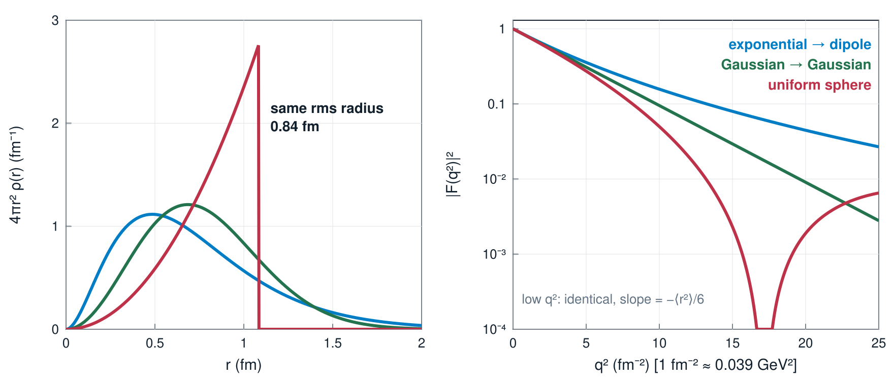
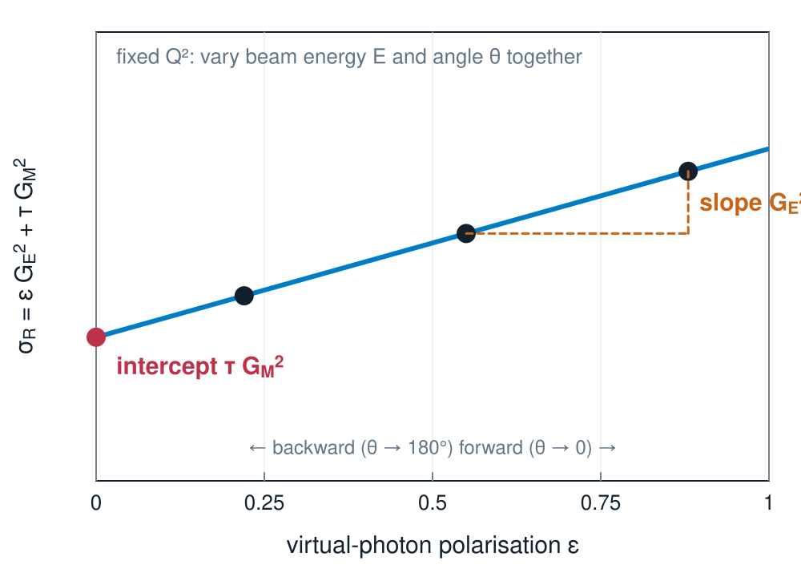
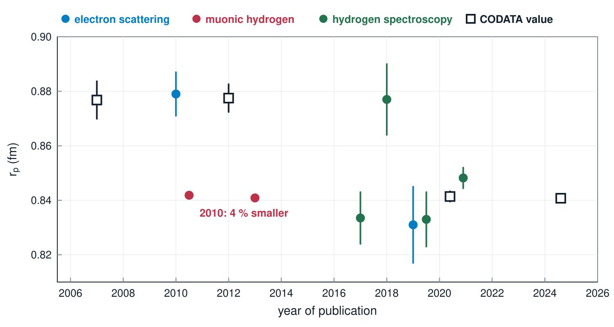

## Lecture 13 {.title-card}

:::: {.slide-body}

::: {.subtitle}
Form factors and inelastic scattering
:::

Mikhail Mikhasenko · KT1 · Winter semester 2026/27 · Thomson, Chapters 7–8

::::

::: {.notes}
Draft. Lecture 12 stopped at "A charge cloud: the form factor" (slide 29): form factors were mentioned, not developed. This lecture opens there, builds intuition with a diffraction picture (widget), then continues with the Lecture 12 slides on the radius, G_E and G_M, Rosenbluth and the proton radius puzzle (copied unchanged). The inelastic part (Thomson Ch. 8) is still to be written.
:::

## 3 · Elastic scattering: where we stopped {.section-title}

:::: {.slide-body}

A charge cloud multiplies the cross section by $|F(\mathbf q)|^2$

::: {.subtle}
Today: what $F$ looks like, and what it tells us
:::

::::

## A charge cloud: the form factor

:::: {.slide-body}

Static target, charge density normalised to $\int\rho(\mathbf r)\,d^3r=1$:

::::: {.two-col .bigmath}
::: {.rule}
[Potential: a convolution]{.rule-head}

$$V(\mathbf r)=-Z\alpha\int\frac{\rho(\mathbf r')}{|\mathbf r-\mathbf r'|}\,d^3r'$$
Fourier transform of a convolution = product of transforms.
:::

::: {.rule}
[Amplitude: a product]{.rule-head}

$$\mathcal M=\mathcal M_{\text{point}}\,F(\mathbf q)$$
$$F(\mathbf q)=\int\rho(\mathbf r)\,e^{i\mathbf q\cdot\mathbf r}\,d^3r$$
:::
:::::

::: {.statement-box}
$\dfrac{d\sigma}{d\Omega}=\left(\dfrac{d\sigma}{d\Omega}\right)_{\text{point}}\big|F(\mathbf q)\big|^2$
:::

::::

::: {.notes}
Board, 5 minutes. Born approximation: M ∝ ∫ e^{iq·r} V(r) d³r = Ṽ(q). Write r = r′ + R, the double integral factorises into ∫ e^{iq·r′} ρ(r′) d³r′ × ∫ e^{iq·R} (−Zα/R) d³R = F(q) × Ṽ_point(q). F(0) = 1 is the total charge; a point charge, ρ = δ³(r), gives F ≡ 1. Static target: Q² = |q|².
:::

## Diffraction: the wall behind a disk {.demo-slide}

:::: {.slide-body}

::: {.widget data-src="widgets/diffraction.html" data-poster="widgets/diffraction-poster.png" data-alt="Interactive diffraction explorer: plane waves of adjustable momentum hit a black disk, hard sphere, soft-edge sphere, Gaussian or exponential target of adjustable radius; the ring pattern on a distant wall is shown in perspective and face-on, and the intensity |F(q)|² is plotted versus scattering angle, |t| or qR with the minima marked"}
:::

::::

::: {.notes}
6–8 minutes, before the board derivation of the radius. Story: light on a disk gives rings on the wall (Fraunhofer); the amplitude at angle θ is the Fourier transform of the target profile, the same F(q) as on the previous slide. (1) Default black disk, 1 GeV: rings, first minimum at qR = 3.83. (2) Drag p up: the rings shrink towards the centre (θ₁ ∝ 1/p), then switch the plot axis to |t|: the minima do not move. The physics lives in t = −q², the angle is just kinematics. (3) Drag p down below 2kR = 3.83: no minimum is reachable; λ is too long to resolve R. (4) Switch shapes with "show the other shapes": same R, identical at small qR (only ⟨r²⟩ matters), different at large qR; the minima need a sharp edge, the Gaussian and the exponential (the proton's dipole) have none. (5) Presets: ¹²C at 420 MeV gives the first minimum near 50°, as measured at Stanford; ²⁰⁸Pb gives many; pp at the LHC is a black disk of R ≈ 1.1 fm with a dip at |t| ≈ 0.47 GeV² (TOTEM, 13 TeV) at θ ≈ 100 μrad. (6) Optional: "× point-like (Mott)" shows what is actually measured, dσ/dΩ = (dσ/dΩ)_Mott |F|².
:::

## What the wall tells us

:::: {.slide-body}

::::: {.two-col}
::: {.rule}
[Position of the minima: the size]{.rule-head}

Minima at fixed $qR$: $3.83$ (disk), $4.49$ (sphere). So $R=4.49/q_1$.

$q=2k\sin\frac\theta2$: raise the energy, $\theta_1$ shrinks, $|t_1|=q_1^2$ stays.
:::

::: {.rule}
[Depth of the minima: the edge]{.rule-head}

Sharp edge → zeros of $F$. Smooth edge (Gaussian, exponential) → no zeros.

Nuclei show minima (¹²C, ²⁰⁸Pb). The proton does not: dipole $F$.
:::
:::::

::: {.take-home}
Resolution needs $2kR\gtrsim4$, i.e. $\lambda\lesssim R$. To see a 1 fm object, $p\gtrsim1$ GeV.
:::

::::

::: {.notes}
2 minutes. The same picture holds for hadron–hadron elastic scattering at high energy: the proton is nearly a black disk for another proton, and the diffraction dip in dσ/dt at |t| ≈ 0.5 GeV² is the analogue of the first dark ring (TOTEM, Eur. Phys. J. C 79 (2019) 861). The quantitative size of a smooth object comes from the slope at q = 0, the next slide.
:::

## Radius from the slope {.landmark}

:::: {.slide-body}

Spherical $\rho(r)$: do the angular integral, then expand for small $Q=|\mathbf q|$:

$$F(Q)=4\pi\int_0^\infty r^2\rho(r)\,\frac{\sin Qr}{Qr}\,dr,\qquad\frac{\sin Qr}{Qr}=1-\frac{Q^2r^2}{6}+\dots$$

$$F(Q^2)=1-\frac{Q^2}{6}\,\langle r^2\rangle+\dots$$

::: {.eq-box}
$$\langle r^2\rangle=-6\,\frac{dF}{dQ^2}\Big|_{Q^2=0}$$
:::

::: {.take-home}
Only the slope at $Q^2=0$: no model for the shape is needed. Units: $\langle r^2\rangle[\text{fm}^2]=(\hbar c)^2\,\langle r^2\rangle[\text{GeV}^{-2}]$, $(\hbar c)^2=0.0389$ GeV² fm².
:::

::::

::: {.notes}
Board, 5 minutes: the intellectual highlight. ∫ e^{iQr cos ϑ} d cos ϑ dφ = 2π (e^{iQr} − e^{−iQr})/(iQr) = 4π sin(Qr)/(Qr). The zeroth term gives ∫ ρ d³r = 1, the second −Q²⟨r²⟩/6 with ⟨r²⟩ = ∫ r² ρ d³r.
:::

## Same radius, different shapes

::: {.slide-refs}
Original figure
:::

:::: {.slide-body}

::: {.wide-figure style="--fig-h:540px"}
{fig-alt="Left: radial charge distributions for an exponential, a Gaussian and a uniform sphere, all with rms radius 0.84 fm. Right: the squared form factors on a logarithmic scale; identical at low q squared, very different at high q squared, with diffraction zeros for the uniform sphere"}
:::

::: {.take-home}
Low $Q^2$ measures only $\langle r^2\rangle$; high $Q^2$ measures the shape. Exponential $\rho\propto e^{-r/a}$ ↔ dipole $(1+Q^2/\Lambda^2)^{-2}$ with $\langle r^2\rangle=12/\Lambda^2$. A sharp edge gives diffraction zeros (Hofstadter, ¹²C, Sheet 7).
:::

::::

::: {.notes}
Uniform sphere of radius R: F = 3(sin x − x cos x)/x³, x = QR, ⟨r²⟩ = 3R²/5. Gaussian: F = exp(−Q²⟨r²⟩/6). The proton is close to the dipole with Λ² = 0.71 GeV²: r = √12 ħc/Λ ≈ 0.81 fm (Sheet 6 class problem 3).
:::

## Proton radius explorer {.demo-slide}

:::: {.slide-body}

::: {.widget data-src="widgets/proton-radius.html" data-poster="widgets/proton-radius-poster.png" data-alt="Interactive proton radius explorer: dipole electric form factor with its tangent at zero for an adjustable radius, and the relative cross-section difference to a 0.841 fm proton versus Q squared"}
:::

::::

::: {.notes}
4 minutes. (1) Move r: the slope at 0 changes, the tangent follows. (2) Pick 0.877 and 0.841 fm: on the left the curves are hard to tell apart. (3) Right panel: at Q² = 0.01 GeV² the cross sections differ by only 0.5 %. Lead into the next slide.
:::

## Why measure the radius at small Q²?

:::: {.slide-body}

::: {.statement-box}
Large $Q^2$ resolves small distances. Yet the radius comes from the **smallest** $Q^2$. Why?
:::

::::: {.two-col}
::: {.rule .fragment}
[Large Q²: the shape]{.rule-head}

$F$ depends on $\langle r^4\rangle,\langle r^6\rangle,\dots$ Getting back to the slope at 0 needs a model for the shape.
:::

::: {.rule .fragment}
[Small Q²: clean but tiny]{.rule-head}

$F\approx1-Q^2\langle r^2\rangle/6$. Between 0.877 and 0.841 fm: $\sigma$ changes by 0.5 % at $Q^2=0.01$ GeV². Needs sub-percent cross sections.
:::
:::::

::::

::: {.notes}
Ask first, 1 minute of discussion. The 2010 Mainz A1 fit used about 1400 cross sections from 0.003 to 1 GeV²; PRad (JLab 2019) reached 2×10⁻⁴ GeV² with a calorimeter at very small angles and normalised to Møller scattering e⁻e⁻ → e⁻e⁻ (the recap quiz).
:::

## Charge and magnetic moment: two form factors

:::: {.slide-body}

The proton vertex is not $\gamma^\mu$. Lorentz invariance and current conservation allow two terms:

$$\bar u\,\gamma^\mu u\;\longrightarrow\;\bar u\Big[F_1(Q^2)\,\gamma^\mu+F_2(Q^2)\,\frac{i\sigma^{\mu\nu}q_\nu}{2M}\Big]u,\qquad\sigma^{\mu\nu}=\tfrac i2[\gamma^\mu,\gamma^\nu]$$

::::: {.two-col .wide-left}
::: {.rule}
[Sachs form factors]{.rule-head}

$$G_E=F_1-\tau F_2,\qquad G_M=F_1+F_2$$
Point-like Dirac proton: $F_1=1$, $F_2=0$ → $G_E=G_M=1$, $\mu_p=1\,\mu_N$
:::

::: {.compare-table .tight}
|  | $p$ | $n$ |
|---|---|---|
| $G_E(0)$ | 1 | 0 |
| $G_M(0)$ | 2.79 | −1.91 |
:::
:::::

::::

::: {.notes}
4 minutes. The vertex itself encodes the structure: a direct extension of the Feynman rules of Lecture 11. G_E(0) is the charge, G_M(0) the magnetic moment in nuclear magnetons (Sheet 6, problem 2: the measured moments show the nucleons are not Dirac particles). F_2(0) = κ_p = 1.79 is the anomalous moment. The neutron is neutral, yet it has a magnetic moment and a charge distribution with G_E′(0) ≠ 0 (⟨r²⟩_n ≈ −0.12 fm²). Interpreting G_E and G_M as Fourier transforms of 3D densities is only exact in the non-relativistic limit (Breit frame); the slope definition of the radius holds regardless.
:::

## The Rosenbluth formula {.landmark}

::: {.slide-refs}
Original figure
:::

:::: {.slide-body .short-visual}

$$\frac{d\sigma}{d\Omega}=\left(\frac{d\sigma}{d\Omega}\right)_{\text{Mott}}\frac{E'}{E}\left[\frac{G_E^2+\tau G_M^2}{1+\tau}+2\tau G_M^2\tan^2\frac\theta2\right]$$

::::: {.picture-layout}
::: {.picture-copy}
$G_E=G_M=1$: the Dirac proton ✓

Reduced cross section:
$$\sigma_R=\varepsilon\,G_E^2+\tau\,G_M^2$$
$$\varepsilon=\Big[1+2(1+\tau)\tan^2\tfrac\theta2\Big]^{-1}$$

::: {.check}
Sheet 6, class problem 3: JLab data.
:::
:::

::: {.picture-visual}

:::
:::::

::::

::: {.notes}
5 minutes, no derivation. The bracket equals σ_R / [ε(1 + τ)]. At fixed Q², changing E and θ together changes ε from 0 (backward) to 1 (forward): a straight line, intercept τG_M², slope G_E². Measured: G_E ≈ G_D, G_M ≈ 2.79 G_D with the dipole G_D = (1 + Q²/0.71 GeV²)⁻². At high Q² the τG_M² term dominates and G_E is hard to extract; polarisation-transfer experiments at JLab (from 2000) found G_E/G_M falling with Q², unlike the Rosenbluth results: two-photon exchange.
:::

## 4 · How big is the proton? {.section-title}

:::: {.slide-body}

Scattering versus spectroscopy

::: {.subtle}
The proton radius puzzle, 2010–2022
:::

::::

## Two ways to measure the radius

:::: {.slide-body}

::::: {.two-col}
::: {.rule}
[Scattering]{.rule-head}

Slope of $G_E(Q^2)$ at $Q^2=0$.

Mainz A1 (2010): about 1400 cross sections, $r_p=0.879(8)$ fm.
:::

::: {.rule}
[Spectroscopy]{.rule-head}

An S-wave lepton is sometimes **inside** the proton:
$$\Delta E_{nS}=\frac{2\pi\alpha}{3}\,|\psi_{nS}(0)|^2\,r_p^2,\qquad|\psi_{nS}(0)|^2=\frac{(m_r\alpha)^3}{\pi n^3}$$
:::
:::::

::: {.take-home}
Muonic hydrogen: $m_r$ is 186 times larger, so the shift is $186^3\approx6\times10^6$ times larger. In μp, $3.7$ meV of the 202 meV Lamb shift ($2S$–$2P$) comes from the proton size.
:::

::::

::: {.notes}
3 minutes. Only S states have ψ(0) ≠ 0. The finite size weakens the Coulomb attraction inside the proton and raises the S levels. m_r(μp) = 105.66 · 938.27/1043.9 = 95.0 MeV, m_r(ep) = 0.511 MeV. For n = 2: ΔE = α⁴ m_r³ r_p²/12 = 5.2 meV × (r_p/fm)², i.e. 3.7 meV. Measured with a laser at PSI on muons stopped in hydrogen gas. A 4 % radius change shifts this by 0.3 meV; the measurement precision was 0.003 meV.
:::

## The day the proton shrank {.landmark}

::: {.slide-refs}
Original figure from published values
:::

:::: {.slide-body}

::: {.wide-figure style="--fig-h:580px"}
{fig-alt="Proton charge radius versus year: CODATA 2006 and 2010 and Mainz electron scattering near 0.88 fm; muonic hydrogen 2010 and 2013 near 0.841 fm; later hydrogen spectroscopy and the PRad electron scattering experiment mostly near 0.84 fm; CODATA 2018 and 2022 at 0.841 fm"}
:::

::: {.take-home}
Muonic hydrogen (2010): $0.8418(7)$ fm, five standard deviations below CODATA. New electron experiments mostly confirm the small radius: CODATA 2022 gives $r_p=0.84075(64)$ fm.
:::

::::

::: {.notes}
3 minutes. No new physics (lepton universality survived); the lesson is how hard the extrapolation to Q² = 0 and the systematics of hydrogen spectroscopy are. One outlier remains (Paris 1S–3S, 2018). Ongoing: MUSE at PSI compares e±p and μ±p scattering; AMBER at CERN measures μp scattering.
:::

## Next: inelastic scattering {.section-title}

:::: {.slide-body}

The proton breaks up: invariant mass $W$, Bjorken $x$, partons

::: {.subtle}
Thomson, Chapter 8 (to be written)
:::

::::

## Backup {.section-title visibility="uncounted"}

## Backup · References {.references visibility="uncounted"}

:::: {.slide-body}

M. Thomson, *Modern Particle Physics*, Cambridge University Press (2013), Chapters 7 and 8.

M. N. Rosenbluth, Phys. Rev. **79** (1950) 615 · R. Hofstadter, Rev. Mod. Phys. **28** (1956) 214.

J. C. Bernauer *et al.* (A1), Phys. Rev. Lett. **105** (2010) 242001 · W. Xiong *et al.* (PRad), Nature **575** (2019) 147.

R. Pohl *et al.*, Nature **466** (2010) 213 · A. Antognini *et al.*, Science **339** (2013) 417.

A. Beyer *et al.*, Science **358** (2017) 79 · H. Fleurbaey *et al.*, Phys. Rev. Lett. **120** (2018) 183001 · N. Bezginov *et al.*, Science **365** (2019) 1007 · A. Grinin *et al.*, Science **370** (2020) 1061.

P. J. Mohr *et al.*, CODATA 2006, 2010, 2018 and 2022 recommended values (Rev. Mod. Phys.).

G. Antchev *et al.* (TOTEM), Eur. Phys. J. C **79** (2019) 861: elastic pp at 13 TeV, diffraction dip.

All figures in this lecture are original.

::::
