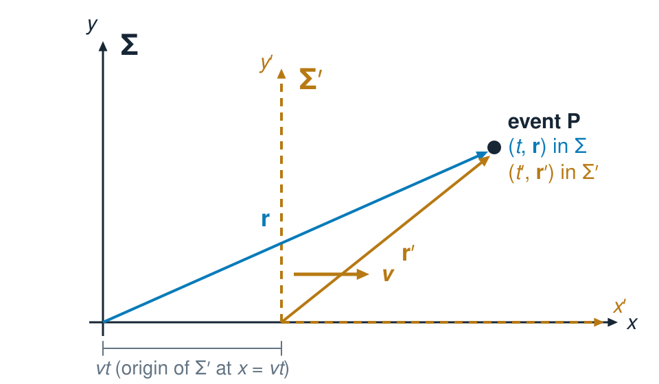
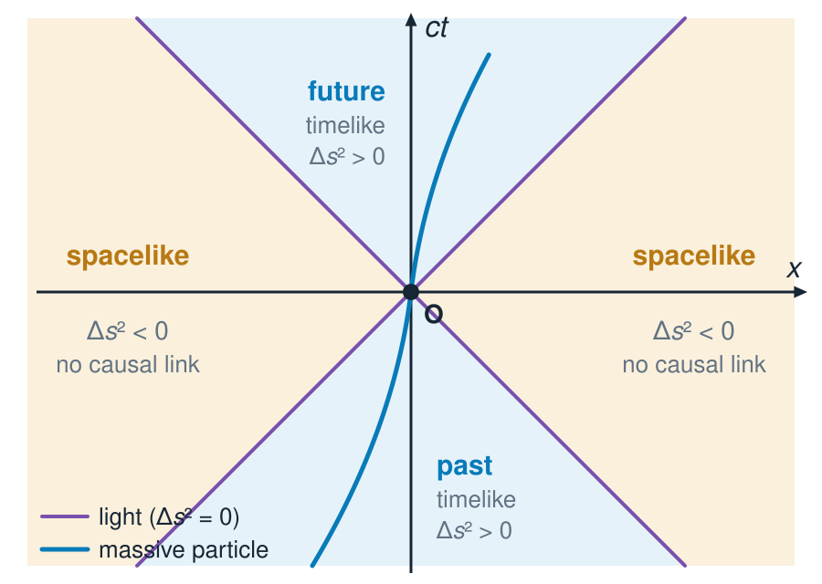
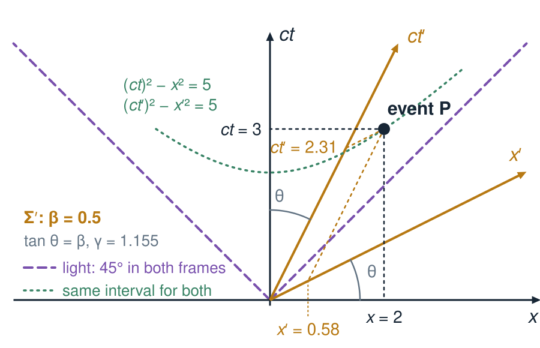
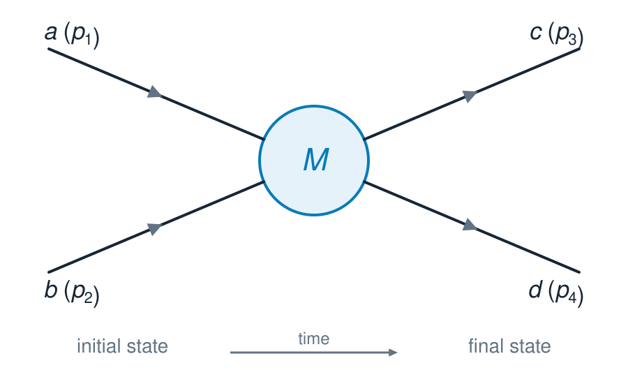
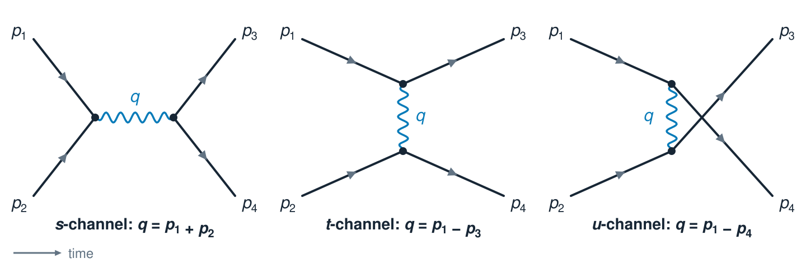
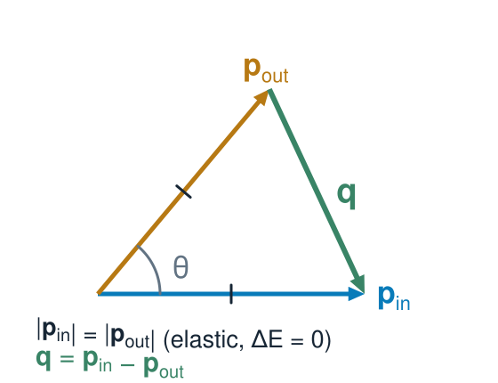
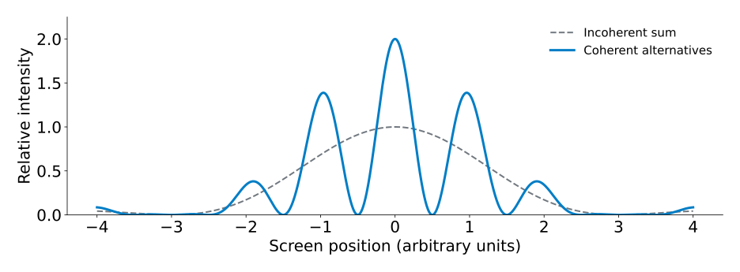
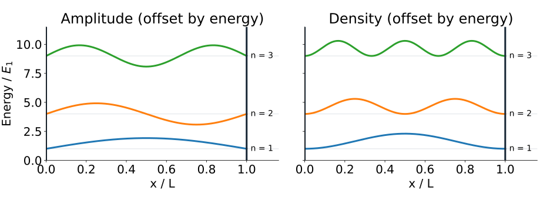

## Lecture 3 {.title-card}

::: {.subtitle}
Quantum Amplitudes and Transition Rates
:::

What determines how often an allowed process occurs?

## Recap: special relativity {.section-title}

::: {.subtitle}
Inertial frames, light cones and Lorentz transformations
:::

## Inertial frames and events

:::::: {.slide-body}
::::: {.side-by-side}
:::: {.txt}
An **inertial frame** has no acceleration and no rotation: a free particle moves on a straight line with constant velocity.

An **event** is a point in spacetime, $(t,x,y,z)$.

Two inertial frames $\Sigma$ and $\Sigma'$ assign **different coordinates to the same event**.

For $v\ll c$ they are related by the Galilean rule $x'=x-vt$, $t'=t$. For large $v$ that rule fails.
::::

:::::
::::::

## Einstein’s postulates

:::: {.slide-body}
1. The laws of physics have the same form in all inertial frames.

2. The speed of light in vacuum is $c$ in every inertial frame, independent of the motion of the source.

A flash emitted at $t=t'=0$ from the common origin has a spherical wavefront for **both** observers:
$$c^2t^2-x^2-y^2-z^2=0\quad\text{and}\quad c^2t'^2-x'^2-y'^2-z'^2=0.$$
The transformation must therefore preserve $c^2t^2-\mathbf x^2$. The **linear** maps that do are the **Lorentz transformations**.

::: {.footnote}
Experimental tests of postulate 2: [Michelson and Morley 1887](https://doi.org/10.2475/ajs.s3-34.203.333){target="_blank"}, no ether wind. [Alväger et al. 1964](https://doi.org/10.1016/0031-9163(64)91095-9){target="_blank"}, photons from fast $\pi^0$ decays (source $\beta=0.99975$) travel at $c$ within about $10^{-4}$. [Müller et al. 2003](https://doi.org/10.1103/PhysRevLett.91.020401){target="_blank"}, isotropy of $c$ to a few parts in $10^{15}$ with cryogenic optical resonators.
:::
::::

## The light cone

:::::: {.slide-body}
::::: {.side-by-side}
:::: {.txt}
Time goes up, one space direction sideways.

Light travels on **45° lines** — in every inertial frame, by postulate 2.

The sign of $\Delta s^2=c^2\Delta t^2-\Delta\mathbf x^2$ is frame independent: **timelike**, **lightlike** or **spacelike**.

Massive particles have worldlines **inside** the cone, $v<c$.
::::

:::::
::::::

## A second observer in the same diagram

:::::: {.slide-body}
::::: {.side-by-side}
:::: {.txt}
Frame $\Sigma'$ moves with $\beta$ along $x$. Its axes, drawn in the $\Sigma$ diagram:

$ct'$ axis ($x'=0$): the line $x=\beta\,ct$.

$x'$ axis ($ct'=0$): the line $ct=\beta\,x$.

Both tilt by $\tan\theta=\beta$ **towards the light cone**, which stays at 45°.

Same event, different coordinates, **same interval**:
$(ct)^2-x^2=(ct')^2-x'^2$.
::::

:::::
::::::

## Lorentz transformation in matrix form

:::: {.slide-body}
$$\begin{pmatrix}ct'\\x'\\y'\\z'\end{pmatrix}=\begin{pmatrix}\gamma&-\beta\gamma&0&0\\-\beta\gamma&\gamma&0&0\\0&0&1&0\\0&0&0&1\end{pmatrix}\begin{pmatrix}ct\\x\\y\\z\end{pmatrix},\qquad X'=\Lambda X$$
$$\beta=\frac vc,\qquad\gamma=\frac1{\sqrt{1-\beta^2}},\qquad X=\Lambda^{-1}X'\ \text{ with }\ \Lambda^{-1}=\Lambda(-\beta).$$
The inverse transformation swaps the roles of $\Sigma$ and $\Sigma'$: flip the sign of $\beta$.

Rotations of the spatial axes are Lorentz transformations too.
::::

## Recap: four-vectors and notation {.section-title}

::: {.subtitle}
Definitions, invariants and the notation used in the book
:::

## Four-vectors

:::: {.slide-body}
A **contravariant** four-vector is any set of four quantities that transforms like $x^\mu$:
$$a'^{\mu}=\Lambda^{\mu}{}_{\nu}\,a^{\nu}$$
Examples, with $c=1$: $\;x^\mu=(t,x,y,z)$, $\;p^\mu=(E,p_x,p_y,p_z)$.

**Einstein summation:** an index that appears once up and once down is summed over $0,1,2,3$:
$$\Lambda^{\mu}{}_{\nu}\,a^{\nu}\equiv\sum_{\nu=0}^{3}\Lambda^{\mu}{}_{\nu}\,a^{\nu}$$
Greek indices ($\mu,\nu$) run over $0,\dots,3$ (0 = time). Latin indices $i=1,2,3$ label space.
::::

## Covariant components and the metric

:::: {.slide-body}
$$a_\mu=g_{\mu\nu}a^\nu,\qquad g_{\mu\nu}=\begin{pmatrix}1&0&0&0\\0&-1&0&0\\0&0&-1&0\\0&0&0&-1\end{pmatrix}\quad\Rightarrow\quad a_\mu=(a^0,-\mathbf a)$$
Particle-physics (“west-coast”) signature $(+,-,-,-)$.\
Many General Relativity (GR) texts use $(-,+,+,+)$ (“east-coast”).


**Covariant** vectors transform with the **inverse** matrix: $a'_\mu=(\Lambda^{-1})^{\nu}{}_{\mu}\,a_\nu$.

$$a^\mu b_\mu=g_{\mu\nu}a^\mu b^\nu=a^0b^0-\mathbf a\cdot\mathbf b$$

::: {.footnote}
Indices versus matrices: in index notation only the **position** of an index (up or down) matters, not a row or column layout.
When we write matrices, contravariant vectors are columns and covariant vectors are rows.
Thomson writes both as columns; for a boost the matrix is symmetric, which hides the difference.
:::
::::

## Scalar products are Lorentz invariant

:::: {.slide-body}
$$a'^{\mu}b'_{\mu}=g_{\mu\nu}\,a'^{\mu}b'^{\nu}=\big(\Lambda^{\mu}{}_{\rho}\,g_{\mu\nu}\,\Lambda^{\nu}{}_{\sigma}\big)\,a^{\rho}b^{\sigma}=g_{\rho\sigma}\,a^{\rho}b^{\sigma}=a^{\rho}b_{\rho}$$
because a Lorentz transformation preserves the metric: $\Lambda^{\mu}{}_{\rho}\,g_{\mu\nu}\,\Lambda^{\nu}{}_{\sigma}=g_{\rho\sigma}$.

Rotations preserve $\sum_i a^ib^i$; Lorentz transformations preserve $a^0b^0-\sum_i a^ib^i$.

**In your own time:** verify $\big(\Lambda^{\mu}{}_{\rho}\,g_{\mu\nu}\,\Lambda^{\nu}{}_{\sigma}\big)=g_{\rho\sigma}$.

**Hence:** any fully contracted expression is Lorentz invariant — $x^\mu x_\mu$, $p^\mu p_\mu=m^2$, $q^\mu q_\mu$, $(p_1+p_2)^\mu(p_1+p_2)_\mu,\dots$
::::

## Sums of four-vectors are four-vectors

:::: {.slide-body}
$a'^{\mu}+b'^{\mu}=\Lambda^{\mu}{}_{\nu}\,(a^{\nu}+b^{\nu})$, so $a^\mu+b^\mu$ transforms like a four-vector. \
So does $\lambda a^\mu$ for a scalar $\lambda$.

- $P^\mu=\sum_i p_i^{\mu}$ is a four-vector, and $P^\mu P_\mu=M^2$ is the **invariant mass** of the system.
- $\sum p^{\mu}_{\mathrm{in}}-\sum p^{\mu}_{\mathrm{out}}=0$ is a four-vector that vanishes: it vanishes **in every frame** if it vanishes in one.
- $E'=\gamma(E-\beta p_x)$ mixes $E$ and $p_x$: energy conservation survives a boost only **together with** momentum conservation.
- Not invariant: $E_1+E_2$, $|\mathbf p_1|+|\mathbf p_2|$, $m_1+m_2$. Invariant: $(E_1+E_2)^2-|\mathbf p_1+\mathbf p_2|^2=(p_1+p_2)^\mu(p_1+p_2)_\mu$.
::::

## Where four-vectors come from

:::: {.slide-body}
| Object | Definition | Components, $c=1$ |
|---|---|---|
| Position | $x^\mu$ | $(t,\mathbf x)$ |
| Four-velocity | $u^\mu=\dfrac{dx^\mu}{d\tau}$ | $\gamma\,(1,\boldsymbol\beta)$ |
| Four-momentum | $p^\mu=m\,u^\mu$ | $(E,\mathbf p)=(\gamma m,\gamma m\boldsymbol\beta)$ |
| Four-derivative | $\partial_\mu=\dfrac{\partial}{\partial x^\mu}$ | $(\partial_t,+\nabla)$, covariant |

The proper time $\tau$ and the mass $m$ are **scalars**.
::::

## Common notation (Thomson)

:::: {.slide-body}
| Symbol | Meaning |
|---|---|
| $x,\ p,\ a$ | four-vectors (plain) |
| $\mathbf x,\ \mathbf p,\ \mathbf a$ | three-vectors (**bold**) |
| $\lvert\mathbf p\rvert$ | magnitude of a three-vector |
| $\mathbf p_1\!\cdot\!\mathbf p_2$ | three-vector scalar product |
| $a\!\cdot\!b\equiv a^\mu b_\mu$ | four-vector scalar product |
| $a^2\equiv a\!\cdot\!a$ versus $\mathbf a^2\equiv\mathbf a\!\cdot\!\mathbf a$ | **different quantities** |
| $p^*,\ E^*$ | three-vectors evaluated in the CM frame |
::::

## Recap: natural units {.section-title}

::: {.subtitle}
$\hbar=c=1$ and Table 2.1
:::

## Natural units and Table 2.1

:::: {.slide-body}
Choose $\hbar=c=1$: every quantity is a power of GeV.

| Quantity | [kg, m, s] | [ħ, c, GeV] | ħ = c = 1 |
|---|---|---|---|
| Energy | kg m² s⁻² | GeV | GeV |
| Momentum | kg m s⁻¹ | GeV/c | GeV |
| Mass | kg | GeV/c² | GeV |
| Time | s | (GeV/ħ)⁻¹ | GeV⁻¹ |
| Length | m | (GeV/ħc)⁻¹ | GeV⁻¹ |
| Area | m² | (GeV/ħc)⁻² | GeV⁻² |

The factors of $\hbar$ and $c$ are not lost: they appear in the dimensions.
::::

## Converting back to SI units

:::: {.slide-body}
Restore $\hbar$ and $c$ by dimensional analysis:
$$\hbar c=0.1973\ \mathrm{GeV\,fm},\qquad\hbar=6.582\times10^{-25}\ \mathrm{GeV\,s}$$

- **Length:** $\langle r^2\rangle^{1/2}_{\mathrm{proton}}=4.1\ \mathrm{GeV}^{-1}\;\to\;4.1\times0.1973\ \mathrm{fm}=0.81\ \mathrm{fm}$.
- **Time:** $1\ \mathrm{GeV}^{-1}=6.582\times10^{-25}\ \mathrm s$, so a width $\Gamma$ gives $\tau=\hbar/\Gamma$.
- **Area:** $1\ \mathrm{GeV}^{-2}=(\hbar c)^2=0.3894\ \mathrm{mb}$.

Multiply by $\hbar$ and $c$ until the units are the ones you want.
::::

## Join the quiz

```{=html}
<div style="display:flex;align-items:center;justify-content:center;gap:100px;height:700px">
<a href="https://www.menti.com/?code=56562487" target="_blank" rel="noopener"></a>
<div style="text-align:center"><p style="font-size:48px;margin:0 0 28px">Scan to join</p><p style="font-size:36px;margin:0 0 18px">or go to <strong>menti.com</strong></p><p style="font-size:76px;font-weight:600;letter-spacing:.06em;margin:0">5656 2487</p></div>
</div>
```

## Question 1 — Inertial frame?

:::: {.slide-body}
Ignore gravity. Which observer is in an **inertial frame**?

**A.** A car at a constant 100 km/h on a roundabout.

**B.** A rocket coasting with its engines off, far from any star.

**C.** A lift accelerating upwards.

**D.** A seat on a carousel turning at constant angular speed.
::::

## Question 2 — Speed of light

:::: {.slide-body}
A lamp at rest in frame $\Sigma$ emits a flash. Bob flies **towards the lamp** at $0.8c$.

What speed of the light does Bob measure?

**A.** $1.8\,c$

**B.** $\approx1.67\,c$

**C.** $c$

**D.** $0.2\,c$
::::

## Question 3 — Which is a four-vector?

:::: {.slide-body}
Which four-component object transforms as a **four-vector**?

**A.** $(m,\,p_x,\,p_y,\,p_z)$

**B.** $(t,\,v_x,\,v_y,\,v_z)$

**C.** $(E^2,\,p_x^2,\,p_y^2,\,p_z^2)$

**D.** $(E_1+E_2,\ \mathbf p_1+\mathbf p_2)$ for two particles
::::

## Question 4 — Conservation in another frame

:::: {.slide-body}
In frame $S$ a reaction conserves total energy and total momentum.

Bob flies past in frame $S'$. Is **total energy** conserved in $S'$?

**A.** Yes: $E'=\gamma(E-\beta p_x)$ mixes $E$ and $p_x$, which are both conserved in $S$.

**B.** No: energy is not invariant, so it is generally not conserved in $S'$.

**C.** Yes: energy is a Lorentz scalar.

**D.** Only if $\beta\ll1$.
::::

## Question 5 — Reading the notation

:::: {.slide-body}
A particle has four-momentum $p$, three-momentum $\mathbf p$, energy $E$ and mass $m$.

Which equation is correct, using Thomson’s notation (bold = three-vector)?

**A.** $p^2=E^2+\mathbf p^2$

**B.** $E^2=\mathbf p^2+m^2$

**C.** $E^2=p^2+m^2$

**D.** $p^2=\mathbf p^2-m^2$
::::

## Question 6 — Natural units

:::: {.slide-body}
The proton’s rms charge radius is $4.1\ \mathrm{GeV}^{-1}$ in natural units.

What is it in femtometres? ($\hbar c=0.1973\ \mathrm{GeV\,fm}$)

**A.** $0.048\ \mathrm{fm}$

**B.** $21\ \mathrm{fm}$

**C.** $0.81\ \mathrm{fm}$

**D.** $4.1\ \mathrm{fm}$
::::

## Mandelstam variables {.section-title}

::: {.subtitle}
Lorentz invariants of $2\to2$ scattering
:::

## Two-to-two kinematics

:::::: {.slide-body}
::::: {.side-by-side .wide-text}
:::: {.txt}
$$a(p_1)+b(p_2)\to c(p_3)+d(p_4)$$
$$p_1+p_2=p_3+p_4$$
$$s=(p_1+p_2)^2=(p_3+p_4)^2$$
$$t=(p_1-p_3)^2=(p_2-p_4)^2$$
$$u=(p_1-p_4)^2=(p_2-p_3)^2$$
Each one is the square of a four-vector, so each is **Lorentz invariant**: evaluate it in the frame where it is easiest.
::::

:::::
::::::

## $s$: energy in the CM frame

:::: {.slide-body}
CM frame: $p_1=(E_1^*,\mathbf p^*)$ and $p_2=(E_2^*,-\mathbf p^*)$, so
$$s=(E_1^*+E_2^*)^2\qquad\Longrightarrow\qquad\sqrt s=\text{total energy in the CM frame.}$$
Stationary target, $p_2=(m_2,\mathbf 0)$:
$$s=m_1^2+m_2^2+2m_2E_1.$$
**Check:** which beam energy on a proton at rest gives $\sqrt s=14\ \mathrm{TeV}$?
::::

## $t$ and $u$: the exchanged four-momentum {.plot-slide}

:::: {.slide-body}
{.physics-plot}

The squared four-momentum of the exchanged particle is $q^2=s,\ t$ or $u$.

Elastic scattering ($m_3=m_1$), CM frame: $t=-2p^{*2}(1-\cos\theta^*)\le0$, a **spacelike** momentum transfer.
::::

## The sum rule

:::: {.slide-body}
$$s+t+u=m_1^2+m_2^2+m_3^2+m_4^2$$
Only **two** of $s,t,u$ are independent: a $2\to2$ process is fixed by the CM energy $\sqrt s$ and the scattering angle, or equivalently by $s$ and $t$.

**In Exercise 2** you will derive the sum rule. Hint: expand each square, e.g. $s=m_1^2+m_2^2+2\,p_1\!\cdot\!p_2$, and use $p_2-p_3-p_4=-p_1$.
::::

## Mandelstam variables beyond $2\to2$

:::: {.slide-body}
- **More particles:** use invariant masses of subsets, $s_{ij}=(p_i+p_j)^2$, $(p_i+p_j+p_k)^2,\dots$
- **How many?** $N\ge4$ massive external particles have $3N-10$ independent invariants: 2 for $2\to2$ and $1\to3$, 5 for $2\to3$.
- **Three-body decay** $M\to1+2+3$: $s_{12}+s_{23}+s_{13}=M^2+m_1^2+m_2^2+m_3^2$, the sum rule behind the Dalitz plot.
- **Crossing:** one amplitude, as a function of $s,t,u$, describes related processes with the roles of $s,t,u$ exchanged, e.g. $e^-\mu^-\to e^-\mu^-$ and $e^+e^-\to\mu^+\mu^-$.
- **Outlook to Hadron colliders:** partons collide at $\hat s=x_1x_2\,s$ ("Bjorken $x$").

Kinematics fixes **what is possible**. What fixes **how often**?
::::

## Amplitudes and decay rates {.section-title}

::: {.subtitle}
From what is possible to how often
:::

## Allowed processes and transition probabilities

:::: {.slide-body}
Conservation laws determine the allowed final states. Interactions determine the amplitudes for reaching them.

$$\text{transition rate}\ \sim\ |\text{transition amplitude}|^2\times\text{available final states}$$

See Thomson, Sec. 2.3:

1. **Waves and probes:** plane waves, de Broglie wavelength, resolution
2. **Probability and flux:** beams and cross sections
3. **Time evolution and conservation:** stationary states, widths
4. **Angular momentum:** the algebra behind spin, isospin and colour
5. **Transition rates:** Fermi’s golden rule
::::

## Waves, probes and resolution {.section-title}

::: {.subtitle}
Sec. 2.3.1 · Plane waves, de Broglie wavelength, momentum transfer
:::

## Plane waves are momentum eigenstates

:::: {.slide-body}
$$\psi(\mathbf x,t)=N\,e^{i(\mathbf p\cdot\mathbf x-Et)}=N\,e^{-ip_\mu x^\mu}$$
$$\hat{\mathbf p}=-i\nabla,\quad\hat E=i\frac{\partial}{\partial t}\qquad\Rightarrow\qquad\hat{\mathbf p}\,\psi=\mathbf p\,\psi,\quad\hat E\,\psi=E\,\psi$$
De Broglie and Planck–Einstein, $\mathbf k=\mathbf p/\hbar$ and $\omega=E/\hbar$, together say $k^\mu=p^\mu/\hbar$. The phase $p_\mu x^\mu$ is a Lorentz scalar: all observers agree on the wave.

Observables are eigenvalues of Hermitian operators acting on $\psi$.

::::

## de Broglie wavelength: a beam is a microscope

:::: {.slide-body}
$$\lambda=\frac h{|\mathbf p|}=\frac{2\pi\hbar}{|\mathbf p|}\qquad\lambda\simeq\frac{1.24\ \mathrm{fm}}{|\mathbf p|\,[\mathrm{GeV}/c]}$$

| Probe momentum | Wavelength $\lambda$ | Compare with |
|---|---|---|
| $1\ \mathrm{MeV}/c$ | $1.24\ \mathrm{pm}$ | between atom and nucleus |
| $100\ \mathrm{MeV}/c$ | $12.4\ \mathrm{fm}$ | a heavy nucleus ($R\approx7\ \mathrm{fm}$) |
| $1\ \mathrm{GeV}/c$ | $1.24\ \mathrm{fm}$ | the proton ($r\approx0.84\ \mathrm{fm}$) |
| $10\ \mathrm{GeV}/c$ | $0.124\ \mathrm{fm}$ | structure inside the proton |
| $6.5\ \mathrm{TeV}/c$ | $1.9\times10^{-4}\ \mathrm{fm}$ | one LHC proton beam |

$\lambda$ is a spatial phase scale, not a particle’s diameter.
::::

## Momentum transfer sets the resolution

:::::: {.slide-body}
::::: {.side-by-side .wide-text}
:::: {.txt}
$$q^\mu=p^\mu_{\mathrm{in}}-p^\mu_{\mathrm{out}}=(\Delta E,\mathbf q),\qquad t=q^\mu q_\mu=\Delta E^2-\mathbf q^2$$
Elastic scattering in the CM frame (or off a heavy target): $\Delta E=0$ and $|\mathbf p_{\mathrm{in}}|=|\mathbf p_{\mathrm{out}}|$, so
$$Q\equiv|\mathbf q|=2|\mathbf p|\sin\frac\theta2,\qquad t=-Q^2,\qquad R\sim\frac{\hbar}{Q}$$
A large $|t|$ resolves a small $R$: at $Q=1\ \mathrm{GeV}/c$, about $0.2\ \mathrm{fm}$.

A high $|\mathbf p|$ alone is not enough: a tiny deflection $\theta$ gives a tiny $Q$.

::: {.footnote}
Once $Q\gtrsim\hbar/R$, the extended charge matters: the cross section is multiplied by $\lvert F(Q)\rvert^2$, the squared Fourier transform of the charge distribution. Form factors are treated in Thomson Chap. 7 (Sec. 7.3), deep inelastic scattering in Chap. 8.
:::
::::

:::::
::::::

## Resolving a target {.widget-slide}

:::: {.slide-body}
::: {.widget data-src="widgets/resolution.html" data-poster="widgets/resolution-poster.png" data-alt="Elastic scattering off a uniform sphere: momentum transfer, resolution length and diffraction minima"}
:::
::::

## Probability and flux {.section-title}

::: {.subtitle}
Sec. 2.3.2 · Beams and cross sections
:::

## Wave function and probability

:::: {.slide-body}
A wave function is a **complex probability amplitude**.

$$\rho(\mathbf x,t)=\psi^*\psi,\qquad P(V)=\int_V\rho\,d^3x$$

A global phase, $\psi\to e^{i\alpha}\psi$, is unobservable; relative phases change interference.
::::

## Probability current: a beam has a flux

:::: {.slide-body}
$$\frac{\partial\rho}{\partial t}+\nabla\!\cdot\!\mathbf j=0,\qquad\mathbf j=\frac1{2im}\big(\psi^*\nabla\psi-\psi\nabla\psi^*\big)$$

Plane wave: $\rho=|N|^2\equiv n$ and $\mathbf j=n\,\mathbf p/m=n\,\mathbf v$.

It describes a beam with $n$ particles per unit volume and flux $\mathbf j=n\mathbf v$.

**Cross section = transition rate / incident flux.**
::::

## Time evolution and conservation {.section-title}

::: {.subtitle}
Sec. 2.3.3–2.3.4 · Stationary states, conserved quantities, widths
:::

## Stationary states and time evolution

:::: {.slide-body}
$$\hat H\phi_n=E_n\phi_n,\qquad\psi_n(\mathbf x,t)=\phi_n(\mathbf x)\,e^{-iE_nt}$$
$$|\varphi(t)\rangle=\sum_n c_n\,e^{-iE_nt}\,|\phi_n\rangle$$
Energy eigenstates only pick up a phase: all expectation values are constant (**stationary states**).

A superposition of different energies evolves: the relative phases $e^{-i(E_n-E_m)t}$ change with time.
::::

## Superposition of energy eigenstates: oscillations

:::: {.slide-body}
Two stationary states with different energies, $|\nu_\alpha\rangle=\cos\theta\,|\nu_1\rangle+\sin\theta\,|\nu_2\rangle$, dephase over a distance $L$ (natural units):

$$P(\nu_\alpha\to\nu_\alpha)=1-\sin^{2}2\theta\,\sin^2\!\Big(\frac{\Delta m^2L}{4E}\Big),\qquad\frac{\Delta m^2L}{4E}=1.267\,\frac{\Delta m^2[\mathrm{eV}^2]\,L[\mathrm{km}]}{E[\mathrm{GeV}]}$$

Example, T2K: $L=295\ \mathrm{km}$, $E\approx0.6\ \mathrm{GeV}$, $\Delta m^2\approx2.5\times10^{-3}\ \mathrm{eV}^2$ give a phase of about $\pi/2$: for $\sin^{2}2\theta\approx1$, nearly complete disappearance.

::: {.footnote}
Amplitude for $\nu_\alpha\to\nu_\beta$: $\sum_iU^*_{\alpha i}\,e^{-iE_it}\,U_{\beta i}$. For two flavours $U$ is a rotation by $\theta$. Revisited in Chapters 13 and 14.
:::
::::

## Oscillations {.widget-slide}

:::: {.slide-body}
::: {.widget data-src="widgets/oscillation.html" data-poster="widgets/oscillation-poster.png" data-alt="Two-flavour neutrino oscillation probability against distance and against L over E"}
:::
::::

## Conserved quantities

:::: {.slide-body}
$$\frac{d\langle\hat A\rangle}{dt}=i\,\langle[\hat H,\hat A]\rangle$$

If $[\hat H,\hat A]=0$, then $A$ is **conserved**.

Momentum (translations), angular momentum (rotations), parity (reflections), …

Symmetry $\Rightarrow$ conservation law $\Rightarrow$ quantum numbers that label states: Noether’s theorem in quantum language.
::::

## Conservation laws at a glance (for reference)

:::: {.slide-body}
::: {.ref-table}
| Quantity | Symmetry | Strong | EM | Weak |
|---|---|:-:|:-:|:-:|
| Energy, momentum | time and space translations | ✓ | ✓ | ✓ |
| Angular momentum $J$ | rotations | ✓ | ✓ | ✓ |
| Electric charge $Q$ | U(1) | ✓ | ✓ | ✓ |
| Colour | SU(3) | ✓ | ✓ | ✓ |
| Baryon number $B$ | U(1) | ✓ | ✓ | ✓ |
| Lepton numbers $L_e,L_\mu,L_\tau$ | U(1) each | ✓ | ✓ | ✓* |
| Isospin $I$ | SU(2) flavour | ✓ | only $I_3$ | ✗ |
| Strangeness, charm, beauty | U(1) each | ✓ | ✓ | ✗ |
| Parity $P$, charge conjugation $C$ | discrete | ✓ | ✓ | ✗ |
| $CP$ | discrete | ✓ | ✓ | small violation |
| $CPT$ | discrete | ✓ | ✓ | ✓ |
:::

::: {.footnote}
For reference after the lecture; we return to each entry later in the course. \*Total lepton number is conserved, but neutrino oscillations violate the individual lepton flavours.
:::
::::

## Commutators label states and limit knowledge

:::: {.slide-body}
Compatible observables, $[\hat A,\hat B]=0$, have common eigenstates $|a,b\rangle$: **quantum numbers** label states.

$$\Delta A\,\Delta B\ge\tfrac12\big|\langle i[\hat A,\hat B]\rangle\big|,\qquad[\hat x,\hat p_x]=i\ \Rightarrow\ \Delta x\,\Delta p_x\ge\frac\hbar2$$

Energy and time: $\Delta E\,\Delta t\sim\hbar$. A short-lived state does not have a sharp energy.
::::

## Lifetime and width

:::: {.slide-body}
$$\frac{dN}{dt}=-\Gamma N,\qquad N(t)=N(0)\,e^{-\Gamma t},\qquad\tau=\frac\hbar\Gamma$$
$$\lvert\psi(t)\rvert^2\propto e^{-\Gamma t}\quad\Longleftrightarrow\quad\text{Breit–Wigner}\quad\frac{1}{(E-M)^2+\Gamma^2/4},\qquad\mathrm{FWHM}=\Gamma$$

| State | $\Gamma$ | $\tau=\hbar/\Gamma$ |
|---|---|---|
| $Z$ | $2.5\ \mathrm{GeV}$ | $2.6\times10^{-25}\ \mathrm s$ |
| $\rho^0$ | $149\ \mathrm{MeV}$ | $4.4\times10^{-24}\ \mathrm s$ |
| $J/\psi$ | $93\ \mathrm{keV}$ | $7.1\times10^{-21}\ \mathrm s$ |

$\Gamma_{\mathrm{tot}}=\sum_f\Gamma_f$ and branching fractions $B_f=\Gamma_f/\Gamma_{\mathrm{tot}}$.
::::

## Width and lifetime {.widget-slide}

:::: {.slide-body}
::: {.widget data-src="widgets/lineshape.html" data-poster="widgets/lineshape-poster.png" data-alt="Breit-Wigner line shape, exponential decay and decay length for several particles"}
:::
::::

## Angular momentum {.section-title}

::: {.subtitle}
Sec. 2.3.5 · The algebra behind spin, isospin and colour
:::

## Angular momentum algebra

:::: {.slide-body}
$$[\hat L_x,\hat L_y]=i\hat L_z\ \text{(and cyclic)},\qquad[\hat L^2,\hat L_i]=0$$
$$\hat L^2|\ell,m\rangle=\ell(\ell+1)|\ell,m\rangle,\qquad\hat L_z|\ell,m\rangle=m|\ell,m\rangle,\qquad m=-\ell,\dots,+\ell$$
The commutators fix the spectrum: $2\ell+1$ states, with integer or half-integer $\ell$ (spin).\
Ladder operators $\hat L_\pm$ step $m$ by one.

**The same algebra returns** for isospin SU(2), flavour SU(3) and colour SU(3): \
learn it once for $\hat L$, use it for all of them.
::::

## Angular distributions {.widget-slide}

:::: {.slide-body}
::: {.widget data-src="widgets/angular.html" data-poster="widgets/angular-poster.png" data-alt="Vector model and angular distribution of the decay products of a spin state"}
:::
::::

## Transition rates {.section-title}

::: {.subtitle}
Sec. 2.3.6 · Fermi’s golden rule
:::

## Transitions induced by a weak perturbation

:::: {.slide-body}
$$\hat H=\hat H_0+\hat H',\qquad\psi=\sum_k c_k(t)\,\phi_k\,e^{-iE_kt},\qquad c_k(0)=\delta_{ki}$$
$$\frac{dc_f}{dt}\approx-i\,T_{fi}\,e^{i(E_f-E_i)t},\qquad T_{fi}=\langle f|\hat H'|i\rangle$$
$$P_{fi}(T)=\lvert T_{fi}\rvert^2\,\frac{\sin^2(\Delta E\,T/2)}{(\Delta E/2)^2},\qquad\Delta E=E_f-E_i$$
First order: $c_i\approx1$ and $c_{k\ne i}\approx0$, with $\hbar=1$.\
The time integral selects $E_f\approx E_i$ within $\Delta E\sim1/T$.
::::

## Sum over final states: a rate emerges

:::: {.slide-body}
Let $\rho(E)=dn/dE$ count the final states.
$$P_{\mathrm{out}}(T)=\int dE\,\rho(E)\,\lvert T_{Ei}\rvert^2\,\frac{\sin^2[(E-E_i)T/2]}{[(E-E_i)/2]^2}\ \xrightarrow{\ T\to\infty\ }\ 2\pi\,\lvert T_{fi}\rvert^2\rho(E_i)\,T$$
The window has area $2\pi T$: the probability grows **linearly** with time, so the rate is constant.
::::

## Fermi’s golden rule

:::: {.slide-body}
$$\boxed{\Gamma_{fi}=2\pi\,\lvert T_{fi}\rvert^2\,\rho(E_i)}\qquad\rho(E_i)=\left|\frac{dn}{dE_f}\right|_{E_i}$$

$\lvert T_{fi}\rvert^2$: the strength of the interaction, the particle physics.

$\rho(E_i)$: the available final states, the kinematics (phase space).

**Check:** if $T_{fi}$ doubles at fixed phase space, what happens to the rate?
::::

## The golden rule {.widget-slide}

:::: {.slide-body}
::: {.widget data-src="widgets/golden-rule.html" data-poster="widgets/golden-rule-poster.png" data-alt="Probability to each final level and total probability growing linearly with time"}
:::
::::

## Beyond first order: intermediate states

:::: {.slide-body}
$$T_{fi}=\langle f|\hat H'|i\rangle+\sum_{k\ne i}\frac{\langle f|\hat H'|k\rangle\langle k|\hat H'|i\rangle}{E_i-E_k}+\dots$$
Second order: the transition goes through an intermediate state $k$.

In the relativistic theory this is an exchanged particle: each term is a Feynman diagram, and the energy denominator becomes the propagator $1/(q^2-m^2)$ with $q^2=s,\,t,\,u$.

The terms are suppressed when the perturbation is weak, for example by powers of $\alpha\approx1/137$ in QED.
::::


## The big takeaway from this lecture

:::: {.slide-body}
$$\text{transition rate}\ \sim\ |\text{transition amplitude}|^2\times\text{available final states}$$

::: {.takeaway}
| Transition rate | Transition amplitude | Available final states |
|---|---|---|
| **Measured:** event counts give widths, lifetimes, branching fractions, cross sections | **Computed:** the matrix element of the interaction, from the Feynman rules | **Kinematics:** four-momentum conservation, masses, $s,t,u$: phase space |
:::

Fermi’s golden rule: $\Gamma_{fi}=2\pi\,\lvert T_{fi}\rvert^2\,\rho(E_i)$
::::

## Thanks for your attention!

:::: {.slide-body}
**Before you leave — a quick quiz**

1. A probe with $|\mathbf p|=1\ \mathrm{GeV}/c$ scatters elastically through a very small angle. Is the resolution good or poor? Which quantity decides, and how is it related to the Mandelstam variable $t$?

2. The $\rho^0$ has a width of about $150\ \mathrm{MeV}$. Estimate its mean lifetime. Would you see a displaced decay vertex?

3. In $\Gamma=2\pi\lvert T_{fi}\rvert^2\rho$: which factor comes from kinematics and which from the interaction? Can a kinematically allowed decay have zero rate?
::::

## Backup {.section-title}

::: {.subtitle}
Quantum reminders and relativistic phase space
:::

## Classical particles versus waves

:::: {.slide-body}
| Classical particle | Classical wave |
|---|---|
| Localized trajectory | Extended amplitude |
| Position and momentum | Wavelength and frequency |
| Alternative paths give exclusive events | Amplitudes can interfere |

Quantum particles give **localized detections with wave-like statistics**.
::::

## Double-slit experiment {.plot-slide}

:::: {.slide-body}
{.physics-plot}

$$P(x)\propto|\psi_1(x)+\psi_2(x)|^2$$
::::

## Light: wave and particle

:::: {.slide-body}
Interference reveals wave behavior.

Discrete absorption and emission reveal photon energy quanta.

$$E=h\nu=\hbar\omega$$

The frequency determines the energy of **each photon**.
::::

## Do electrons behave like waves?

:::: {.slide-body}
An electron beam can form diffraction patterns.

Regularly spaced atoms provide coherent scattering alternatives.

Each electron is detected locally; many detections reveal an extended pattern.

**The relevant wavelength depends on momentum.**
::::

## Normalization

:::: {.slide-body}
$$\int_{-\infty}^{\infty}|\psi(x,t)|^2\,dx=1$$

For an unnormalized square-integrable function $f$:

$$\psi(x)=\frac{f(x)}{\sqrt{\int|f(x)|^2dx}}$$

The particle must be found somewhere in the allowed space.
::::

## How does a wave function evolve?

:::: {.slide-body}
An initial wave function specifies the state at $t=0$.

An equation of motion predicts its later amplitude and phase.

$$\psi(x,0)\quad\longrightarrow\quad\psi(x,t)$$

We now use **nonrelativistic quantum mechanics**, valid for momenta $p\ll mc$.
::::

## Energy and momentum operators

:::: {.slide-body}
Acting on $e^{i(kx-\omega t)}$:

$$-i\hbar\frac{\partial\psi}{\partial x}=\hbar k\psi=p\psi$$

$$i\hbar\frac{\partial\psi}{\partial t}=\hbar\omega\psi=E\psi$$

$$\hat p=-i\hbar\partial_x,\qquad\hat E=i\hbar\partial_t$$
::::

## Schrödinger equation

:::: {.slide-body}
Start from the nonrelativistic energy relation:

$$E=\frac{p^2}{2m}+V$$

Replace energy and momentum by their operators:

$$i\hbar\frac{\partial\psi}{\partial t}=\left[-\frac{\hbar^2}{2m}\nabla^2+V\right]\psi$$

**This motivates the equation; it is not a derivation from classical mechanics.**
::::

## Free particle

:::: {.slide-body}
For $V=0$, plane waves solve the Schrödinger equation:

$$\psi(x,t)=A e^{i(kx-\omega t)},\qquad\omega=\frac{\hbar k^2}{2m}.$$

$$E=\frac{p^2}{2m},\qquad p=\hbar k$$

The energy determines how quickly the phase evolves.
::::

## Particle in a box {.plot-slide}

:::: {.slide-body}
{.physics-plot}

$$\psi_n(x)=\sqrt{\frac2L}\sin\frac{n\pi x}{L},\qquad E_n=\frac{n^2\pi^2\hbar^2}{2mL^2},\quad n=1,2,\ldots$$
::::

## Uncertainty principle

:::: {.slide-body}
$$\Delta x\,\Delta p\ge\frac\hbar2$$

$\Delta x$ and $\Delta p$ are standard deviations of measurement distributions.

A narrower position packet requires a broader momentum distribution.

**This is a property of the quantum state, not merely imperfect equipment.**
::::

## Wave packets {.widget-slide}

:::: {.slide-body}
::: {.widget data-src="widgets/wave-packet.html" data-poster="widgets/wave-packet-poster.png" data-alt="A Gaussian packet in position and momentum space"}
:::
::::

## Free evolution of a wave packet {.widget-slide}

:::: {.slide-body}
For $V=0$: $\omega=\hbar k^2/(2m)$ and $v_{\mathrm{group}}=p/m$.

::: {.widget data-src="widgets/wave-packet.html" data-poster="widgets/wave-packet-poster.png" data-alt="Free Schrödinger evolution of a Gaussian wave packet"}
:::
::::

## Two-body decay rate

:::: {.slide-body}
For distinguishable daughters and an angle-independent invariant amplitude, with $\hbar=c=1$:
$$\boxed{\Gamma_{1\to2}=\frac{p^*}{8\pi M^2}\,\overline{|\mathcal M|^2}}.$$

Kinematics supplies $p^*$; the interaction supplies $\mathcal M$.

As $M\to m_1+m_2$, $p^*\to0$: phase space closes.
::::

## Check: a decay width

:::: {.slide-body}
Use $M=5\ \mathrm{GeV}$, $m_1=3\ \mathrm{GeV}$, $m_2=0$, so $p^*=1.6\ \mathrm{GeV}$.

For this toy model, take $\overline{|\mathcal M|^2}=1\ \mathrm{GeV}^2$, independent of angle.

Compute $\Gamma$ and the mean lifetime using
$$\hbar=6.582\times10^{-25}\ \mathrm{GeV\,s}.$$

::: {.footnote}
Result: $\Gamma\approx2.5\ \mathrm{MeV}$ and $\tau\approx2.6\times10^{-22}\ \mathrm s$. The amplitude is an invented toy number, not a measured width.
:::
::::

## Scattering and cross section

:::: {.slide-body}
For incident flux $j=nv$ and one target:
$$\text{scattering rate}=j\sigma.$$

The cross section removes the dependence on the incident flux.

For colliding beams, the event rate is $R=\mathcal L\sigma$.

**The same ingredients recur:** amplitude squared, final-state phase space, and the initial-state normalization.
::::

## What determines an observed process?

:::: {.slide-body}
**Kinematics:** allowed momenta and available phase space.

**Quantum dynamics:** transition amplitudes and interference.

**Measured quantities:** decay widths, lifetimes, branching fractions, and cross sections.

Can a kinematically allowed process have zero rate? Explain.
::::

## Relativistic final-state phase space

:::: {.slide-body}
With $\hbar=c=1$:
$$d\Phi_n=(2\pi)^4\delta^{(4)}\!\left(P-\sum_jp_j\right)\prod_j\frac{d^3p_j}{(2\pi)^3\,2E_j}.$$
$$d\Gamma=\frac{1}{2M}\overline{|\mathcal M|^2}\,d\Phi_n.$$

The delta function enforces four-momentum conservation.
::::

## Two-body scattering in the CM frame

:::: {.slide-body}
For distinguishable final particles, with $\hbar=c=1$:
$$\frac{d\sigma}{d\Omega}=\frac{1}{64\pi^2s}\frac{|\mathbf p_f^*|}{|\mathbf p_i^*|}\overline{|\mathcal M|^2}.$$

The bar denotes a sum over final spins and an average over unpolarized initial spins.

The angular dependence comes from $\mathcal M$.
::::
