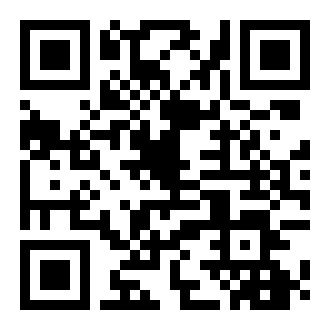
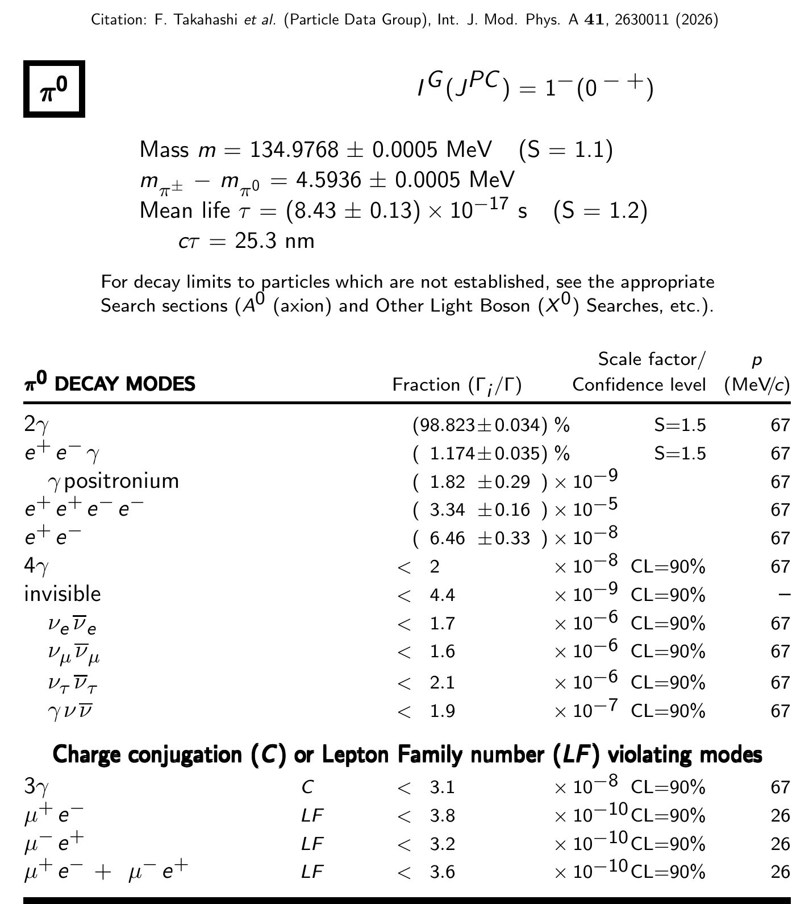
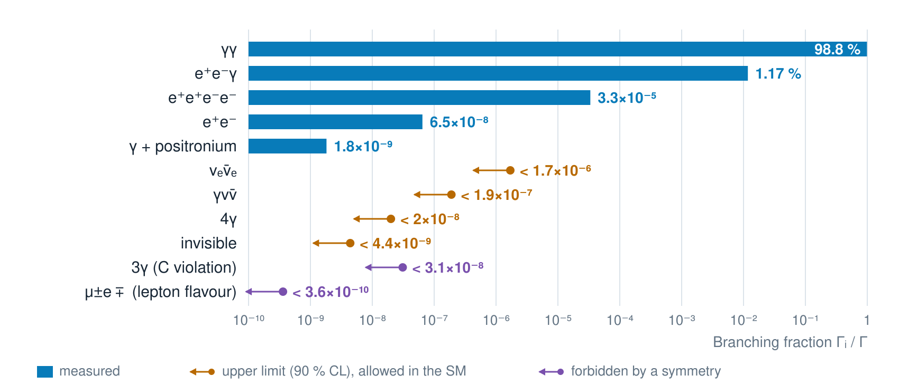
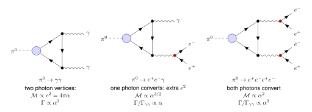
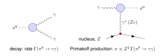
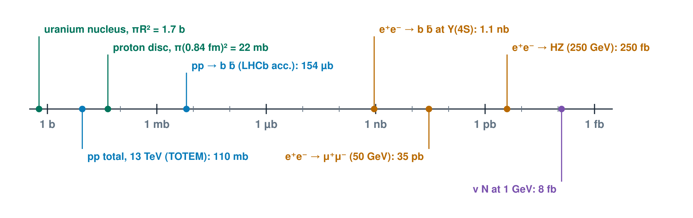
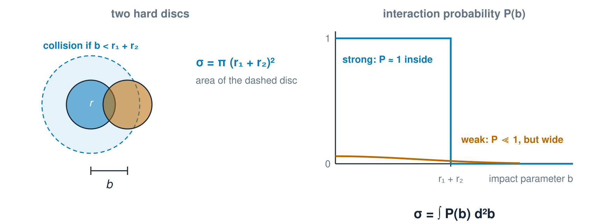
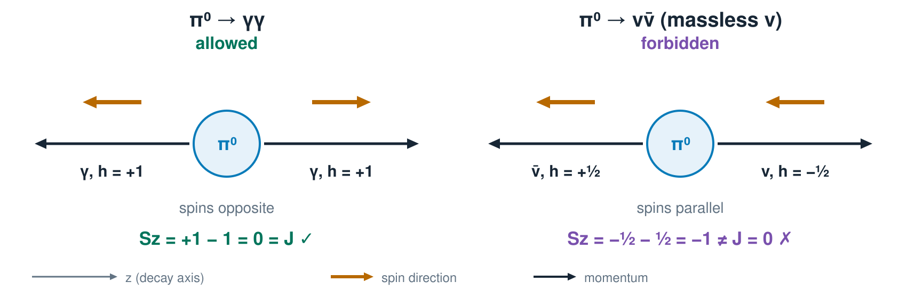
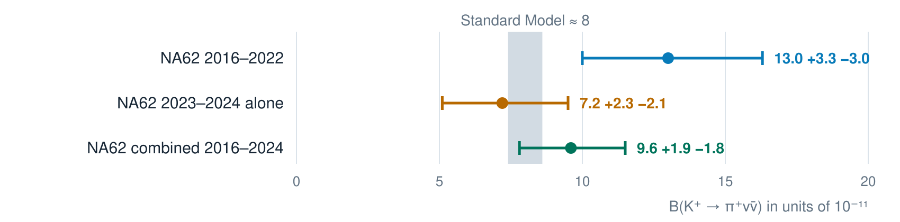
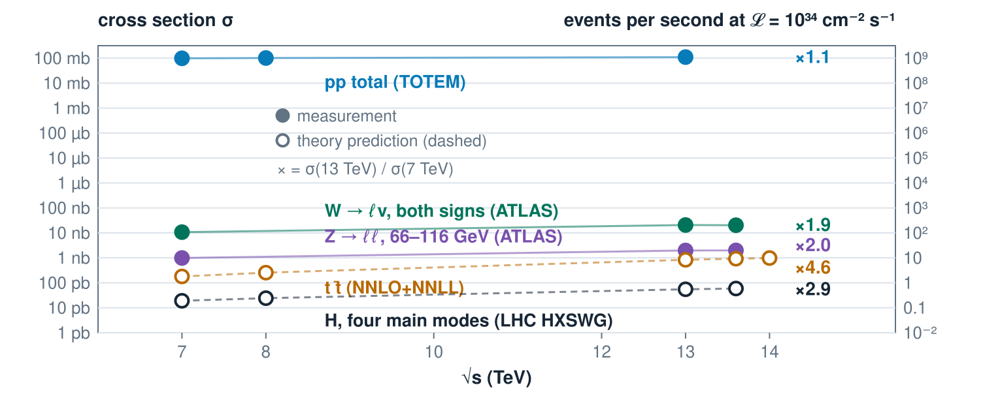

## Lecture 4 {.title-card}

::: {.subtitle}
Decay Rates and Cross Sections
:::

From rates to counted events: how often does it happen, and how do we measure it?

## Recap: kinematics

:::: {.slide-body}

- **Four-vectors:** $p=(E,\mathbf p)$, $p^2=E^2-\mathbf p^2=m^2$. Scalar products are Lorentz invariant, and sums of four-vectors are four-vectors.

- **Natural units:** $\hbar=c=1$. Then $1\ \mathrm{GeV}^{-1}$ stands for $0.197\ \mathrm{fm}$ as a length and for $6.6\times10^{-25}\ \mathrm s$ as a time.

- **Mandelstam variables** of $a+b\to c+d$:\ $s=(p_a+p_b)^2$ is the squared CM energy, $t=(p_a-p_c)^2=-Q^2$ the squared momentum transfer, and $s+t+u=\sum_i m_i^2$.
::::

## Recap: waves, states and widths

:::: {.slide-body}

- **Probes:** $\lambda=2\pi\hbar/|\mathbf p|$, and the resolution is $R\sim\hbar/Q$ with $t=-Q^2$: a small deflection resolves only large structures.

- **States:** stationary states have a trivial time dependence, superpositions of energy eigenstates oscillate with $\Delta E/\hbar$. \
   Conserved quantities belong to commuting operators ($J$, $J_z$, $C$, …).

- **Unstable states:** $\Gamma=\hbar/\tau$, $N(t)=N_0e^{-\Gamma t}$, Breit–Wigner with $\mathrm{FWHM}=\Gamma$. \
  Angular distributions carry the angular momentum of the decaying state.
::::

## Recap: from amplitude to rate

:::: {.slide-body}
$$\Gamma_{fi}=2\pi\,\lvert T_{fi}\rvert^2\,\rho(E_i)\qquad\text{rate}\ \sim\ |\text{amplitude}|^2\times\text{available final states}$$

- $T_{fi}=\langle f|\hat H'|i\rangle$ is the **strength of the interaction**. At higher order it becomes a sum over intermediate states: Feynman diagrams, with propagators $1/(q^2-m^2)$.

- $\rho(E_i)$ counts the **final states** at the energy $E_i\leadsto$ kinematics, phase space.

::::

## Join the quiz

```{=html}
<div style="display:flex;align-items:center;justify-content:center;gap:100px;height:700px">
<a href="https://www.menti.com/?code=79487325" target="_blank" rel="noopener"></a>
<div style="text-align:center"><p style="font-size:48px;margin:0 0 28px">Scan to join</p><p style="font-size:36px;margin:0 0 18px">or go to <strong>menti.com</strong></p><p style="font-size:76px;font-weight:600;letter-spacing:.06em;margin:0">7948 7325</p></div>
</div>
```

## Question 1 — Oscillation period

:::: {.slide-body}
Two states differ in energy by $\Delta E=3.3\times10^{-4}\ \mathrm{eV}$ ($\hbar=6.58\times10^{-16}\ \mathrm{eV\,s}$). \ A superposition of the two oscillates.

What is the oscillation period?

**A.** $0.3\ \mathrm{ps}$

**B.** $2\ \mathrm{ps}$

**C.** $12\ \mathrm{ps}$

**D.** $80\ \mathrm{ps}$
::::

## Question 2 — Angular distribution

:::: {.slide-body}
A spin-0 particle decays into two spin-0 particles.

What is the angular distribution of the daughters in the parent rest frame?

**A.** Isotropic

**B.** $\propto\cos^2\theta$

**C.** $\propto\sin^2\theta$

**D.** $\propto1+\cos\theta$
::::

## Question 3 — Elastic scattering

:::: {.slide-body}
Elastic scattering $ab\to ab$ in the CM frame, through the angle $\theta$. Which statement is correct?

**A.** Elastic: new particles may be produced. Mandelstam $|t|$ grows as $\theta\to0$.

**B.** Elastic: same particles in and out. $\theta\to0$ gives maximal $|t|$, so the finest structure is resolved.

**C.** Elastic: same particles in and out. $t$ depends only on $\sqrt s$, not on $\theta$.

**D.** Elastic: same particles in and out, $|\mathbf p^*|$ unchanged. $\theta\to0$ gives $|t|\to0$, so only coarse structure is resolved.
::::

## Question 4 — A fast $\pi^0$

:::: {.slide-body}
A $\pi^0$ ($m=135\ \mathrm{MeV}$, $\tau=8.4\times10^{-17}\ \mathrm s$) has a momentum of $1\ \mathrm{GeV}/c$.

How far does it fly on average before it decays? ($c=3\times10^8\ \mathrm{m/s}$)

**A.** $3.4\ \mathrm{nm}$

**B.** $25\ \mathrm{nm}$

**C.** $190\ \mathrm{nm}$

**D.** $19\ \mathrm{\mu m}$
::::

## Question 5 — Zero rate

:::: {.slide-body}
How can a kinematically allowed decay have zero rate? (E.g. $\pi^0\to\gamma\gamma\gamma$)

**A.** It cannot: if the phase space $\rho$ is non-zero, the rate is non-zero.

**B.** A conservation law (charge conjugation $C$ in the example) makes the matrix element $T_{fi}$ vanish.

**C.** Photons can never be produced in groups of three.

**D.** Energy is not conserved in this decay (3 massless photons in the example).
::::

## Question 6 — The golden rule

:::: {.slide-body}
Fermi’s golden rule: $\Gamma=2\pi\,|T_{fi}|^2\rho(E_i)$. Which statement is correct?

**A.** $T_{fi}$ counts the available final states; $\rho$ is the strength of the interaction.

**B.** $T_{fi}$ is the strength of the interaction between initial and final state; $\rho$ counts the final states available at the energy $E_i$.

**C.** Both factors are kinematics; the interaction only fixes the energy $E_i$.

**D.** $\rho$ depends on the interaction; $T_{fi}$ depends only on the masses of the particles.
::::

## Phase space and normalization {.section-title}

::: {.subtitle}
Sec. 3.2 · Counting final states
:::

## Counting final states

:::: {.slide-body}
**Why count final states?** \
The golden rule $\Gamma=2\pi\,|T_{fi}|^2\rho(E_i)$ (Lecture 3) needs $\rho(E_i)=dn/dE$,\
 the number of final states per unit energy. Now done relativistically.

In a box of volume $V$ the momentum states form a lattice, $\mathbf p=2\pi\mathbf n/L$. \
The number of states in $d^3p$ is $$dn=\frac{V\,d^3p}{(2\pi)^3}\qquad\Rightarrow\qquad\rho(E)=\frac{dn}{dE}=\frac{V\,p\,E}{(2\pi)^3}\,d\Omega,\qquad(\hbar=c=1)$$
using $p\,dp=E\,dE$.

More final states at larger $p$, and more for a heavier particle at the same $p$.

The box volume $V$ must drop out of every observable rate: it cancels against the normalization of the wave functions.
::::

## Why count states in a box?

:::: {.slide-body}
- **A plane wave cannot be normalized:** $\int|\psi|^2dV=\infty$. A rate needs the probability to end up in a *normalized* final state.

- **Box of side $L$ with periodic boundary conditions:** momenta become discrete, $\mathbf p=2\pi\mathbf n/L$, and every state holds exactly one particle in $V=L^3$. The sum over final states is well defined.

- **The continuum comes back:** the time integral selects states within $\Delta E\sim1/T$ of $E_i$. For large $L$ the level spacing is much smaller than $1/T$, so $\sum_f\to\int dE\,\rho(E)$.

- **Order of limits:** $L\to\infty$ first (the particles do not reach the walls within $T$), then $T\to\infty$. $V$ cancels in every observable.

::::

## Counting states in a box {.widget-slide}

:::: {.slide-body}
::: {.widget data-src="widgets/phase-space.html" data-poster="widgets/phase-space-poster.png" data-alt="Lattice of momentum states in a box with a shell highlighted and the count per momentum bin"}
:::
::::

## Normalization: $2E$ particles per unit volume

:::: {.slide-body}
$$\psi=N\,e^{i(\mathbf p\cdot\mathbf x-Et)},\qquad\int\psi^*\psi\,dV=2E$$
**Why $2E$?** Under a boost the volume contracts, $V\to V/\gamma$, while the energy grows, $E\to\gamma E$. A density of $2E$ particles per unit volume is Lorentz covariant, so the same normalization can be used in every frame.

$\mathcal M_{fi}$ is the matrix element computed with these wave functions: it is **Lorentz invariant**.

::: {.footnote}
We use the result and do not derive it: the derivation is in Thomson Sec. 3.2. The factors of $2E$ are the price of a covariant normalization.
:::
::::

## Invariant phase space and the decay rate

:::: {.slide-body}
For a particle of mass $M$ with four-momentum $p=(E,\mathbf p)$ decaying into particles $i$ with $p_i$:
$$\Gamma=\frac1{2E}\int\overline{|\mathcal M|^2}\,d\Phi,\qquad d\Phi=(2\pi)^4\,\delta^{(4)}\!\Big(p-\sum_ip_i\Big)\prod_i\frac{d^3p_i}{(2\pi)^3\,2E_i}$$
The integral $I=\int\overline{|\mathcal M|^2}\,d\Phi$ is **Lorentz invariant**: $|\mathcal M|^2$ is built from scalar products,\
$\delta^{(4)}$ and $d^3p/2E$ are invariant. Only $1/2E$ depends on the frame.

- **Rest frame of the parent (its CM frame):** $E=M$, and the rate is \
$\Gamma_0=\dfrac{I}{2M}$, with lifetime $\tau_0=1/\Gamma_0$.

- **Frame where the parent moves:** $E=\gamma M$, so $\Gamma=\dfrac{I}{2\gamma M}=\dfrac{\Gamma_0}{\gamma}$ and the lifetime is $\gamma\tau_0$.

**Time dilation** comes out of the formula automatically (Lectures 2 and 3).
::::

## Particle decays {.section-title}

::: {.subtitle}
Sec. 3.3 · Decay rates, lifetimes and branching fractions
:::

## Two-body decay

:::: {.slide-body}
For $a\to1+2$ in the rest frame of $a$ (Thomson Problem 3.2):
$$p^*=\frac1{2M}\sqrt{\big(M^2-(m_1+m_2)^2\big)\big(M^2-(m_1-m_2)^2\big)}$$
$$\Gamma=\frac{p^*}{32\pi^2M^2}\int\overline{|\mathcal M|^2}\,d\Omega\ \xrightarrow{\ \text{isotropic}\ }\ \boxed{\Gamma=\frac{p^*}{8\pi M^2}\,\overline{|\mathcal M|^2}}$$
Kinematics supplies $p^*$; the interaction supplies $\mathcal M$. \
As $M\to m_1+m_2$, $p^*\to0$: phase space closes.

**Example $\pi^-\to\mu^-\bar\nu_\mu$ (Problem 3.1):** $p^*=\dfrac{m_\pi^2-m_\mu^2}{2m_\pi}=29.8\ \mathrm{MeV}/c$ and $E_\mu=109.8\ \mathrm{MeV}$.

::: {.footnote}
Problem 3.1 in the book prints $m_\pi=140\ \mathrm{GeV}$; this is a misprint for $140\ \mathrm{MeV}$.
:::
::::

## Check: a decay width

:::: {.slide-body}
Use $M=5\ \mathrm{GeV}$, $m_1=3\ \mathrm{GeV}$, $m_2=0$, so $p^*=1.6\ \mathrm{GeV}$.

For this toy model, take $\overline{|\mathcal M|^2}=1\ \mathrm{GeV}^2$, independent of angle.

Compute $\Gamma$ and the mean lifetime using
$$\hbar=6.582\times10^{-25}\ \mathrm{GeV\,s}.$$

::: {.footnote}
Result: $\Gamma\approx2.5\ \mathrm{MeV}$ and $\tau\approx2.6\times10^{-22}\ \mathrm s$. The amplitude is an invented toy number, not a measured width.
:::
::::

## Two-body decay explorer {.widget-slide}

:::: {.slide-body}
::: {.widget data-src="widgets/two-body-decay.html" data-poster="widgets/two-body-decay-poster.png" data-alt="Daughter momentum over parent mass versus parent mass, and lab energy ranges of the two daughters"}
:::
::::

## Three-body decays

:::: {.slide-body}
Three particles in the final state leave **two** independent variables\
($3N-10$ with $N=4$, Lecture 3). Use squared invariant masses:
$$m_{12}^2=(p_1+p_2)^2,\qquad m_{23}^2=(p_2+p_3)^2,\qquad m_{13}^2=(p_1+p_3)^2$$
$$m_{12}^2+m_{23}^2+m_{13}^2=M^2+m_1^2+m_2^2+m_3^2$$
Three-body phase space is **flat** in these variables:
$$d\Gamma=\frac1{(2\pi)^3}\,\frac1{32M^3}\,\overline{|\mathcal M|^2}\,dm_{12}^2\,dm_{23}^2$$
A **Dalitz plot** shows the events in the $(m_{12}^2,m_{23}^2)$ plane. Constant $|\mathcal M|^2$ fills the allowed region uniformly: all structure is dynamics.

::: {.footnote}
Phase space is always flat, but $\overline{|\mathcal M|^2}$ is constant only for spin-0 particles.  \
With spin, the spin sum gives kinematic factors, e.g. for $0\to\tfrac{1}{2}\,\tfrac{1}{2}\,0$ with a scalar coupling $\overline{|\mathcal M|^2}\propto m_{12}^2-(m_1+m_2)^2$. \
Baryon decays are not flat even without resonances.

Thomson does not treat Dalitz plots
:::
::::

## Kinematic limits of the Dalitz plot

:::: {.slide-body}
Fix $m_{12}$ and go to the rest frame of the pair $(1,2)$:
$$E_2^*=\frac{m_{12}^2-m_1^2+m_2^2}{2m_{12}},\qquad E_3^*=\frac{M^2-m_{12}^2-m_3^2}{2m_{12}}$$
$$\big(m_{23}^2\big)_{\max,\min}=(E_2^*+E_3^*)^2-\Big(\sqrt{E_2^{*2}-m_2^2}\ \mp\ \sqrt{E_3^{*2}-m_3^2}\Big)^2$$
$$(m_1+m_2)^2\le m_{12}^2\le(M-m_3)^2$$

- The **edge** of the plot is the set of configurations with all three momenta **collinear** in the parent frame; the interior has the momenta in a plane at an angle.

- $m_{12}^2$ is largest when particle 3 is at rest, and smallest when 1 and 2 have no relative momentum.

- The area is the phase space: it shrinks to a point at threshold, $M\to m_1+m_2+m_3$.
::::

## Dalitz plot explorer {.widget-slide}

:::: {.slide-body}
::: {.widget data-src="widgets/dalitz.html" data-poster="widgets/dalitz-poster.png" data-alt="Dalitz plot with kinematic boundary, flat phase space and resonance bands"}
:::
::::

## Rates, lifetimes and branching fractions

:::: {.slide-body}
$$\Gamma=\sum_f\Gamma_f,\qquad\tau=\frac\hbar\Gamma,\qquad B_f=\frac{\Gamma_f}{\Gamma},\qquad N(t)=N_0\,e^{-\Gamma t}$$
Every open decay channel adds to $\Gamma$. A partial width is a branching fraction times the total: $\Gamma_f=B_f\,\hbar/\tau$.

**Check (Thomson Problem 3.3):** $K^+\to\pi^+\pi^0$ has $\Gamma_f=1.2\times10^{-8}\ \mathrm{eV}$ and the kaon has $\tau=1.2\times10^{-8}\ \mathrm s$. What is $B(K^+\to\pi^+\pi^0)$?

::: {.footnote}
Result: $\Gamma=\hbar/\tau=5.5\times10^{-8}\ \mathrm{eV}$, so $B=0.22$ (PDG: 20.7%).
:::
::::

## Where to look it up: the PDG

:::::: {.slide-body}
::::: {.side-by-side .wide-text}
:::: {.txt}
The *Review of Particle Physics* lists particles like this:

- quantum numbers

- mass

- lifetime or width

- other properties (if applicable)

- every decay mode with its fraction or limit.

It also defines standards, provides reviews and compiles other relevant information for particle physics.

::: {.footnote}
Particle Data Group, Review of Particle Physics 2026 <https://pdg.lbl.gov/> ,\
$\pi^0$ summary table.
:::
::::
{fig-alt="Summary table of the neutral pion from the Review of Particle Physics"}
:::::
::::::

## A complete PDG listing: the neutral pion

:::: {.slide-body}
$\pi^0$: $I^G(J^{PC})=1^-(0^{-+})$, $m=134.977\ \mathrm{MeV}$, $\tau=(8.43\pm0.13)\times10^{-17}\ \mathrm s$.

::: {.ref-table}
| Mode | $\Gamma_i/\Gamma$ | What sets the size | Thomson |
|---|---|---|---|
| $\gamma\gamma$ | $(98.823\pm0.034)\,\%$ | two photon vertices: $\propto\alpha^2$ | Sec. 5.3–5.4 |
| $e^+e^-\gamma$ | $(1.174\pm0.035)\,\%$ | one photon converts: extra $\alpha$ | Sec. 5.3–5.4 |
| $\gamma$ + positronium | $(1.82\pm0.29)\times10^{-9}$ | bound $e^+e^-$ in the final state | not covered |
| $e^+e^+e^-e^-$ | $(3.34\pm0.16)\times10^{-5}$ | both photons convert: extra $\alpha^2$ | Sec. 5.3–5.4 |
| $e^+e^-$ | $(6.46\pm0.33)\times10^{-8}$ | helicity suppression $(m_e/m_\pi)^2$ | Sec. 11.6 |
| $4\gamma$ | $<2\times10^{-8}$ | more photon vertices | not covered |
| invisible | $<4.4\times10^{-9}$ | no Standard Model source (includes $\nu\bar\nu$) | not covered |
| $\nu\bar\nu$ ($e,\mu,\tau$) | $<1.7,\ 1.6,\ 2.1\times10^{-6}$ | forbidden for massless $\nu$: helicity | Sec. 11.4, 11.6 |
| $\gamma\nu\bar\nu$ | $<1.9\times10^{-7}$ | Standard Model: $6\times10^{-18}$ (PDG) | not covered |
| $3\gamma$ | $<3.1\times10^{-8}$ | **forbidden**: $C(\pi^0)=+1$, $C(3\gamma)=-1$ | Sec. 4.7.5, Chap. 14 |
| $\mu^\pm e^\mp$ | $<3.6\times10^{-10}$ | **forbidden**: lepton flavour conservation | Chap. 13 |
:::

::: {.footnote}
PDG Review of Particle Physics, $\pi^0$ listing, rows reordered by type (limits at 90% CL). The last two columns are ours; the book does not compute these decays.
:::
::::

## The same table as a picture {.plot-slide}

:::: {.slide-body}
{.physics-plot fig-alt="Branching fractions and upper limits of the neutral pion on a logarithmic axis"}

Nine orders of magnitude! An upper limit is a measurement of zero: it says how far the experiments could reach.
::::

## Reading the table

:::: {.slide-body}
$$\Gamma_i=B_i\,\frac\hbar\tau:\qquad\Gamma=\frac{6.58\times10^{-16}\ \mathrm{eV\,s}}{8.43\times10^{-17}\ \mathrm s}=7.8\ \mathrm{eV},\quad\Gamma_{\gamma\gamma}=7.7\ \mathrm{eV},\quad\Gamma_{e^+e^-\gamma}=0.09\ \mathrm{eV}$$

- **Kinematics** is the same for almost all modes ($p^*=67\ \mathrm{MeV}/c$): it does not explain the pattern.
- **The amplitude** does: powers of $\alpha$ (next slide) and a helicity factor $(m_e/m_\pi)^2$.
- **Selection rules** switch an amplitude off completely, and they are of three different kinds: angular momentum (helicity) for $\nu\bar\nu$, the symmetry $C$ for $3\gamma$, lepton flavour for $\mu e$. Thomson covers them in Sec. 11.6, Sec. 4.7.5 with Chap. 14, and Chap. 13; the explanations are in the backup.

Each row is a question: is the Standard Model right at this level?
::::

## Counting powers of $\alpha$ {.plot-slide}

:::: {.slide-body}
{.physics-plot fig-alt="Feynman diagrams of pi0 to two photons, to e+ e- gamma and to two e+ e- pairs with the powers of alpha" style="height:560px"}

Each photon vertex costs $e=\sqrt{4\pi\alpha}$. The blob (a quark loop) is common to all diagrams and cancels in ratios.
::::

## Counting powers of $\alpha$: a check

:::: {.slide-body}
$$\frac{\Gamma(e^+e^-\gamma)}{\Gamma(\gamma\gamma)}=\frac{2\alpha}{3\pi}\left(2\ln\frac{m_\pi}{m_e}-\frac72\right)=1.19\%\qquad\text{PDG: }\frac{1.174}{98.823}=1.19\%$$

- **One extra factor $\alpha$**: a photon turns into an $e^+e^-$ pair. The natural size of the ratio is $\alpha/\pi=0.23\%$.

- **The logarithm** is the integral $\int dm_{ee}^2/m_{ee}^2$ over the Dalitz variable from $4m_e^2$ to $m_\pi^2$: a nearly real photon converts most easily. It lifts $\alpha/\pi=0.23\%$ to $1.19\%$.

- **Two conversions** cost $\alpha^2$ (with logarithms): $\Gamma(e^+e^+e^-e^-)/\Gamma(\gamma\gamma)=3.4\times10^{-5}$.

::: {.footnote}
Leading order in $\alpha$ with a pointlike $\pi^0\gamma\gamma$ vertex (Kroll and Wada); form-factor and radiative corrections are small. The $4\gamma$ mode needs more than naive counting and is not shown.
:::
::::

## Research with the $\pi^0$: an eV-wide width {.plot-slide}

:::: {.slide-body}
{.physics-plot fig-alt="Feynman-like diagrams of the decay of the neutral pion to two photons and of its Primakoff production in the Coulomb field of a nucleus" style="height:290px"}

The flight distance is tens of nanometres (Question 4), so the width is measured differently. **PrimEx-II (JLab, Science 2020)** produces $\pi^0$ from a photon in the Coulomb field of a nucleus, the **Primakoff effect**: the same blob as in the decay, with one photon crossed into the initial state, so $\sigma\propto Z^2\,\Gamma(\pi^0\to\gamma\gamma)$.

$$\Gamma(\pi^0\to\gamma\gamma)=7.80\pm0.05\pm0.11\ \mathrm{eV}\ (1.5\%)\qquad\text{LO prediction:}\ \Gamma=\frac{\alpha^2m_\pi^3}{64\pi^3f_\pi^2}\approx7.7\text{–}7.8\ \mathrm{eV}$$
The $\alpha^2$ is the one just counted. The coefficient comes from the quark loop (the “chiral anomaly”, to look up in a QCD course).

::: {.footnote}
PrimEx Collaboration, Science 368 (2020) 506; the PDG average of the lifetime includes this result (PDG notes LARIN 20). $f_\pi\approx92\ \mathrm{MeV}$.
:::
::::

## Interaction cross sections {.section-title}

::: {.subtitle}
Sec. 3.4 · Flux, cross sections and luminosity
:::

## Scattering and cross section

:::: {.slide-body}
**From the Primakoff effect:** one amplitude, seen in decay *or* production. In production we choose beam and target.\
**Goal:** characterize the scattering process, from beam flux to an event count.

| | Decay | Scattering |
|---|---|---|
| Rate | $\Gamma$ | $\Phi\,\sigma$, with the **cross section** $\sigma$ (area) |
| Experiment | number of parents $N$ | **flux** $\Phi=n_av_a$ (per area and time) |
| Event rate | $N\,\Gamma$ | $N_b\,\Phi\,\sigma=\mathcal L\,\sigma$ |

: {tbl-colwidths="[24,32,54]"}

$\Phi\sigma$ is a rate like $\Gamma$: a probability per time for one target particle. $\sigma$ is that rate with the flux divided out. Same $\overline{|\mathcal M|^2}$ and phase space, different initial-state normalization.

**Luminosity** $\mathcal L=N_b\Phi$ for $N_b$ targets ($\int\!\mathcal L\,dt$ in $\mathrm{fb}^{-1}$).\
Areas come in **barns**: $1\ \mathrm b=10^{-28}\ \mathrm m^2$, the size of a heavy nucleus.
::::

## What is a barn?

:::: {.slide-body}
$$1\ \mathrm b=10^{-28}\ \mathrm m^2=100\ \mathrm{fm}^2=(10\ \mathrm{fm})^2\qquad1\ \mathrm{GeV}^{-2}=(\hbar c)^2=0.3894\ \mathrm{mb}$$

- **Proton:** $\pi r_p^2=\pi(0.84\ \mathrm{fm})^2=2.2\ \mathrm{fm}^2=22\ \mathrm{mb}$.
- **Two protons collide** if their centres pass within $2r_p$: $\pi(2r_p)^2=88\ \mathrm{mb}$. Measured at $13\ \mathrm{TeV}$: $\sigma_{\mathrm{inel}}=79.5\pm1.8\ \mathrm{mb}$ and $\sigma_{\mathrm{tot}}=110.6\pm3.4\ \mathrm{mb}$ (TOTEM).
- **Heavy nucleus:** $\pi R^2$ with $R=1.2\,A^{1/3}\ \mathrm{fm}$: uranium has $R=7.4\ \mathrm{fm}$ and $\pi R^2=1.7\ \mathrm b$. A barn is the size of a heavy nucleus: “as big as a barn door”.

| mb | µb | nb | pb | fb |
|---|---|---|---|---|
| $10^{-31}\ \mathrm m^2$ | $10^{-34}\ \mathrm m^2$ | $10^{-37}\ \mathrm m^2$ | $10^{-40}\ \mathrm m^2$ | $10^{-43}\ \mathrm m^2$ |

::: {.footnote}
The cross section of the proton is the area of a disc of the proton’s size: fm$^2$ and mb are the natural units of the strong interaction. The $88\ \mathrm{mb}$ disc is closest to $\sigma_{\mathrm{inel}}$. $\sigma_{\mathrm{tot}}=\sigma_{\mathrm{inel}}+\sigma_{\mathrm{el}}$ is larger because (i) the elastic part is the diffractive shadow of the absorption (a black disc has $\sigma_{\mathrm{el}}=\sigma_{\mathrm{inel}}$, so $\sigma_{\mathrm{tot}}=2\pi R^2$), (ii) the strong force has no sharp edge (range $\sim\hbar/m_\pi c\approx1.4\ \mathrm{fm}$, not the charge radius $r_p$), and (iii) $\sigma_{\mathrm{tot}}$ grows with energy (about $\ln^2 s$) as the gluon density rises.
:::
::::

## Two length scales: size and wavelength

:::: {.slide-body}
**Large objects:** $\sigma\sim\pi R^2$, the size sets the area ($\sim10$–$100\ \mathrm{mb}$ for hadrons).

**Point-like objects:** no size, so the only length is the wavelength $\hbar/p$ of Lecture 3:
$$\sigma(e^+e^-\to\mu^+\mu^-)=\frac{4\pi\alpha^2}{3s}=\frac{86.8\ \mathrm{nb}}{(\sqrt s/\mathrm{GeV})^2}\qquad\text{(Problem 3.5)}$$
At $\sqrt s=50\ \mathrm{GeV}$: $35\ \mathrm{pb}$, about $10^{-9}$ of $\sigma_{\mathrm{tot}}(pp)\approx40\ \mathrm{mb}$.

The cross section falls as $1/s\sim\lambda^2$: a more energetic probe has a **shorter wavelength** and a smaller target area.

The coupling enters squared, $\alpha^2$: the strength of the interaction, not the size, makes the area small.
::::

## From barns to femtobarns {.plot-slide}

:::: {.slide-body}
{.physics-plot fig-alt="Cross sections on a logarithmic axis from barns to femtobarns" style="height:500px"}

Geometry sets the large cross sections. Point-like interactions are much smaller, and the weak interaction smaller still.
::::

## Is a cross section a wave-function overlap? {.plot-slide}

:::: {.slide-body}
{.physics-plot fig-alt="Two discs at impact parameter b and the interaction probability as a function of b for a strong and a weak interaction"}

**Yes, with one precise statement:** the cross section is the interaction probability integrated over the impact parameter.
::::

## Overlap in the quantum picture

:::: {.slide-body}
$$\sigma=\int P(b)\,d^2b$$

- **Strong, large objects:** $P\approx1$ wherever the two overlap, so $\sigma=\pi(r_1+r_2)^2$.

- **Weak interaction:** $P\ll1$ everywhere, but the integral over many $b$ still gives a finite area.

- **Quantum picture:** $P$ contains $|\langle f|\hat H'|i\rangle|^2$, an overlap integral of the initial and final states (golden rule, Lecture 3). A beam is a plane wave: it samples **all** impact parameters at once, and $\sigma$ is the effective area.

- **Luminosity** is the same idea for the beams: the overlap integral of the two particle densities.
::::


## Flux factor and the invariant cross section

:::: {.slide-body}
$$\sigma=\frac1F\int\overline{|\mathcal M_{fi}|^2}\,d\Phi,\qquad F=4\sqrt{(p_a\!\cdot\!p_b)^2-m_a^2m_b^2}$$

| Frame | Flux factor $F$ |
|---|---|
| CM frame | $4\,p_i^*\sqrt s$ |
| $b$ at rest (fixed target) | $4\,m_b\,|\mathbf p_a|$ |
| non-relativistic limit | $4\,m_am_b\,|\mathbf v_a-\mathbf v_b|$ |

Compare the decay, $\Gamma=\dfrac1{2E_a}\int\overline{|\mathcal M|^2}\,d\Phi$: $1/F$ plays the role of $1/2E_a$.

$F$, $\mathcal M$ and $d\Phi$ are invariant, so **$\sigma$ is the same in every frame reached by a boost along the beam**: an area transverse to the boost does not contract (Lecture 2).
::::

## Luminosity: counting collisions

:::: {.slide-body}
Thomson does not discuss it explicitly, but every measurement needs it:
$$N=\sigma\int\mathcal L\,dt=\sigma\,L_{\mathrm{int}},\qquad\mathcal L=f\,n_b\,\frac{N_1N_2}{4\pi\sigma_x\sigma_y}$$
$\mathcal L$ in $\mathrm{cm^{-2}s^{-1}}$ is the **overlap of the two beams**: bunch frequency, number of bunches, particles per bunch and the transverse size.

$1\ \mathrm{fb}^{-1}=10^{39}\ \mathrm{cm}^{-2}$, hence $N=\sigma[\mathrm{fb}]\times L_{\mathrm{int}}[\mathrm{fb}^{-1}]$.\
 At $\mathcal L=2\times10^{34}\ \mathrm{cm^{-2}s^{-1}}$ one gets about $200\ \mathrm{fb^{-1}}$ per $10^7\ \mathrm s$.

**Example (Problem 3.4):** a Higgs factory with $\sigma(e^+e^-\to HZ)=250\ \mathrm{fb}$, $\mathcal L=2\times10^{34}\ \mathrm{cm^{-2}s^{-1}}$ and five years at 50% uptime ($7.9\times10^7\ \mathrm s$) gives $1580\ \mathrm{fb^{-1}}$ and $N\approx4\times10^5$ Higgs bosons.
::::

## Luminosity and event rates {.widget-slide}

:::: {.slide-body}
::: {.widget data-src="widgets/luminosity.html" data-poster="widgets/luminosity-poster.png" data-alt="Overlap of two Gaussian beams and event rates of several pp processes for the chosen luminosity"}
:::
::::

## Integrated Luminosity is not universal

:::: {.slide-body}
::: {.ref-table}
| | Belle II ($e^+e^-$ at $\Upsilon(4S)$) | LHCb ($pp$ at $13\ \mathrm{TeV}$) |
|---|---|---|
| $b$ production | $\sigma(e^+e^-\to b\bar b)\approx1.1\ \mathrm{nb}$ | $154\ \mathrm{\mu b}$ in the acceptance ($2<\eta<5$) |
| $b$ hadrons per fb$^{-1}$ | $\approx10^6$ $B\bar B$ pairs | $\approx10^{11}$ |
| share of all hadronic events | about a quarter | below 1% |
| species | $B^0$, $B^+$ only | $B^0$, $B^+$, $B_s$, $B_c$, $\Lambda_b$, … |
| initial state | fixed $\sqrt s$, known four-momentum, neutrals and missing energy usable | unknown parton momenta, forward acceptance, pile-up |
| recording | almost every $B\bar B$ event | selective trigger: most collisions are discarded |
| energy | fixed | $\sigma(b\bar b)$ grows by $2.1$ from $7$ to $13\ \mathrm{TeV}$ |
:::

$\mathcal L_{\mathrm{int}}$ counts collisions at one energy. Physics reach also depends on $\sigma$, efficiency, background and which particle you need.

::: {.footnote}
Belle II recorded $428\ \mathrm{fb^{-1}}$ in 2019–2022, about $5\times10^8$ $B\bar B$ pairs; LHCb expects about $23\ \mathrm{fb^{-1}}$ by the end of Run 3 (projection). Sources: Belle II TDR and luminosity paper (arXiv:2407.00965); LHCb, PRL 118 (2017) 052002.
:::
::::


## Counting a rare decay: $H\to Z\gamma$

:::: {.slide-body}
$$N=L_{\mathrm{int}}\ \sigma\ B\ \varepsilon$$
**ATLAS + CMS, Run 2 (2023):** $140\ \mathrm{fb^{-1}}$ each at $13\ \mathrm{TeV}$. $\sigma(pp\to H)\approx55\ \mathrm{pb}$ gives $7.7\times10^6$ Higgs bosons per experiment.

$B_{\mathrm{SM}}(H\to Z\gamma)=1.5\times10^{-3}$ and $B(Z\to e^+e^-,\mu^+\mu^-)=6.7\%$ leave about $800$ clean events per experiment before efficiency, on a large background.

Result: **evidence at $3.4\sigma$**, signal strength $2.2\pm0.7$ times the Standard Model. The measurement needs both experiments, and more luminosity is on the way.

::: {.footnote}
ATLAS and CMS, Phys. Rev. Lett. 132 (2024) 021803, arXiv:2309.03501. The cross section and the estimate of the event count are ours.
:::
::::

## Differential cross sections {.section-title}

::: {.subtitle}
Sec. 3.5 · and what scattering teaches about structure
:::

## Differential cross section

:::: {.slide-body}
For distinguishable final particles, in the CM frame, with $\hbar=c=1$:
$$\frac{d\sigma}{d\Omega}=\frac{1}{64\pi^2s}\frac{p_f^*}{p_i^*}\overline{|\mathcal M|^2},\qquad\sigma=\int\frac{d\sigma}{d\Omega}\,d\Omega$$
The bar denotes a sum over final spins and an average over unpolarized initial spins. Elastic scattering has $p_f^*=p_i^*$.

With $dt=2p_i^*p_f^*\,d\cos\theta^*$ (Lecture 3):
$$\frac{d\sigma}{dt}=\frac{\overline{|\mathcal M|^2}}{64\pi\,s\,p_i^{*2}}$$
**The angular dependence comes from $\mathcal M$.** A flat $d\sigma/d\Omega$ means no preferred direction; structure in the interaction shows up as structure in the angle.
::::

## Rutherford: the first structure measurement

:::: {.slide-body}
Geiger and Marsden (1909): $\alpha$ particles of $7.7\ \mathrm{MeV}$ on a gold foil. Most go straight; about one in $8000$ is deflected by more than $90^\circ$.

Rutherford (1911): a small, heavy, charged nucleus. Non-relativistic scattering off a heavy target:
$$\frac{d\sigma}{d\Omega}=\left(\frac{zZ\,\alpha\hbar c}{4E_{\mathrm{kin}}}\right)^2\frac1{\sin^4(\theta/2)}=\frac{4\,(zZ\alpha)^2m^2}{Q^4}$$
The $1/Q^4$ is the squared photon propagator, $|\mathcal M|^2\propto1/t^2$ (Chapter 5). Thomson Sec. 7.2 treats Rutherford and Mott scattering.

Closest approach, head-on: $d=\dfrac{2\cdot79\,\alpha\hbar c}{E}=\dfrac{158\times1.44\ \mathrm{MeV\,fm}}{7.7\ \mathrm{MeV}}\approx30\ \mathrm{fm}$, far outside the gold nucleus ($R\approx7\ \mathrm{fm}$). Rutherford sees only the Coulomb field: the resolution is limited by the **beam energy**.
::::

## Extended objects: form factors

:::: {.slide-body}
If the target has a charge distribution $\rho(\mathbf r)$, the cross section is multiplied by a form factor:
$$\frac{d\sigma}{d\Omega}=\left(\frac{d\sigma}{d\Omega}\right)_{\mathrm{point}}\lvert F(Q^2)\rvert^2,\qquad F(\mathbf q)=\int\rho(\mathbf r)\,e^{i\mathbf q\cdot\mathbf r}\,d^3r\approx1-\frac{Q^2\langle r^2\rangle}{6}$$
$F$ is the Fourier transform of the charge density: the **radius is the slope at $Q^2\to0$**. At $Q\gtrsim\hbar/R$ the cross section drops below the point-like curve, and for sharp-edged nuclei diffraction minima appear (Lecture 3).

**Hofstadter (Stanford, 1950s):** electrons of $100$–$500\ \mathrm{MeV}$, wavelength about $1\ \mathrm{fm}$. Charge distributions of nuclei, and a proton that is not a point: $r_p\approx0.8\ \mathrm{fm}$ (Nobel Prize 1961).

::: {.footnote}
Thomson Sec. 7.3. A dipole form factor $F=(1+Q^2/\Lambda^2)^{-2}$ with $\Lambda^2=0.71\ \mathrm{GeV}^2$ gives $\sqrt{\langle r^2\rangle}=\sqrt{12}/\Lambda=4.1\ \mathrm{GeV^{-1}}=0.81\ \mathrm{fm}$, the number of Question 6 in Lecture 3.
:::
::::

## Electron–proton scattering {.widget-slide}

:::: {.slide-body}
::: {.widget data-src="widgets/ep-scattering.html" data-poster="widgets/ep-scattering-poster.png" data-alt="Lab-frame kinematics of electron-proton elastic scattering and the shape of the differential cross section with and without a form factor"}
:::
::::

## Today: how large is the proton?

:::: {.slide-body}
The same formula, now at the percent level:

- **Electron scattering** (decades of data): $r_p\approx0.88\ \mathrm{fm}$.
- **Muonic hydrogen spectroscopy** (PSI, 2010 and 2013): $r_p\approx0.84\ \mathrm{fm}$, a discrepancy of several $\sigma$: the “proton radius puzzle”.
- **PRad (JLab, Nature 2019):** electron scattering at very small $Q^2$ finds $r_p=0.831\pm0.014\ \mathrm{fm}$, in line with the muon result.
- **MUSE (PSI):** electrons and muons, both charges, on the same hydrogen target, to test lepton universality and two-photon exchange. Data taking is ongoing.

Small $Q^2$ means **small angle**: the radius is the slope of $d\sigma/dQ^2$ at $Q^2\to0$.

::: {.footnote}
Antognini et al., Science 339 (2013) 417; PRad Collaboration, Nature 575 (2019) 147; MUSE: Gilman et al., arXiv:1303.2160 and conference reports. Numbers rounded.
:::
::::

## A ladder of resolutions

:::: {.slide-body}
::: {.ref-table}
| Probe | Resolution | What was found | Where |
|---|---|---|---|
| $\alpha$, $7.7\ \mathrm{MeV}$ | $\gtrsim30\ \mathrm{fm}$ (Coulomb barrier) | a point-like, heavy nucleus (1911) | Sec. 7.2 |
| $e^-$, $100$–$500\ \mathrm{MeV}$ | $\approx1\ \mathrm{fm}$ | extended nuclei, the size of the proton (1950s) | Sec. 7.3–7.5 |
| $e^-$, $5$–$20\ \mathrm{GeV}$ | $\lesssim0.1\ \mathrm{fm}$ | point-like quarks inside the proton (SLAC, 1968) | Chap. 8 |
:::

At $Q\gg1/r_p$ the proton breaks up: **deep inelastic scattering**. The cross section does not fall like $|F|^2$: it scales, as if the electron scattered off point-like constituents (Nobel Prize 1990).

Every step in the table is the same recipe: choose a probe with enough $Q$, measure $d\sigma/d\Omega$, compare with the point-like prediction.
::::

## The big takeaway from this lecture

:::: {.slide-body}
$$\Gamma=\frac1{2E_a}\int\overline{|\mathcal M|^2}\,d\Phi\qquad\sigma=\frac1F\int\overline{|\mathcal M|^2}\,d\Phi$$

::: {.takeaway}
| Measured | Computed | Kinematics |
|---|---|---|
| **Counts:** widths, lifetimes, branching fractions, cross sections, luminosity, $N=L_{\mathrm{int}}\sigma B\varepsilon$ | **Amplitude:** $\mathcal M$ from the interaction. Where does it come from? Chapters 4 and 5 | **Phase space and flux:** what is possible and how much room there is ($p^*$, $F$, $s$, $t$, $u$) |
:::

Next lecture: the Dirac equation, the first step towards computing $\mathcal M$.
::::

## Thanks for your attention!

:::: {.slide-body}
**Before you leave — a quick quiz**

1. A proton beam runs at $\mathcal L=2\times10^{34}\ \mathrm{cm^{-2}s^{-1}}$ for one day. How many events does a process with $\sigma=1\ \mathrm{pb}$ give?

2. Give two reasons from the $\pi^0$ table why a decay allowed by energy and momentum has a tiny or zero rate.

3. A $1\ \mathrm{GeV}$ electron scatters elastically through $40^\circ$ off a proton. Estimate $Q$ and $\hbar c/Q$. Does it resolve the proton?
::::

## Backup {.section-title}


## Backup: Reading a Dalitz plot

:::: {.slide-body}

- **Flat** is the reference: phase space alone. **Bands** are resonances: $R\to(ij)$ gives a band at $m_{ij}^2=M_R^2$ with the width $\Gamma_R$ (Breit–Wigner, Lecture 3), vertical, horizontal or diagonal depending on the pair. Where bands cross they interfere.

- **The original Dalitz decay** is in the PDG table: $\pi^0\to\gamma e^+e^-$. The spectrum falls as $dm_{ee}^2/m_{ee}^2$; its integral between $4m_e^2$ and $m_\pi^2$ is the logarithm $\sim2\ln(m_\pi/m_e)$ of the $\alpha$ counting.

- **Pentaquarks:** LHCb studied $\Lambda_b\to J/\psi\,p\,K^-$. The horizontal bands are $\Lambda^*\to pK^-$ resonances. Narrow vertical structures in $m(J/\psi\,p)$ near $4.31$, $4.44$ and $4.46\ \mathrm{GeV}$ are the $P_c$ pentaquark candidates, a $c\bar c uud$ system (2015, 2019).

::: {.footnote}
LHCb, Phys. Rev. Lett. 115 (2015) 072001 and 122 (2019) 222001. The bands in the explorer are illustrative, not fits.
:::
::::

## Backup: why is $\pi^0\to\nu\bar\nu$ forbidden? Helicity {.plot-slide}

:::: {.slide-body}
{.physics-plot fig-alt="Back-to-back photons with equal helicity have opposite spins along the decay axis; neutrino and antineutrino have parallel spins" style="height:400px"}

The $\pi^0$ has $J=0$, so the final state must have $J_z=0$ along any axis, for example the decay axis. **Orbital angular momentum has no component along the direction of motion**, so only the spins count. Photons with equal helicity have opposite spins: allowed. A massless $\nu$ is left-handed and a massless $\bar\nu$ right-handed: the spins are parallel, $|S_z|=1$.

For massive neutrinos the rate is suppressed by $(m_\nu/m_\pi)^2$. The same effect makes $\pi^+\to e^+\nu$ ($1.2\times10^{-4}$) rarer than $\pi^+\to\mu^+\nu$. Thomson: Sec. 4.8 (helicity), Sec. 6.4 (chirality), Sec. 11.6 (helicity in pion decay).
::::

## Backup: why is $\pi^0\to3\gamma$ forbidden? $C$ parity

:::: {.slide-body}

- **$C$** turns every particle into its antiparticle; QED and QCD conserve it. The photon has $C=-1$ ($A_\mu$ changes sign with the charges), so $n$ photons have $C=(-1)^n$, **whatever their momenta, polarizations or angular momenta**.

- The $\pi^0$ ($q\bar q$ with $L=S=0$) has $C=(-1)^{L+S}=+1$: it can go to $2\gamma$, not to $3\gamma$.

- **Higher angular momenta do not help**, and they are not needed: three photons can have $J=0$. Angular momentum allows $3\gamma$; $C$ forbids it. The weak interaction violates $C$, but its contribution is negligible. Thomson: Sec. 4.7.5, Chap. 14.

::: {.ref-table}
| Mode | Forbidden by | Because |
|---|---|---|
| $\nu\bar\nu$ | angular momentum | $\nu_L$ and $\bar\nu_R$ spins add up to $|S_z|=1>J=0$ |
| $3\gamma$ | symmetry $C$ | $C(\pi^0)=+1$, $C(3\gamma)=-1$ for any angular momentum |
| $\mu^\pm e^\mp$ | lepton flavour | $L_e$ and $L_\mu$ are conserved |
:::
::::

## Backup: Research with the $\pi^0$: searching for the invisible

:::: {.slide-body}
**NA62 (CERN, JHEP 2021):** $4\times10^9$ tagged $\pi^0$ from $K^+\to\pi^+\pi^0$ and a photon veto that rejects visible decays at the $10^{-9}$ level:
$$B(\pi^0\to\text{invisible})<4.4\times10^{-9}\quad(90\%\ \mathrm{CL}),\ \text{about 60 times better than before.}$$
**What about the $\nu\bar\nu$ rows?** They are part of “invisible”: the PDG note says the limit applies to all invisible channels, including $\nu\bar\nu$. So $\sum_\ell B(\nu_\ell\bar\nu_\ell)<4.4\times10^{-9}$, about 400 times stricter than each flavour entry ($\sim10^{-6}$). Those entries stay in the listing because they are **flavour-specific** measurements: beam-dump experiments (CHARM 1988) and LSND (2004) detect the neutrinos, while NA62 sees only missing energy.

In the Standard Model nothing carries the energy away ($\nu\bar\nu$ is forbidden for massless neutrinos), so a signal would mean a new light, weakly coupled particle, for example an axion-like particle or a dark photon.

::: {.footnote}
NA62 Collaboration, arXiv:2010.07644; PDG $\pi^0$ listings 2026, note to $\Gamma_7$ and references of $\Gamma_8$–$\Gamma_{10}$.
:::
::::

## Backup: rare kaon decays, $K^+\to\pi^+\nu\bar\nu$ {.plot-slide}

:::: {.slide-body}
{.physics-plot fig-alt="NA62 measurements of the branching fraction of K+ to pi+ nu nubar compared with the Standard Model value" style="height:400px"}

2024: first observation (5σ), 51 candidates over 18 expected background events. With the 2023–2024 data (2026 preprint): $B=(9.6^{+1.9}_{-1.8})\times10^{-11}$, consistent with the Standard Model.

::: {.footnote}
NA62, arXiv:2412.12015 (JHEP 2025) and arXiv:2607.16413 (preprint). Figure redrawn from the quoted numbers; the Standard Model band ($\approx8\times10^{-11}$) is approximate.
:::
::::

## Backup: why so rare? Not phase space

:::: {.slide-body}
$B\sim10^{-10}$ for $K^+\to\pi^+\nu\bar\nu$, but the pion can carry up to $227\ \mathrm{MeV}/c$: phase space is wide open.

The amplitude is tiny: the decay needs a quark to change flavour, $s\to d$, with no tree-level diagram. It runs through loops with heavy particles and is suppressed by small CKM matrix elements (weak-interaction chapters, from Chapter 11).

That suppression makes the rate **sensitive to new heavy particles in the loop**: a small, precisely predicted number, compared with a measurement.

$$\Gamma=\frac1{2M}\int\overline{|\mathcal M|^2}\,d\Phi\qquad\text{small }\Gamma\ \Leftarrow\ \text{small }|\mathcal M|^2\text{ or closed phase space}$$

This decay has three bodies in the final state, so the two-body formula does not apply, but the same logic does. Try the preset $K^+\to\pi^+\nu\bar\nu$ in the Dalitz explorer: $m_{\nu\nu}^2$ is the variable experiments cut on.
::::

## Cross sections and rates at the LHC {.plot-slide}

:::: {.slide-body}
{.physics-plot fig-alt="Total, W, Z, top pair and Higgs production cross sections of pp collisions as a function of the centre-of-mass energy, with the event rate at a luminosity of 10 to the 34 per square centimetre and second on the right axis" style="height:440px"}

- **Rate $=\mathcal L\sigma$:** at $10^{34}\ \mathrm{cm^{-2}s^{-1}}$: $\sim10^9$ collisions, $\sim200$ $W$, $\sim20$ $Z$, $\sim8$ $t\bar t$ per second, one Higgs boson every two seconds.
- **$\sigma_{\mathrm{tot}}$ hardly grows with $\sqrt s$, hard processes do:** heavier final states need larger parton momentum fractions $x$, where the gluon density rises quickly.

::: {.footnote}
Sources: TOTEM; ATLAS (EPJC 77, 367; PLB 759, 601; arXiv:2403.12902); LHC Top WG; LHC HXSWG.
:::
::::


## Backup: Elastic $e^-p$ scattering in the lab frame

:::: {.slide-body}
Massless electron on a proton at rest (Thomson Sec. 3.5.2):
$$E_3=\frac{m_pE_1}{m_p+E_1(1-\cos\theta)},\qquad t=-2m_p(E_1-E_3)=-Q^2$$
$$\frac{dt}{d\cos\theta}=2E_3^2,\qquad\frac{d\sigma}{d\Omega}=\frac{1}{64\pi^2m_p^2}\left(\frac{E_3}{E_1}\right)^2\overline{|\mathcal M|^2}=\frac{1}{64\pi^2}\frac{\overline{|\mathcal M|^2}}{\big(m_p+E_1-E_1\cos\theta\big)^2}$$
At $E_1\ll m_p$ the recoil is negligible, $E_3\approx E_1$, and $t=-4E_1^2\sin^2(\theta/2)$: the Rutherford shape follows from $|\mathcal M|^2\propto1/t^2$.

The electron mass can be kept: Thomson Problem 3.10.
::::
