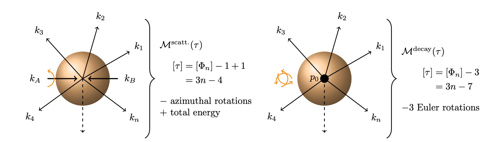
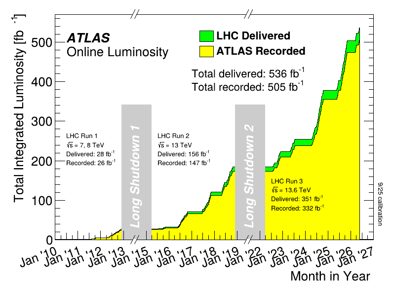
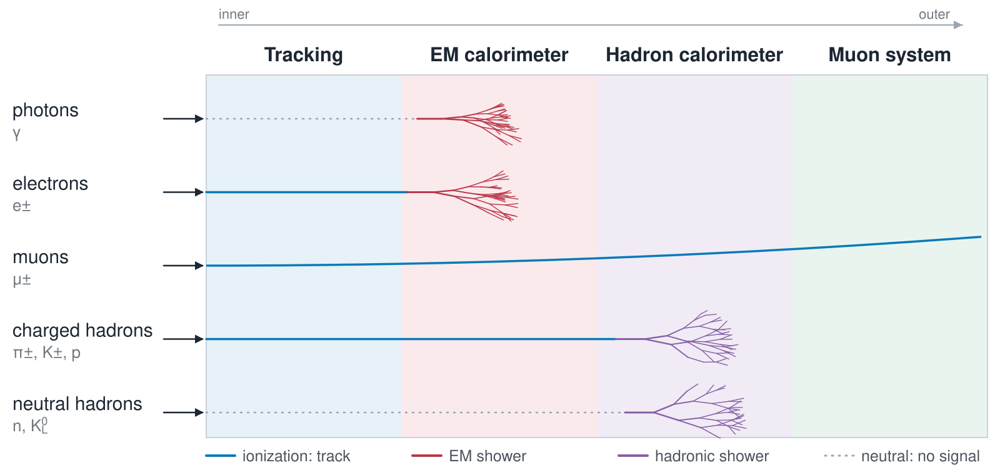
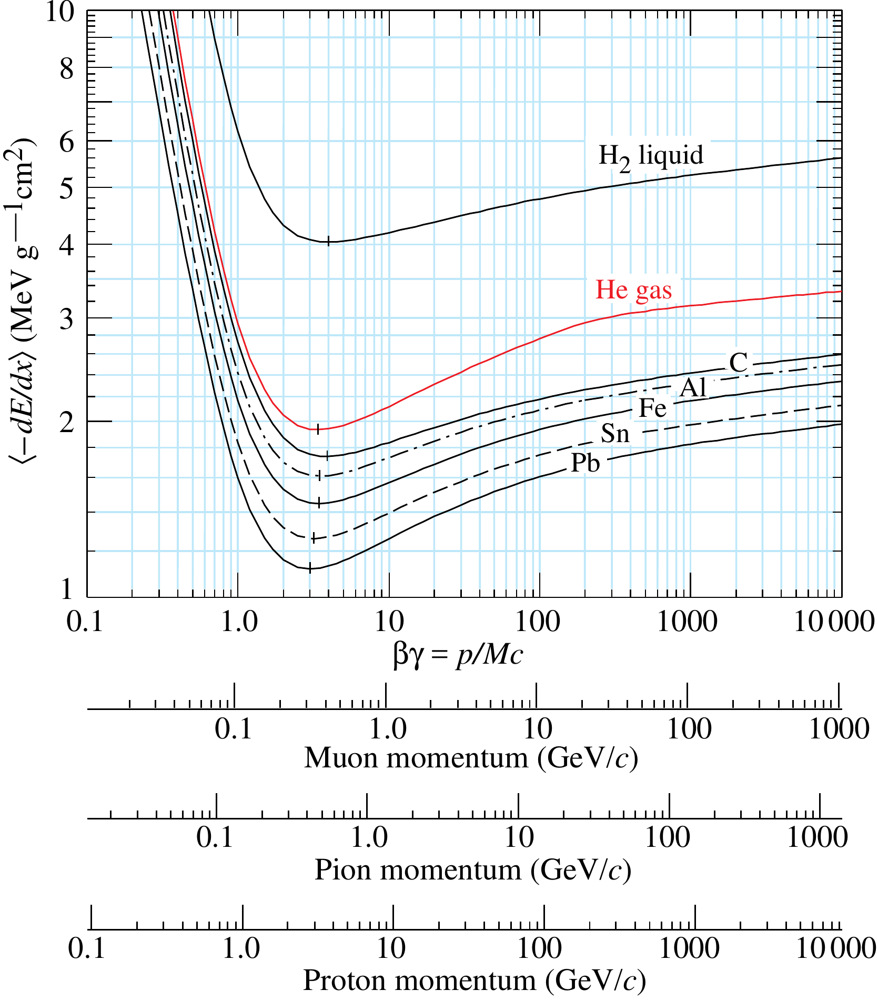
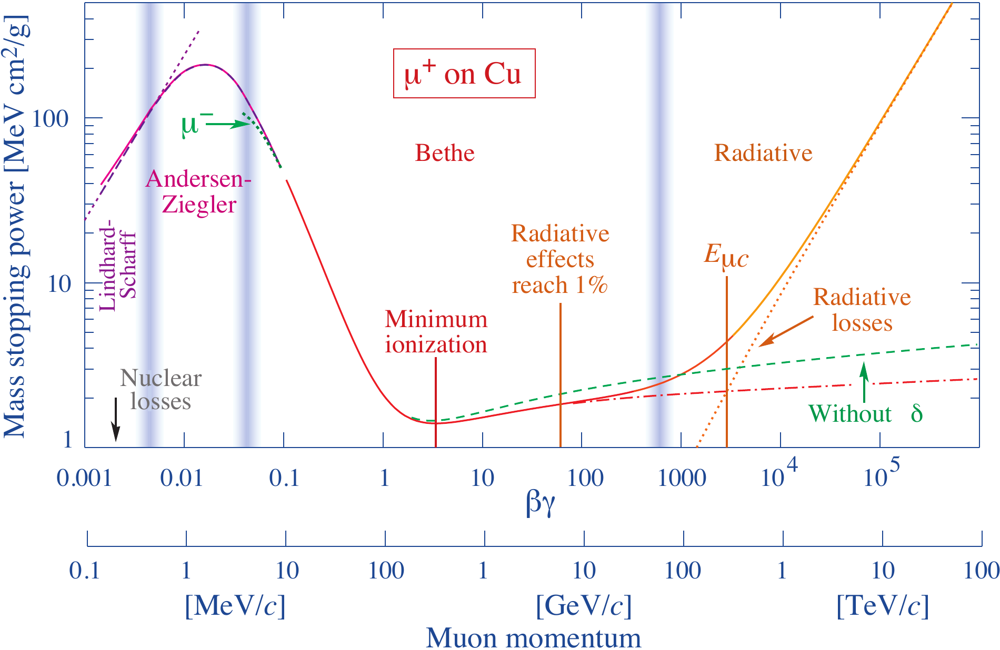
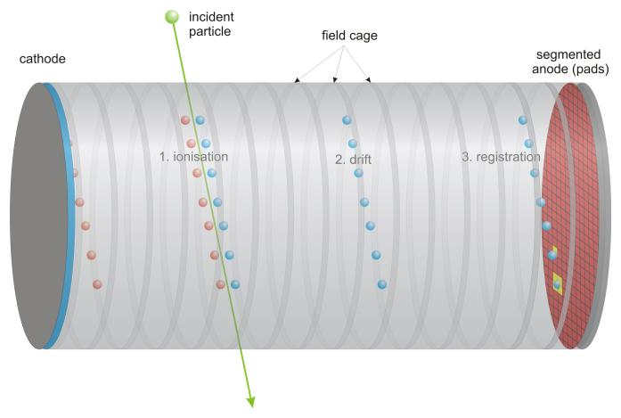
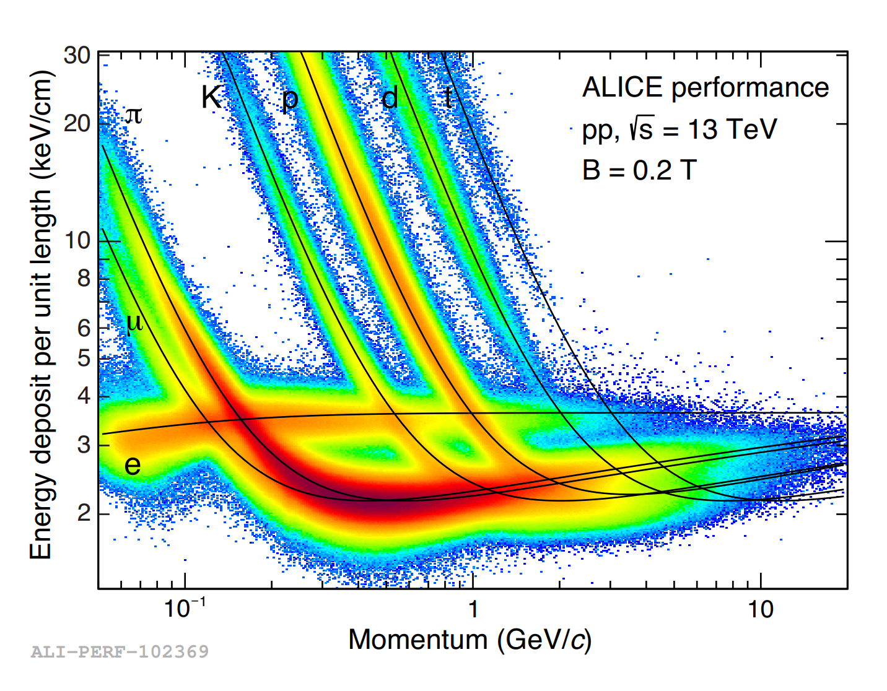
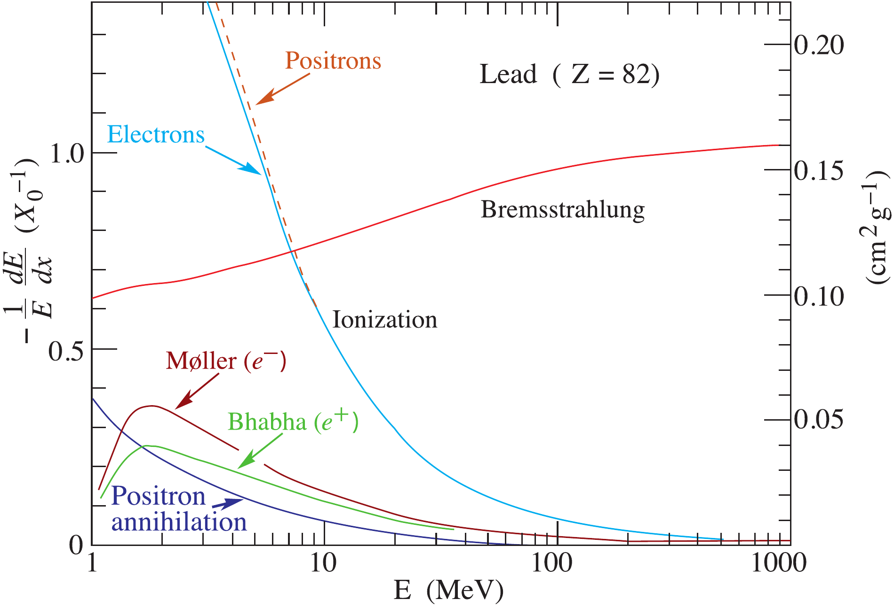
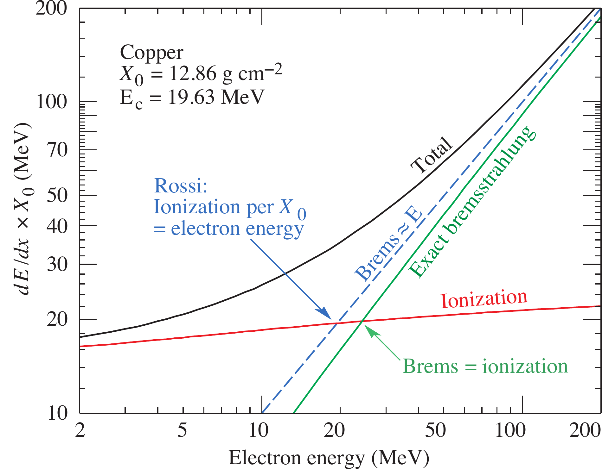
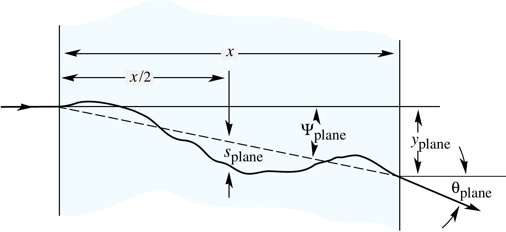

## Lecture 5 {.title-card}

:::: {.slide-body}

::: {.subtitle}
Interaction of Particles with Matter
:::

Mikhail Mikhasenko · 30 October 2026

::::

## Recall: from an interaction to an event 

:::: {.slide-body}

$$d\Gamma=\frac{\overline{|\mathcal M|^2}}{2M}\,d\Phi_n,
\qquad d\sigma=\frac{\overline{|\mathcal M|^2}}{F}\,d\Phi_n$$

**Matrix element:** how the interaction connects the initial and final states.

**Phase space:** the available final momenta, subject to conservation laws.

**Flux:** normalize scattering to the incident particles.

Decay formula: parent rest frame. Throughout: $\hbar=c=1$ unless restored.

::::

::: {.notes}
About 40 minutes including discussion; the six recall questions are in recall-questions.md. Kinematics adapted from ESHEP Lecture 2, section 20-kinematics; no spin or exotic-hadron material. The bar denotes the appropriate sum/average over unobserved spin states, not a topic for this recap.
:::

## Phase space: what does each factor count? {.phase-space-components}

::: {.slide-refs}
[AEPSHEP 2026 · Hadron spectroscopy](https://mmikhasenko.github.io/2026-AEPSHEP-Hadron-Spectroscopy/)
:::

:::: {.slide-body}

::: {.ps-formula}
::: {.ps-term .ps-lhs}
$$d\Phi_n\;=$$
:::
::: {.ps-term .ps-measure}
$$\prod_{i=1}^{n}\frac{d^3\mathbf p_i}{(2\pi)^3\,2E_i}$$
:::
::: {.ps-term .ps-delta}
$$(2\pi)^4\,\delta^{(4)}\Big(P-\sum_{i=1}^{n}p_i\Big)$$
:::
:::

::: {.ps-cards}
::: {.ps-card .ps-measure}

Each particle

Three momentum components $\mathbf p_i$. Dividing by $2E_i$ counts states the same way in every frame.
:::
::: {.ps-card .ps-shell}

On the mass shell

$E_i=\sqrt{m_i^2+|\mathbf p_i|^2}$: the energy is fixed by the mass, not a new number.
:::
::: {.ps-card .ps-delta}

Conservation

Total energy and momentum equal the parent's: $3n$ momenta $-\,4$ constraints $=$ **$3n-4$** coordinates.
:::
:::

::: {.take-home}
The measure counts states; **the matrix element weights them**.
:::
::::

::: {.notes}
Adapted directly from the AEPSHEP Lecture 2 coloured phase-space layout. Fixed external masses and fixed total four-momentum. Identical-particle symmetry factors are required when integrating labelled momenta for identical daughters.
:::

## Collider and decay: which rotations matter? {.counting-figure}

::: {.slide-refs}
[Hanhart & Mikhasenko · AEPSHEP 2026](https://mmikhasenko.github.io/2026-AEPSHEP-Hadron-Spectroscopy/)
:::

:::: {.slide-body}

::::

::: {.notes}
Here n counts final particles; these are amplitude variables after removing overall rotations. Collider: the beam defines an axis, remove one overall azimuth and let the collision energy vary, (3n−4)−1+1 = 3n−4. Decay at fixed parent mass: remove three orientation angles, 3n−7 shape variables for generic n ≥ 3 (two bodies: 2 coordinates, both angles; three bodies: 5 = 2 shape + 3 orientation). Do not apply 3n−7 to a two-body decay: rotations around its common momentum axis act trivially. For scattering at fixed s, after removing azimuth, the count is 3n−5; allowing s to vary restores one.
:::

## Two bodies: one fixed momentum {.formula-slide}

:::: {.slide-body}

$$\mathbf p_1^*=-\mathbf p_2^*,\qquad
E_1^*+E_2^*=M,\qquad
$$
$$q=\frac{\sqrt{\big(M^2-(m_1+m_2)^2\big)\big(M^2-(m_1-m_2)^2\big)}}{2M}$$
$$d\Phi_2=\frac{q}{16\pi^2M}\,d\Omega,
\qquad\Phi_2=\frac{q}{4\pi M}$$

At threshold $M=m_1+m_2$: $q=0$. For massless daughters: $q=M/2$.

Phase space is uniform in solid angle; the **amplitude can introduce angular dependence**.

::::

::: {.notes}
Board derivation: the spatial delta function sets p2=−p1. The radial integral is q² dq δ(M−E1−E2)/(16π²E1E2). Its Jacobian is q(1/E1+1/E2)=qM/(E1E2), giving q/(16π²M).
:::

## Three pair masses, only two independent 

:::: {.slide-body}

$$s_{ij}=(p_i+p_j)^2,\qquad P=p_1+p_2+p_3$$
$$s_{12}+s_{13}+s_{23}=M^2+m_1^2+m_2^2+m_3^2.$$

Two pair masses fix the momentum triangle's **shape**.

Three angles specify its **orientation** in the parent rest frame.

A rotation changes the orientation; a Lorentz boost changes energies and momenta. **Neither changes the pair masses.**

::::

::: {.notes}
Board: expand all three pair squares and compare with P². Ask students why adding particle masses would not give a pair invariant mass.
:::

## Shape and orientation of one event {.widget-slide}

::: {.slide-refs}
[AEPSHEP 2026 · Hadron spectroscopy](https://mmikhasenko.github.io/2026-AEPSHEP-Hadron-Spectroscopy/)
:::

:::: {.slide-body}

::: {.widget data-src="widgets/eshep/shape-orientation.html?rot=35" data-poster="widgets/eshep/w-shape.png" data-alt="Shape and orientation of one event"}
:::

::::

::: {.notes}
ESHEP widget: Λb → p K− J/ψ is only a kinematic example. Rotate the triangle, then change its pair mass and angle. One rotation slider illustrates one of the three orientation angles; it is not a Lorentz boost. No resonances or spin analysis.
:::

## The Dalitz plot: flat measure, curved boundary {.formula-slide}

::: {.slide-refs}
[AEPSHEP 2026 · Hadron spectroscopy](https://mmikhasenko.github.io/2026-AEPSHEP-Hadron-Spectroscopy/)
:::

:::: {.slide-body}

After integrating the overall orientation:
$$d\Phi_3=\frac{ds_{12}\,ds_{13}}{128\pi^3M^2}
\quad\text{inside the allowed boundary}.$$

A constant matrix element and uniform efficiency give a **uniform density in squared pair masses**.

A one-dimensional projection need not be flat: each bin contains a different amount of allowed phase space.

Changing from $s=m^2$ to $m$ adds a Jacobian: $dN/dm=2m\,dN/ds$.

::::

::: {.notes}
The measure shown is orientation-integrated. If the amplitude depends on orientation, integrate that dependence too; one cannot simply drop it. Derive the boundary by cos θ between −1 and +1 in the pair frame.
:::

## Uniform phase space and its projection {.widget-slide}

::: {.slide-refs}
[AEPSHEP 2026 · Hadron spectroscopy](https://mmikhasenko.github.io/2026-AEPSHEP-Hadron-Spectroscopy/)
:::

:::: {.slide-body}

::: {.widget data-src="widgets/eshep/dalitz-phasespace.html?n=4000&mass=m2" data-poster="widgets/eshep/w-phsp-fill.png" data-alt="Uniform phase space and its projection"}
:::

::::

::: {.notes}
Increase the event count. Switch from m² to m. Ask whether the broad peak in the projection proves a resonance: it does not.
:::

## One pair mass and one angle {.widget-slide}

::: {.slide-refs}
[AEPSHEP 2026 · Hadron spectroscopy](https://mmikhasenko.github.io/2026-AEPSHEP-Hadron-Spectroscopy/)
:::

:::: {.slide-body}

::: {.widget data-src="widgets/eshep/dalitz-phasespace.html?view=slice&m=1.9&cos=0.4" data-poster="widgets/eshep/w-phsp-slice.png" data-alt="One pair mass and one angle"}
:::

::::

::: {.notes}
At fixed s12, move cos θ from −1 to +1: the point spans the allowed vertical slice. The angle is measured in the pair rest frame. This is a kinematic coordinate, without spin interpretation.
:::

## Partial widths, branching fractions and lifetime {.formula-slide}

:::: {.slide-body}

$$\Gamma_i=\frac{1}{2M}\int_i\overline{|\mathcal M_i|^2}\,d\Phi_i,
\qquad \Gamma_{\mathrm{tot}}=\sum_i\Gamma_i$$
$$B_i=\frac{\Gamma_i}{\Gamma_{\mathrm{tot}}},\qquad
\tau=\frac{\hbar}{\Gamma_{\mathrm{tot}}},\qquad\sum_i B_i=1.$$

The **total width** sets the lifetime; a **partial width** sets a channel's share.

In natural units: $[\Gamma]=\mathrm{GeV}$, $[\tau]=\mathrm{GeV}^{-1}$.

Restore seconds with $\hbar=6.582\times10^{-25}\,\mathrm{GeV\,s}$.

::::

## From decays to collisions {.section-title}

:::: {.slide-body}

A width counts decays **per parent particle**: $\;d\Gamma=\overline{|\mathcal M|^2}\,d\Phi_n/2M$.

A cross section counts collisions **per incoming flux**: $\;d\sigma=\overline{|\mathcal M|^2}\,d\Phi_n/F$.

How do we count collisions?

::::

## Fixed target: count the discs {.counting-slide}

:::: {.slide-body}

::: {.split}
::: {.copy}
Seen along the beam, every target centre is a **disc of area $\sigma$**.

A beam particle interacts if it lands on a disc. In area $A$ there are $N_t=n_tA\ell$ discs:
$$P=\frac{N_t\,\sigma}{A}=n_t\ell\,\sigma\ll1.$$

With $\dot N_b$ beam particles per second:
$$R=\dot N_b\,n_t\ell\,\sigma\equiv\mathcal L_{\mathrm{fixed}}\,\sigma.$$
$$\boxed{\mathcal L_{\mathrm{fixed}}=\dot N_b\,n_t\ell}$$

::: {.notation}
$n_t$ · target centres per volume

$\ell$ · target thickness

$A$ · area seen by the beam

$\sigma$ · cross section = disc area

$P$ · interaction probability per beam particle

$\dot N_b$ · beam particles per second

$R$ · interactions per second
:::
:::
::: {.visual}
::: {.widget data-src="widgets/tube-counting.html" data-poster="widgets/tube-counting-poster.png" data-alt="Beam's-eye view of a thin target: discs of area sigma and the beam particles that land on them"}
:::
:::
:::

::::

::: {.notes}
About 3 minutes. Equivalent picture: each beam particle drags a tube of cross-section σ through the target; the number of centres inside the tube is n_t σ ℓ. Fire 200 and compare the hit fraction with the covered fraction; raise σ or the number of centres. Thin target: discs rarely overlap, P ≪ 1 (overlaps are where attenuation e^(−n σ x) comes from, used later in the lecture). Assumptions: uniform beam over the target area, independent scatterers, fixed incident energy. R is the interaction rate corrected for efficiency and background.
:::

## From cross section to matter

:::: {.slide-body}

For a thin layer, the target derivation gave
$$P_{\mathrm{interaction}}\simeq n\sigma\,\Delta x.$$

For successive layers, only particles that have not yet interacted remain in the incident beam:
$$dI=-n\sigma I\,dx\quad\Longrightarrow\quad
I(x)=I_0e^{-n\sigma x}.$$

The mean free path is $\lambda=1/(n\sigma)$.

For $N_b$ incident particles, $N_{\mathrm{int}}=N_b(1-e^{-n\sigma\ell})\simeq N_b n\sigma\ell$ in a thin target.

::::

::: {.notes}
Continuation of the fixed-target luminosity argument: target length and number of interactions. Independent interactions, homogeneous material and fixed cross section; attenuation of the uncollided beam.
:::

## Collider: the other bunch is the target {.counting-slide}

:::: {.slide-body}

::: {.split}
::: {.copy}
Bunch 2 has $N_2$ particles spread over area $A$: $N_2$ discs.

Each of the $N_1$ particles of bunch 1 hits one with $P=N_2\sigma/A$:
$$N_{\mathrm{events/crossing}}=\frac{N_1N_2}{A}\,\sigma.$$

At crossing frequency $f$:
$$\boxed{\mathcal L=\frac{fN_1N_2}{A}},\qquad R=\mathcal L\sigma.$$

::: {.notation}
$N_1,N_2$ · particles per bunch

$f$ · bunch-crossing frequency

$A$ · bunch area (uniform); Gaussian: $4\pi\sigma_x\sigma_y$

$P$ · interaction probability per particle of bunch 1

$R$ · interactions per second
:::
:::
::: {.visual}
::: {.widget data-src="widgets/tube-counting.html?mode=collider" data-poster="widgets/tube-counting-collider-poster.png" data-alt="Beam's-eye view of a bunch: discs of area sigma around its particles and the particles of the other bunch landing on them"}
:::
:::
:::

::::

::: {.notes}
About 3 minutes. Same picture as for the fixed target; only the target changed. General form for two beams with densities n1, n2: R = σ (v1+v2) ∫ n1 n2 d³x; per crossing the factor v1+v2 cancels the crossing time and leaves the transverse overlap. The slide assumes uniform bunches of area A; real bunches are Gaussian, A_eff = 4π σx σy for identical head-on beams (σx, σy are the transverse beam sizes, not the cross section); crossing angles and the hourglass effect reduce the overlap.
:::

## The flux factor in different frames {.formula-slide}

:::: {.slide-body}

$$d\sigma=\frac{\overline{|\mathcal M|^2}}{F}\,d\Phi_n,
\qquad F=4\sqrt{(p_1\!\cdot p_2)^2-m_1^2m_2^2}\quad\text{(invariant)}$$

| Situation | Flux factor $F$ |
|---|---|
| Collinear beams | $4E_1E_2\,|\mathbf v_1-\mathbf v_2|$ |
| Fixed target, $p_2=(m_2,\mathbf 0)$ | $4m_2\,|\mathbf p_{\mathrm{beam}}|$ |
| Centre of mass | $4p^*\sqrt s$ |
| Massless particles | $2s$ |

In a decay, $2M$ plays the role of $F$: one particle at rest.

::::

::: {.notes}
About 2 minutes. F = 4 E1 E2 v_rel with v_rel = √[(p1·p2)² − m1²m2²]/(E1E2); for collinear motion v_rel = |v1 − v2|, the beam speed for a stationary target and v1+v2 for head-on beams. Massless: p1·p2 = s/2, so F = 2s. F is the invariant normalization in the microscopic cross section; luminosity counts the actual beam overlap. Centre of mass: p* is the momentum of either incoming particle.
:::

## Instantaneous luminosity versus accumulated data

::: {.slide-refs}
[ATLAS luminosity, CC BY 4.0](https://twiki.cern.ch/twiki/bin/view/AtlasPublic/LuminosityPublicResultsRun3)

[LHCb, PRL 118 (2017) 052002](https://doi.org/10.1103/PhysRevLett.118.052002)

[LHC Higgs WG, arXiv:2402.09955](https://arxiv.org/abs/2402.09955)
:::

:::: {.slide-body}

::: {.split}
::: {.copy}
$$R=\mathcal L\sigma,\qquad
\mathcal L_{\mathrm{int}}=\int\mathcal L\,dt,\qquad
N=\sigma\mathcal L_{\mathrm{int}}$$

$[\mathcal L]=\mathrm{cm^{-2}s^{-1}}$, $\;[\mathcal L_{\mathrm{int}}]=\mathrm{fb^{-1}}$, $\;1\,\mathrm{fb}=10^{-39}\,\mathrm{cm^2}$

**Higgs**, 13.6 TeV: $\sigma\approx60\,\mathrm{pb}$
$\times\,332\,\mathrm{fb^{-1}}\approx2\times10^7$ produced

**b hadrons** in LHCb, 13 TeV: $\sigma\approx154\,\mu\mathrm b$
$\times\,1\,\mathrm{fb^{-1}}\approx1.5\times10^{11}$
:::
::: {.visual}

:::
:::

::::

::: {.notes}
About 3 minutes. 332 fb⁻¹ is the Run 3 luminosity recorded by ATLAS on the plot (9/25 calibration, to early 2026). Higgs: about 60 pb is the sum of all production modes at mH = 125 GeV from the LHC Higgs WG interim 13.6 TeV tables (gluon fusion alone 52.2 pb); 60 pb × 332 fb⁻¹ = 60 000 fb × 332 fb⁻¹ ≈ 2 × 10⁷ produced, before any branching fraction or efficiency. b hadrons: LHCb σ(pp → H_b X) = 154.3 ± 1.5 ± 14.3 μb at 13 TeV for 2 < η < 5 (published value; the arXiv v1 quoted 144 μb). 1 μb = 10⁹ fb. A selected decay sample: N_selected = L_int σ B ε. Constant cross section at fixed energy; otherwise integrate σ(t)L(t).
:::

## Quiz: recall Lecture 4 {#recall-quiz}

:::: {.slide-body}

Scan the QR code or visit <a href="https://www.menti.com">menti.com</a>

1299 7733

Six questions · one answer per question

::::

::: {.notes}
Joining panel captured from the live Mentimeter quiz on 30 October 2026. Check the joining code before reusing this slide in a later session.
Presenter: https://www.mentimeter.com/app/presentation/alqqnvak4gfdyz6rcpa729e7t41b2f15/present
:::

## Interaction of particles with matter {.section-title}

:::: {.slide-body}

Which particles, which processes, which signals?

::::

## Natural radiation in a cloud chamber {.media-slide .cloud-chamber-slide}

::: {.widget data-src="widgets/cloud-chamber.html" data-poster="widgets/cloud-chamber-poster.png" data-alt="Cloud chamber with Geant4 tracks from radon alpha particles, background electrons and cosmic muons"}
:::

::: {.notes}
Start a 60-second exposure, or inspect alpha, electron and muon tracks separately. Playback defaults to real time; optional 10× playback accelerates arrivals while optical persistence remains illustrative. A single legend identifies teaching colours (actual trails are white). Drag to rotate; the same scale is used on all three axes. Dashed full paths are optional and off by default. This is a cloud chamber, with condensation around ions in supersaturated vapour, not a bubble chamber. The geometry is 20 × 20 × 5 cm of standard air; the default visible layer is the bottom 1 cm. The optional full-depth view is idealized. Geant4 11.3.2 (FTFP_BERT, through the existing Julia environment) generated 150 events: 5.49 MeV radon-222 alpha particles, 50 keV–1 MeV illustrative background electrons, and representative 4 GeV cosmic muons. Playback samples that bank with random arrival times; it runs offline without Julia or a server. Assumed rates: 100 Bq/m³ radon, approximately 1 muon/cm²/min through the lid, and an illustrative electron rate of 0.3/s in the full volume. No radioactive daughter chain, physical beta spectrum, chamber walls, vapour thermodynamics or calibrated detection efficiency is simulated. Gamma rays would be seen via secondary electrons, not direct photon trails. Full assumptions and regeneration script are in widgets/cloud-model-notes.txt and widgets/cloud-transport.jl.
:::

## Cross section and mean free path

:::: {.slide-body}

For number density $n$ and a cross section $\sigma$:

$$dP=n\sigma\,dx,\qquad \lambda=\frac{1}{n\sigma}.$$

The unscattered beam intensity decreases as

$$I(x)=I_0e^{-x/\lambda}.$$

::: {.take-home}
A cross section becomes an interaction probability once we specify the material and its thickness.
:::

::::

::: {.notes}
About 2 minutes. Independent interactions in a homogeneous medium; a fixed cross section at fixed incident energy. For mixtures, λ⁻¹ = Σ n_i σ_i. Attenuation here refers to removal from the uncollided beam, not necessarily absorption of all its energy.
:::

## Each particle leaves its own signature {.full-figure}

::: {.slide-refs}
Redrawn after C. Lippmann (2003)
:::

:::: {.slide-body}

::: {.visual}

:::

::: {.take-home}
Only charged particles ionize. Photons and neutral hadrons are seen through the charged particles they produce.
:::

::::

::: {.notes}
About 2 minutes. The question of the lecture: why does each particle stop in a different layer? Photons and electrons shower in the electromagnetic calorimeter (bremsstrahlung and pair production), hadrons in the much deeper hadron calorimeter (nuclear interactions), muons only ionize and cross everything. Neutrinos (not drawn) leave nothing. Colours of the signatures follow the process colours used in the section titles. Own drawing, after the well-known figure by C. Lippmann (2003).
:::

## Charged particles: interactions in matter {#charged-particles-three-visible-effects .process-overview}

:::: {.slide-body}

::::: {.process-grid}
::: {.process-box .process-ionization}
[Excitation and ionization]{.process-title}

Transfer energy to **atomic electrons**.

Light and free charges → detector signals
:::

::: {.process-box .process-radiation}
[Bremsstrahlung]{.process-title}

Radiate a **photon** when deflected.

Radiative energy loss → electromagnetic showers
:::

::: {.process-box .process-scattering}
[Coulomb scattering]{.process-title}

Deflect in the electric field of **nuclei**.

Repeated deflections → a track changes direction
:::

::: {.process-box .process-nuclear}
[Nuclear interactions]{.process-title}

Hadrons interact strongly with **nuclei**.

Nuclear breakup and secondary particles → hadronic showers
:::
:::::

::: {.process-summary}
Energy transfer · radiation · deflection · nuclear reactions
:::

::::

::: {.notes}
About 2 minutes. Overview of the main processes developed in this lecture, not an exhaustive list. The first three are electromagnetic; the nuclear box applies to hadrons. Coulomb scattering also occurs on electrons; nuclei dominate the small-angle deflections discussed here. Elastic nuclear recoil transfers some energy. Bremsstrahlung is especially important for electrons and positrons. Excitation may yield light; ionization yields free charge and can also lead to light. Cherenkov radiation is introduced separately later.
:::

## Processes and particles: the map of this lecture {.process-map}

:::: {.slide-body}

| | e^±^ | μ^±^ | π^±^, K^±^, p | γ | n, K^0^~L~ |
|---|:-:|:-:|:-:|:-:|:-:|
| [1 · Ionization]{.proc .process-ionization} | ● | ● | ● | | |
| [2 · Bremsstrahlung]{.proc .process-radiation} | ● | ○ | | | |
| [3 · Multiple scattering]{.proc .process-scattering} | ● | ● | ● | | |
| [4 · Photon interactions]{.proc .process-photon} | | | | ● | |
| [5 · Nuclear interactions]{.proc .process-nuclear} | | | ● | | ● |
| [6 · Cherenkov light]{.proc .process-cherenkov} | ● | ● | ● | | |

::: {.map-legend}
● important · ○ only at very high energy
:::

::::

::: {.notes}
About 2 minutes. One row per section of the lecture; read the columns as "what happens to this particle". Charged particles: ionization always, multiple scattering always, Cherenkov light only above threshold. Bremsstrahlung matters for electrons above the critical energy; for muons only at hundreds of GeV (m² suppression). Photons interact only through photoelectric effect, Compton scattering and pair production. Hadrons, charged or neutral, also interact strongly with nuclei. Rare processes (photonuclear, muon nuclear interactions, δ-electrons) are left out on purpose.
:::

## 1 · Ionization {.section-title .process-section .process-ionization}

:::: {.slide-body}

::: {.section-who}
**Particles:** every charged particle

**Process:** energy transferred to atomic electrons

**Signal:** free charge and light: tracks, d*E*/d*x*, identification
:::

::: {.roadmap}
[1 · Ionization]{.step .process-ionization .here} [2 · Bremsstrahlung]{.step .process-radiation} [3 · Multiple scattering]{.step .process-scattering} [4 · Photon interactions]{.step .process-photon} [5 · Nuclear interactions]{.step .process-nuclear} [6 · Cherenkov light]{.step .process-cherenkov}
:::

::::

::: {.notes}
Section 1 of 6. The longest section: mean loss (Bethe–Bloch), its fluctuations, and how a TPC turns both into tracks and particle identification.
:::

## Stopping power

:::: {.slide-body}

The mean energy lost per unit path length is

$$S=-\left\langle\frac{dE}{dx}\right\rangle\qquad [\mathrm{MeV/cm}].$$

Dividing by the material density gives the **mass stopping power**:

$$S_m=\frac{S}{\rho}\qquad [\mathrm{MeV\,cm^2/g}].$$

For a thin layer, $\langle\Delta E\rangle\simeq S_m\,\rho\,\ell$.

::::

::: {.notes}
About 2 minutes. Use x for geometric path length throughout, rather than alternating between length and mass thickness. The layer must be thin enough that the stopping power does not change much along the path. Energy lost by the primary need not all be deposited locally: energetic secondary electrons and photons can escape.
:::

## Ionization: the Bethe–Bloch curve

::: {.slide-refs}
[PDG 2024 · Fig. 34.2](https://pdg.lbl.gov/2024/figures/figures.html)
:::

:::: {.slide-body}

::: {.split}
::: {.copy}
**Heavy charged particles** transfer energy to atomic electrons.

- At low velocity: approximately $z^2/\beta^2$.
- A broad minimum near $\beta\gamma\sim3$–$4$.
- A relativistic rise, moderated by polarization of the medium.

The horizontal variable is $\beta\gamma=p/(Mc)$.
:::
::: {.visual}

:::
:::

::::

::: {.notes}
About 4 minutes. Original pages 4–5. The Bethe equation is for moderately relativistic heavy charged particles, not for electrons or the very-low-velocity end. The minimum depends somewhat on material; quote βγ, not simply γ. I is the mean excitation energy, δ the density correction. Full formula in backup.
:::

## Minimum-ionizing particles

:::: {.slide-body}

Near the minimum, a singly charged particle loses roughly

$$S_m\simeq1\text{–}2\ \mathrm{MeV\,cm^2/g}$$

in many detector materials.

**Example:** $300\,\mu\mathrm m$ of silicon, $\rho=2.33\,\mathrm{g/cm^3}$, $S_m\simeq1.7\,\mathrm{MeV\,cm^2/g}$:

$$\langle\Delta E\rangle\simeq1.7\times2.33\times0.030\ \mathrm{MeV}\simeq0.12\ \mathrm{MeV}.$$

::: {.take-home}
“MIP” describes a velocity regime, not a particle species.
:::

::::

::: {.notes}
About 2 minutes. Original page 5. The 1–2 range is a practical rule of thumb, not universal (hydrogen is an exception). This is a mean loss estimate; the most probable deposit is lower. Silicon density and stopping-power scale: PDG Atomic and Nuclear Properties, https://pdg.lbl.gov/AtomicNuclearProperties/HTML/silicon_Si.html .
:::

## Energy-loss regimes {.full-figure}

::: {.slide-refs}
[PDG 2024 · Fig. 34.1](https://pdg.lbl.gov/2024/figures/figures.html)
:::

:::: {.slide-body}

::: {.visual}

:::

::: {.take-home}
Locate the minimum, the Bethe region, and the onset of radiative losses.
:::

::::

::: {.notes}
About 2 minutes. Original page 6. The central overview plot uses positive muons on copper. Do not apply its energy boundaries to electrons. Radiative losses for muons include pair production and photonuclear interactions as well as bremsstrahlung.
:::

## Time projection chamber

::: {.slide-refs}
[LCTPC · Working principle](https://www.lctpc.org/e8/e57671)
:::

:::: {.slide-body}

::: {.split}
::: {.copy}
1. The particle **ionizes the gas** along its path.
2. Released electrons **drift** towards the readout plane.
3. Pads measure transverse position; **drift time** gives the third coordinate.

A magnetic field bends the track, providing the momentum.
:::
::: {.visual}

:::
:::

::::

::: {.notes}
About 3 minutes. Original page 8. A noble-gas mixture with quencher is typical. Fields are of order hundreds of V/cm, not one universal value. z = v_d(t−t_0); timing and drift calibration matter. Momentum comes from curvature, not ionization alone. Source: LCTPC page cited on slide.
:::

## A TPC event, step by step {.media-slide}

::: {.widget data-src="widgets/tpc.html?present=1" data-poster="widgets/tpc-poster.png" data-alt="Interactive three-dimensional TPC: a track, drifting ionization electrons, pad hits and dE/dx versus momentum"}
:::

::: {.notes}
About 5 minutes. Pick a pion at 0.5 GeV/c and press Drift: the track crosses in nanoseconds, then the electron clouds drift to the nearer end plate for up to about 100 µs. Ask which electrons arrive first (those nearest the pads) and how z follows from the arrival time; drag the time slider to show it. Switch to End: the circle gives p_T = 0.3 B R (B = 0.5 T). Switch to Side: the slope gives the dip angle and hence p. Pad colour shows the charge per row: a few rows are much brighter (Landau tail), which is why the truncated mean is used. Then drag the momentum slider for a kaon and a proton to trace their bands, and press Spray 200 to fill the plot. Bands separate at low p (1/β² rise) and merge near minimum ionization; the pion band is brightest because pions are most abundant in the spray. The Explanation button lists formulas and model assumptions: ALICE-like geometry, 80 pad rows, ALEPH-type Bethe–Bloch, diffusion drawn ×12. The next slide shows the measured ALICE bands.
:::

## Particle identification with ionization

::: {.slide-refs}
[ALICE / Heidelberg](https://www.physi.uni-heidelberg.de/~sma/research/tpc.php)
:::

:::: {.slide-body}

::: {.split}
::: {.copy}
At the same momentum,

$$\beta\gamma=\frac{p}{Mc}.$$

Different masses therefore sample different parts of the ionization curve.

**Read the plot:**

- Why are the bands separated?
- What sets their brightness?
- What sets their width?
:::
::: {.visual}

:::
:::

::::

::: {.notes}
About 3 minutes. Original page 10. Band position: mass and charge through βγ and z². Brightness: number of entries on the plot, also affected by acceptance and selection, not the brightness of a single track. Width: ionization fluctuations, number of samples, path-length corrections and detector resolution. Truncated-mean estimators suppress large deposits; no exact truncation fraction is assumed.
:::

## 2 · Bremsstrahlung {.section-title .process-section .process-radiation}

:::: {.slide-body}

::: {.section-who}
**Particles:** electrons and positrons; muons only at very high energy

**Process:** a photon radiated in the field of a nucleus

**Signal:** energy loss over the radiation length *X*~0~; the start of a shower
:::

::: {.roadmap}
[1 · Ionization]{.step .process-ionization} [2 · Bremsstrahlung]{.step .process-radiation .here} [3 · Multiple scattering]{.step .process-scattering} [4 · Photon interactions]{.step .process-photon} [5 · Nuclear interactions]{.step .process-nuclear} [6 · Cherenkov light]{.step .process-cherenkov}
:::

::::

::: {.notes}
Section 2 of 6. Defines the radiation length X0, used again for multiple scattering and showers.
:::

## Bremsstrahlung and radiation length

:::: {.slide-body}

A charged particle accelerated in a nuclear electric field can emit a photon:

$$e^-+Z\longrightarrow e^-+Z+\gamma.$$

For a high-energy electron in the bremsstrahlung-dominated regime,

$$-\left\langle\frac{dE}{dx}\right\rangle_{\mathrm{rad}}\simeq\frac{E}{X_0},
\qquad \langle E(x)\rangle\simeq E_0e^{-x/X_0}.$$

::: {.take-home}
After one radiation length, the mean electron energy is approximately $E_0/e$.
:::

::::

::: {.notes}
About 2 minutes. Original page 12. X0 is used here as a length; material tables also quote ρX0 in g/cm². This describes mean radiative energy loss, not an identical fractional loss in every event. Nuclear recoil conserves momentum. Bremsstrahlung is suppressed roughly as inverse mass squared for otherwise comparable charged leptons; X0 remains a conventional material property defined for electrons.
:::

## Electrons and positrons

::: {.slide-refs}
[PDG 2024 · Fig. 34.11](https://pdg.lbl.gov/2024/figures/figures.html)
:::

:::: {.slide-body}

::: {.split}
::: {.copy}
Their small mass makes radiation important at modest energies.

- **Ionization and excitation** at low energies.
- Electron–electron (**Møller**) and positron–electron (**Bhabha**) scattering.
- **Bremsstrahlung** at high energies.
- Positrons can **annihilate** with electrons.
:::
::: {.visual}

:::
:::

::::

::: {.notes}
About 2 minutes. Original page 13. The electron is identical to target electrons; the positron has distinct scattering and annihilation channels. Heavy-particle Bethe–Bloch cannot simply be used without electron-specific corrections.
:::

## Critical energy

::: {.slide-refs}
[PDG 2024 · Fig. 34.13](https://pdg.lbl.gov/2024/figures/figures.html)
:::

:::: {.slide-body}

::: {.split}
::: {.copy}
The electron critical energy marks the crossover:

$$S_{\mathrm{rad}}(E_c)\simeq S_{\mathrm{coll}}(E_c).$$

**Below:** collision losses dominate.

**Above:** radiation dominates.

For electrons in copper, the scale is about **20 MeV**.
:::
::: {.visual}

:::
:::

::::

::: {.notes}
About 2 minutes. Original page 14. Two conventions are shown in the source figure: exact equality and Rossi’s approximation E_c/X0 = ionization loss. Do not identify their numerical values as exactly equal. Muon critical energies are much higher (hundreds of GeV for many solids), with several radiative processes; avoid presenting the old ~100 GeV copper estimate as precise.
:::

## 3 · Multiple scattering {.section-title .process-section .process-scattering}

:::: {.slide-body}

::: {.section-who}
**Particles:** every charged particle

**Process:** many small deflections by nuclei

**Signal:** a blurred direction: limits momentum and vertex resolution
:::

::: {.roadmap}
[1 · Ionization]{.step .process-ionization} [2 · Bremsstrahlung]{.step .process-radiation} [3 · Multiple scattering]{.step .process-scattering .here} [4 · Photon interactions]{.step .process-photon} [5 · Nuclear interactions]{.step .process-nuclear} [6 · Cherenkov light]{.step .process-cherenkov}
:::

::::

::: {.notes}
Section 3 of 6. One slide; the full Highland expression is in backup.
:::

## Multiple Coulomb scattering

::: {.slide-refs}
[PDG 2024 · Fig. 34.10](https://pdg.lbl.gov/2024/figures/figures.html)
:::

:::: {.slide-body}

::: {.split}
::: {.copy}
Many small deflections accumulate while a particle traverses matter.

The central angular distribution is approximately Gaussian:

$$\theta_0\propto\frac{|z|}{\beta p}\sqrt{\frac{x}{X_0}}.$$

**Low momentum** and **more material** degrade the direction measurement.
:::
::: {.visual}

:::
:::

::::

::: {.notes}
About 2 minutes. Original page 15. θ0 is the RMS of the central Gaussian approximation in one projected plane. Large-angle single-scattering tails are not Gaussian. For fixed momentum and material, the variance grows approximately linearly with thickness; a logarithmic correction is in backup. More material also creates secondary interactions and losses.
:::
