## Lecture 7 {.title-card}

::: {.subtitle}
Particle Detectors I: Tracking, Light and Charge
:::

Different interactions with matter need different detector technologies.

## Recap: ionization and its fluctuations {.photo-slide .recap}

:::: {.slide-body}

- **Mean energy loss** $S=-\langle dE/dx\rangle$: falls like $z^2/\beta^2$, broad minimum near $\beta\gamma\sim3$–$4$ (minimum-ionizing particle), slow rise above.
- **Fluctuations:** many small transfers make the peak, rare energetic secondary electrons the tail. The **most-probable loss** lies below the mean.
- **Use:** $dE/dx$ against momentum identifies particles, e.g. in a TPC.

::::: {.photos .cols2}
::: {.photo}
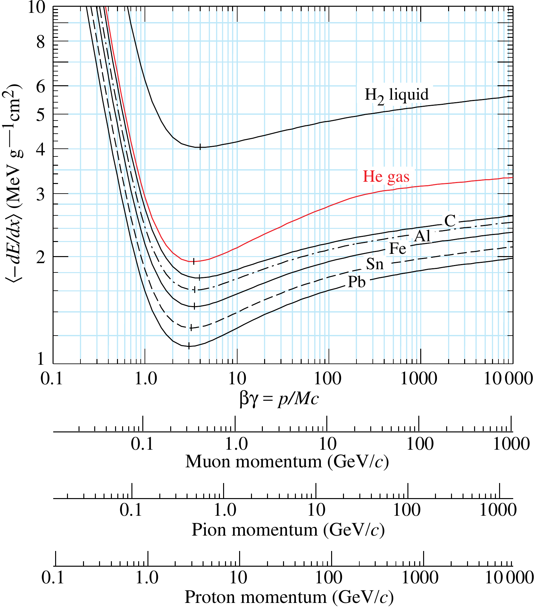

::: {.cap}
**Mean energy loss (Bethe–Bloch)**\
PDG 2024, Fig. 34.2 · CC BY 4.0
:::
:::
::: {.photo}
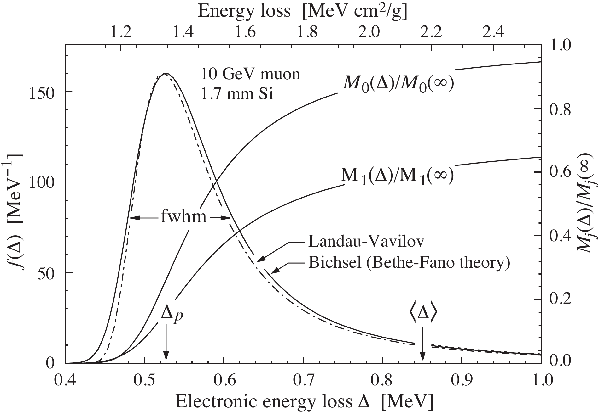

::: {.cap}
**Energy deposit of a 10 GeV muon in 1.7 mm silicon**\
PDG 2024, Fig. 34.7 · CC BY 4.0
:::
:::
:::::

::::

## Recap: radiation, scattering and photons {.photo-slide .recap}

:::: {.slide-body}

- **Bremsstrahlung:** $\langle E(x)\rangle=E_0\,e^{-x/X_0}$ for electrons; $X_0$ is short in dense materials (copper: about 1.4 cm). Below the critical energy ($\approx20$ MeV in copper) ionization dominates.
- **Multiple scattering:** $\theta_0\propto\dfrac{|z|}{\beta p}\sqrt{\dfrac{x}{X_0}}$: low momentum and more material blur the direction.
- **Photons:** photoelectric effect, Compton scattering, **pair production** $\gamma+Z\to e^-e^+Z$, which needs the nucleus to take the recoil.

::::: {.photos .cols2}
::: {.photo}
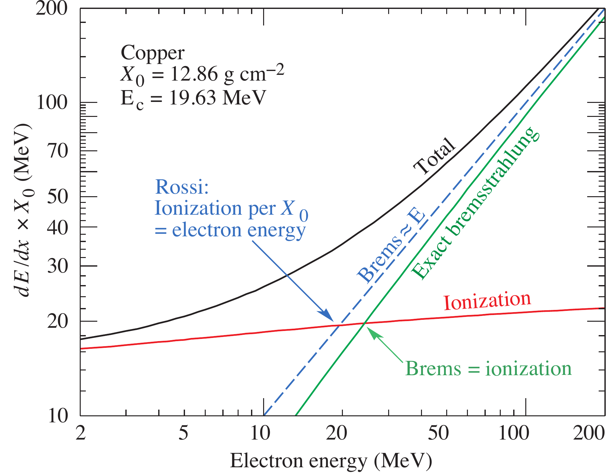

::: {.cap}
**Electron energy loss in copper**\
PDG 2024, Fig. 34.13 · CC BY 4.0
:::
:::
::: {.photo}
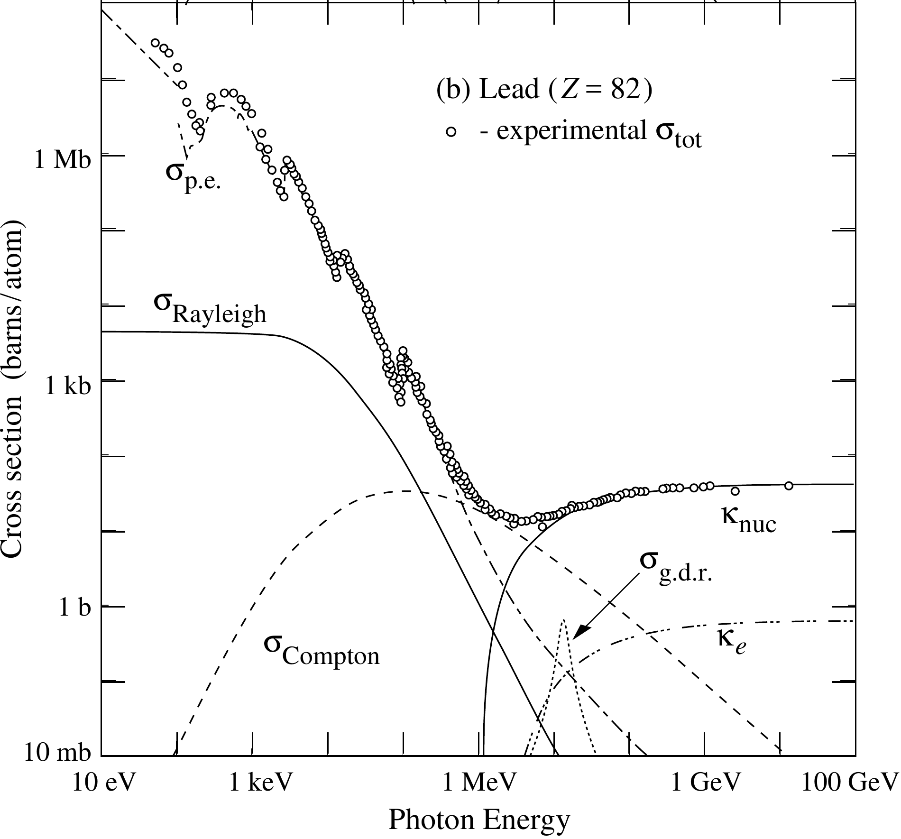

::: {.cap}
**Photon cross sections in lead**\
PDG 2024, Fig. 34.15(b) · CC BY 4.0
:::
:::
:::::

::::

## Recap: showers and Cherenkov light {.photo-slide .recap}

:::: {.slide-body}

- **Electromagnetic shower:** bremsstrahlung and pair production alternate and multiply the particles until their energy is about $E_c$.
- **Hadronic shower:** nuclear interactions, $\lambda_I\gg X_0$. The electromagnetic ($\pi^0\to\gamma\gamma$) and the invisible part (nuclear binding energy) **fluctuate from event to event**.
- **Cherenkov light:** if $\beta n>1$, at $\cos\theta_C=1/(\beta n)$; threshold $p_{\mathrm{th}}=mc/\sqrt{n^2-1}$.

::::: {.photos .cols3}
::: {.photo}
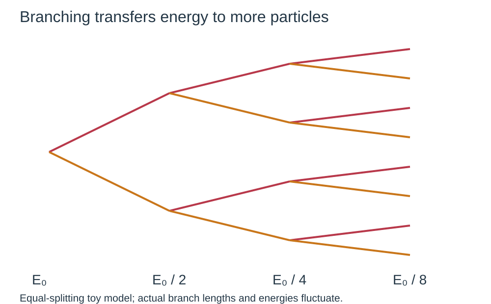

::: {.cap}
**Electromagnetic cascade**\
Own drawing
:::
:::
::: {.photo}
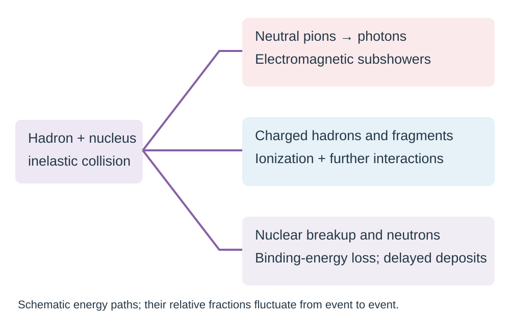

::: {.cap}
**Hadronic shower**\
Own drawing
:::
:::
::: {.photo}
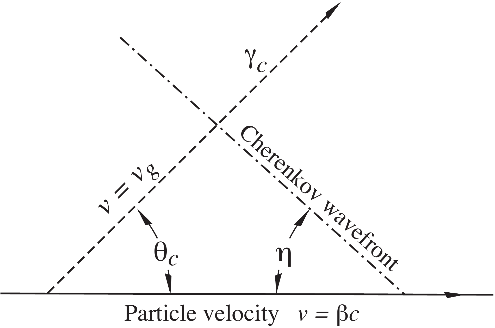

::: {.cap}
**Cherenkov emission**\
PDG 2024, Fig. 34.26 · CC BY 4.0
:::
:::
:::::

::::

## Join the quiz

```{=html}
<div style="display:flex;align-items:center;justify-content:center;gap:100px;height:700px">
<a href="https://www.menti.com/?code=53313249" target="_blank" rel="noopener"></a>
<div style="text-align:center"><p style="font-size:48px;margin:0 0 28px">Scan to join</p><p style="font-size:36px;margin:0 0 18px">or go to <strong>menti.com</strong></p><p style="font-size:76px;font-weight:600;letter-spacing:.06em;margin:0">5331 3249</p></div>
</div>
```

## Question 1 — Fluctuations

:::: {.slide-body}
Why is the most-probable energy deposit of a muon in thin silicon below the mean?

**A.** Most collisions transfer large energies.

**B.** Rare energetic secondary electrons raise the mean.

**C.** Incident muons have different energies.

**D.** Detector noise shifts the peak downwards.
::::

## Question 2 — Multiple scattering

:::: {.slide-body}
Momentum doubles, thickness quadruples. How does the RMS scattering angle change? Assume $\beta\simeq1$, ignore log terms.

**A.** Halves.

**B.** Stays unchanged.

**C.** Doubles.

**D.** Quadruples.
::::

## Question 3 — Pair production

:::: {.slide-body}
Why can a single photon not convert into $e^+e^-$ in vacuum, even with an energy above $2m_ec^2$?

**A.** Charge conservation forbids it.

**B.** In vacuum, the threshold is $4m_ec^2$.

**C.** Energy and momentum cannot both be conserved.

**D.** An atomic electron must supply the positron.
::::

## Question 4 — Radiation length

:::: {.slide-body}
Roughly how large is the radiation length $X_0$ of air at sea level (electron energy falls to $1/e$ by bremsstrahlung)?

**A.** 3 cm

**B.** 3 m

**C.** 300 m

**D.** 30 km
::::

## Question 5 — Cherenkov threshold

:::: {.slide-body}
A 5 GeV/$c$ track crosses a radiator with $n=1.0014$. Which particle emits Cherenkov light? Use $m_\pi=140$ and $m_K=494$ MeV/$c^2$; $p_{\mathrm{th}}=mc/\sqrt{n^2-1}$.

**A.** Both pion and kaon.

**B.** Neither.

**C.** Only the pion.

**D.** Only the kaon.
::::

## Question 6 — Hadronic showers

:::: {.slide-body}
Why can fully contained hadronic showers of the same energy produce different signals?

**A.** The energy needed to release nucleons from nuclei fluctuates between showers.

**B.** Energy conservation holds only on average.

**C.** All emitted neutrons escape the calorimeter.

**D.** Full containment prevents signal fluctuations.
::::

## Where we are going {.full-figure}

::: {.slide-refs}
Redrawn after C. Lippmann (2003)
:::

:::: {.slide-body}

::: {.visual}
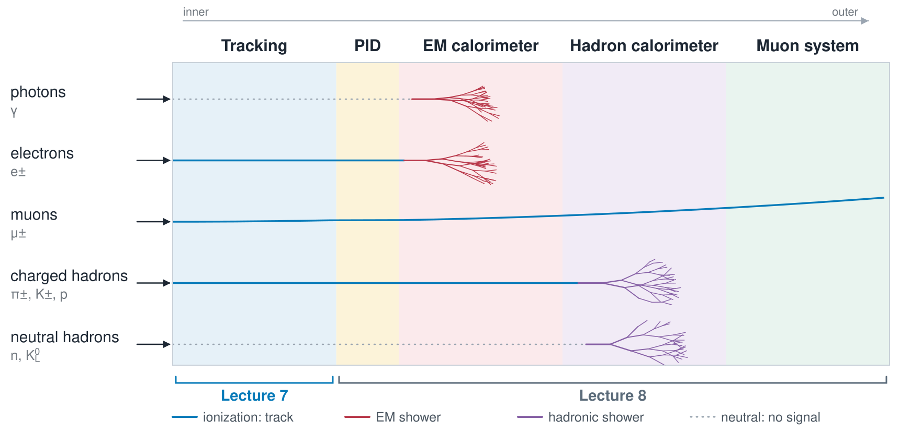

:::

::: {.take-home}
No single detector measures everything. Each layer exploits one interaction with matter. PID layers let particles pass: they measure velocity or the particle type without stopping them.
:::

::::

## What do we want to measure? {.measure-list}

:::: {.slide-body}

| The question | The quantity | Where it comes from |
|---|---|---|
| Where did it pass? | position, direction | tracking layers [L7]{.lec .lec7} |
| How hard was it kicked? | momentum | tracks bent in a magnetic field [L7]{.lec .lec7} |
| When did it pass? | time | fast scintillators, silicon [L7]{.lec .lec7} |
| How much energy? | energy | calorimeters [L8]{.lec .lec8} |
| What is it? | particle type | d*E*/d*x*, Cherenkov light, time of flight, showers, penetration [L8]{.lec .lec8} |

::: {.take-home}
Every quantity needs a different interaction, so a general-purpose experiment combines several technologies.
:::

::::

## 1 · Magnets and momentum {.section-title}

:::: {.slide-body}

How a magnetic field turns a position measurement into a momentum measurement.

::::

## Momentum from curvature

::: {.slide-refs}
Own drawing
:::

:::: {.slide-body}

::: {.split}
::: {.copy}
In a field $B$ a charged particle moves on a circle. For a singly charged particle

$$p_T\,[\mathrm{GeV}/c]=0.3\;B\,[\mathrm T]\;r\,[\mathrm m].$$

Only the component of $\mathbf p$ perpendicular to $\mathbf B$ bends.

**Example:** $B=3.8$ T and $p_T=100$ GeV/$c$ give $r\approx 88$ m. Over a tracker of 1 m the track is almost straight, so we measure a small **sagitta** $s$.

$$s\simeq\frac{0.3\,B\,L^2}{8\,p_T}\approx 1.4\ \mathrm{mm}\quad(L=1\ \mathrm m)$$
:::
::: {.visual}
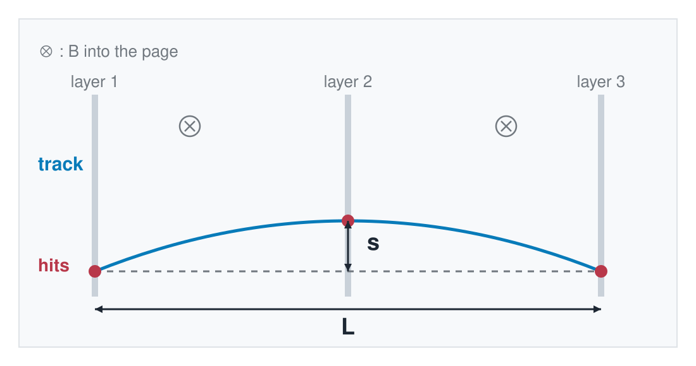

:::
:::

::::

## Momentum resolution

:::: {.slide-body}

With $N$ hits of position resolution $\sigma_x$ spread over a length $L$ (the standard result, not derived here):

$$\frac{\sigma(p_T)}{p_T}\;\simeq\;\frac{\sigma_x\,p_T}{0.3\,B\,L^2}\sqrt{\frac{720}{N+4}}\;\oplus\;\text{(multiple scattering)}$$

- **Grows with $p_T$**: stiff tracks are nearly straight.
- **Improves with $B$ and, quadratically, with the lever arm $L$**, and with precise hits.
- **Multiple scattering** (Lecture 5) adds a term that does not depend on $p_T$ and is proportional to $1/(B\sqrt{L X_0})$: material in the tracker sets the limit at low $p_T$.

**Example:** $B=4$ T, $L=1$ m, $\sigma_x=10$ µm, $N=10$ at $p_T=100$ GeV/$c$ gives $\sigma(p_T)/p_T\approx0.6\,\%$.

::: {.take-home}
Large $B\,L^2$, precise hits and little material: this is the design brief of every tracker.
:::

::::

## Explore: resolution {.widget-slide}

::: {.slide-refs}
Own toy simulation
:::

:::: {.slide-body}

::: {.widget data-src="widgets/momentum-resolution.html?present" data-poster="widgets/momentum-resolution-poster.png" data-alt="Toy barrel tracker: one event with hits and fitted circle, and the momentum resolution against pT"}
:::

::::

## CMS and ATLAS magnets {.full-figure}

::: {.slide-refs}
Own drawing · [ATLAS](https://doi.org/10.1088/1748-0221/3/08/S08003) · [CMS](https://doi.org/10.1088/1748-0221/3/08/S08004) · JINST 3 (2008)
:::

:::: {.slide-body}

::: {.visual}
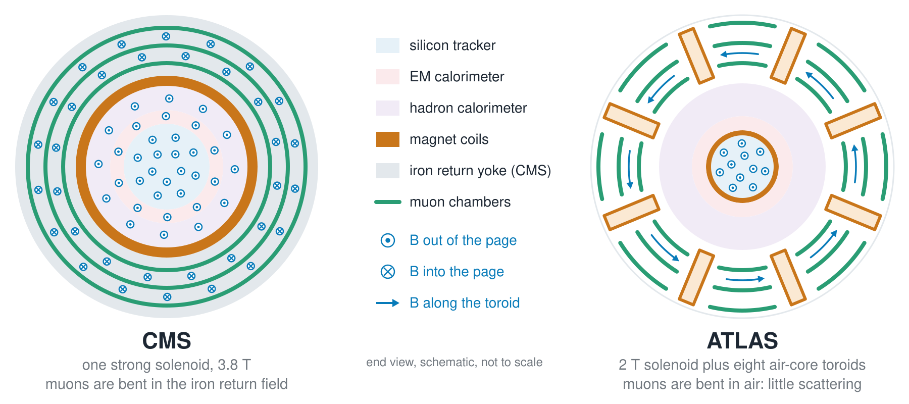

:::

::: {.take-home}
CMS: strong field for everything, muons measured in the iron. ATLAS: weaker tracker field, but muons bend in air with little scattering. LHCb: one dipole, about 4 Tm.
:::

::::

## Magnets in the flesh {.photo-slide}

:::: {.slide-body}

::::: {.photos .cols3}
::: {.photo}
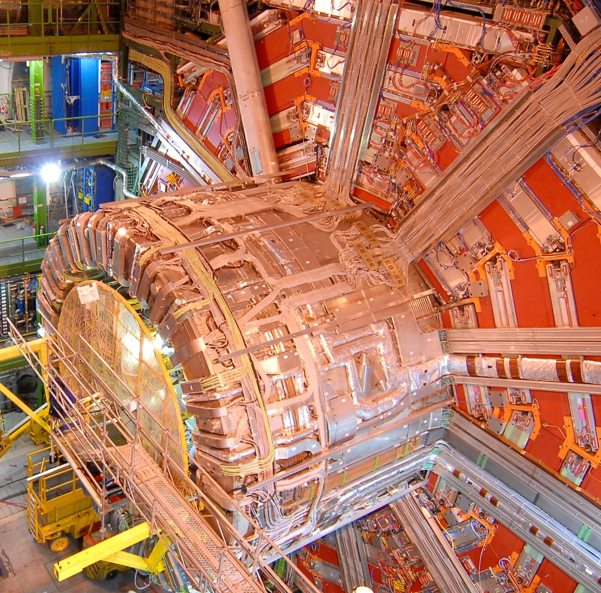

::: {.cap}
**CMS solenoid, 3.8 T**\
CMS Collaboration, JINST 19 (2024) P05064, Fig. 2 · CC BY 4.0
:::
:::

::: {.photo}
<div class="local-photo" data-local="figures/local/atlas-toroid.jpg" data-alt="The eight coils of the ATLAS barrel toroid"></div>

::: {.cap}
**ATLAS barrel toroid, eight coils**\
CERN, ATLAS Experiment (CDS 910381) · © CERN
:::
:::

::: {.photo}
<div class="local-photo" data-local="figures/local/lhcb-magnet.jpg" data-alt="The LHCb dipole magnet with a person for scale"></div>

::: {.cap}
**LHCb dipole**\
P. Ginter, “LHCb Magnet”, CERN CDS 1124307 · © CERN
:::
:::
:::::

::::

## 2 · Gas detectors {.section-title}

:::: {.slide-body}

Ionization of a gas, drift of the charge, amplification at a wire.

::::

## Drift tube and wire chamber

::: {.slide-refs}
Own drawing
:::

:::: {.slide-body}

::: {.split .fig-wide}
::: {.copy}
1. The particle **ionizes the gas**: about 100 electron–ion pairs per cm.
2. In the field of the tube, electrons **drift** to the thin anode wire at a few cm/µs.
3. Close to the wire the field is huge: electrons **avalanche**, a gain of order $10^4$–$10^5$.
4. If the passage time is known (trigger), the **drift time** gives the distance to the wire.

Typical resolution: 50–200 µm per wire.
:::
::: {.visual}
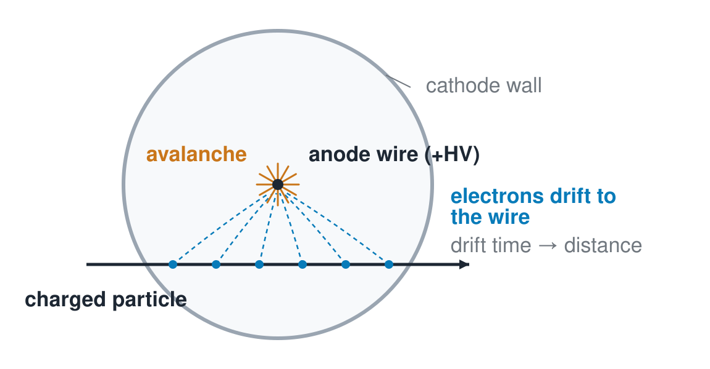

:::
:::

::::

## The multiwire proportional chamber {.photo-slide .short}

:::: {.slide-body}

::::: {.photos .cols2}
::: {.photo}
<div class="local-photo" data-local="figures/local/charpak-mwpc.jpg" data-alt="Georges Charpak and colleagues with a multiwire proportional chamber"></div>

::: {.cap}
**Georges Charpak and his multiwire chamber, 1970**\
CERN-HI-7008008, CDS 39073 · © CERN
:::
:::

::: {.photo}
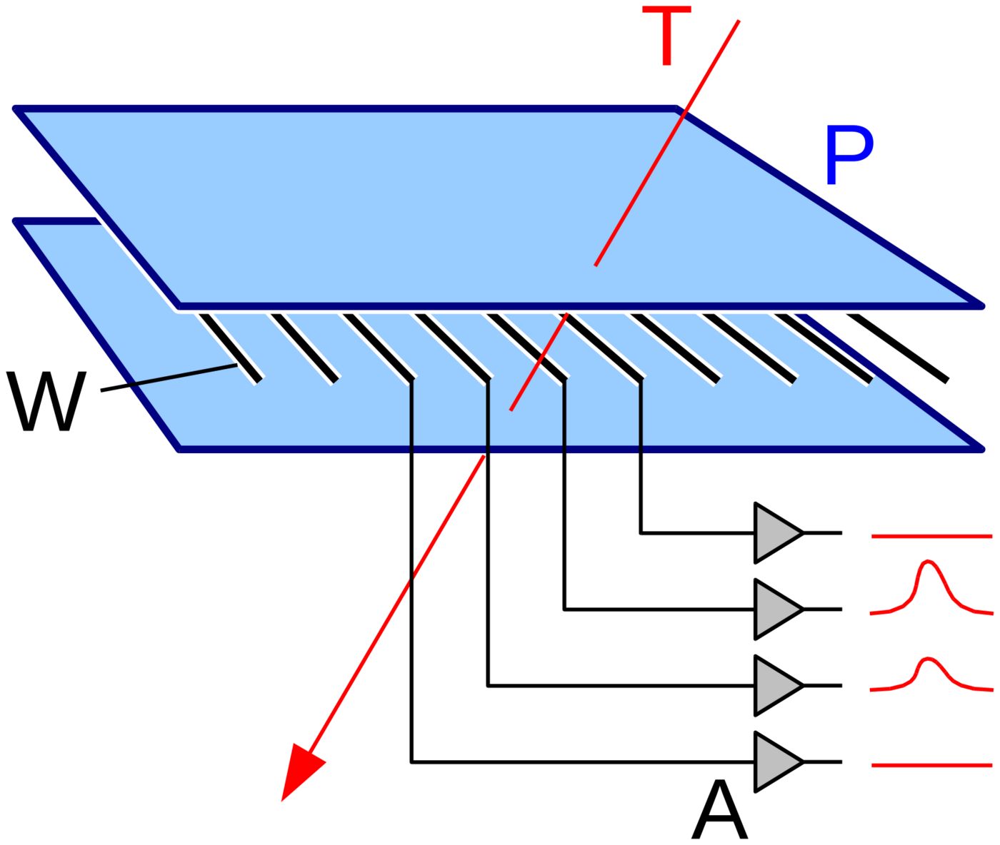

::: {.cap}
**Principle:** wires (W) between two cathode planes (P); the track (T) gives a signal on the nearest wires only, one amplifier (A) per wire.\
M. Schmid, Wikimedia Commons · CC BY-SA 3.0
:::
:::
:::::

::: {.take-home}
Charpak (1968): every wire is its own proportional counter, and the wires that fire show where the track crossed. Wire pitch about 2 mm. Nobel Prize in Physics 1992.
:::

::::

## From wires to 3D {.full-figure}

::: {.slide-refs}
Own drawing
:::

:::: {.slide-body}

::: {.visual}
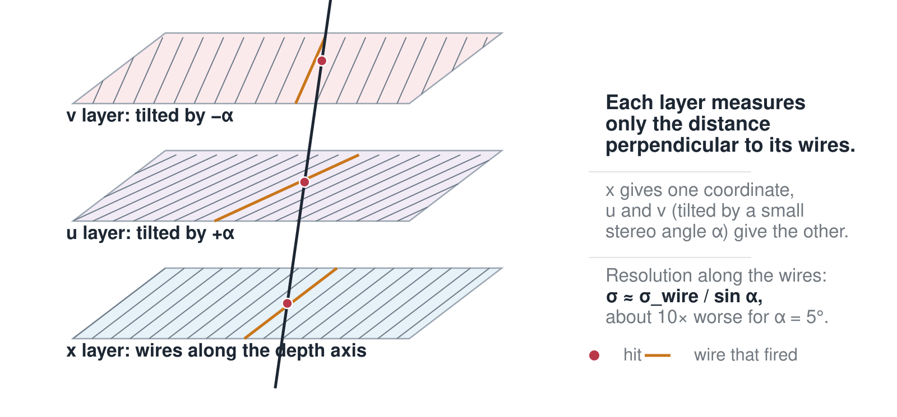

:::

::: {.take-home}
Stack layers with different wire directions. The bending plane needs the precision; the other coordinate needs only a small stereo angle (a few degrees). Perpendicular layers where both matter.
:::

::::

## Drift chamber: Belle II {.photo-slide .short}

:::: {.slide-body}

::::: {.photos .cols2}
::: {.photo}
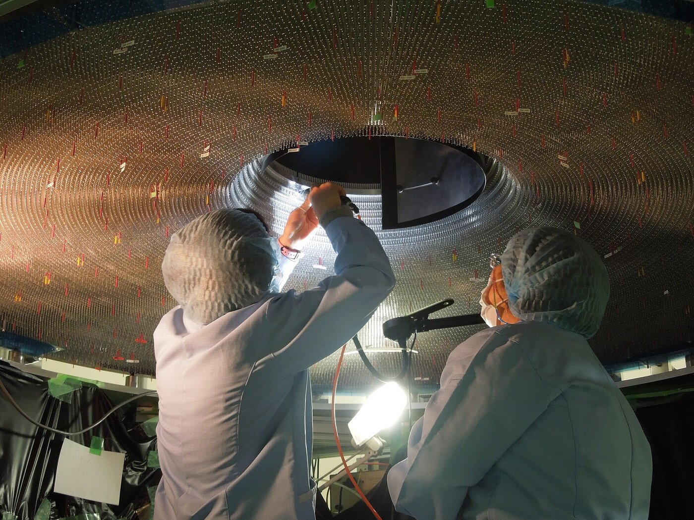

::: {.cap}
**Central drift chamber under construction**\
N. Taniguchi / Belle II, Wikimedia Commons · CC BY-SA 4.0
:::
:::

::: {.photo}
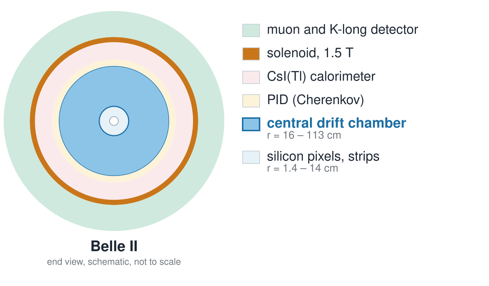

::: {.cap}
**Where it sits in the experiment**\
Own drawing
:::
:::
:::::

::: {.take-home}
About 14 000 sense wires in 56 layers. Axial layers and stereo layers (tilted by a few degrees) give the third coordinate; the pulse height gives d*E*/d*x* for particle identification.
:::

::::

## Straw tubes: ATLAS TRT {.photo-slide .short}

:::: {.slide-body}

::::: {.photos .cols2}
::: {.photo}
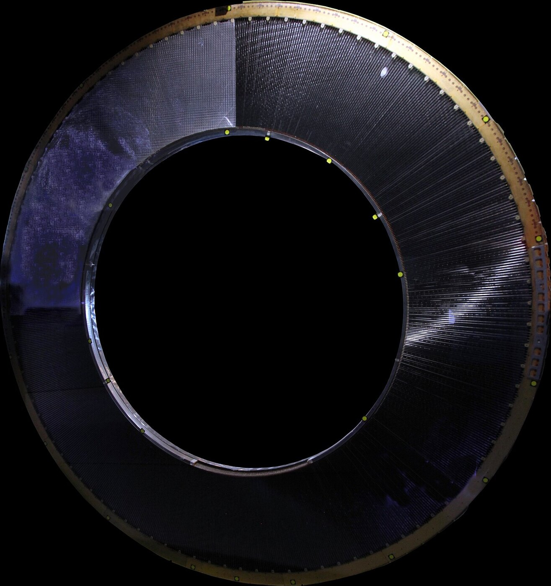

::: {.cap}
**Straw-tube tracker prototype wheel**\
Rama, Wikimedia Commons · CC BY-SA 3.0 fr
:::
:::

::: {.photo}
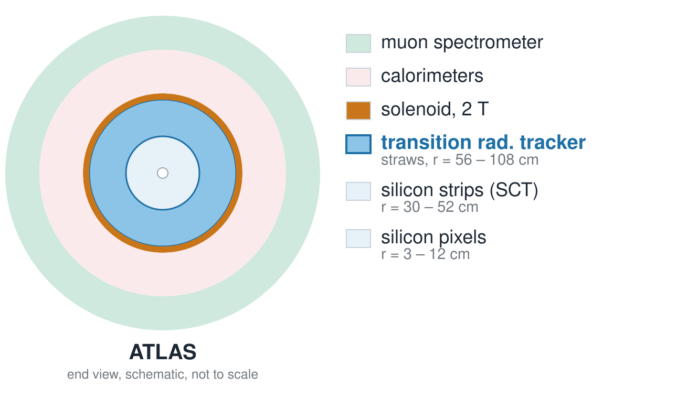

::: {.cap}
**Where it sits in the experiment**\
Own drawing
:::
:::
:::::

::: {.take-home}
About 300 000 straws of 4 mm diameter. Barrel straws run along the beam, so they measure only r–φ (about 130 µm); the silicon layers give z. The xenon gas also detects transition radiation from electrons (Lecture 8).
:::

::::

## GEM and Micromegas {.photo-slide .schematics .short .tall-cap}

:::: {.slide-body}

::::: {.photos .cols2}
::: {.photo}
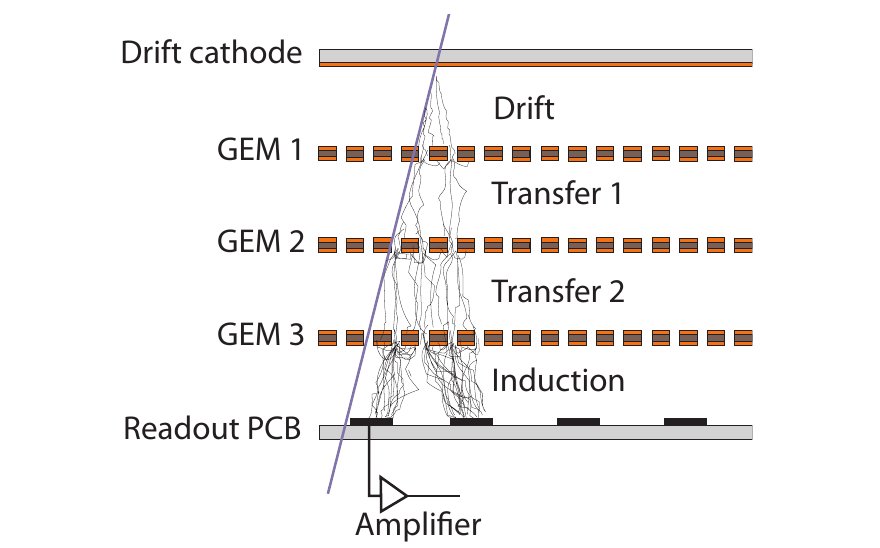

::: {.cap}
**Triple GEM:** the avalanche forms in the holes (70 µm) of thin foils; stacking several foils shares the gain.\
**In use:** CMS forward muon chambers (GE1/1), ALICE TPC readout since Run 3, LHCb muon system.\
CMS Collaboration, JINST 19 (2024) P05064, Fig. 76 · CC BY 4.0
:::
:::

::: {.photo}
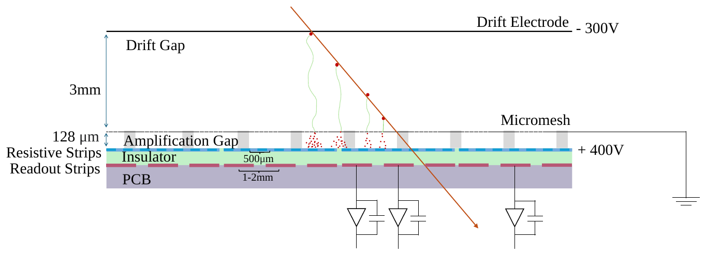

::: {.cap}
**Micromegas:** a fine mesh about 100 µm above the readout strips; a thin amplification gap, so the ions leave within about 100 ns.\
**In use:** ATLAS New Small Wheels (about 1200 m²), sPHENIX outer tracker, T2K near-detector TPC.\
S. Aune et al. (sPHENIX), arXiv:2403.13789, Fig. 3 · CC BY 4.0
:::
:::
:::::

::: {.take-home}
Wire spacing limits rate and resolution. With readout pitches of 0.1–0.5 mm and tiny gaps, these detectors reach tens of µm and much higher rates.
:::

::::

## Gas detectors: goals and challenges {.challenges}

:::: {.slide-body}

| We want | The challenge | What is done about it |
|---|---|---|
| **little material, large area** | gas gives only about 100 electron–ion pairs per cm, so one layer is not fully efficient | many layers or long tracks; light gas keeps the material low |
| **high rate** | ions are about 1000× slower than electrons; they pile up and distort the field (space charge) | small cells and gaps, as in GEM and Micromegas |
| **long life** | ageing: deposits form on wires and electrodes under irradiation and reduce the gain | clean gas and materials; do not run at too high a gain |
| **fast signals** | electrons need microseconds to drift; in a long TPC about 100 µs, so events overlap | short drift cells, triggers, continuous readout |

::::

## 3 · Silicon detectors {.section-title}

:::: {.slide-body}

The same idea in a solid: more charge per µm, much faster, much finer.

::::

## Silicon: a solid-state detector

::: {.slide-refs}
Own drawing
:::

:::: {.slide-body}

::: {.split .fig-wide}
::: {.copy}
- Silicon is a **semiconductor**: it has free charges of its own, which would drown a signal.
- A **diode** (a p–n junction) with a voltage in the blocking direction sweeps them out. A few hundred µm of silicon are then **free of mobile charge**, like an empty gas volume.
- A passing MIP creates about **80 electron–hole pairs per µm** (3.6 eV each): about $2\times10^4$ pairs in 300 µm.
- The pairs drift in about 10 ns to the **strips** or **pixels** on the surface.
:::
::: {.visual}
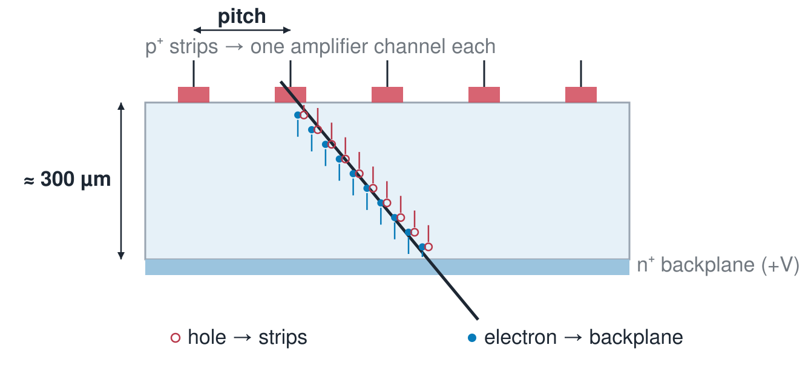

:::
:::

::::

## Strips and pixels {.full-figure}

::: {.slide-refs}
Own drawing
:::

:::: {.slide-body}

::: {.visual}
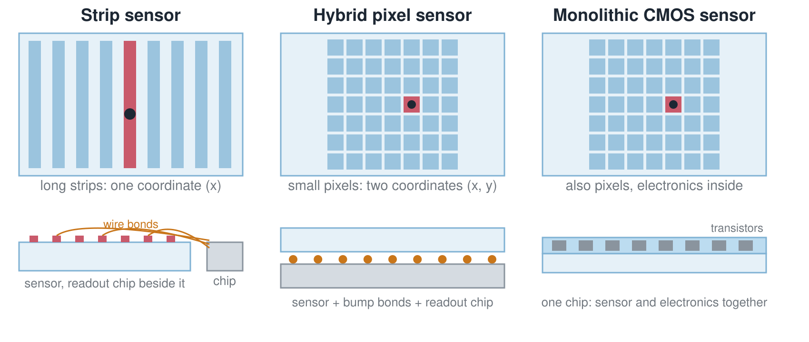

:::

::: {.take-home}
**Strips** are long diodes: one coordinate, cheap, for large areas. **Pixels** are small diodes: two coordinates, even at high hit density. **Hybrid:** sensor and readout chip are separate. **CMOS** (the chip technology of computers and phones): sensor and electronics in one thin chip.
:::

::::

## Pitch and resolution

:::: {.slide-body}

A hit strip of pitch $p$ says only: the particle crossed **somewhere** inside the strip, equally likely anywhere. The rms of such a uniform distribution of width $p$ is

$$\sigma_x=\sqrt{\int_{-p/2}^{p/2}\frac{x^2}{p}\,dx}=\sqrt{\frac{p^2}{12}}=\frac{p}{\sqrt{12}}\ \approx\ 0.29\,p.$$

**Example:** $p=50\ \mu$m gives $\sigma_x\approx 14\ \mu$m.

If the charge is shared between neighbouring strips and read out as an analogue value, the position can be interpolated and the resolution gets better than $p/\sqrt{12}$.

::: {.take-home}
The pitch sets the precision: fine pitch, many channels, more power and material.
:::

::::

## Strip module: ATLAS SCT {.photo-slide .short}

:::: {.slide-body}

::::: {.photos .cols2}
::: {.photo}
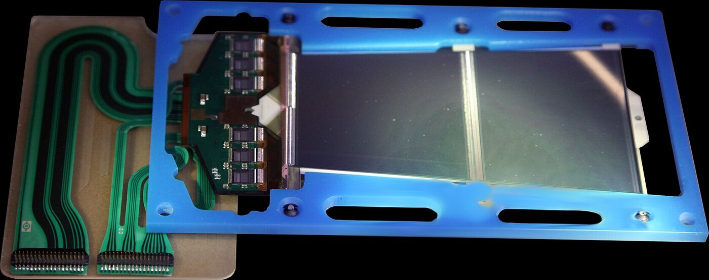

::: {.cap}
**ATLAS SCT strip module**: sensors, hybrid with readout chips, flex cable\
Rama, Wikimedia Commons · CC BY-SA 3.0 fr
:::
:::

::: {.photo}
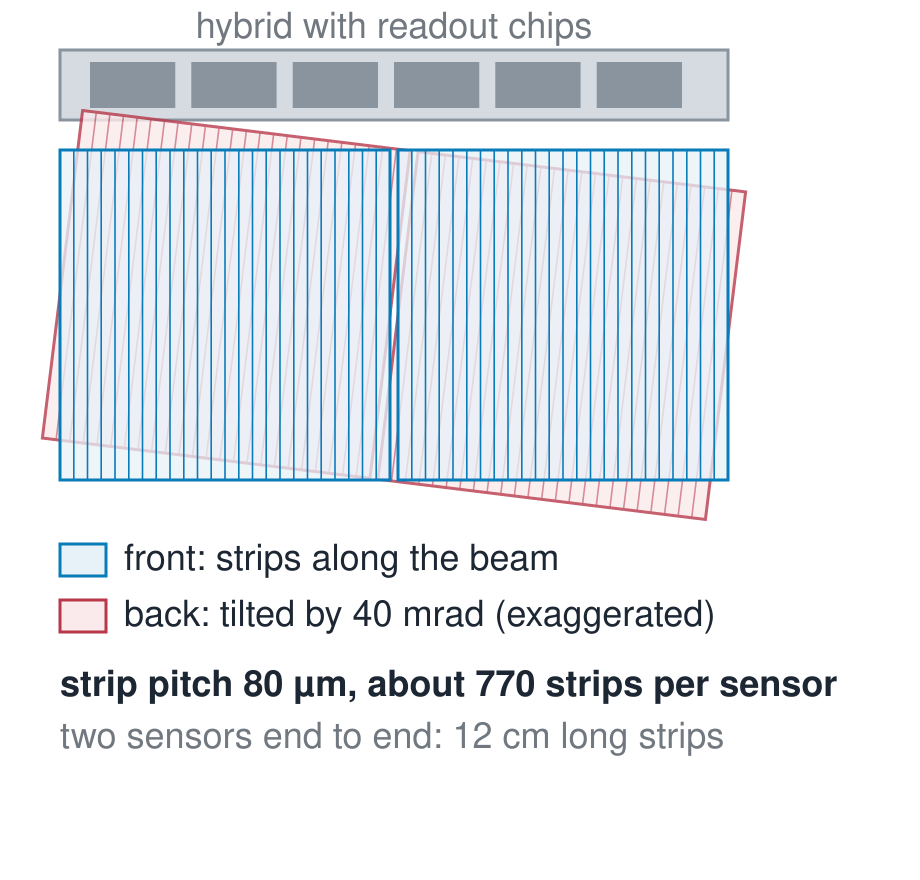

::: {.cap}
**What is on the sensors**\
Own drawing, after the SCT module layout
:::
:::
:::::

::: {.take-home}
Two layers of strips, tilted against each other by 40 mrad: together they give a point, not just a line.
:::

::::

## Strip module: LHCb VELO {.photo-slide .short}

:::: {.slide-body}

::::: {.photos .cols2}
::: {.photo}
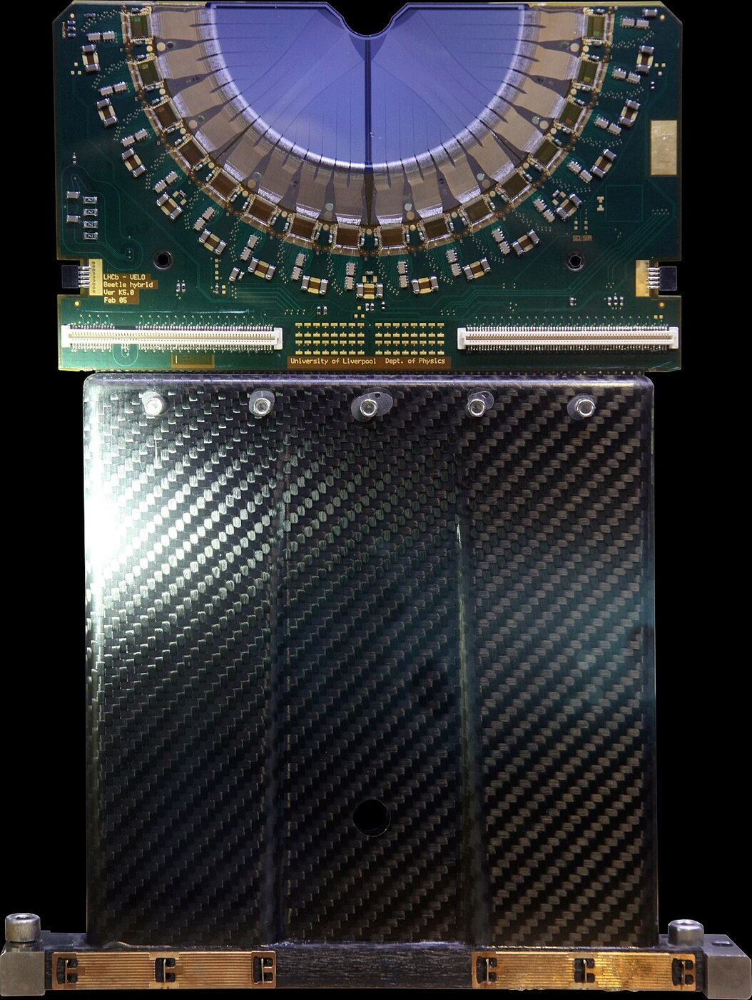

::: {.cap}
**LHCb VELO module** (Run 1 and 2): half-disc sensors, hybrid, carbon-fibre support\
Rama, Wikimedia Commons · CC BY-SA 3.0 fr
:::
:::

::: {.photo}
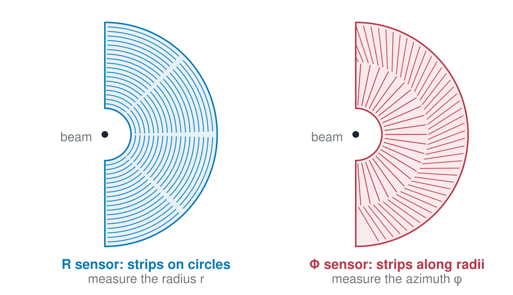

::: {.cap}
**What is on the sensors**\
Own drawing, after the VELO module layout
:::
:::
:::::

::: {.take-home}
Strips shaped for the physics: circles give the radius, radial strips the azimuth. The sensor edge is about 8 mm from the beam.
:::

::::

## Radiation damage {.full-figure}

::: {.slide-refs}
Own drawing
:::

:::: {.slide-body}

::: {.visual}
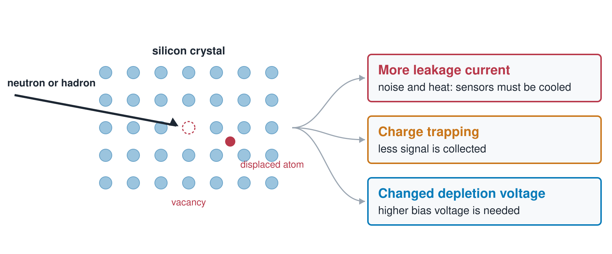

:::

::: {.take-home}
Near the beam, particles damage the crystal itself. Sensors are cooled, biased higher and, if needed, replaced.
:::

::::

## 4 · Scintillators and photosensors {.section-title}

:::: {.slide-body}

Excitation gives light, light gives a fast electrical signal.

::::

## Scintillators: light from ionization {.full-figure}

::: {.slide-refs}
Own drawing
:::

:::: {.slide-body}

::: {.visual}
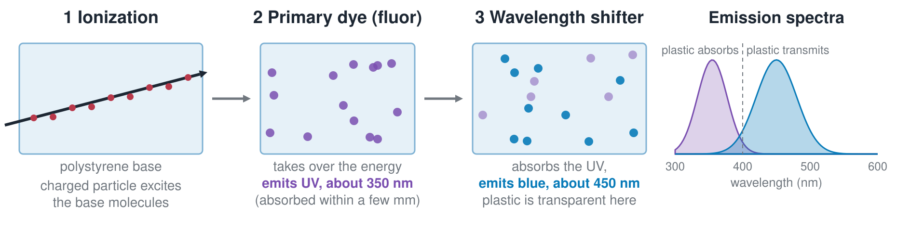

:::

::: {.take-home}
Plastic scintillators give about $10^4$ photons per MeV within a few ns. The **dyes** shift the light to a colour that the plastic transmits and the photosensor sees. Crystals (PbWO~4~, LYSO) are slower but denser: calorimeters, Lecture 8.
:::

::::

## Photosensors: PMT and SiPM {.full-figure}

::: {.slide-refs}
Own drawing
:::

:::: {.slide-body}

::: {.visual}
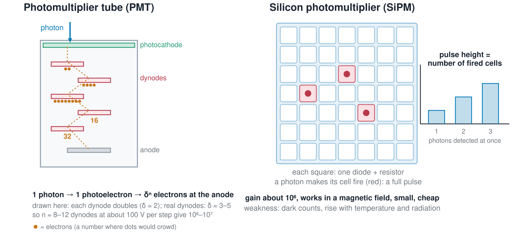

:::

::: {.take-home}
A PMT multiplies one photoelectron in vacuum; a SiPM counts photons with many tiny diodes. SiPMs are compact, cheap and work in a magnetic field, so they are replacing PMTs in many modern detectors.
:::

::::

## Scintillators and photosensors in pictures {.photo-slide}

:::: {.slide-body}

::::: {.photos .cols3}
::: {.photo}
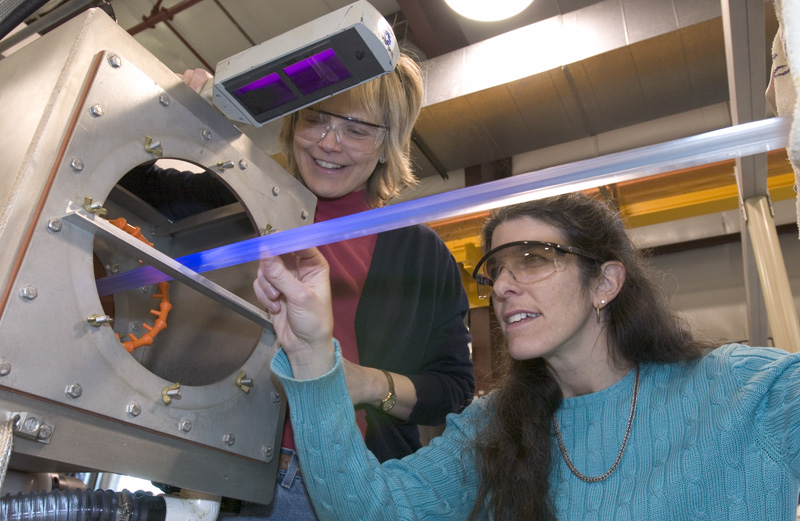

::: {.cap}
**Plastic scintillator**\
Fermilab, public domain, via Wikimedia Commons
:::
:::

::: {.photo}
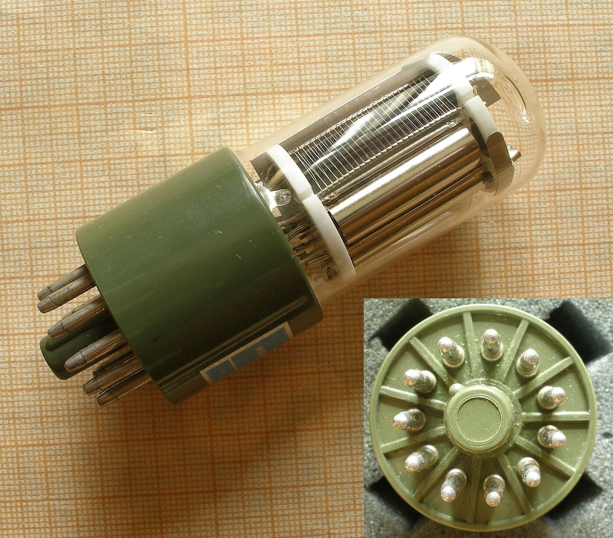

::: {.cap}
**Photomultiplier tube**\
ScAvenger, Wikimedia Commons · CC BY-SA 4.0
:::
:::

::: {.photo}
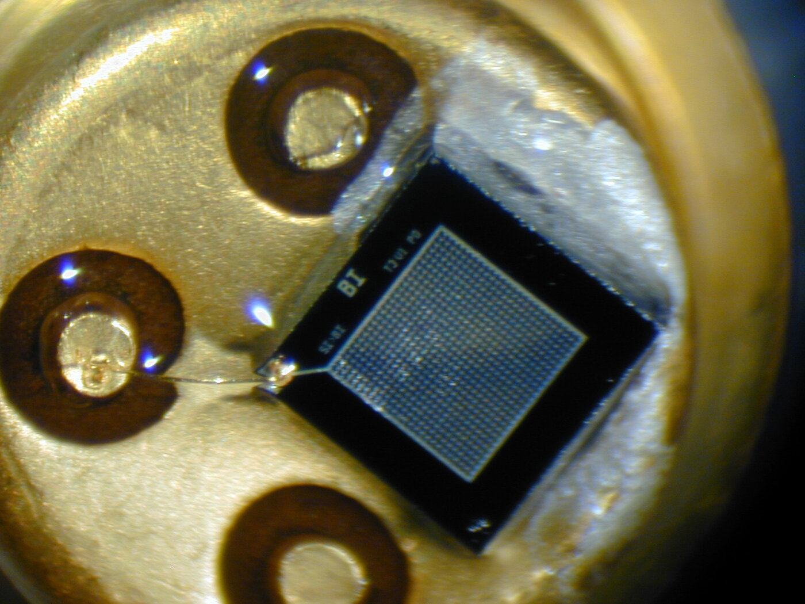

::: {.cap}
**Silicon photomultiplier**\
Wikimedia Commons (user GLevi) · CC BY-SA 3.0
:::
:::
:::::

::::

## Example: LHCb SciFi tracker {.full-figure}

::: {.slide-refs}
Own drawing
:::

:::: {.slide-body}

::: {.visual}
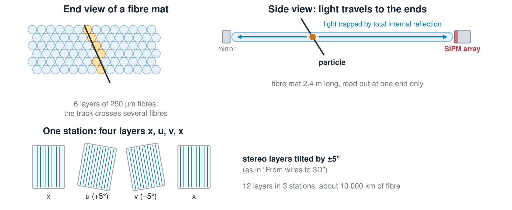

:::

::: {.take-home}
Scintillating fibres (250 µm) with SiPMs at the ends: hits known to better than 100 µm. The SiPMs are cooled to about −40 °C against dark counts.
:::

::::

## Time as a measurement

::: {.slide-refs}
Active area of research
:::

:::: {.slide-body}

At the HL-LHC, about 200 collisions occur in each bunch crossing. Their vertices overlap in space but are spread over **about 200 ps** in time.

A **time stamp per hit** (tens of ps) can pull them apart: *4D tracking* is an active field of detector R&D, for example for the LHCb VELO upgrade.

::: {.photos .cols1}
::: {.photo}
<div class="local-photo" data-local="figures/local/velo-timing.jpg" data-alt="Simulated VELO tracks at Upgrade II luminosity: all tracks of a bunch crossing, and the same event with a 20 ps time window"></div>

::: {.cap}
Left: tracks of one bunch crossing at Upgrade II luminosity. Right: the same event within a 20 ps time window.\
LHCb, CERN Courier, March/April 2023, “LHCb looks forward to the 2030s” · © CERN
:::
:::
:::

::::

## What we asked of the detectors {.shopping-list .short}

:::: {.slide-body}

| Detector | Interaction used → signal | What we ask of it today | Typical challenge |
|---|---|---|---|
| **Gas tracker**, TPC | [Ionization]{.proc .process-ionization}: free charge, drifted and amplified → position, d*E*/d*x* | large volume, little material, high rate | slow drift, ion space charge, ageing |
| **Silicon tracker** | [Ionization]{.proc .process-ionization}: e–h pairs in a thin diode → position | µm precision, thin, fast, radiation hard | radiation damage, cooling and cables (material), cost |
| **Scintillator**, SiPM | [Excitation]{.proc .process-ionization}: light flash → time, trigger, energy | ns timing, large area, cheap | light yield, ageing, noise of photosensor |

::::

## Detectors and Nobel prizes

:::: {.slide-body}

| Year | Prize | Detection method |
|---|---|---|
| 1927 | C.T.R. Wilson | cloud chamber |
| 1948 | P.M.S. Blackett | advanced cloud chamber |
| 1950 | C.F. Powell | nuclear emulsion |
| 1954 | W. Bothe | coincidence method |
| 1958 | P.A. Cherenkov, I. Frank, I. Tamm | Cherenkov effect |
| 1960 | D.A. Glaser | bubble chamber |
| 1992 | G. Charpak | multiwire proportional chamber |
| 2009 | W.S. Boyle, G.E. Smith | CCD sensor |

::::

## Take-home {.take-fig}

::: {.slide-refs}
Redrawn after C. Lippmann (2003)
:::

:::: {.slide-body}

- **Gas** and **silicon** turn the ionization of charged particles into positions; a magnetic field turns the track curvature into **momentum**, with $\sigma(p_T)/p_T$ growing with $p_T$ and shrinking with $BL^2$.
- **Scintillators** and photosensors turn energy deposits into fast signals for timing and triggering.
- Next time: energy (calorimeters), identity (RICH, TRD, time of flight) and muons.

::: {.visual}


:::

::::

## Backup {.section-title}

## Backup: radiation falls with distance from the beam

:::: {.slide-body}

::: {.split .fig-wide}
::: {.copy}
- **Fluence:** the number of particles per cm², counted in “1 MeV neutron equivalents” ($n_{eq}$/cm²).
- At 8 mm from the beam it is about $5\times10^{13}\,n_{eq}$/cm² for each fb$^{-1}$ of collisions, and it falls steeply with radius: by more than a factor 10 between 1 cm and 4 cm.
- The innermost layers therefore set the radiation hardness requirement.
:::
::: {.visual}
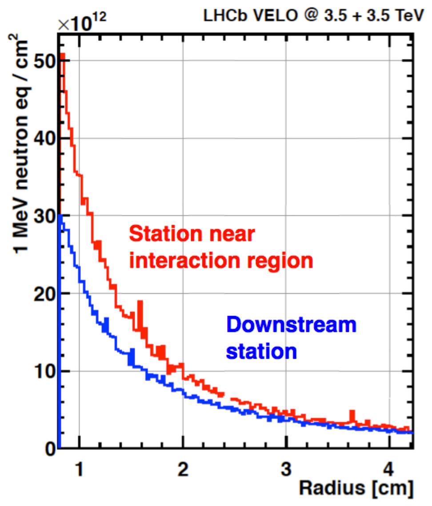

::: {.credit}
Fluence from simulated 7 TeV pp collisions for 1 fb⁻¹. LHCb VELO group, JINST 8 (2013) P08002 · CC BY 3.0
:::
:::
:::

::::

## Backup: material per layer {.full-figure}

::: {.slide-refs}
Own calculation · values marked approx. from the literature
:::

:::: {.slide-body}

::: {.visual}
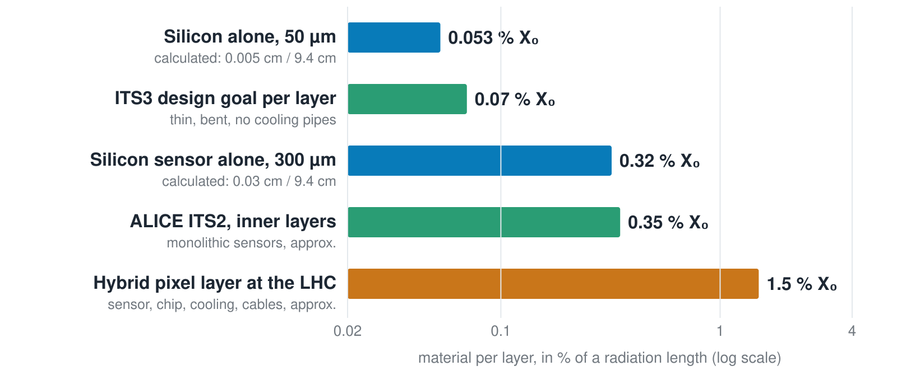

:::

::: {.take-home}
“Little material” means a small fraction of a radiation length per layer. Silicon alone is cheap ($X_0=9.4$ cm); chips, cables, cooling and supports make a hybrid layer several times thicker. Monolithic sensors can be thinned to about 50 µm.
:::

::::

## Backup: where does the material sit? {.photo-slide .short}

:::: {.slide-body}

::::: {.photos .cols2}
::: {.photo}
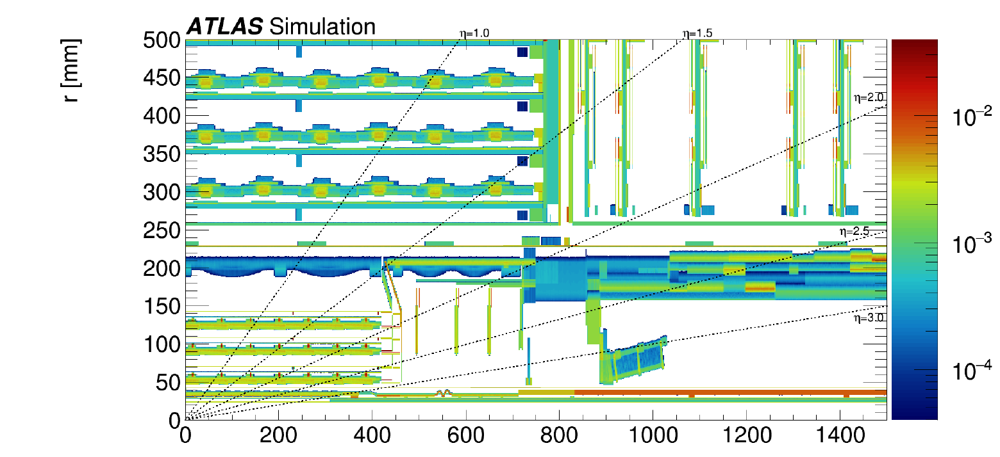

::: {.cap}
**Map of the ATLAS inner detector material** (r in mm against z in mm; colour: material per radial step). Barrel layers, cooling and service lines.\
ATLAS Collaboration, JINST 12 (2017) P12009 · CC BY 3.0
:::
:::

::: {.photo}
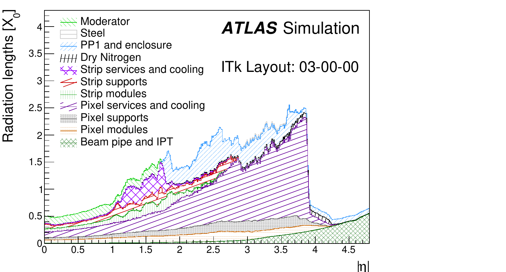

::: {.cap}
**Planned ATLAS ITk**: material against |η|, by component. Services, cooling and supports exceed the sensor modules.\
ATLAS Collaboration, JINST 20 (2025) P02018 · CC BY 4.0
:::
:::
:::::

::: {.take-home}
Most of the material is not silicon: cables, cooling pipes and supports. It grows towards the forward region, where particles cross it at a shallow angle.
:::

::::

## Backup: thinner and bent sensors {.photo-slide}

:::: {.slide-body}

::::: {.photos .cols2}
::: {.photo}
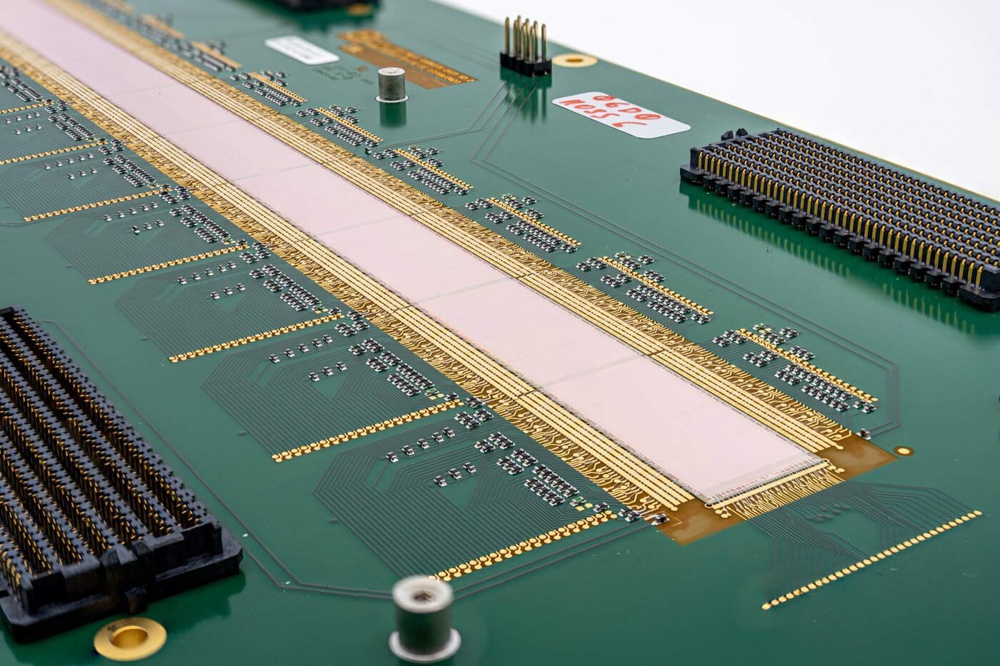

::: {.cap}
**Stitched sensor (MOSS) on a carrier card**\
M. Suljic, Wikimedia Commons · CC BY-SA 4.0
:::
:::

::: {.photo}
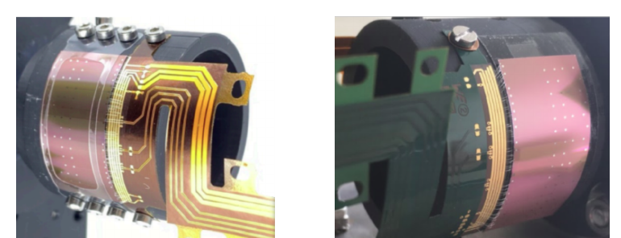

::: {.cap}
**Bent 50 µm ALPIDE sensors (R&D prototype)**\
B.-M. Blidaru et al., JINST 17 C09006 (arXiv:2112.10414), Fig. 2a,b · CC BY 4.0
:::
:::
:::::

::::

## Backup: all detector types in one table {.shopping-list}

:::: {.slide-body}

| Detector | Interaction used → signal | What we ask of it today | Typical challenge |
|---|---|---|---|
| **Gas tracker**, TPC [L7]{.lec .lec7} | [Ionization]{.proc .process-ionization}: free charge, drifted and amplified → position, d*E*/d*x* | large volume, little material, high rate | slow drift, ion space charge, ageing |
| **Silicon tracker** [L7]{.lec .lec7} | [Ionization]{.proc .process-ionization}: e–h pairs in a thin diode → position | µm precision, thin, fast, radiation hard | radiation damage, cooling and cables (material), cost |
| **Scintillator**, SiPM [L7]{.lec .lec7} | [Excitation]{.proc .process-ionization}: light flash → time, trigger, energy | ns timing, large area, cheap | light yield, ageing, noise of photosensor |
| **EM calorimeter** [L8]{.lec .lec8} | [Bremsstrahlung]{.proc .process-radiation} and pair production: shower → energy of e^±^, γ | percent resolution, fine granularity, compact | stochastic fluctuations, leakage, dead material in front |
| **Hadron calorimeter** [L8]{.lec .lec8} | [Nuclear interactions]{.proc .process-nuclear}: shower → energy of hadrons and jets | full containment, hermetic | very deep, large fluctuations, invisible energy |
| **RICH, DIRC, TOF, TRD** [L8]{.lec .lec8} | [Cherenkov light]{.proc .process-cherenkov}, flight time, transition radiation → velocity → π/K/p, e | single-photon detection, ps timing | momentum range fixed by radiator, few photons |
| **Muon system** [L8]{.lec .lec8} | only [ionization]{.proc .process-ionization}: muons survive the absorber | large area, robust, cheap | punch-through, decays in flight, low *p* muons stop |

::: {.map-legend}
Neutrinos are not in the list: they leave no signal and appear as missing energy.
:::

::::
