## Lecture 8 {.title-card}

:::: {.slide-body}

::: {.subtitle}
Accelerators
:::

Mikhail Mikhasenko · KT1 · Winter semester 2026/27

::::

::: {.notes}
90-minute session following Lecture 7 (tracking, light and charge). Section budget: why accelerate 0–12; electric fields 12–35 (two demos); magnetic fields 35–62 (three demos); synchrotron radiation 62–80; from collisions to experiments 80–90. Luminosity was covered in Lecture 4 and sits in the backup. With six demos the deck is full: keep each demo to 3–4 minutes. The next lecture (DAQ and trigger) starts from the last two slides: 40 MHz of crossings, far too many to record.
:::

## Ninety years of accelerators {.photo-hook}

:::: {.slide-body}

::::: {.photo-pair}
::: {.photo}
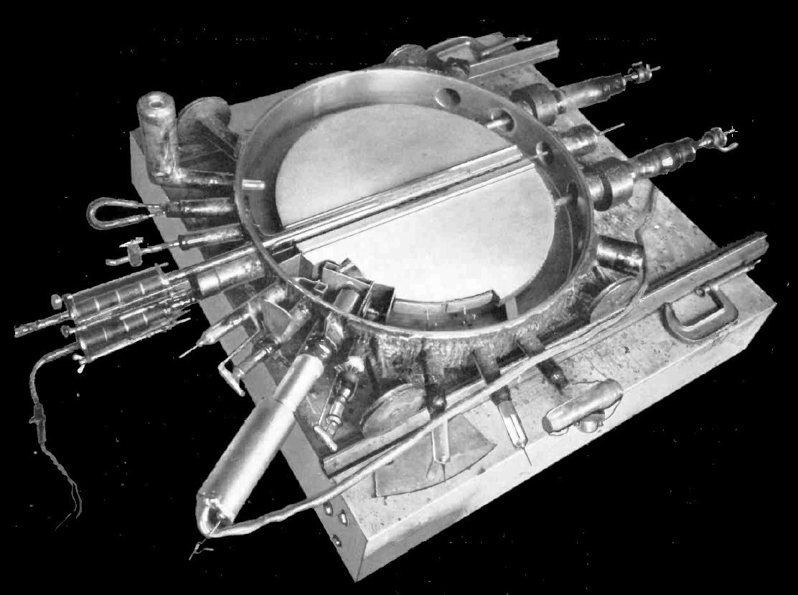

::: {.plot-caption}
1935 · Berkeley 27-inch cyclotron: a few MeV; the vacuum chamber fits on a table. Photo: J. B. Livingood, public domain.
:::
:::

::: {.photo}

::: {.plot-caption}
2008 · LHC tunnel: 7 TeV design, 27 km, 1232 dipoles. Photo: M. Brice/CERN, CC BY-SA 3.0.
:::
:::
:::::

::: {.take-home}
A factor of about a million in energy. Today: what each step required, and what limits the next.
:::

::::

::: {.notes}
2 minutes. Hook, not history. Ask: what physical principle is the same in both machines? (Electric fields give energy, magnetic fields steer.) What changed? (Superconductivity, RF, strong focusing, synchrotron principle.) Photo credits: 27-inch cyclotron dees, John B. Livingood, 1935, public domain via Wikimedia Commons; LHC tunnel sector 3-4, Maximilien Brice, CERN, CC BY-SA 3.0 via Wikimedia Commons. Full credits in SOURCES.md.
:::

## The lecture in five questions

:::: {.slide-body}

1. **Motivation:** why do we need high energy?
2. **Acceleration:** how do electric fields add energy?
3. **Guidance:** how do magnets steer and focus a beam?
4. **Limits:** why do electrons and protons need different machines?
5. **Experiments:** what does the machine mean for detectors?

::::

::: {.notes}
1 minute. Each section answers one question; return to the list at section boundaries. Luminosity (Lecture 4) is in the backup.
:::

## 1 · Why accelerate? {.section-title}

:::: {.slide-body}

Energy buys resolution and the mass of new particles.

::: {.subtle}
Resolution · thresholds · fixed target or collider · history of colliders
:::

::::

::: {.notes}

:::

## Energy buys resolution and mass

:::: {.slide-body}

**Resolution:** a probe of momentum $p$ resolves distances $\Delta x\sim\hbar/p$, with $\hbar c\approx197\ \mathrm{MeV\,fm}$.

| Momentum $pc$ | Resolved scale | Structure |
|---|---:|---|
| 200 MeV | 1 fm | proton size |
| 20 GeV | 0.01 fm | quarks inside the proton |
| 2 TeV | $10^{-4}$ fm | today's frontier |

**Mass:** to produce a final state we need $\sqrt{s}\ \ge\ \sum m_i c^2$, e.g. $Z$: 91 GeV, $t\bar t$: 346 GeV.

::::

::: {.notes}
4 minutes. Recall Lecture 3 (waves, probes and resolution) and Lecture 2 (collision thresholds); no new derivation. The deep-inelastic electron scattering at SLAC (1968, 20 GeV linac) resolved point-like constituents at roughly the 0.01–0.1 fm scale. Thresholds use invariant mass, which is why the collision geometry on the next slide matters.
:::

## Fixed target or collider?

::: {.slide-refs}
Original teaching model
:::

:::: {.slide-body}

::::: {.picture-layout}
::: {.picture-copy}
Fixed target ($m$ at rest):

$$\sqrt{s}\approx\sqrt{2Emc^2}$$

Head-on beams:

$$\sqrt{s}=2E$$

A 7 TeV proton on a proton at rest: **115 GeV**. Two 7 TeV beams: **14 TeV**.
:::

::: {.picture-visual}
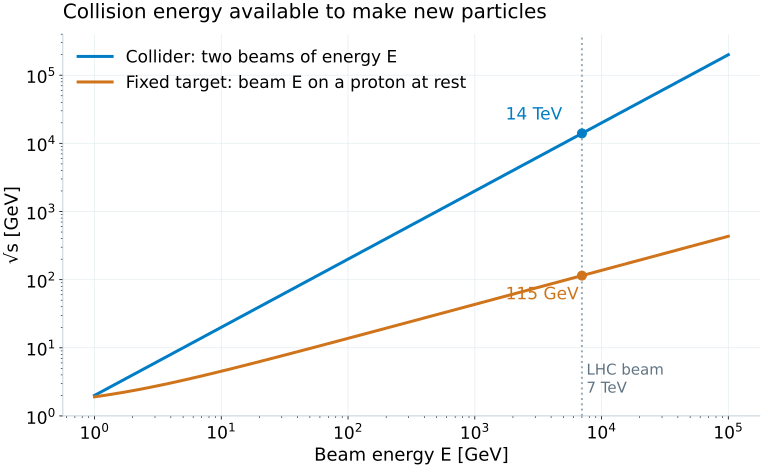

::: {.plot-caption}
Proton beam; fixed target is a proton at rest.
:::
:::
:::::

::::

::: {.notes}
4 minutes. From Lecture 2: s=(p1+p2)², fixed target s=m1²+m2²+2E1m2 (c=1). Ask students where the remaining energy goes in the fixed-target case: into the motion of the centre of mass, required by momentum conservation. Fixed targets still win on luminosity (dense target, many targets per beam) and secondary beams (neutrinos, kaons, muons) — e.g. CERN North Area, NA62, COMPASS/AMBER.
:::

## Colliders over time {.landmark}

::: {.slide-refs}
Original compilation
:::

:::: {.slide-body}

::::: {.picture-layout}
::: {.picture-copy}
Collision energy grew by **a factor 10 every ~15 years**, until about 1990.

Each step used **new technology**: storage rings, superconducting magnets, antiproton cooling.

What does the flattening after the LHC tell you?
:::

::: {.picture-visual}
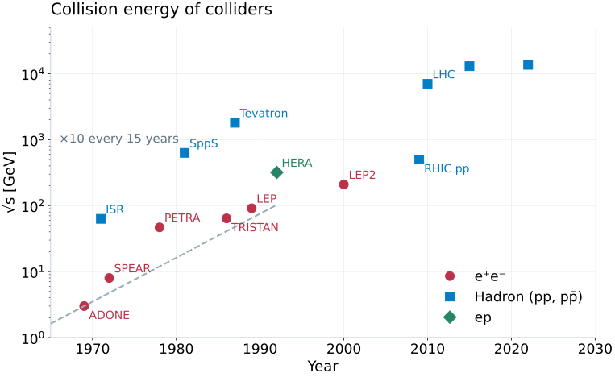

::: {.plot-caption}
Maximum √s of each collider at its start year; LEP2, RHIC 500 GeV and LHC upgrades at the year reached.
:::
:::
:::::

::::

::: {.notes}
4 minutes. This is a Livingston-style plot restricted to colliders. Point out the discoveries: J/ψ at SPEAR (1974), gluon jets at PETRA (1979), W and Z at the SppS (1983), top at the Tevatron (1995), precision Z at LEP/SLC (1989–), Higgs at the LHC (2012). The flattening reflects cost and size limits that the rest of the lecture explains: magnets for protons, synchrotron radiation for electrons. Data: original compilation of well-documented maximum design/operating √s; values are rounded; most points are plotted at the start of collider operation with the maximum energy later reached, LEP2, RHIC pp 500 GeV and the LHC steps at the year reached. Approximate by design: the trend, not the exact year, is the message.
:::

## 2 · Accelerating: electric fields {.section-title}

:::: {.slide-body}

Only electric fields change a particle's energy.

::: {.subtle}
Electrostatic · cyclotron · RF cavities · bunches · injector chains
:::

::::

::: {.notes}
Magnetic forces are perpendicular to velocity and do no work: dE/dt = q v·E.
:::

## Electrostatic machines: $\Delta E=qV$

::: {.slide-refs}
[Geni · CC BY-SA 4.0](https://commons.wikimedia.org/wiki/File:Cockcroft%E2%80%93Walton_generator_2012.JPG)
:::

:::: {.slide-body}

::::: {.picture-layout}
::: {.picture-copy}
One potential difference, crossed **once**.

1932: Cockcroft and Walton split lithium with protons of **a few hundred keV**.

Limit: electrical **breakdown** — a few to ~25 MV.

Still used for **ion beams**, e.g. radiocarbon dating.
:::

::: {.picture-visual .photo}
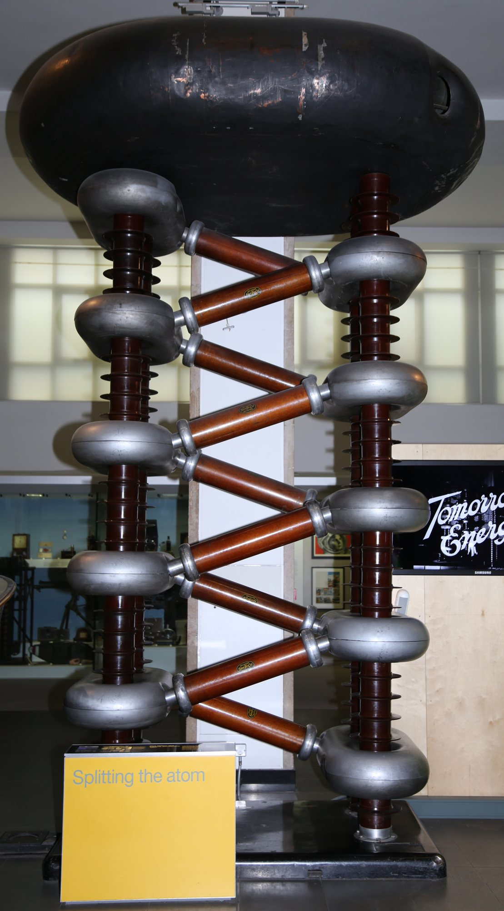

::: {.plot-caption}
Cockcroft–Walton generator, Science Museum London: diode–capacitor stages multiply the voltage.
:::
:::
:::::

::::

::: {.notes}
3 minutes. p + ⁷Li → 2 α was the first nuclear reaction induced by artificially accelerated particles (Nobel Prize 1951); the generator reached about 700 kV, and the reaction was seen with protons from about 125 keV up to a few hundred keV. As linac injectors, Cockcroft–Walton generators were replaced by radio-frequency quadrupoles (at CERN in 1993); electrostatic tandems remain workhorses for ion beams and accelerator mass spectrometry. Van de Graaff and tandem accelerators reach higher voltages (tandems effectively double by changing the ion charge). A static field cannot be reused: the particle must return to ground potential, which is why the next idea is a time-dependent field. Photo: Cockcroft–Walton generator in the Science Museum, London; Geni, CC BY-SA 4.0, via Wikimedia Commons.
:::

## Cockcroft–Walton demo {.demo-slide}

:::: {.slide-body}

::: {.widget data-src="widgets/cw.html" data-poster="widgets/cw-poster.png" data-alt="Interactive Cockcroft–Walton ladder: capacitors and diodes with node voltages, conducting diodes highlighted, output voltage rising towards 2N times the input"}
:::

::::

::: {.notes}
4 minutes. Press ½ cycle a few times with N = 3 and point at the diodes that light up: on the negative half cycle charge moves from the right column into the left; on the positive half cycle from the left into the right, one rung higher. The right column builds up a DC staircase 0, 2V₀, 4V₀, 6V₀. Then Play: the output approaches 2N·V₀ = 600 kV. Switch on a load: the output sags and ripples — the droop grows roughly as N³, which is why practical ladders stop at a few stages and about 1 MV. The 1932 machine reached about 700 kV.
:::

## Reuse the field: the cyclotron

::: {.slide-refs}
[E. O. Lawrence, US patent 1,948,384 (1934)](https://patents.google.com/patent/US1948384A)
:::

:::: {.slide-body}

::::: {.picture-layout}
::: {.picture-copy}
A magnetic field bends the ion back to the **same gap** every half turn.

$$f=\frac{qB}{2\pi\gamma m}$$

Independent of radius while $\gamma\approx1$: one fixed RF frequency.

Protons at 1 T: $f\approx15\ \mathrm{MHz}$.
:::

::: {.picture-visual .photo}
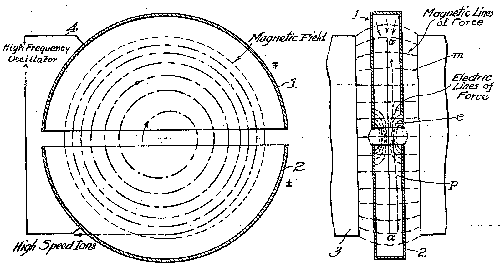

::: {.plot-caption}
Lawrence's patent: spiral orbit between two "dees".
:::
:::
:::::

::::

::: {.notes}
4 minutes. Derive on the board: qvB = γmv²/r ⇒ ω=qB/(γm). As γ grows the particle arrives late; classical cyclotrons stop near ~20 MeV for protons. Fixes: vary the frequency (synchrocyclotron), shape the field (isochronous cyclotron), or keep the radius fixed and ramp B (synchrotron, next slides). Medical cyclotrons today: 11–18 MeV for PET isotopes, ~230–250 MeV isochronous or superconducting cyclotrons for proton therapy. Patent drawing is public domain.
:::

## The synchrotron: fixed radius, rising field

:::: {.slide-body}

A cyclotron's magnet fills the whole orbit, and $\gamma$ spoils its timing.

**Synchrotron:** keep the orbit radius $\rho$ **fixed**.

- Ramp the dipole field with the momentum: $B=p/(0.3\,\rho)$.
- Lock the RF frequency to the revolution frequency.
- Magnets only around a thin pipe → rings of **kilometres**.

LHC: 0.54 T at 450 GeV → 8.33 T at 7 TeV, in about 20 minutes.

::::

::: {.notes}
3 minutes. Phase stability (Veksler 1944, McMillan 1945) made synchrotrons possible: particles slightly off energy or timing oscillate around the synchronous particle instead of being lost. Every circular collider is a synchrotron; the ramp is why each machine covers only a limited energy range and needs injectors (the CERN chain at the end of this section). 450/(0.3 × 2804 m) = 0.535 T. Today the LHC ramps to 6.8 TeV (about 8.1 T).
:::

## Radio-frequency cavities

::: {.slide-refs}
[Z22 · CC BY-SA 4.0](https://commons.wikimedia.org/wiki/File:A_1.3_GHz_nine-cell_superconducting_radio_frequency.JPG)
:::

:::: {.slide-body}

::::: {.picture-layout}
::: {.picture-copy}
A resonant cavity stores an oscillating field; the bunch crosses when it points **forward**.

Superconducting niobium: **~5–35 MV/m**.

Linac: 1 TeV at 30 MV/m needs **33 km**.

Ring: LHC reuses 16 MV per turn, **11 245 turns/s**.
:::

::: {.picture-visual .photo}
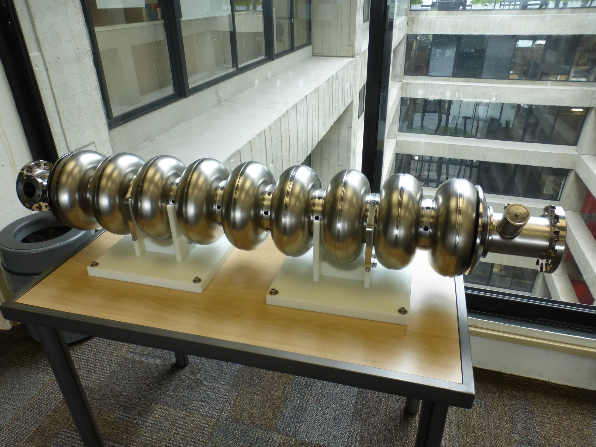

::: {.plot-caption}
Nine-cell 1.3 GHz niobium cavity (TESLA type, about 1 m long).
:::
:::
:::::

::::

::: {.notes}
5 minutes. Linac vs ring trade-off: a linac crosses each cavity once, so the gradient sets the length; a ring crosses the same cavities every turn, so modest voltage suffices. LHC: 8 superconducting 400 MHz cavities per beam, 16 MV per beam per turn; ramping 450 GeV → 6.8 TeV in about 20 minutes needs only ≈0.5 MeV of net gain per turn (6.35 TeV / (1200 s × 11 245 Hz)). TESLA/XFEL-type cavities reach ≈25–35 MV/m in operation. Normal-conducting cavities (e.g. CLIC design, 100 MV/m) work in short pulses. Photo: nine-cell 1.3 GHz niobium cavity at Fermilab; Z22, CC BY-SA 4.0, via Wikimedia Commons.
:::

## RF cavity demo {.demo-slide}

:::: {.slide-body}

::: {.widget data-src="widgets/rf.html" data-poster="widgets/rf-poster.png" data-alt="Interactive RF cavity: chain of cells with oscillating electric field, a particle crossing, and energy gain versus arrival phase"}
:::

::::

::: {.notes}
4 minutes. Send a bunch at φ = 0: it meets a forward field in every cell because each cell is half a wavelength long and the field flips each half period (π mode). Then φ = 90°: it gains nothing; 180°: it is decelerated (this is how energy-recovery linacs and beam dumps by RF work). Compare 1 cell and 9 cells: the gain adds up. The B field (circles near the wall) is 90° out of phase: energy sloshes between electric and magnetic field like in an LC circuit. Transit-time factor: a single gap crossed during half a period gets 2/π of the peak voltage.
:::

## RF makes bunches

::: {.slide-refs}
Original teaching model
:::

:::: {.slide-body}

::::: {.picture-layout}
::: {.picture-copy}
Late particles get a **larger kick**, early ones a smaller kick: both drift back.

The beam splits into **bunches**.

LHC: 400 MHz → 2.5 ns buckets; bunches every **25 ns**.

That is the **40 MHz** clock of the experiments.
:::

::: {.picture-visual}
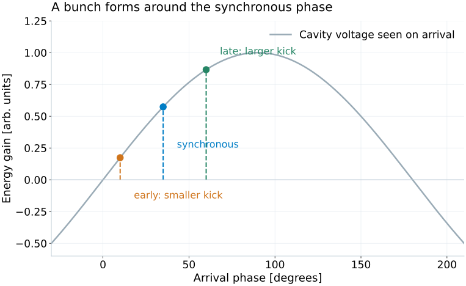

::: {.plot-caption}
Phase stability at low energy. Ultra-relativistic rings (LHC) work on the mirror-image slope.
:::
:::
:::::

::::

::: {.notes}
4 minutes. Phase focusing (Veksler 1944, McMillan 1945) made synchrotrons possible. Below transition, faster particles arrive earlier, so the stable phase is on the rising slope as drawn. In ultra-relativistic rings, a higher-energy particle takes a longer orbit and arrives later; the stable phase moves to the falling slope (transition crossing). Keep this as a remark. Particles oscillate around the synchronous phase: synchrotron oscillations. Only every 10th bucket is filled in the LHC. The bunch structure is exactly why detectors and triggers work with a 25 ns clock — next lecture.
:::

## A chain of accelerators {.full-figure}

::: {.slide-refs}
[CERN · accelerator complex 2022 (CC BY 4.0)](https://commons.wikimedia.org/wiki/File:CERN_accelerator_complex_2022.png)
:::

:::: {.slide-body}

::: {.visual}

:::

::: {.take-home}
Linac4 (160 MeV) → PS Booster (2 GeV) → PS (26 GeV) → SPS (450 GeV) → LHC (6.8 TeV).
:::

::::

::: {.notes}
3 minutes. Each synchrotron has a limited energy range: magnets need a minimum field quality at injection and a maximum field at top energy, so a ratio of roughly 10–20 per machine. Older machines become injectors and feed fixed-target programmes (ISOLDE, n_TOF, North Area, AD/ELENA antimatter). Linac4 accelerates H⁻ ions, stripped at injection. Figure: CERN, "The CERN accelerator complex, layout in 2022", CC BY 4.0, via Wikimedia Commons.
:::

## 3 · Guiding: magnetic fields {.section-title}

:::: {.slide-body}

Magnets bend and focus; they set the size of a proton ring.

::: {.subtle}
Magnetic rigidity · superconducting dipoles · quadrupole focusing · beam size
:::

::::

::: {.notes}

:::

## Magnetic rigidity: $p=0.3\,B\rho$

::: {.slide-refs}
Original teaching model
:::

:::: {.slide-body}

::::: {.picture-layout}
::: {.picture-copy}
$$p\,[\mathrm{GeV}/c]=0.3\;B\,[\mathrm{T}]\;\rho\,[\mathrm{m}]$$

The **same equation** as track bending in Lecture 7.

LHC: 7 TeV at 8.33 T → $\rho=2.8$ km; dipoles fill 2/3 of **26.7 km**.
:::

::: {.picture-visual}
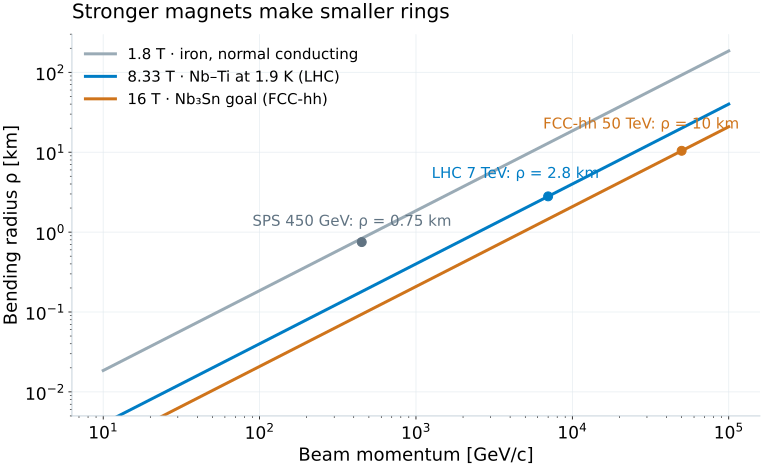

::: {.plot-caption}
Energy reach = field × size. Field is the expensive part.
:::
:::
:::::

::::

::: {.notes}
4 minutes. Derive 0.3 from p=qBρ with q=e: p[GeV/c]=e·B·ρ·c/(10⁹ e V) = 0.2998 Bρ. In a spectrometer we measure ρ to get p; in an accelerator we choose p and ρ and need B. LHC: 1232 dipoles × 14.3 m ≈ 17.6 km of the 26.7 km circumference. Iron saturates near 2 T, so higher fields need superconducting coils: Nb–Ti at 1.9 K for 8.33 T; Nb₃Sn for HL-LHC interaction-region quadrupoles and the 14–16 T studies for FCC-hh.
:::

## Dipoles and quadrupoles

::: {.slide-refs}
Original teaching model · Photos: [CERN PhotoLab · CC BY 4.0](https://commons.wikimedia.org/wiki/File:LEAR_magnet.jpg), [Unnerving duck · CC BY-SA 4.0](https://commons.wikimedia.org/wiki/File:CERN_type_QW_magnet.jpg)
:::

:::: {.slide-body}

::::: {.picture-layout .magnet-layout}
:::: {.picture-copy}
**Dipole:** uniform field → **bends** the beam.

**Quadrupole:** force grows with distance from the axis → a **lens**, but **in** in one plane and **out** in the other.

::: {.magnet-photos}

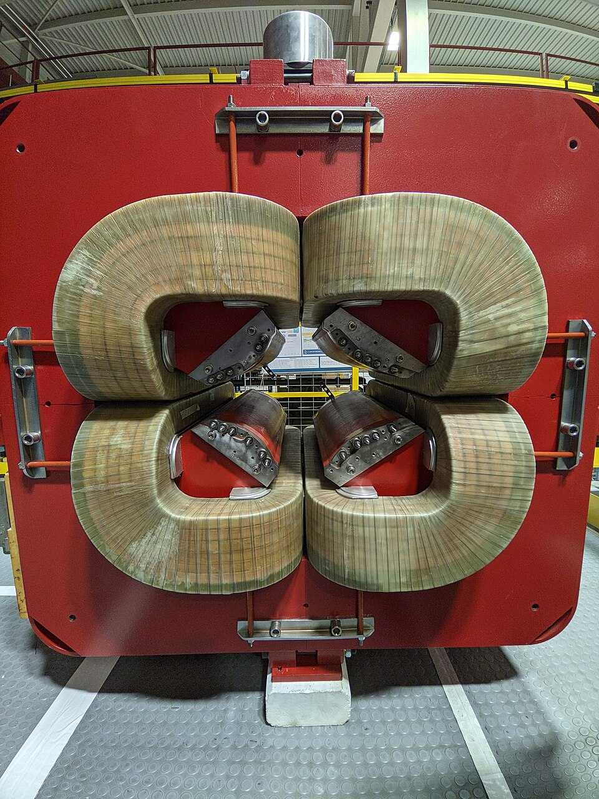
:::

::: {.magnet-photo-labels}
[Dipole (LEAR, CERN)]{} [Quadrupole (QW, CERN)]{}
:::
::::

::: {.picture-visual}
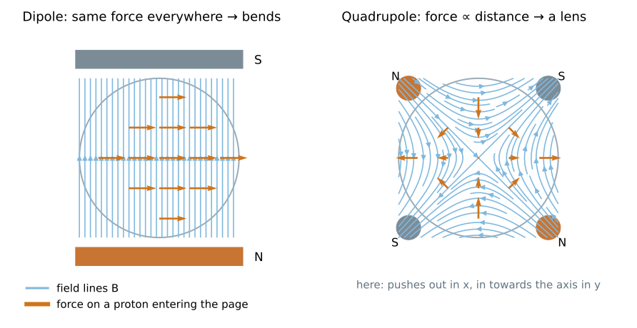

::: {.plot-caption}
Force F = qv × B on a proton entering the page.
:::
:::
:::::

::::

::: {.notes}
3 minutes. Dipole: two poles, B uniform in the gap, F = q v B sideways: the ring's "steering". Quadrupole: four poles N-S-N-S, B_y = g x, B_x = g y; the restoring force grows linearly with offset, exactly what a lens does to light rays (deflection ∝ distance from the axis → focal length). Why one plane only: inside the aperture ∇·B = 0 and ∇×B = 0, so a field that pushes inward in x must push outward in y. The fix (alternating quadrupoles) comes three slides later. Higher multipoles (sextupoles, octupoles) correct chromatic and nonlinear effects — mention only. Photos: one of the four bending magnets of LEAR (Low Energy Antiproton Ring), CERN PhotoLab, CC BY 4.0; quadrupole type QW (Tesla Engineering) on display in the CERN Antiproton Decelerator hall, Unnerving duck, CC BY-SA 4.0; both via Wikimedia Commons. Both are normal-conducting (iron-dominated) magnets: the pole shape defines the field, unlike the LHC's superconducting coils shown later.
:::

## 27 km of magnets {.full-figure}

::: {.slide-refs}
[M. Brice/CERN · CC BY-SA 3.0](https://commons.wikimedia.org/wiki/File:Views_of_the_LHC_tunnel_sector_3-4,_tirage_2.jpg)
:::

:::: {.slide-body}

::: {.visual}

:::

::: {.take-home}
1232 dipoles at 1.9 K · two beams in one magnet · 11.85 kA · ~9 GJ stored magnetic energy.
:::

::::

::: {.notes}
3 minutes. "Two-in-one" design: both counter-rotating proton beams share one cryostat and yoke, with opposite fields in the two apertures. Superfluid helium at 1.9 K cools 36 000 tonnes of cold mass. The 2008 incident (a faulty splice between magnets) shows the scale of stored energy: about 9 GJ magnetic energy in total, and ~360 MJ per beam at design intensity. Photo: Maximilien Brice, CERN, CC BY-SA 3.0, via Wikimedia Commons.
:::

## Inside the magnets

::: {.slide-refs}
[Wikimedia Commons (CC0)](https://commons.wikimedia.org/wiki/File:LHC_magnet_types.jpg)
:::

:::: {.slide-body}

::::: {.picture-layout}
::: {.picture-copy}
**Two beams, one magnet:** opposite fields in two apertures, 19 cm apart.

Copper-coloured **Nb–Ti coils** carry 11.85 kA; the field shape comes from the **current distribution**, not iron poles.

Left: dipole (bends). Right: quadrupole (focuses).
:::

::: {.picture-visual .photo}
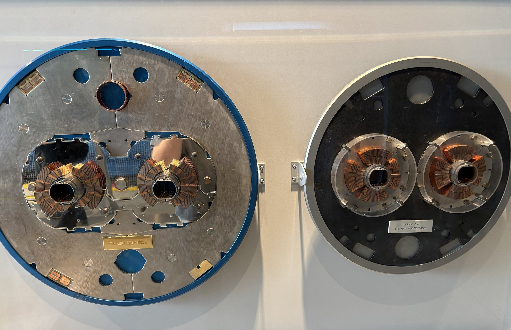

::: {.plot-caption}
LHC magnet cross-sections on display: dipole and quadrupole, both "two-in-one".
:::
:::
:::::

::::

::: {.notes}
3 minutes. A current distribution ∝ cos θ around the aperture gives a pure dipole field; ∝ cos 2θ a quadrupole. The stainless-steel collars hold the coils against the magnetic forces (hundreds of tonnes per metre at full field); the iron yoke returns the flux and is itself cooled to 1.9 K inside the cryostat. Compare with Lecture 7 tracking magnets: a solenoid in a detector bends tracks with the same Lorentz force. Photo: Ajheindel, CC0, via Wikimedia Commons.
:::

## Magnet explorer {.demo-slide}

:::: {.slide-body}

::: {.widget data-src="widgets/magnet.html" data-poster="widgets/magnet-poster.png" data-alt="Clickable schematic cross-section of an LHC dipole cryomagnet with the name, temperature, purpose and a fact for each part"}
:::

::::

::: {.notes}
4 minutes. Let students click from the beam outwards: beam → beam screen → cold bore → coils → collars → yoke → helium vessel → heat exchanger → bus bars → thermal shield → insulation vacuum → vessel → support posts. The thread: everything is about holding 8.33 T and removing heat at 1.9 K. The 2008 bus-bar incident is a memorable story about the stored energy. Schematic after the LHC Design Report Vol. I, ch. 7; facts rounded.
:::

## Quadrupoles focus — in one plane at a time

::: {.slide-refs}
Original teaching model
:::

:::: {.slide-body}

::::: {.picture-layout}
::: {.picture-copy}
One quadrupole: focusing in $x$, **defocusing** in $y$.

Alternate them (**FODO**): net focusing in both planes.

Particles oscillate around the orbit: **betatron oscillations**.

Like lenses: $\dfrac{1}{F}=\dfrac{d}{f^2}>0$.
:::

::: {.picture-visual}
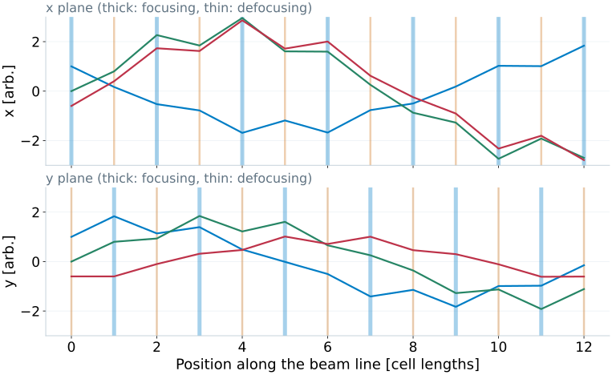

::: {.plot-caption}
Thin lenses, f = 1.2 L; the same particles in both planes.
:::
:::
:::::

::::

::: {.notes}
4 minutes. ∇×B=0 and ∇·B=0 in the aperture force the quadrupole field pattern; you cannot focus in both planes with one magnet. Strong (alternating-gradient) focusing: Courant, Livingston and Snyder, 1952 (and Christofilos). The particles oscillate around the design orbit: betatron oscillations. Thin-lens doublet: two lenses f and −f separated by d give 1/F = d/f². Stability requires f > L/2 for this symmetric cell (|trace| < 2 of the one-cell transfer matrix).
:::

## Emittance: how much room the beam needs

:::: {.slide-body}

Each particle has a **position** $x$ and an **angle** $x'$. Plot all particles: a cloud.

**Emittance** $\varepsilon$ = area of that cloud / π (units: mm·mrad).

Lenses and drifts **reshape** the cloud but cannot shrink its area (Liouville).

A tiny spot needs **large angles** — like focusing a flashlight.

::: {.take-home}
Only acceleration shrinks the angles: $x'=p_x/p$, so $\varepsilon\propto1/p$.
:::

::::

::: {.notes}
2 minutes, then the demo. Liouville: for conservative forces the phase-space density is conserved, so linear optics maps an ellipse to an ellipse of the same area. Analogy: a flashlight beam can be focused to a small spot only with a large cone angle; a laser has small emittance. Emittance can be reduced by non-conservative processes: synchrotron radiation damping in electron rings, stochastic and electron cooling (antiprotons) — mention only.
:::

## Emittance demo {.demo-slide}

:::: {.slide-body}

::: {.widget data-src="widgets/emittance.html" data-poster="widgets/emittance-poster.png" data-alt="Phase-space widget: particle cloud in position and angle; drifts, lenses, a squeeze to focus and acceleration; emittance shown"}
:::

::::

::: {.notes}
4 minutes. Ask a student to try to make ε smaller with drifts and lenses — it never changes. "Squeeze to a focus": the size drops, the angular spread grows. Then accelerate: angles halve, ε halves. This is why beams get smaller as they gain energy, and why the strong final quadrupoles at the experiments produce a tiny spot with a beam that diverges quickly.
:::

## Squeezing the beam at the collision point

:::: {.slide-body}

$$\sigma^*=\sqrt{\varepsilon\,\beta^*},\qquad \varepsilon\approx\frac{\varepsilon_N}{\gamma}$$

$\beta^*$: how strongly the final quadrupoles squeeze (a length set by the optics).

$\varepsilon_N$: normalized emittance, fixed at the source and kept by the whole chain.

LHC design: $\varepsilon_N=3.75\ \mu\mathrm{m}$, $\gamma=7460$, $\beta^*=0.55\ \mathrm{m}$ ⇒ $\sigma^*\approx$ **17 µm**.

::: {.take-home}
A proton bunch thinner than a hair (~70 µm) — needed for collisions to happen at all.
:::

::::

::: {.notes}
3 minutes. ε=3.75e-6/7460=5.0e-10 m; σ=sqrt(5.0e-10×0.55)=1.66e-5 m. Run 3 uses β* of about 30 cm. The β function is a property of the magnet lattice: large in the arcs, tiny at the collision points. The smaller the spot, the larger the beam angles (the demo), so the final focusing quadrupoles must sit close to the experiment and have huge apertures. Luminosity ∝ 1/σ*² is in the backup (Lecture 4 covered luminosity).
:::

## 4 · Limits: synchrotron radiation {.section-title}

:::: {.slide-body}

Why electrons and protons need different machines.

::: {.subtle}
Radiated power · mass to the fourth power · rings, linacs and muons · light sources
:::

::::

::: {.notes}

:::

## Why does a bent beam radiate?

::: {.slide-refs}
Original teaching model
:::

:::: {.slide-body}

::::: {.picture-layout}
::: {.picture-copy}
Any **accelerated charge** radiates (Larmor): $P\propto q^2a^2$.

**Bremsstrahlung:** sudden kick from a **nucleus**, in matter.

**Synchrotron radiation:** steady $a=c^2/\rho$ from a **magnet**, in vacuum.

Same physics, different force. At $v\to c$: $P\propto\gamma^4a^2$, emitted in a cone of angle $1/\gamma$.
:::

::: {.picture-visual}
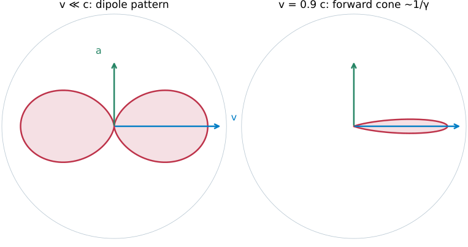

::: {.plot-caption}
Same sideways acceleration a, two speeds: at high speed a forward searchlight.
:::
:::
:::::

::::

::: {.notes}
4 minutes. Students often equate synchrotron radiation with bremsstrahlung. Both are radiation from accelerated charges; the difference is the source of the acceleration. Bremsstrahlung (Lectures 5–6): the Coulomb field of a nucleus, random, a ∝ Z e²/m, so the radiated energy scales as 1/m² — why electrons shower and muons do not. Synchrotron radiation: the magnet, steady, transverse acceleration a = v²/ρ. Relativistic (Liénard) for a ⊥ v: P = q² γ⁴ a² / (6π ε₀ c³) with a = c²/ρ gives P ∝ γ⁴/ρ²; at fixed energy γ = E/mc², hence m⁻⁴ — even stronger mass dependence than bremsstrahlung. The cone: in the particle frame the pattern is a dipole; the Lorentz boost folds it into a cone of half-angle ~1/γ along the velocity — a searchlight sweeping round the ring, which is why light sources deliver intense X-ray pulses. Figure: Jackson eq. 14.44 for acceleration perpendicular to velocity, plotted in the orbit plane for β = 0 and 0.9, each normalised to its maximum.
:::

## How much energy is lost per turn?

::: {.slide-refs}
Original teaching model
:::

:::: {.slide-body}

::::: {.picture-layout}
::: {.picture-copy}
$$\Delta E_{\mathrm{turn}}\propto\frac{\gamma^4}{\rho}=\frac{1}{\rho}\left(\frac{E}{mc^2}\right)^{4}$$

Same $E$ and ring: protons radiate $(m_e/m_p)^4\approx10^{-13}$ as much.

LEP2: **3.4 GeV** per turn. LHC: **6.7 keV** per turn.
:::

::: {.picture-visual}
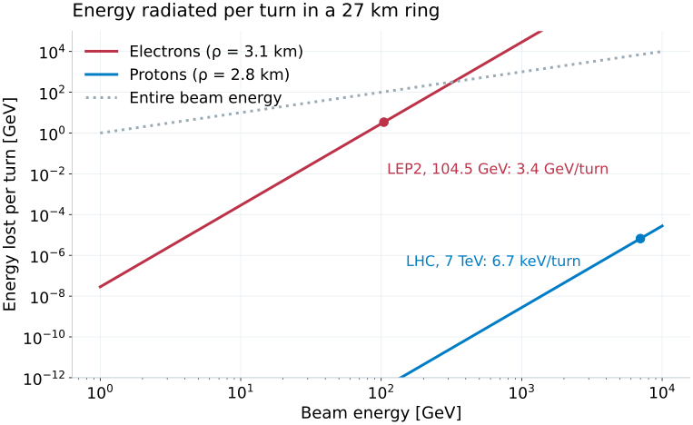

::: {.plot-caption}
$\Delta E[\mathrm{GeV}]=8.85\times10^{-5}\,E^4[\mathrm{GeV}^4]/\rho[\mathrm{m}]$ for electrons; protons scaled by $(m_e/m_p)^4$.
:::
:::
:::::

::::

::: {.notes}
3 minutes. Radiated power P=(e²c/6πε₀)β⁴γ⁴/ρ²; loss per turn ΔE=(e²/3ε₀)β³γ⁴/ρ. LEP2 at 104.5 GeV with ρ≈3.1 km lost ≈3.4 GeV per turn, replaced by ≈3.6 GV of superconducting RF — LEP was stopped by this wall. The LHC radiates only ~kW per beam, but onto a 1.9 K cold bore, so a beam screen intercepts it.
Figure: original analytic curves, electrons at ρ=3096 m (LEP) and protons at ρ=2804 m (LHC dipoles). Above the dotted line the ring cannot store the beam at all.
:::

## Three ways around the wall

:::: {.slide-body}

::: {.compare-table}
| | Idea | Price |
|---|---|---|
| Bigger $e^\pm$ ring | $\Delta E\propto1/\rho$ (FCC-ee: 91 km) | Cost; ~200 GeV per beam |
| Linear collider | No bending, no radiation | One pass per bunch |
| Muons | $(m_\mu/m_e)^4\approx2\times10^{9}$ less loss | Decay: ~1000 turns |
| Protons | Magnets set the limit | Partons, pile-up, rates |
:::

::: {.take-home}
Leptons give clean collisions; protons give energy reach — and the trigger problem of next lecture.
:::

::::

::: {.notes}
4 minutes. Linear colliders: SLC (1989–1998) was the only one built; ILC and CLIC are designs. Muon collider: lab lifetime γτ = 2.2 µs × E/m_μ; at 1.5 TeV that is ~31 ms, and in a ring with ~10 T dipoles the beam survives on the order of a thousand turns — check with the demo. Protons: collide quarks and gluons carrying a fraction of the proton momentum, so the parton √s varies event by event; the price is pile-up and enormous inelastic rates.
:::

## Ring designer demo {.demo-slide}

:::: {.slide-body}

::: {.widget data-src="widgets/designer.html" data-poster="widgets/designer-poster.png" data-alt="Interactive ring designer: choose particle, beam energy and dipole field; see bending radius, circumference, synchrotron loss per turn and collision energy"}
:::

::::

::: {.notes}
6 minutes. Start from the LHC defaults (protons, 7 TeV, 8.33 T): 2.8 km radius, 26.7 km ring, 6.7 keV per turn. Switch to electrons: the same ring would lose more than the beam energy every turn. Lower the electron energy to ~104.5 GeV: still impossible at 8.33 T because the ring is only ~40 m in radius. Lower the field to 0.11 T: 3.1 km radius, about 3.4 GeV per turn — LEP2 in the same tunnel. For electrons a weak field and a large radius are the point. Switch to muons at 1.5 TeV and 10 T: tiny ring, small losses, but only about a thousand turns before decay. Increase the field to 16 T with protons at 50 TeV: FCC-hh scale. The model ignores RF, focusing and beam–beam effects.
:::

## Pause and check

:::: {.slide-body}

Why not put **7 TeV electrons** in the LHC tunnel?

::: {.fragment}
$$\Delta E_{\mathrm{turn}}=8.85\times10^{-5}\,\frac{(7000)^4}{2800}\ \mathrm{GeV}\approx8\times10^{7}\ \mathrm{GeV}$$

Ten thousand times the beam energy — **in every turn**.

::: {.take-home}
For electrons the limit is radiation; for protons it is the magnet.
:::
:::

::::

::: {.notes}
3 minutes. Let students estimate with the scaling from LEP2 first: (7000/104.5)⁴ ≈ 2×10⁷ times 3.4 GeV ≈ 7×10⁷ GeV (radius nearly equal). The fragment reveals the full number. Ask what energy an electron ring in the LHC tunnel could reach if the RF could supply ~3–4 GeV per turn: about LEP2, ~100 GeV.
:::

## 5 · From collisions to experiments {.section-title}

:::: {.slide-body}

What does the machine mean for the detector, and beyond physics?

::: {.subtle}
Rates · cross-section hierarchy · applications
:::

::::

::: {.notes}

:::

## Cross sections and rates: recap {.full-figure}

::: {.slide-refs}
Lecture 4 figure (course-generated)
:::

:::: {.slide-body}

::: {.visual}
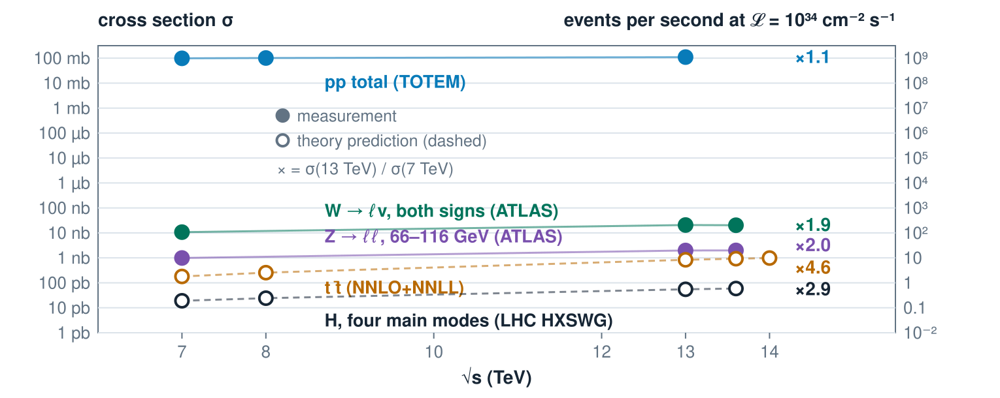
:::

::: {.take-home}
At 10³⁴ cm⁻²s⁻¹: 10⁹ collisions/s, one Higgs every 2 s — storage takes ~10³ events/s. Next lecture: **how do we choose?**
:::

::::

::: {.notes}
3 minutes. Recap of the Lecture 4 plot (course-generated from TOTEM, ATLAS, LHC Top WG and LHC HXSWG numbers). Interesting processes sit 6–10 orders of magnitude below the total cross section. The bridge: the accelerator delivers 40 MHz of crossings with ~25+ interactions each; the experiment can store about a kHz. The next lecture (DAQ and trigger) is about that selection.
:::

## Accelerators beyond particle physics

::: {.slide-refs}
[NSLS-II · CC BY-SA 4.0](https://commons.wikimedia.org/wiki/File:NSLS-II_Aerial.jpg)
:::

:::: {.slide-body}

::::: {.picture-layout}
::: {.picture-copy}
**Radiotherapy:** electron linacs, 6–18 MV X-rays.

**Proton therapy:** 70–250 MeV, uses the **Bragg peak**.

**PET isotopes:** 11–18 MeV cyclotrons.

**Light sources:** synchrotron radiation as the product.

Most accelerators serve **industry and medicine**.
:::

::: {.picture-visual .photo}
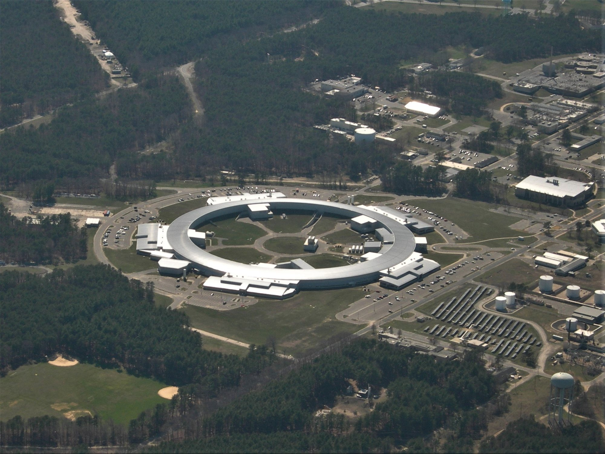

::: {.plot-caption}
NSLS-II, Brookhaven: a 3 GeV electron ring built to radiate.
:::
:::
:::::

::::

::: {.notes}
3 minutes. Proton therapy uses the Bragg peak from Lecture 5: the beam energy sets the depth of the dose maximum (≈ 4 cm at 70 MeV, ≈ 38 cm at 250 MeV in water). Light sources are electron rings optimised to produce synchrotron radiation — the same effect that limited LEP — used for protein structures, materials and chemistry; ESRF in Grenoble and PETRA III at DESY are European examples. Free-electron lasers (European XFEL, Hamburg) use the superconducting cavities shown earlier. Ion implanters (keV–MeV) dope every computer chip. There are tens of thousands of accelerators worldwide, the vast majority outside research. Photo: NSLS-II aerial view, Zxcvbnm789, CC BY-SA 4.0, via Wikimedia Commons.
:::

## Five numbers to remember

:::: {.slide-body}

1. $2N\cdot V_0$: electrostatic ladders stop near **1 MV**; RF reuses fields **11 245 times a second** (LHC).
2. $p=0.3\,B\rho$: **8.33 T** and **2.8 km** for 7 TeV.
3. **25 ns** bunch spacing → 40 MHz crossings.
4. $\Delta E_{\mathrm{turn}}\propto E^4/(m^4\rho)$: **3.4 GeV** (LEP2) vs **6.7 keV** (LHC).
5. $\varepsilon\propto1/p$: **17 µm** beams at the collision point.

::::

::: {.notes}
2 minutes. Ask students to reconstruct the physics behind each number in one sentence.
:::

## Exit questions

:::: {.slide-body}

1. Why does a fixed-target experiment waste most of the beam energy?
2. Why can a ring use much weaker cavities than a linac?
3. Why does one quadrupole not focus a beam in both planes?
4. Why did LEP use a **weak** field (0.11 T) in a 27 km tunnel?
5. Synchrotron radiation and bremsstrahlung: what is the same, what differs?

::::

::: {.notes}
3 minutes. Answers: 1, momentum conservation — the centre of mass keeps moving, √s ∝ √E. 2, the ring reuses the same cavities every turn. 3, ∇·B = 0 and ∇×B = 0 force focusing in one plane to come with defocusing in the other. 4, for electrons the loss ∝ E⁴/ρ: a large radius keeps it manageable, and a large radius at fixed momentum means a weak field. 5, both are radiation from accelerated charges; bremsstrahlung from the Coulomb kick of a nucleus in matter (∝ 1/m²), synchrotron radiation from the steady centripetal acceleration in a magnet (∝ 1/m⁴ at fixed energy), emitted in a 1/γ cone.
:::

## Next lecture: DAQ and trigger

:::: {.slide-body}

The machine delivers **40 MHz** of crossings, each with **tens of interactions**.

Detectors produce **MB per event**; storage takes **~1 kHz**.

**How do we decide, within microseconds, which collisions to keep?**

::: {.subtle}
Homework: estimate the LHC beam energy stored per beam ($N=1.15\times10^{11}$, 2808 bunches, 7 TeV) and compare with a car or a train.
:::

::::

::: {.notes}
Homework answer: 2808 × 1.15e11 × 7e12 eV × 1.6e-19 J/eV ≈ 362 MJ per beam — a high-speed train at ~150 km/h, or about 90 kg of TNT. Explains why machine protection and beam dumps matter.
:::

## Backup · Details {.section-title}

:::: {.slide-body}

Derivations and further reading

::: {.subtle}
Luminosity and pile-up · fixed-target invariant mass · synchrotron-radiation formula · references
:::

::::

::: {.notes}

:::

## Backup · The cross-section hierarchy {.landmark .tall-figure}

::: {.slide-refs}
[W. J. Stirling · 2010 lecture, p22](https://indico.cern.ch/event/94815/contributions/1282690/attachments/1106827/1579062/LBLMIT_Stirling_v2.pdf)
:::

:::: {.slide-body}

::::: {.picture-layout}
::: {.picture-copy}
Read vertically at one collider energy.

**Interesting processes sit 6–11 orders of magnitude below the total.**

The right axis turns each cross section into events per second at $\mathcal{L}=10^{33}\,\mathrm{cm^{-2}s^{-1}}$.

Tevatron → LHC: heavy final states (top, Higgs) **grow fastest** with energy.
:::
:::: {.picture-visual}

::: {.plot-caption}
W. J. Stirling, proton–(anti)proton cross sections (WJS2009); historical predictions.
:::
::::
:::::

::::

::: {.notes}
3 minutes, optional. The classic Stirling plot: x is √s, left y the cross section in nb, both logarithmic; the right axis converts to rates at L = 10³³ cm⁻²s⁻¹. Locate total, b, W/Z, top and Higgs at the LHC line. Higgs curves assume masses 120/200/500 GeV: historical predictions, not the measured 125 GeV cross section. Steeply rising curves (top, Higgs) show why energy matters for heavy final states. Image: local only — its reuse licence is not confirmed, so the public deck shows a placeholder with the credit (see THIRD_PARTY.md).
:::

## Backup · Luminosity from beam parameters

:::: {.slide-body}

Two bunches of $N_1,N_2$ particles collide with transverse size $\sigma_x,\sigma_y$:

$$\mathcal{L}=\frac{f_{\mathrm{rev}}\,n_b\,N_1N_2}{4\pi\,\sigma_x\sigma_y}\,F$$

LHC design: $f_{\mathrm{rev}}=11.2$ kHz, $n_b=2808$, $N=1.15\times10^{11}$, $\sigma^*=17\ \mu$m, $F\approx0.84$:

$$\mathcal{L}\approx1.0\times10^{34}\ \mathrm{cm^{-2}\,s^{-1}}$$

::::

::: {.notes}
4 minutes. Interpret each factor: more bunches, more particles per bunch (enters squared), smaller beams. F is the geometric reduction from the crossing angle needed to avoid parasitic collisions between bunches. Arithmetic: 11245 × 2808 × (1.15e11)² / (4π × (16.7e-4 cm)²) ≈ 1.2e34, times 0.84 ≈ 1.0e34. Run 3 levels the luminosity near 2×10³⁴ by adjusting β* during the fill, to limit pile-up. Limits: beam–beam interaction, beam intensity (instabilities, machine protection), and the experiments' tolerance for pile-up.
:::

## Backup · Luminosity turns probability into rate

:::: {.slide-body}

$$R=\mathcal{L}\,\sigma,\qquad N=\sigma\int\mathcal{L}\,dt$$

At $\mathcal{L}=10^{34}\,\mathrm{cm}^{-2}\mathrm{s}^{-1}$:

| Process | Cross section | Rate |
|---|---:|---:|
| Inelastic $pp$ | 80 mb | $8\times10^8\ \mathrm{s}^{-1}$ |
| $W\to\ell\nu$ | 20 nb | $200\ \mathrm{s}^{-1}$ |
| Higgs | 50 pb | 1 every 2 s |

Integrated: $1\ \mathrm{fb}^{-1}=10^{39}\ \mathrm{cm}^{-2}$. 140 fb⁻¹ (LHC Run 2) → **~7 million Higgs bosons**.

::::

::: {.notes}
3 minutes. Recall Lecture 4 (cross sections). Cross sections rounded at √s=13 TeV: inelastic ≈ 80 mb; W→ℓν per lepton flavour ≈ 20 nb; total Higgs production ≈ 55 pb. Produced is not recorded: branching fractions, acceptance, trigger and reconstruction efficiency follow (next lecture). 1 b = 10⁻²⁴ cm².
:::

## Backup · One crossing, many interactions {.landmark}

::: {.slide-refs}
[CMS · Public luminosity plots, Run 2](https://twiki.cern.ch/twiki/bin/view/CMSPublic/LumiPublicResults)
:::

:::: {.slide-body}

::::: {.picture-layout}
::: {.picture-copy}
Mean interactions per crossing:

$$\mu=\frac{\mathcal{L}\,\sigma_{\mathrm{inel}}}{f_{\mathrm{rev}}\,n_b}\approx25$$

at design luminosity.

Run 2 averages reached **30–40**.

What exactly is on the horizontal axis?
:::
:::: {.picture-visual}

::: {.plot-caption}
CMS Run 2: recorded luminosity versus mean pile-up.
:::
::::
:::::

::::

::: {.notes}
4 minutes. μ = 1e34 × 8e-26 / (11245 × 2808) ≈ 25. The x axis is the mean interactions per crossing μ, not the measured vertex count of one event; the y axis is recorded luminosity per μ bin. Higher luminosity per bunch means more pile-up, which costs reconstruction and trigger performance; this is why luminosity is levelled. HL-LHC aims for μ≈140–200.
:::

## Backup · Collision energy, fixed target

:::: {.slide-body}

Beam $(E_1,\vec p_1)$ on target $(m_2,\vec 0)$, with $c=1$:

$$s=(p_1+p_2)^2=m_1^2+m_2^2+2E_1m_2$$

For $E_1\gg m_1,m_2$: $\sqrt{s}\approx\sqrt{2E_1m_2}$.

Head-on beams of equal energy $E$, $|\vec p|\approx E$: $s=(2E)^2$.

Example: HERA, $e$ (27.5 GeV) on $p$ (920 GeV): $\sqrt{s}=\sqrt{4E_eE_p}\approx318$ GeV.

::::

::: {.notes}
Optional derivation for questions. Asymmetric colliders (HERA, B factories) also boost the centre of mass, useful for measuring decay times.
:::

## Backup · Synchrotron radiation formulas

:::: {.slide-body}

Radiated power for a charge on a circle (Liénard):

$$P=\frac{e^2c}{6\pi\varepsilon_0}\,\frac{\beta^4\gamma^4}{\rho^2}$$

Energy per turn, $\Delta E=P\cdot2\pi\rho/(\beta c)$:

$$\Delta E=\frac{e^2}{3\varepsilon_0}\,\frac{\beta^3\gamma^4}{\rho}\quad\Rightarrow\quad\Delta E\,[\mathrm{GeV}]=8.85\times10^{-5}\,\frac{E^4\,[\mathrm{GeV}^4]}{\rho\,[\mathrm{m}]}\ \ (e^\pm)$$

Critical photon energy $E_c=\tfrac{3}{2}\hbar c\,\gamma^3/\rho$: X-rays for GeV electron rings.

::::

::: {.notes}
Optional. For a separated-function ring only the dipoles radiate, so ρ is the dipole bending radius, not the average ring radius. E_c explains why light sources at a few GeV produce keV X-rays.
:::

## Backup · The LHC in a nutshell

::: {.slide-refs}
[Oxford Sparks: A quick look around the LHC (YouTube)](https://www.youtube.com/watch?v=BEnaEMMAO_s)
:::

:::: {.slide-body}

::: {.widget data-src="https://www.youtube-nocookie.com/embed/BEnaEMMAO_s?rel=0" data-poster="widgets/lhc-video-poster.png" data-alt="Oxford Sparks animated video: a quick look around the LHC" data-ratio="1.778"}
:::

::::

::: {.notes}
For fun, about 2 minutes. Animated tour of the LHC by Oxford Sparks (University of Oxford): the ring, the magnets, the cavities and the experiments in one go. Needs an internet connection; in the PDF export the poster frame stands in for the video.
:::

## Backup · Reference material {.references}

:::: {.slide-body}

[CERN Accelerator School](https://cas.web.cern.ch/) — open proceedings and introductory courses.

[F. Tecker, Introduction to accelerator physics (CERN, 2019)](https://indico.cern.ch/event/819412/contributions/3608649/attachments/1944647/3226029/2019-Intro-Acc-Physics.pdf) — overview lecture.

[O. Brüning et al., LHC Design Report, Vol. I (CERN-2004-003)](https://cds.cern.ch/record/782076) — LHC parameters.

[H. Wiedemann, Particle Accelerator Physics (Springer, open access)](https://doi.org/10.1007/978-3-319-18317-6) — textbook.

[CMS luminosity public results](https://twiki.cern.ch/twiki/bin/view/CMSPublic/LumiPublicResults) — Run-2 pile-up.

B. R. Martin and G. Shaw, *Particle Physics*, ch. on experimental methods · M. Thomson, *Modern Particle Physics*, ch. 1.

::::

::: {.notes}
Photo and figure credits are in SOURCES.md.
:::

