## Lecture 9 {.title-card}

:::: {.slide-body}

::: {.subtitle}
Basics of Trigger and DAQ
:::

Mikhail Mikhasenko · KT1 · Winter semester 2026/27

::::

::: {.notes}
90-minute session for students who meet trigger and data acquisition (DAQ) for the first time. Follows Lecture 7 (detectors: tracking, gas, silicon, scintillators) and Lecture 8 (accelerators). Budget: accelerator recap 0–12 min; the complete experiment 12–25; history (Tycho Brahe, Geiger–Müller counters, coincidences) 25–45; building a DAQ step by step (after N. Neufeld, ESI 2009) 45–65; scaling up to the LHC 65–85; summary and exit questions 85–90. Advanced material from the earlier draft (tag and probe, menus, bandwidth, persistence, CPU budgets) is in the backup.
:::

## Today in four questions

:::: {.slide-body}

1. **The experiment:** what does a collider deliver, and what does a detector record?
2. **History:** Tycho Brahe's logbook and the first electronic trigger.
3. **DAQ:** how do we build a readout, step by step, without losing events?
4. **Trigger:** how do we choose 1 collision in 10⁶ within microseconds?

::::

::: {.notes}
1 minute. Return to this list at each section boundary. The goal is understanding the ideas — threshold, coincidence, dead time, buffer, multi-level decision — not hardware acronyms.
:::

## Recap 1 · Electric fields give energy

::: {.slide-refs}
[Z22 · CC BY-SA 4.0](https://commons.wikimedia.org/wiki/File:A_1.3_GHz_nine-cell_superconducting_radio_frequency.JPG)
:::

:::: {.slide-body}

::::: {.picture-layout}
::: {.picture-copy}
A charge crossing a voltage gains $\Delta E=qV$.

Static voltages stop near **1 MV**.

**RF cavities** reuse an oscillating field: the LHC beam passes the same cavities **11 245 times a second**.

::: {.check}
Why can a ring use much weaker cavities than a linac?
:::
:::

::: {.picture-visual}
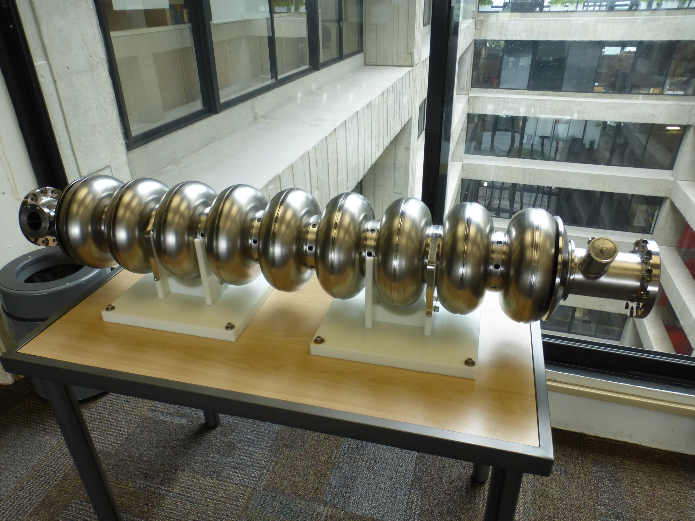

::: {.plot-caption}
Nine-cell 1.3 GHz niobium cavity, about 1 m long.
:::
:::
:::::

::::

::: {.notes}
2 minutes. Recap only; ask the question and take one answer. Answer: a ring passes the same cavities every turn, so the energy gain adds up turn after turn; a linac crosses each cavity once, so its length is set by the gradient. Photo: nine-cell 1.3 GHz niobium cavity at Fermilab; Z22, CC BY-SA 4.0, via Wikimedia Commons (copied from Lecture 8).
:::

## Recap 2 · Magnetic fields steer and focus

::: {.slide-refs}
Lecture 8 figure (original)
:::

:::: {.slide-body}

::::: {.picture-layout}
::: {.picture-copy}
$$p\,[\mathrm{GeV}]=0.3\,B\,[\mathrm{T}]\,\rho\,[\mathrm{m}]$$

**Dipoles** bend the beam around the ring.

**Quadrupoles** focus it — in one plane at a time.

LHC: **8.33 T** and $\rho=$ **2.8 km** for 7 TeV.
:::

::: {.picture-visual}
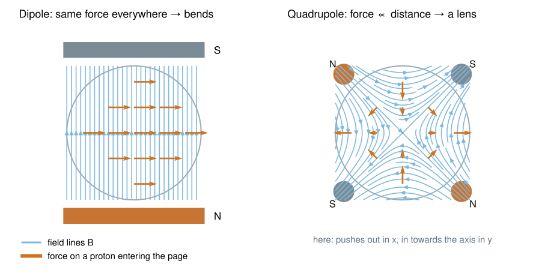
:::
:::::

::::

::: {.notes}
2 minutes. Same formula students used for momentum measurement in Lecture 7: the tracker magnet and the accelerator dipole obey the same Lorentz force. Check: 0.3 × 8.33 × 2804 ≈ 7000 GeV.
:::

## Recap 3 · Why collide two beams?

::: {.slide-refs}
Lecture 8 figure (original)
:::

:::: {.slide-body}

::::: {.picture-layout}
::: {.picture-copy}
Fixed target: $\sqrt{s}\approx\sqrt{2Emc^2}$

Collider: $\sqrt{s}=2E$

7 TeV on a proton at rest → **115 GeV**.

Two 7 TeV beams → **14 TeV**.

::: {.check}
Where does the rest of the energy go in a fixed-target collision?
:::
:::

::: {.picture-visual}
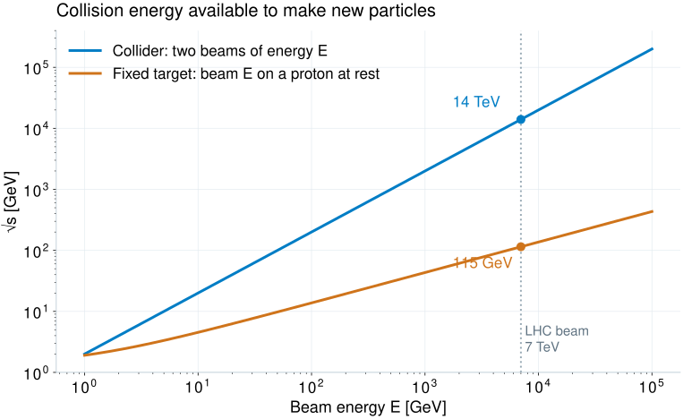
:::
:::::

::::

::: {.notes}
2 minutes. Answer: into the motion of the centre of mass (momentum conservation). Fixed targets still matter for intensity and secondary beams.
:::

## Recap 4 · Why the LHC collides protons

::: {.slide-refs}
Original teaching model
:::

:::: {.slide-body}

::::: {.picture-layout}
::: {.picture-copy}
A bent charge radiates: **synchrotron radiation**.

$$\Delta E_{\mathrm{turn}}\propto\frac{1}{\rho}\left(\frac{E}{mc^2}\right)^{4}$$

LEP2 electrons: **3.4 GeV** per turn.

LHC protons: **6.7 keV** per turn.

The price: protons are **composite** — messy collisions.
:::

::: {.picture-visual}
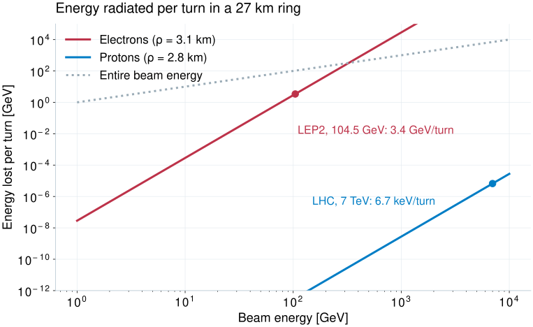
:::
:::::

::::

::: {.notes}
2 minutes. (m_e/m_p)^4 ≈ 10^-13. The price of protons is the point for today: quarks and gluons collide, most collisions are soft and uninteresting, and many happen at once.
:::

## Recap 5 · RF makes bunches: a 40 MHz clock

::: {.slide-refs}
Lecture 8 figure (original)
:::

:::: {.slide-body}

::::: {.picture-layout}
::: {.picture-copy}
Late particles get a larger kick, early ones a smaller kick: the beam splits into **bunches**.

LHC: bunches every **25 ns**.

$$f=\frac{1}{25\ \mathrm{ns}}=40\ \mathrm{MHz}$$

**This is the heartbeat of the experiment.**
:::

::: {.picture-visual}
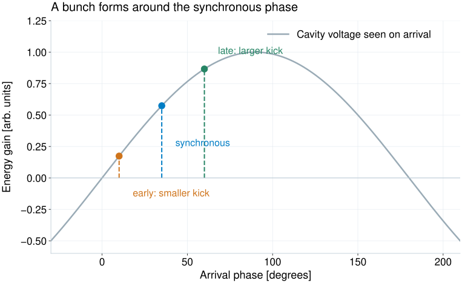
:::
:::::

::::

::: {.notes}
2 minutes. The detector does not see a continuous beam: collisions can only happen when two bunches cross. Every detector channel, trigger and readout system in today's lecture is synchronized to this 40 MHz clock.
:::

## Recap 6 · Luminosity: σ → rate {.full-figure}

::: {.slide-refs}
Rounded values at 13 TeV (TOTEM, ATLAS, LHC Top and Higgs working groups)
:::

:::: {.slide-body}

::: {.visual}
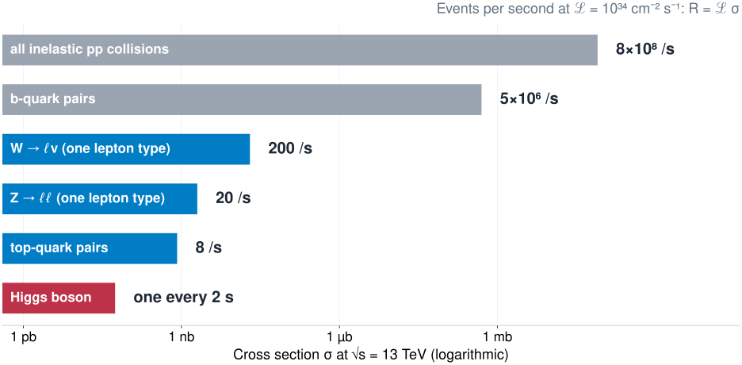
:::

::: {.take-home}
$R=\mathcal{L}\sigma$. At $\mathcal{L}=10^{34}\,\mathrm{cm^{-2}s^{-1}}$: **≈10⁹ collisions/s**, but **one Higgs every 2 s**. How do we find it?
:::

::::

::: {.notes}
2 minutes. Simplified version of the Lecture 4 plot, at one energy. Conversion: 1 pb × 10³⁴ cm⁻²s⁻¹ = 10⁻³⁶ cm² × 10³⁴ cm⁻²s⁻¹ = 0.01 /s. Rounded 13 TeV values: inelastic ≈ 80 mb → 8×10^8 /s; bb̄ ≈ 0.5 mb → 5×10^6 /s; W→ℓν ≈ 20 nb and Z→ℓℓ ≈ 2 nb per lepton flavour; tt̄ ≈ 830 pb → 8 /s; Higgs ≈ 55 pb → 0.5 /s. The interesting processes sit 9–10 orders of magnitude below the total. This is the question of today. About 12 minutes elapsed.
:::

## 1 · The complete experiment {.section-title}

:::: {.slide-body}

What does the detector see in one bunch crossing?

::: {.subtle}
Events · signals · digitization · data volume
:::

::::

::: {.notes}

:::

## What is an "event"? {.landmark}

::: {.slide-refs}
[CMS · Public luminosity plots, Run 2](https://twiki.cern.ch/twiki/bin/view/CMSPublic/LumiPublicResults)
:::

:::: {.slide-body}

::::: {.picture-layout}
::: {.picture-copy}
**Event** = all detector signals from **one bunch crossing**.

One crossing contains **25–60 collisions**: *pile-up*.

Usually **at most one** of them is interesting.

Horizontal axis: what does it count?
:::
:::: {.picture-visual}


::: {.plot-caption}
CMS Run 2: recorded luminosity versus mean number of collisions per crossing.
:::
::::
:::::

::::

::: {.notes}
3 minutes. Distinguish three words: crossing (two bunches meet, every 25 ns), collision/interaction (one proton–proton interaction), event (the recorded data of one crossing). The x axis is the mean number of interactions per crossing μ; the y axis is luminosity recorded at that μ. Run 2 average about 34. μ = Lσ_inel/(f_rev n_b) ≈ 25 at design luminosity.
:::

## From a particle to a number

::: {.slide-refs}
Original teaching model
:::

:::: {.slide-body}

::::: {.picture-layout}
::: {.picture-copy}
Sensor (Lecture 7) → **charge or light**.

Front-end electronics → **voltage pulse**.

Height ∝ energy deposited.

Start ∝ arrival time.

What do we write to disk?
:::

::: {.picture-visual}
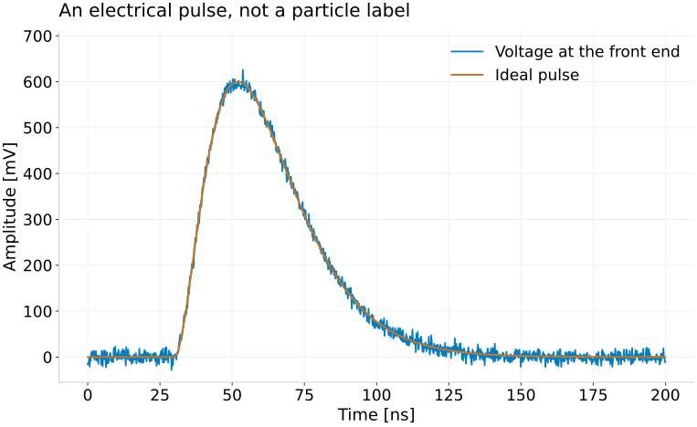

::: {.plot-caption}
Illustrative waveform; not recorded detector data.
:::
:::
:::::

::::

::: {.notes}
2 minutes. Elicit: amplitude (or area) → energy after calibration; start time → time of passage; channel number → position. The waveform itself is rarely stored; we store a few numbers per channel.
:::

## Digitization: ADC and TDC

::: {.slide-refs}
Original teaching model
:::

:::: {.slide-body}

::::: {.picture-layout}
::: {.picture-copy}
**ADC** (analogue-to-digital converter): measures the **height** → an integer.

**TDC** (time-to-digital converter): measures the **time** → an integer.

Here: 3 bits = **8 levels**. Real ADCs: 10–14 bits.

Each number is stored with its **channel ID**.
:::

::: {.picture-visual}
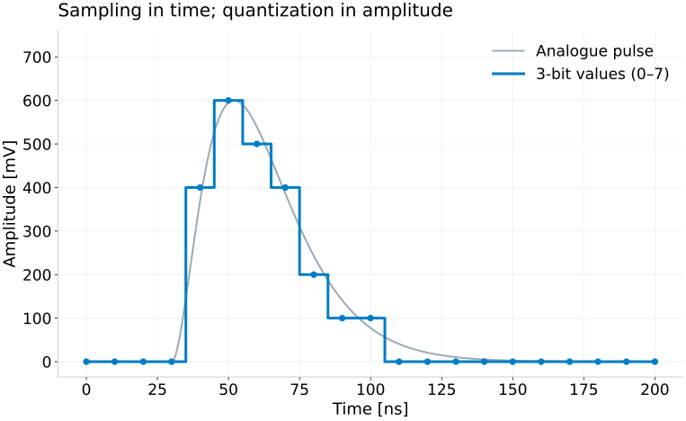

::: {.plot-caption}
Toy 3-bit ADC: 10 ns sample spacing, 100 mV steps.
:::
:::
:::::

::::

::: {.notes}
3 minutes. Two steps: sample in time, quantize in amplitude. A digital code is not yet an energy: calibration converts it later. Ask: what information is lost? (Values between levels, the shape between samples.) 12 bits = 4096 levels.
:::

## How big is one event?

:::: {.slide-body}

| | |
|---|---:|
| Readout channels | ~10⁸ |
| Fraction of channels hit in a crossing | ~1% |
| Bytes per hit (channel ID + value + time) | a few |
| **Event size after removing empty channels** | **≈ 1 MB** |

::: {.take-home}
**Zero suppression:** only channels above a threshold are read out. Without it the event would be ~100× larger.
:::

::::

::: {.notes}
3 minutes. Order-of-magnitude estimate; let students multiply: 10^8 × 1% × ~1 byte ≈ 1 MB. Real ATLAS and CMS raw events are 1–2 MB. Zero suppression is our first "selection": a threshold applied channel by channel. The next slide multiplies by the rate.
:::

## Too much data

::: {.slide-refs}
Original teaching model
:::

:::: {.slide-body}

$$\text{data rate}=\text{event rate}\times\text{event size}$$

| | Event rate | × 1 MB |
|---|---:|---:|
| Every bunch crossing | 40 MHz | **40 TB/s** |
| What we can write to disk | ~1 kHz | **~1 GB/s** |

40 TB/s ≈ **300 000** home internet connections at 1 Gbit/s, all the time.

::: {.take-home}
We must keep **1 crossing in 40 000** — and throw away the rest **for ever**.
:::

::::

::: {.notes}
3 minutes. Let students do the arithmetic: 4×10^7 × 10^6 B = 4×10^13 B/s. 40 TB/s × 8 bit/B = 320 Tbit/s. At 1 GB/s one day of running already fills 86 TB (backup slide). The deciding system is the **trigger**; the system that moves and records the data is the **DAQ**. Both ideas are almost a hundred years old — next section. About 27 minutes elapsed.
:::

## 2 · History: the first DAQ and the first trigger {.section-title}

:::: {.slide-body}

From Tycho Brahe's logbook to Geiger–Müller counters

::: {.subtle}
Systematic measurement · Geiger mode · coincidences · counter-controlled cloud chamber
:::

::::

::: {.notes}

:::

## Tycho Brahe: the first systematic data acquisition

::: {.slide-refs}
[After N. Neufeld · ESI 2009, pp. 6–9](https://indico.cern.ch/event/43007/contributions/1065030/attachments/927884/1313738/trigger-daq-analysis-esi09-neufeld1.pdf)
:::

:::: {.slide-body}

::::: {.picture-layout .portrait-layout}
::: {.picture-copy}
At 16, Tycho (1546–1601) saw a planetary conjunction happen **days** away from the date the best tables predicted.

His answer: a **measurement campaign**.

- one place (Uraniborg, island of Hven), the **same instruments**;
- the **same procedure**, night after night, for **about 20 years**;
- every entry with its **conditions**: weather, light, "not so good".
:::

::: {.picture-visual}


::: {.plot-caption}
Tycho Brahe (portrait, public domain).
:::
:::
:::::

::::

::: {.notes}
4 minutes. Tell it as a story. Tycho Brahe, Danish nobleman, built the observatory Uraniborg on the island of Hven (1576–1597) with large naked-eye instruments (mural quadrant, sextants). His positions were good to about 1–2 arcminutes, several times better than anything before. The key word is *systematic*: controlled conditions (same instruments, same procedure, repeated measurements) and careful notes on the boundary conditions — exactly what we call data quality and systematic uncertainties today. Mars was followed for about 18 years; each observation took about an hour by eye. Storyline from N. Neufeld, ESI 2009, pp. 6–9. Portrait: 16th-century painting, public domain; low-resolution copy taken from Neufeld's slides.
:::

## Tycho's DAQ in today's words

::: {.slide-refs}
[After N. Neufeld · ESI 2009, p. 8](https://indico.cern.ch/event/43007/contributions/1065030/attachments/927884/1313738/trigger-daq-analysis-esi09-neufeld1.pdf)
:::

:::: {.slide-body}

::::: {.picture-layout}
::: {.picture-copy}
**Trigger** = *when* to take data: the position of the Sun and the Moon. About **once every 3 days**.

**DAQ** = write the numbers into the logbook: **~100 bytes per hour**.

**Analysis** = Kepler, years later.
:::

::: {.picture-visual}
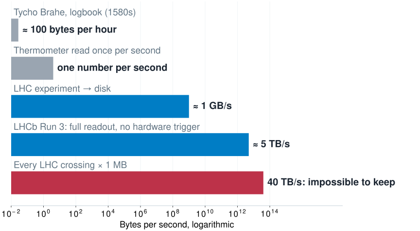

::: {.plot-caption}
Bytes per second, orders of magnitude. Seventeen decades from Tycho to the LHC.
:::
:::
:::::

::::

::: {.notes}
3 minutes. Neufeld's numbers: bandwidth about 100 bytes per hour (written to the logbook), trigger rate about 3.85×10⁻⁶ Hz, i.e. one observation every three days on average. Compare with LHCb (Run 3): ~30 MHz of crossings, ~5 TB/s full readout. Ask: what would be Tycho's "dead time"? (Cloudy nights, daytime.)
:::

## Raw data → physics: Kepler's 8 arcminutes

:::: {.slide-body}

Tycho did not find the law in his data. His assistant **Johannes Kepler** did.

Circular orbits missed Tycho's Mars positions by **8 arcminutes**.

Kepler **trusted the measurement** — he knew Tycho was good to ~2 arcminutes — and abandoned the circle: **ellipses** (1609).

::: {.take-home}
The size and speed of a DAQ say nothing about the importance of the discovery. **Knowing your uncertainties** does.
:::

::::

::: {.notes}
3 minutes. Kepler joined Tycho in Prague in 1600 and inherited the observations after Tycho's death in 1601. Fitting circles (with all the classical refinements) left a discrepancy of 8 arcminutes for Mars — about a quarter of the Moon's diameter. Because Tycho's instruments and procedures were documented well enough to trust ~2′, Kepler concluded the model, not the data, was wrong: elliptical orbits, Astronomia Nova (1609). Kepler's laws then led to Newton's gravitation. Moral, quoting Neufeld's slide in spirit: the size and speed of a DAQ system are not correlated with the importance of the discovery. Raw data also needed conversion (from sky coordinates to orbital coordinates) and quality corrections — the analysis chain we will meet in the next lectures. 8′ ≈ 0.13°.
:::

## The Geiger–Müller counter (1928)

::: {.slide-refs}
Original schematic · H. Geiger, W. Müller, Kiel, 1928
:::

:::: {.slide-body}

::::: {.picture-layout}
::: {.picture-copy}
A gas-filled tube with a thin wire at **high voltage**.

**One** ionization electron starts an avalanche that spreads along the **whole wire**.

Big pulse (~1 V): no amplifier needed — you can **hear the click**.

But: **every particle gives the same pulse**.
:::

::: {.picture-visual}
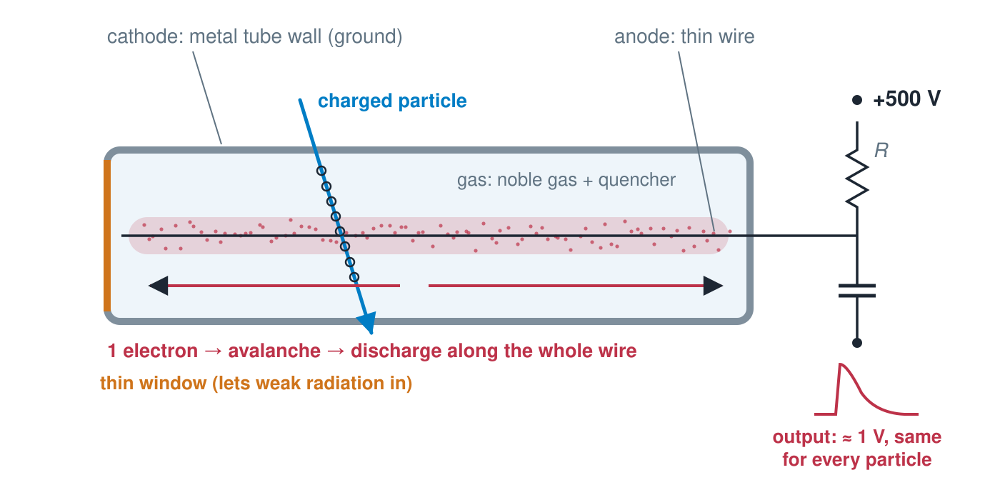
:::
:::::

::::

::: {.notes}
4 minutes. Same construction as the drift tube of Lecture 7 (cathode tube, anode wire), but run at a higher voltage. In a proportional tube the avalanche stays local and its size is proportional to the primary ionization; in Geiger mode UV photons from the avalanche start new avalanches along the entire wire until the positive-ion space charge around the wire lowers the field and stops the discharge. A quench gas (organic vapour or halogen) absorbs the photons and prevents re-triggering. Typical operating voltage 400–1000 V depending on the tube. Consequences: (1) huge signal, simple electronics — ideal in the 1930s; (2) no energy information — counts only; (3) a long dead time, ~100 µs, while the ions drift to the wall. The thin end window (mica) lets α and β particles enter; γ rays are detected via electrons they knock out of the wall. Hans Geiger and his student Walther Müller, University of Kiel, 1928.
:::

## One tube, three regimes

::: {.slide-refs}
Original schematic (qualitative)
:::

:::: {.slide-body}

::::: {.picture-layout}
::: {.picture-copy}
Raise the voltage:

**Ionization chamber:** collect the primary charge.

**Proportional:** gain $10^3$–$10^5$, pulse ∝ ionization.

**Geiger–Müller:** pulse independent of ionization.

Geiger mode: a perfect **yes/no** detector.
:::

::: {.picture-visual}
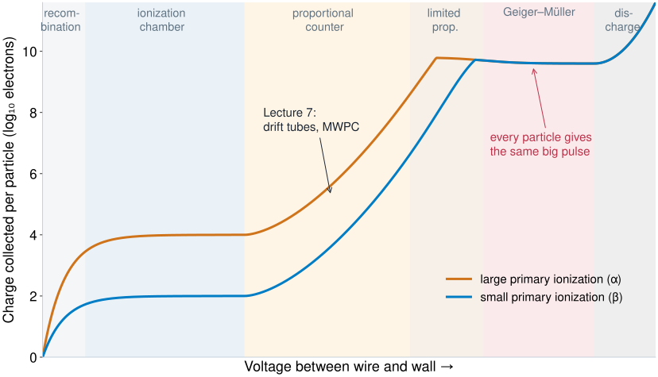

::: {.plot-caption}
Schematic; voltages and gains depend on the gas and the geometry.
:::
:::
:::::

::::

::: {.notes}
3 minutes. Classic textbook diagram (e.g. Knoll; Leo; Grupen–Shwartz), redrawn qualitatively. Two curves differ by a factor 100 in primary ionization (α vs β). Ionization chamber: gain 1, plateau. Proportional: gain grows exponentially with voltage, the ratio of the two curves stays fixed — this is where drift tubes and MWPCs operate. Limited proportional: space charge saturates. Geiger: the curves merge — information on energy is lost, but the signal is large and uniform. Beyond: continuous discharge, which destroys the tube. Point out the trade-off that will appear again: a yes/no signal is fast and easy to use for a decision.
:::

## Two counters in coincidence (1929)

::: {.slide-refs}
Original schematic · W. Bothe, W. Kolhörster, Z. Phys. 56 (1929) 751
:::

:::: {.slide-body}

::::: {.picture-layout}
::: {.picture-copy}
**Bothe and Kolhörster:** two counters, one above the other.

Simultaneous clicks → **one particle crossed both**.

Cosmic rays crossed thick absorbers: **charged, penetrating particles**.

**Rossi (1930):** an electronic **AND** of many counters.
:::

::: {.picture-visual}
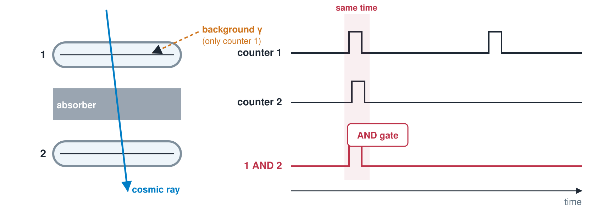
:::
:::::

::::

::: {.notes}
4 minutes. Bothe and Kolhörster (Berlin, 1929) placed two Geiger–Müller counters one above the other, at first with a 4 cm gold block between them, and recorded the counter signals photographically. Coincidences persisted with the absorber in place, showing that the cosmic radiation contained charged particles that penetrate a lot of matter (we now know: mostly muons). Bothe then built an electronic coincidence circuit (1929); Bruno Rossi in Florence (Nature 125, 636, 1930) built a vacuum-tube circuit for any number of counters, the ancestor of every logic AND gate in a trigger. Bothe received the Nobel Prize in 1954 "for the coincidence method". The key idea: one counter cannot tell a cosmic ray from radioactivity; two aligned counters, required at the same time, can. Cosmic muon flux at sea level: about 1 per cm² per minute through a horizontal surface.
:::

## Accidental coincidences

:::: {.slide-body}

Two **independent** counters with rates $R_1$, $R_2$ fire "together" (within $\tau$) by chance:

$$R_{\mathrm{acc}}=2\tau R_1R_2$$

Example: $R_1=R_2=50\ \mathrm{Hz}$, true cosmic coincidences ≈ **1.5 Hz**.

::: {.fragment}
| Resolving time $\tau$ | Accidentals $R_{\mathrm{acc}}$ |
|---|---:|
| 1 ms (early circuits) | **5 Hz** — swamps the signal |
| 10 µs | **0.05 Hz** |
| 10 ns (modern) | **5×10⁻⁵ Hz** |
:::

::: {.take-home}
Faster electronics → narrower coincidence window → cleaner selection.
:::

::::

::: {.notes}
4 minutes. Derive in one line on the board: a pulse in counter 1 opens a window of total width 2τ (±τ); the chance that counter 2 fires in it is 2τR_2; multiply by R_1. Have students compute the 1 ms row before revealing the table (click). 1.5 Hz of true coincidences corresponds to roughly 100 cm² of counter area. The same formula sets the timing requirements of modern triggers: at the LHC the coincidence window is one 25 ns crossing. The 1 ms and 10 µs entries are illustrative orders of magnitude, not the specification of one historical circuit.
:::

## The first trigger: a counter-controlled cloud chamber

::: {.slide-refs}
Original schematic · P. M. S. Blackett, G. Occhialini, Proc. R. Soc. A 139 (1933) 699
:::

:::: {.slide-body}

::::: {.picture-layout}
::: {.picture-copy}
A cloud chamber shows **beautiful tracks** — but expanded at random, most photos are **empty**.

**Blackett and Occhialini (1932):** let the counters decide.

Coincidence → expand → photograph.

Result: positrons and particle **showers**.
:::

::: {.picture-visual}
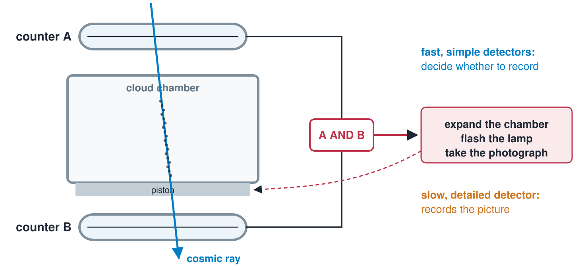
:::
:::::

::::

::: {.notes}
4 minutes. A Wilson cloud chamber is made sensitive by a sudden expansion; it then needs a long time to recover, so it can take only a few pictures per minute. Expanded at random times, only a small fraction of photographs show a cosmic-ray track. Occhialini had learned the coincidence technique from Rossi in Florence; with Blackett in Cambridge they used a coincidence of counters above and below the chamber to fire the expansion. It works because the ion trails survive the short time between the particle's passage and the expansion. With it they confirmed Anderson's positron and saw electron–positron showers (1933). Blackett received the Nobel Prize in 1948. This is the trigger concept in its purest form: fast, simple detectors decide; a slow, detailed detector records.
:::

## Trigger and DAQ: the two words of today

:::: {.slide-body}

::: {.two-col}
::: {.rule}
[Trigger]{.rule-head}

**Decides** whether an event is recorded.

Uses **fast, simple** information.

1932: two counters in coincidence.

Today: muon chambers, calorimeters, then computers.
:::
::: {.rule}
[DAQ (data acquisition)]{.rule-head}

**Reads out, assembles and stores** the chosen events.

Uses the **full, detailed** information.

1932: the cloud-chamber photograph.

Today: 10⁸ channels → network → computer farm → disk.
:::
:::

::: {.take-home}
The principle has not changed in 90 years: **a fast decision on part of the data, then a full recording.**
:::

::::

::: {.notes}
2 minutes. Ask students to name the trigger and the DAQ in the Blackett–Occhialini set-up. The selection is irreversible: whatever the trigger rejects is lost. About 45 minutes elapsed.
:::

## 3 · Building a DAQ, step by step {.section-title}

:::: {.slide-body}

From one thermometer to a particle detector

::: {.subtle}
Clock or trigger · many sensors · delay · busy · buffer
:::

::::

::: {.notes}
Storyline of this section follows N. Neufeld, ESI 2009, pp. 16–29: a trivial DAQ grows one element at a time. Each step answers one problem of the previous one.
:::

## Step 1 · One sensor, read on a clock

::: {.slide-refs}
[After N. Neufeld · ESI 2009, pp. 23–24](https://indico.cern.ch/event/43007/contributions/1065030/attachments/927884/1313738/trigger-daq-analysis-esi09-neufeld1.pdf)
:::

:::: {.slide-body}

A thermometer in the lab, read by a voltmeter connected to a computer:

```python
while True:
    T = voltmeter.read()          # the measurement
    logbook.write(clock.now(), T) # storage
    sleep(1)                      # the "trigger": a clock
```

::: {.two-col}
::: {.rule}
[Sensor → digitizer → computer → disk]{.rule-head}

This is already a complete **DAQ**.
:::
::: {.rule}
[A clock is enough]{.rule-head}

The temperature changes **slowly**: any moment is as good as another.
:::
:::

::::

::: {.notes}
3 minutes. Neufeld's example: a Pt100 resistance thermometer read with a digital voltmeter over USB, a few lines of code. Point out how little the DAQ needs to know about the sensor. Ask: would this loop work for a particle detector? No — a particle passes at a random moment and its signal lasts ~100 ns; reading every second would almost always see nothing. That is step 3.
:::

## Step 2 · Many sensors: cables do not scale

::: {.slide-refs}
[Photo: N. Neufeld · ESI 2009, p. 29](https://indico.cern.ch/event/43007/contributions/1065030/attachments/927884/1313738/trigger-daq-analysis-esi09-neufeld1.pdf)
:::

:::: {.slide-body}

::::: {.picture-layout}
::: {.picture-copy}
**16 sensors:** a USB hub, the same program.

**160 sensors:** 160 voltmeters and cables? Expensive and fragile.

→ **Readout boards** with many channels in a **crate**, sharing one **bus**.

**10⁸ channels:** boards → optical links → **network** → computers.
:::

::: {.picture-visual}
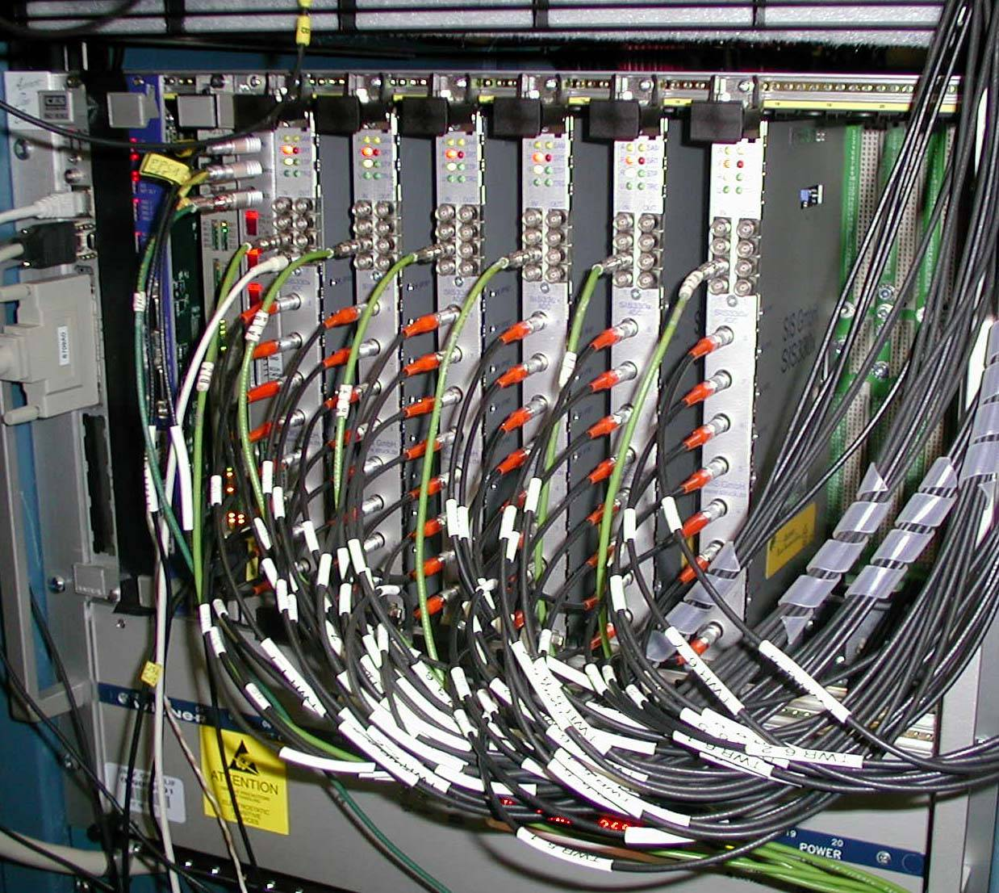

::: {.plot-caption}
Readout boards in a VME crate. Even 100 channels make a thicket of cables.
:::
:::
:::::

::::

::: {.notes}
3 minutes. Neufeld pp. 25–29. The architecture must be scalable: 16 sensors need no change, 160 need a new idea. A crate provides mechanics, power and a standard way (a bus, e.g. VME, IEEE 1014) to read many boards. Buses are shared: only one board talks at a time, so a bus does not scale to an LHC detector. Modern experiments digitize on the detector, send data over optical fibres and use switched networks (Ethernet) — like the internet. Photo from Neufeld's slides; original source not stated there.
:::

## Step 3 · Particles arrive at random: a trigger

::: {.slide-refs}
Redrawn after N. Neufeld · ESI 2009, p. 17
:::

:::: {.slide-body}

::::: {.picture-layout .diagram}
::: {.picture-copy}
Copy the signal to a **discriminator**: "a particle is here **now**".

Its output **starts the ADC**.

The **delay** holds the analogue signal while the trigger decides.

Remember the delay: at the LHC it becomes a **pipeline**.
:::

::: {.picture-visual}
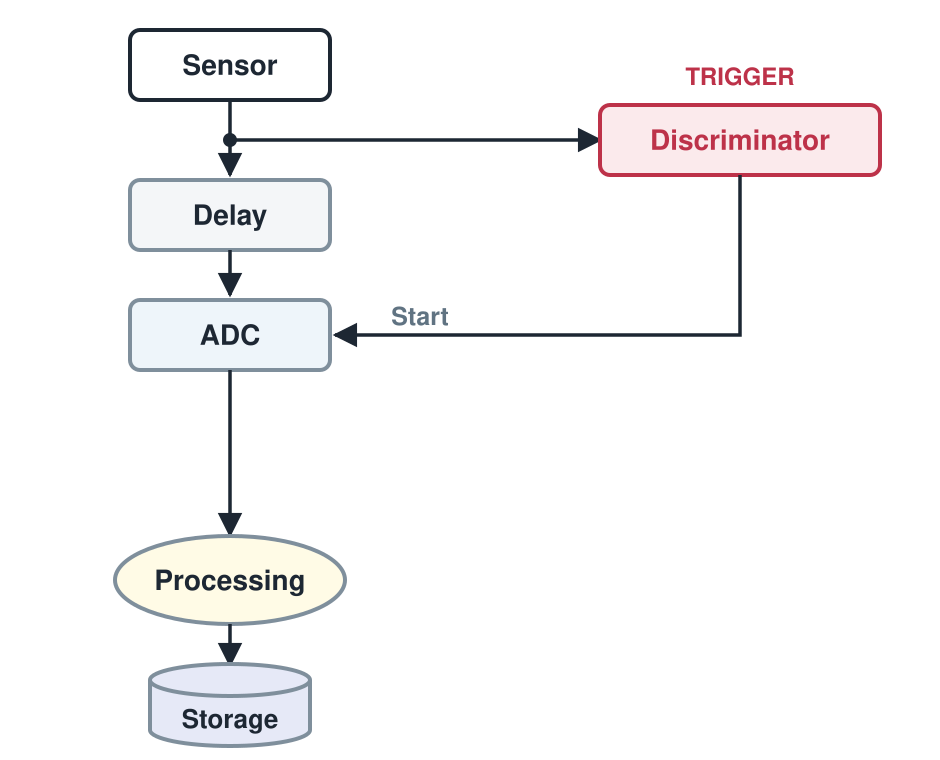
:::
:::::

::::

::: {.notes}
4 minutes. Compare with step 1: the clock is replaced by a signal derived from the detector itself — a self-triggered DAQ. The discriminator (next slide) is the modern version of the Geiger click. The delay is needed because the decision takes time (tens of ns in a simple circuit): without it the pulse would already have passed the ADC when the start arrives. In the 1970s–80s delays were literally long coaxial cables (≈5 ns per metre).
:::

## Inside the trigger: the discriminator

::: {.slide-refs}
Original teaching model
:::

:::: {.slide-body}

::::: {.picture-layout}
::: {.picture-copy}
Compare the pulse with a **threshold**.

Above: output a **logic 1**. Below: nothing.

The Geiger counter was a discriminator by construction.

The ADC still measures the **full pulse**.
:::

::: {.picture-visual}
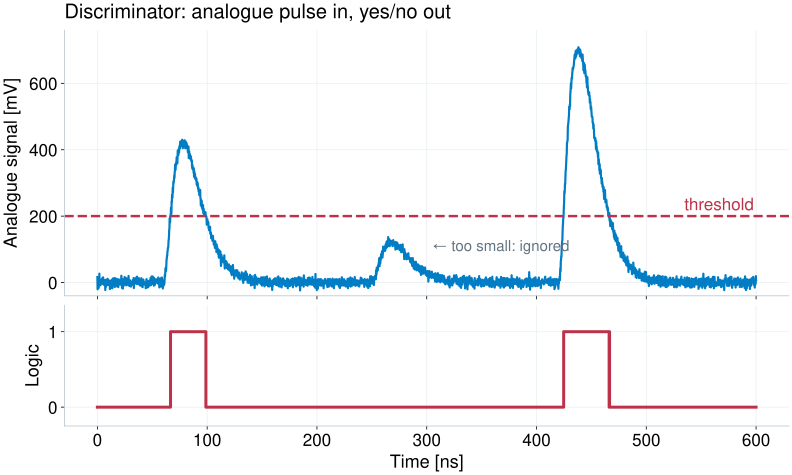
:::
:::::

::::

::: {.notes}
2 minutes. The threshold must sit above the noise but below the smallest real signal. The rising edge of the logic signal also marks the time. Several discriminator outputs can be combined in a coincidence — Bothe and Rossi's AND.
:::

## Step 4 · What if a particle arrives while we are busy?

::: {.slide-refs}
Redrawn after N. Neufeld · ESI 2009, p. 18
:::

:::: {.slide-body}

::::: {.picture-layout .diagram}
::: {.picture-copy}
The ADC and the processing take time.

A second trigger now would **corrupt** the event.

**Busy flag:** set at "start", cleared when processing is done. Triggers pass only if **not busy**.

The time spent busy is **dead time**.
:::

::: {.picture-visual}
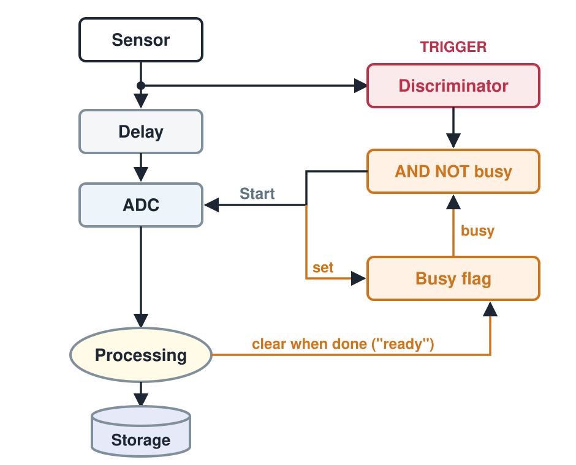
:::
:::::

::::

::: {.notes}
3 minutes. Neufeld p. 18: dead time (%) is the ratio between the time the DAQ is busy and the total time. Note the orange elements are the only change from step 3. Next slide: how much do we lose?
:::

## Dead time: how much do we lose?

::: {.slide-refs}
Original teaching model
:::

:::: {.slide-body}

::::: {.picture-layout}
::: {.picture-copy}
$\tau$ = busy time after each event.

Input rate $R$, recorded rate:

$$r=\frac{R}{1+R\tau}\;\xrightarrow{R\to\infty}\;\frac{1}{\tau}$$

Example: $R=1$ kHz, $\tau=100\ \mu$s → we lose **9%**.

Geiger counter ($\tau\approx100\ \mu$s): at most **10 000 counts/s**.
:::

::: {.picture-visual}
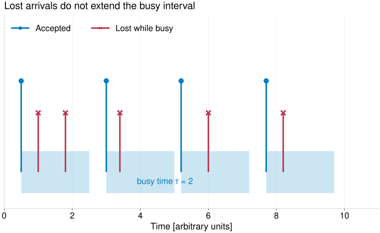

::: {.plot-caption}
Toy example with busy time τ = 2 time units.
:::
:::
:::::

::::

::: {.notes}
4 minutes. Derivation in one line: on average each recorded event is followed by τ of dead time plus 1/R of waiting for the next particle, so r = 1/(τ + 1/R). Live fraction 1/(1+Rτ) = 1/1.1 = 91% in the example. Lab-course link: a Geiger counter close to a strong source under-counts; correct with R = r/(1−rτ). This "non-paralyzable" model assumes lost particles do not extend the busy time. Backup has the plot of r versus R.
:::

## Step 5 · Add a buffer

::: {.slide-refs}
Redrawn after N. Neufeld · ESI 2009, pp. 19–20
:::

:::: {.slide-body}

::::: {.picture-layout .diagram}
::: {.picture-copy}
A **FIFO** (first in, first out) between ADC and processing.

Busy only while the ADC converts — or when the FIFO is **full**.

Random arrivals → steady processing: the buffer **de-randomizes**.
:::

::: {.picture-visual}
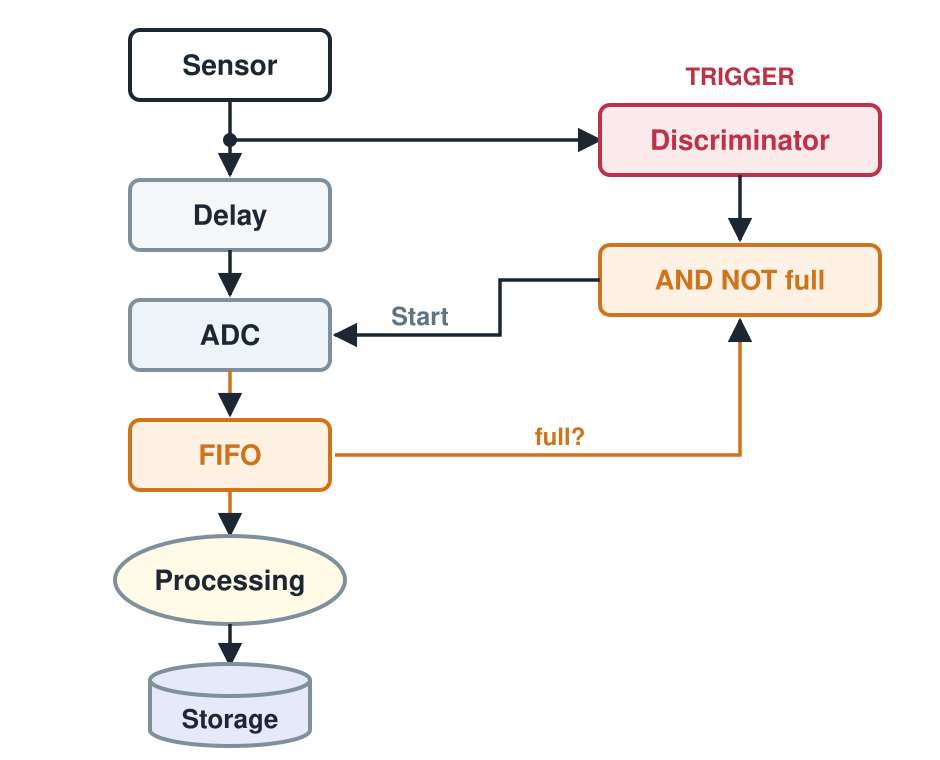
:::
:::::

::::

::: {.notes}
3 minutes. Analogy: the queue at a supermarket checkout. Without the FIFO the system is busy for ADC conversion plus processing; with it, only for the conversion (as long as the processing keeps up on average). Buffers are everywhere in a modern DAQ: on the detector, on readout boards, in computer memory, on disk. Try it in the demo.
:::

## Event queue demo {.demo-slide}

:::: {.slide-body}

::: {.widget data-src="widgets/queue.html" data-poster="widgets/queue-poster.png" data-alt="Interactive event queue with ADC and FIFO states, occupancy history, busy fractions and event accounting"}
:::

::::

::: {.notes}
5 minutes. Ask for a prediction first. Start with the one-busy-stage model (step 4). Then switch to ADC → FIFO → processor and try buffer depths 0 → 8 → 32 at 8 kHz input (step 5). Then raise the input to 15 kHz, above the 10 kHz processor capacity: the buffer fills and losses return. A 200 ms simulation is replayed over about 10 seconds.
:::

## Pause and check

:::: {.slide-body}

Input **12 kHz**, processor **10 kHz**, buffer **1 000 000 events**.

Will we ever lose events? When?

::: {.fragment}
The buffer grows by $12-10=2$ thousand events per second:

$$t_{\mathrm{full}}\approx\frac{10^6}{2\times10^3\ \mathrm{s}^{-1}}=500\ \mathrm{s}$$

::: {.take-home}
A buffer smooths **fluctuations**. Only a faster processor — or a **trigger that reduces the rate** — fixes a too-high average rate.
:::
:::

::::

::: {.notes}
3 minutes including thinking time. Answer revealed on click. After 500 s (about 8 minutes) the buffer is full and we lose 2 kHz of the 12 kHz input, about 17%. Bridge to the LHC: the same five steps, but with 10⁸ channels and a new crossing every 25 ns. About 63 minutes elapsed.
:::

## 4 · Scaling up to the LHC {.section-title}

:::: {.slide-body}

The same five steps — with 10⁸ channels and 25 ns

::: {.subtle}
Crossings in flight · the full detector · calorimeter trigger · thresholds · pipeline · two levels
:::

::::

::: {.notes}

:::

## 25 ns is short

::: {.slide-refs}
Original schematic · after N. Neufeld · ESI 2009, p. 51
:::

:::: {.slide-body}

::::: {.picture-layout .diagram}
::: {.picture-copy}
In 25 ns light travels **7.5 m**.

A detector is **25 m** tall: particles from **three crossings** are inside at once.

Every channel must be **synchronized** to the 40 MHz clock and must know **which crossing** it saw.
:::

::: {.picture-visual}
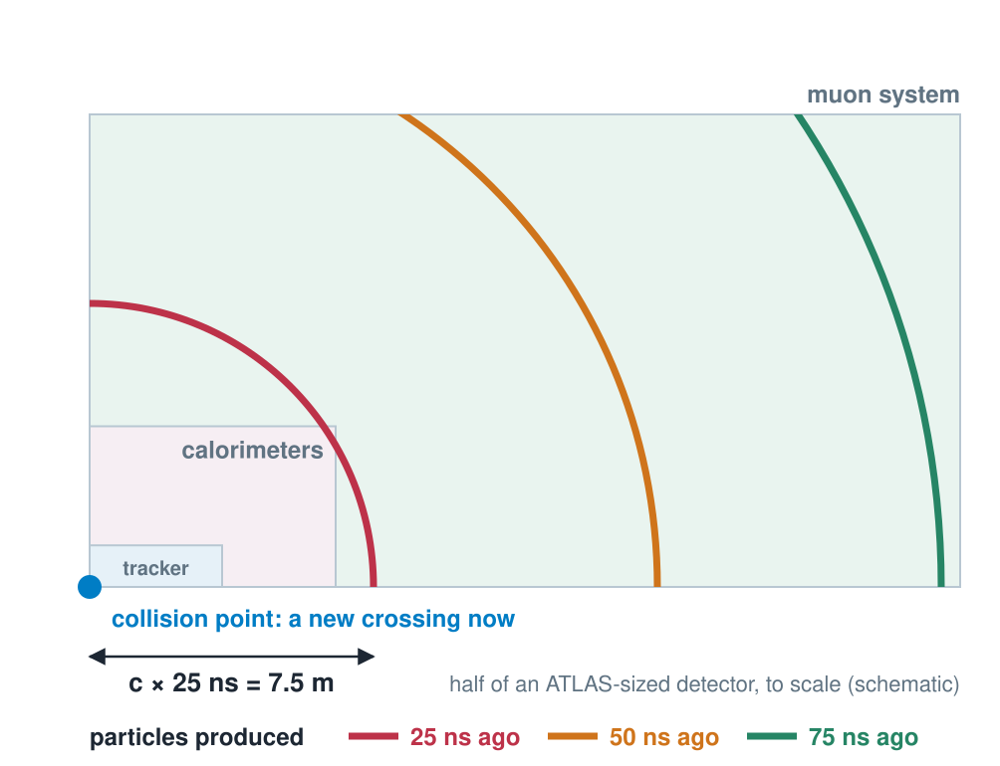
:::
:::::

::::

::: {.notes}
3 minutes. ATLAS: 25 m high, 44 m long; the drawing shows one quarter (half length, half height), to scale. Particles move at nearly c, so at any moment the outer muon chambers see particles from a crossing that happened 50–75 ns earlier, while new particles leave the collision point. Some detector signals are longer than 25 ns (drift times in gas, calorimeter pulses), so the electronics must assign each signal to its crossing (bunch-crossing identification). And the system is on-line: a rejected crossing is gone for ever.
:::

## The full detector at work {.full-figure}

::: {.slide-refs}
Original schematic · after N. Neufeld · ESI 2009, p. 54
:::

:::: {.slide-body}

::: {.visual}
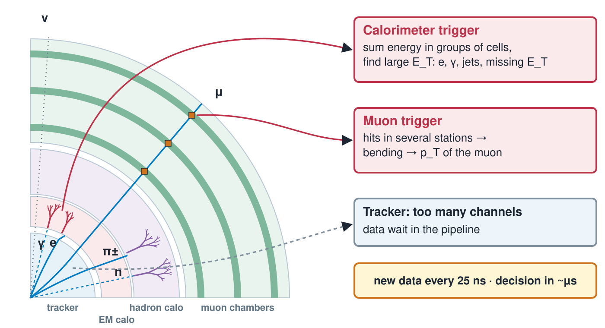
:::

::: {.take-home}
Every system records every crossing, but only the **calorimeters** and **muon chambers** feed the first trigger: few channels, simple sums. The **tracker** waits in the pipeline.
:::

::::

::: {.notes}
4 minutes. Walk through the particles (recall the detector layers of Lecture 7), in a transverse slice: γ and e shower in the EM calorimeter, π± and n in the hadron calorimeter, μ reaches the muon chambers, ν escapes (missing transverse energy). Level-1 (called Level-0 at LHCb) uses only the systems with few, large channels and simple signatures: the calorimeters are read in coarse "trigger towers" (sums of many cells), the muon system in a few stations. The tracker has ~10⁸ channels and pattern recognition is too slow for 25 ns — it is used only after the accept, in the High-Level Trigger. Redrawn after Neufeld p. 54 (original CMS illustration).
:::

## Example: a calorimeter trigger {.full-figure}

::: {.slide-refs}
Original teaching model
:::

:::: {.slide-body}

::: {.visual}
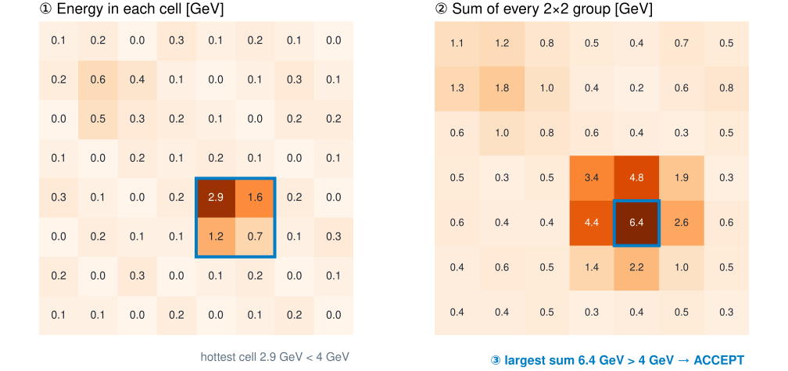
:::

::: {.take-home}
A shower **spreads over neighbouring cells**. Add every 2×2 group, keep the largest sum, compare with the threshold — for all groups **in parallel, every 25 ns**.
:::

::::

::: {.notes}
5 minutes. Step by step: (1) each cell measures energy (converted to transverse energy E_T = E sin θ with a fixed factor per cell); (2) a shower that hits near a cell corner shares its energy between up to four cells, so the hottest cell alone (2.9 GeV) would fail a 4 GeV threshold although the particle had 6.4 GeV; summing every overlapping 2×2 group recovers it; (3) only the largest sum (one number!) is sent on and compared with the threshold. Overlapping groups: each cell enters four sums, so no shower is missed wherever it lands. This is simple arithmetic — additions and comparisons — so it can be built in FPGAs/ASICs that finish within a fixed latency. Toy numbers; noise 0–0.6 GeV per cell.
:::

## Your turn: be the trigger

:::: {.slide-body}

::: {.two-col}
::: {.calo-grid}
| | | | | | |
|---:|---:|---:|---:|---:|---:|
| 0.1 | 0.3 | 0.2 | 0.0 | 0.4 | 0.1 |
| 0.2 | 1.8 | 2.1 | 0.3 | 0.1 | 0.2 |
| 0.0 | 0.9 | 1.2 | 0.2 | 0.5 | 0.3 |
| 0.3 | 0.1 | 0.2 | 0.4 | **3.6** | 0.2 |
| 0.1 | 0.2 | 0.0 | 0.3 | 0.4 | 0.1 |
| 0.2 | 0.1 | 0.3 | 0.1 | 0.2 | 0.0 |
:::
::: {}
Cell energies in GeV. Threshold: **5 GeV** on the largest 2×2 sum.

1. Where is the largest 2×2 sum?
2. Accept or reject?

::: {.fragment}
Around the hottest cell (3.6): at most **4.7 GeV**.

Rows 2–3, columns 2–3: 1.8 + 2.1 + 0.9 + 1.2 = **6.0 GeV** → **accept**.

The hottest cell is not the biggest cluster.
:::
:::
:::

::::

::: {.notes}
4 minutes. Give students one minute with a neighbour. The four sums containing the 3.6 GeV cell are 4.7, 4.7, 4.6 and 4.3 GeV — all below threshold. The broad deposit in the upper left (typical of a hadron shower or a particle hitting a cell corner) gives 6.0 GeV. Follow-up question: what would a single-cell trigger with a 3 GeV threshold do? (Fire on the 3.6 GeV cell — a different event selection.)
:::

## A real one: the LHCb Level-0 calorimeter trigger

::: {.slide-refs}
LHCb, Runs 1–2 (2010–2018)
:::

:::: {.slide-body}

| | |
|---|---|
| Input | ECAL ≈ 6 000 cells, HCAL ≈ 1 500 cells, every 25 ns |
| Clusters | $E_T$ of every **2×2 group of cells**, computed on the front-end boards |
| Particle type | hits in the preshower and pad detectors in front: **e, γ or hadron?** |
| Decision | largest-$E_T$ candidate of each type above a threshold of **a few GeV** |
| Output | ≤ **1 MHz** (with the muon trigger), fixed latency **4 µs** |

::: {.take-home}
Exactly our toy. Since 2022 LHCb runs the same idea — and much more — **in software** on GPUs.
:::

::::

::: {.notes}
3 minutes. LHCb's hardware first level was called Level-0 (L0). L0 combined the calorimeter trigger (hadron, electron, photon, π⁰ candidates from 2×2 clusters) and the muon trigger (straight-line track in the muon stations → p_T) and reduced 40 MHz of crossings to at most 1 MHz, with a fixed 4 µs latency (the front-end pipelines were sized for it). Thresholds changed with running conditions; typical Run-2 values were around 3–4 GeV for hadrons and 2–3 GeV for electrons and photons. ATLAS and CMS use the same idea with "trigger towers" (≈0.1 × 0.1 in η × φ) and sliding windows of 2×2 or 4×4 towers, plus isolation around the cluster. In Run 3 LHCb removed L0 and reads every crossing (next slides). Numbers rounded; check the LHCb trigger papers (e.g. JINST 8 P04022, 2013) before quoting precisely.
:::

## What makes a crossing interesting?

:::: {.slide-body}

| Signature | Seen in | Example physics |
|---|---|---|
| **Energetic muon** | muon system | $Z\to\mu^+\mu^-$, $H\to ZZ\to4\mu$ |
| **Energetic electron or photon** | EM calorimeter | $W\to e\nu$, $H\to\gamma\gamma$ |
| **Energetic jets** | hadron calorimeter | top quarks, new heavy particles |
| **Missing energy** | sum of all calorimeters | neutrinos, dark matter? |

::: {.take-home}
Most collisions produce only **low-energy** particles. Rare heavy particles decay into **high-energy** ones: we cut on **transverse momentum** $p_T$.
:::

::::

::: {.notes}
4 minutes. Link to the full-detector slice: the muon system and the calorimeters give quick, coarse information, so Level-1 uses them; the tracker has too many channels to read out at 40 MHz. Transverse momentum p_T is the momentum component perpendicular to the beam: the colliding partons have almost no p_T, so large p_T signals a hard collision. A Z boson (91 GeV) decays into two muons of about 45 GeV each; typical particles from a soft collision have p_T below 1 GeV. H→4μ is the "golden" signature.
:::

## A threshold: keep signal, reject background

::: {.slide-refs}
Original teaching model
:::

:::: {.slide-body}

::::: {.picture-layout}
::: {.picture-copy}
Background: **100 000 /s**, mostly low $p_T$.

Signal: **100 /s**, higher $p_T$.

Keep events above the threshold.

**Signal efficiency** = kept signal / all signal.

Find a cut that fits **1 000 /s** to disk.
:::

::: {.picture-visual}


::: {.plot-caption}
Toy rate densities; grey region is rejected at 7 GeV/c.
:::
:::
:::::

::::

::: {.notes}
2 minutes setup. Note the logarithmic vertical axis: at low p_T the background is a thousand times larger than the signal. Raising the threshold reduces the background rapidly but also cuts into the signal. All numbers synthetic. The next slide lets students try it.
:::

## Trigger threshold demo {.demo-slide}

:::: {.slide-body}

::: {.widget data-src="widgets/threshold.html" data-poster="widgets/threshold-poster.png" data-alt="Interactive trigger threshold comparing signal efficiency, background acceptance, sample composition and storage bandwidth"}
:::

::::

::: {.notes}
5 minutes. First move only the threshold: watch signal efficiency, background acceptance and the bandwidth to disk. Find the lowest threshold that fits. Then reduce the event size: bandwidth changes, efficiencies do not. Then increase the background rate: the threshold must go up and signal is lost. Message: the trigger always trades efficiency for rate.
:::

## Real thresholds are not sharp

::: {.slide-refs}
Original teaching model
:::

:::: {.slide-body}

::::: {.picture-layout}
::: {.picture-copy}
The trigger measures $p_T$ **fast and roughly**.

A muon of 22 GeV is sometimes kept; one of 28 GeV is sometimes lost.

**Turn-on**, then a **plateau**.

Analyses use events **on the plateau**, where the efficiency is high and well measured.
:::

::: {.picture-visual}
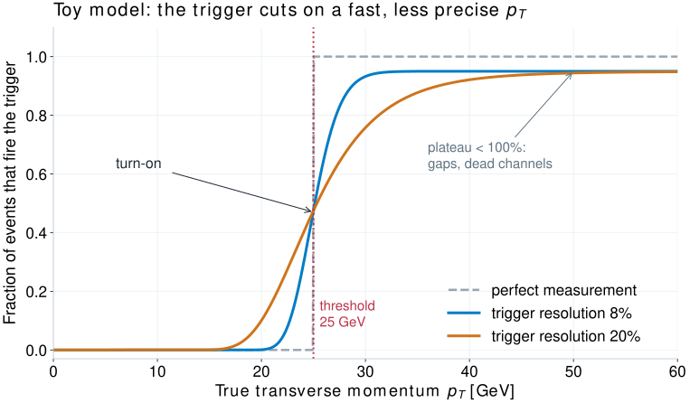
:::
:::::

::::

::: {.notes}
3 minutes. Toy model: the trigger cuts at 25 GeV on a measured p_T with Gaussian resolution 8% or 20% of p_T, plateau 95%. The worse the trigger resolution, the wider the turn-on. Real example: the CMS isolated-muon trigger (backup slide), with data/simulation comparison. How do we measure this curve without knowing the true muons? Tag and probe — backup.
:::

## The delay grows up: the pipeline

::: {.slide-refs}
Original schematic
:::

:::: {.slide-body}

A new crossing every **25 ns**. The Level-1 decision takes **2.5 µs**.

::: {.visual .belt}
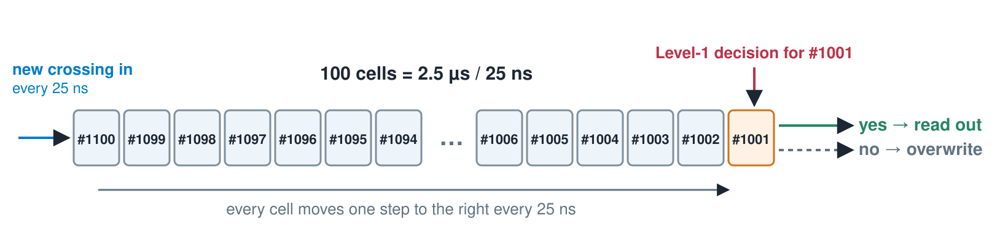
:::

::: {.take-home}
Step 3's **delay**, made of memory: every channel keeps the last **100 crossings** while Level-1 decides. No dead time from the decision itself.
:::

::::

::: {.notes}
3 minutes. Analogy: a conveyor belt — the decision for each item arrives a fixed time later, exactly when the item reaches the end of the belt. 2.5 µs / 25 ns = 100 cells. The trigger is itself pipelined: it starts on a new crossing every 25 ns while older ones are still being processed. The 2.5 µs include cable delays from the detector to the counting room and back, which is why Level-1 uses custom electronics (FPGAs). Real ATLAS Level-1 latency < 2.5 µs; ATLAS accepts about 1 crossing in 400.
:::

## Two trigger levels

::: {.slide-refs}
Original schematic · after N. Neufeld · ESI 2009, p. 52
:::

:::: {.slide-body}

::::: {.picture-layout .diagram}
::: {.picture-copy}
**Level-1** (hardware): calorimeter + muons only, in **µs**. 40 MHz → 100 kHz.

**Event building:** collect all pieces of one event into **one computer**.

**High-Level Trigger** (software): full reconstruction, close to offline. 100 kHz → **~1 kHz**.
:::

::: {.picture-visual}
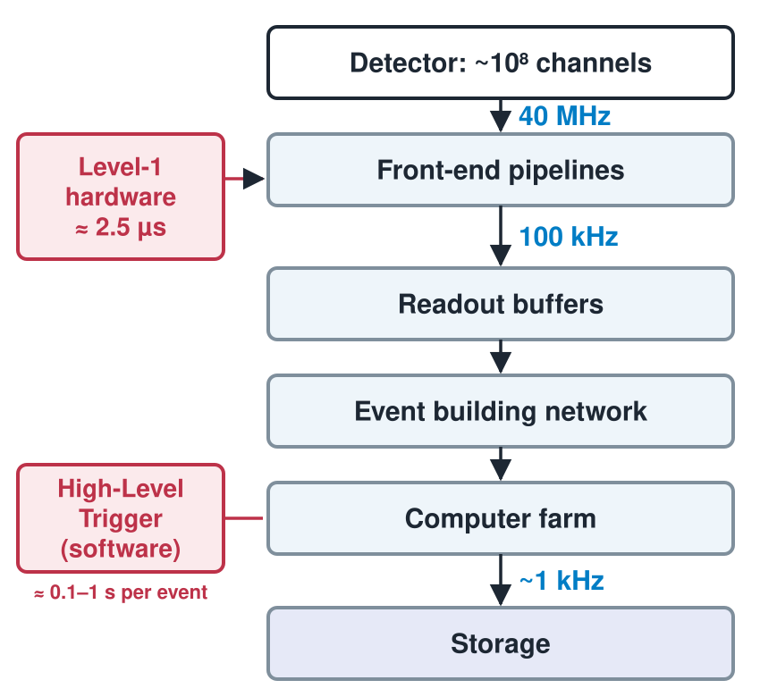
:::
:::::

::::

::: {.notes}
4 minutes. Follow one event down the chain. Compare with our five steps: pipelines = delay; Level-1 = discriminator logic, much bigger; readout buffers = FIFO; event building = many sensors (step 2) with a switched network instead of a bus; HLT = processing. Event building: after a Level-1 accept, ~500 readout units each hold a fragment; the network sends all fragments of one event to the same computer, while other computers work on other events. CMS (Neufeld p. 55): ~1 Tbit/s event-building network, thousands of PCs. The real ATLAS Run-2 diagram is in the backup. Numbers are round Run-2 values for ATLAS/CMS.
:::

## The rates in numbers {.full-figure}

::: {.slide-refs}
Original teaching model; round numbers for ATLAS/CMS
:::

:::: {.slide-body}

::: {.visual}
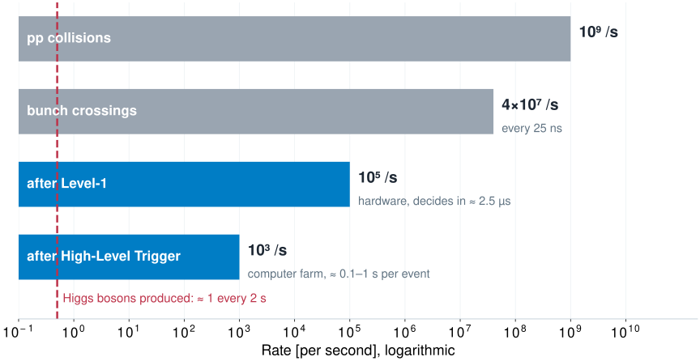
:::

::: {.take-home}
Each level gives the next one **more time per event**. Even after both, most recorded events are **not** Higgs bosons.
:::

::::

::: {.notes}
2 minutes. Each step reduces the rate by a factor 100–400. The recorded rate is still ~2000 times the Higgs production rate: the trigger is only the first selection; the analysis does the rest.
:::

## New trend: trigger in software {.full-figure}

::: {.slide-refs}
[LHCb Starterkit · Run-3 design](https://lhcb.github.io/starterkit-lessons/first-analysis-steps/dataflow-run3.html)
:::

:::: {.slide-body}

::: {.visual}

:::

::: {.take-home}
LHCb since 2022: **no hardware trigger**. All 30 MHz read out → GPUs (HLT1) → disk buffer → CPUs (HLT2).
:::

::::

::: {.notes}
3 minutes. LHCb studies b and c hadrons: their decay products have low p_T, so a hardware p_T threshold would throw away much of the signal. Instead the full detector is read out (about 5 TB/s in the diagram) and the first selection runs on a few hundred GPUs with full tracking. A disk buffer lets the detector be calibrated before the second software stage. The trade-off: you must move every crossing over the network. Cheaper networks and GPUs make this possible; future experiments follow the same path. About 85 minutes elapsed.
:::

## Five things to remember

:::: {.slide-body}

1. **40 MHz × 1 MB = 40 TB/s** — we can keep only ~1 kHz.
2. **Tycho:** systematic, documented measurements — Kepler trusted 8 arcminutes.
3. **Trigger** decides *when* (fast, partial data); **DAQ** records the full event. First trigger: Geiger counters in **coincidence**.
4. **A DAQ in five steps:** clock → trigger + delay → busy logic (**dead time**) → **buffer**.
5. **LHC:** the delay becomes a **pipeline**; two trigger levels, 40 MHz → 100 kHz → 1 kHz.

::::

::: {.notes}
1 minute. Ask students to explain each line in one sentence to their neighbour.
:::

## Exit questions

:::: {.slide-body}

1. Why does a Geiger–Müller counter not measure the particle's energy?
2. Two counters at 100 Hz each, window $\tau=100$ ns: accidental rate?
3. A detector with $\tau=50\ \mu$s sees 10 kHz. What fraction is lost?
4. Why must Level-1 store every crossing in a pipeline?
5. Why would a low-$p_T$ threshold be essential for LHCb but not for a Higgs search?

::::

::: {.notes}
3 minutes. Answers: (1) in Geiger mode the discharge spreads along the whole wire and stops by itself; its size does not depend on the initial ionization. (2) 2 × 10^-7 s × 10^4 s^-2 = 2×10^-3 Hz. (3) Rτ = 0.5, live fraction 1/1.5 = 67%, so 33% lost. (4) The decision takes 2.5 µs = 100 crossings; without a pipeline the data would be overwritten before the decision arrives. (5) b-hadron decay products have only a few GeV of p_T; Higgs decay products have tens of GeV.
:::

## Thank you for your attention {.title-card}

:::: {.slide-body}

::: {.subtitle}
Questions?
:::

::::

## Backup · Details {.section-title visibility="uncounted"}

:::: {.slide-body}

Material from the extended version of this lecture

::: {.subtle}
Cross sections · dead time · event building · efficiency · menus · bandwidth · real-time analysis
:::

::::

::: {.notes}

:::

## Backup · A real turn-on curve: CMS {.landmark visibility="uncounted"}

::: {.slide-refs}
[CMS · HLT performance, Run 2 (2024)](https://cms-results.web.cern.ch/cms-results/public-results/publications/TRG-19-001/)
:::

:::: {.slide-body}

::::: {.picture-layout}
::: {.picture-copy}
Trigger: "muon with $p_T>24$ GeV".

x: muon $p_T$ measured **offline**; y: fraction that **fired the trigger**.

**Turn-on**, then **plateau** at ~90%.

Why gradual? The fast trigger measures $p_T$ **less precisely**.
:::
:::: {.picture-visual}


::: {.plot-caption}
CMS isolated-muon trigger efficiency, Run 2.
:::
::::
:::::

::::

::: {.notes}
4 minutes. Read the axes slowly. Below 24 GeV the trigger sometimes fires because the online p_T was overestimated; above, it sometimes misses because it was underestimated. Analyses use events on the plateau (e.g. offline p_T > 26–27 GeV) where the efficiency is high and well measured. The plateau below 100% comes from detector gaps and isolation requirements. The lower panel compares data and simulation; any difference becomes a correction factor. How do we measure this curve without knowing the true muons? Tag and probe — backup slide.
:::

## Backup · Pipeline timing {visibility="uncounted"}

::: {.slide-refs}
[ATLAS · Trigger operation, Run 2 (2020)](https://arxiv.org/abs/2007.12539)
:::

:::: {.slide-body}

::::: {.picture-layout}
::: {.picture-copy}
A new crossing every **25 ns**. Level-1 needs **2.5 µs**.

Keep every crossing in a **pipeline** memory until its decision.

$$\frac{2.5\ \mu\mathrm{s}}{25\ \mathrm{ns}}=100\ \text{crossings in memory}$$

Accept → read out. Reject → overwrite.
:::

::: {.picture-visual}
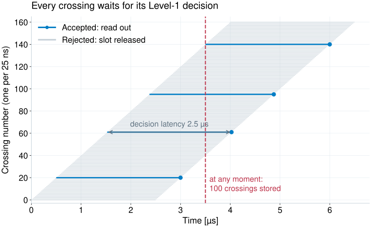

::: {.plot-caption}
Accepts enlarged in frequency for visibility (real: ~1 in 400).
:::
:::
:::::

::::

::: {.notes}
3 minutes. Analogy: a conveyor belt; the decision for each item arrives a fixed time later, by which time the item has reached the end of the belt. The trigger is itself pipelined: it starts working on a new crossing every 25 ns while older ones are still being processed, so there is no dead time from the decision itself. The 2.5 µs include cable delays from the detector to the counting room and back, which is why Level-1 must sit close and use custom electronics (FPGAs).
:::

## Backup · A real system: ATLAS Run 2 {.full-figure visibility="uncounted"}

::: {.slide-refs}
[ATLAS, JINST 15 P10004 (2020)](https://arxiv.org/abs/2007.12539)
:::

:::: {.slide-body}

::: {.visual}

:::

::: {.take-home}
40 MHz → **Level-1** (calorimeter + muons, hardware) → 100 kHz → readout → **HLT** (computer farm) → ~1 kHz → disk.
:::

::::

::: {.notes}
4 minutes. Follow one event: left, the detector front ends hold data in pipelines; Level-1 calorimeter and muon logic decide in 2.5 µs; accepted events are read out into buffers; the HLT computers request the data they need and run fast versions of the offline reconstruction, including tracking; accepted events go to permanent storage. Do not teach the acronyms. Source: ATLAS Collaboration, JINST 15 P10004 (2020), Fig. 1, CC BY 4.0. This is the 2015–2018 (Run 2) architecture.
:::

## Backup · Prescale {visibility="uncounted"}

:::: {.slide-body}

Low-threshold triggers fire far too often — but we still need some of those events: calibration, efficiency, cross-checks.

**Prescale $P$:** keep only **one in $P$** events that pass.

$$R_{\mathrm{recorded}}=\frac{R_{\mathrm{pass}}}{P}$$

Example: a 5 GeV muon trigger fires at 20 kHz; with $P=200$ it records **100 Hz**.

::: {.take-home}
A **trigger menu** is a list of hundreds of triggers, each with its own threshold and prescale. An event is kept if **any** of them fires.
:::

::::

::: {.notes}
2 minutes. The prescaled events are a random, unbiased subset of that trigger's selection, so they can measure efficiencies of higher-threshold triggers. In the analysis, a prescaled trigger corresponds to 1/P of the luminosity. A "zero-bias" trigger records randomly chosen crossings with no condition at all. The backup shows the CMS menu rates and the ATLAS rate and bandwidth during a fill.
:::

## Backup · A buffer absorbs bursts {visibility="uncounted"}

::: {.slide-refs}
Original teaching model
:::

:::: {.slide-body}

::::: {.picture-layout}
::: {.picture-copy}
Particles arrive **randomly**: sometimes several close together.

A **buffer** (FIFO: first in, first out) stores events while the processor is busy.

Same input, same processor: with 8 slots almost nothing is lost.
:::

::: {.picture-visual}
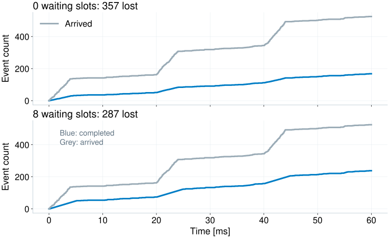

::: {.plot-caption}
Same burst arrivals, 8 kHz mean input; processor handles 10 kHz.
:::
:::
:::::

::::

::: {.notes}
3 minutes. Analogy: a queue at a supermarket checkout. A FIFO decouples the random arrival of events from the steady processing. Buffers are everywhere in a modern DAQ: on the detector, in readout boards, in computer memory and on disk. Generated with the exact widget model (seed 821, 60 ms, ADC time 0). Next: try it.
:::

## Backup · Cross sections {.landmark .tall-figure visibility="uncounted"}

::: {.slide-refs}
[W. J. Stirling · 2010 lecture, p22](https://indico.cern.ch/event/94815/contributions/1282690/attachments/1106827/1579062/LBLMIT_Stirling_v2.pdf)
:::

:::: {.slide-body}

::::: {.picture-layout}
::: {.picture-copy}
Read vertically at one collider energy.

**Strong production dominates; rare processes sit many orders below.**

$$R=\mathcal{L}\sigma$$

Why would random recording be inefficient?
:::
:::: {.picture-visual}
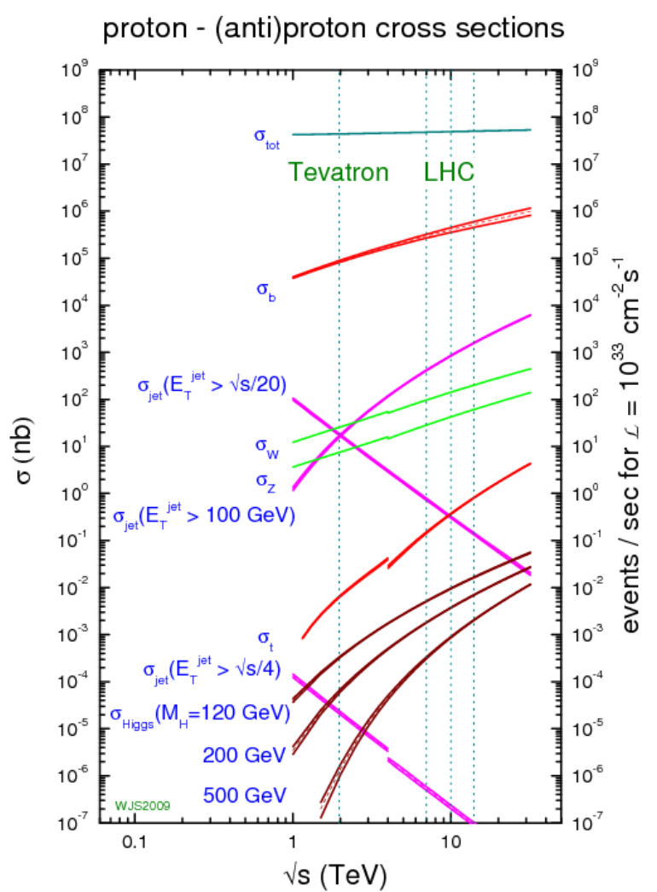

::: {.plot-caption}
Stirling’s classic hierarchy; historical predictions (WJS2009).
:::
::::
:::::

::::

::: {.notes}
5 minutes. Read x as centre-of-mass energy and left y as cross section in nb, both logarithmic. Right y converts to rates only at L=10^33 cm^-2 s^-1. Locate total, b, W/Z, top and Higgs at the LHC marker. Higgs curves assume masses 120, 200 and 500 GeV: historical predictions, not the measured 125 GeV cross section. Curves mix inclusive processes and jets with different cuts, so they are not disjoint event categories. The key is the scale hierarchy, not current numerical predictions.
:::

## Backup · Luminosity turns probability into rate {visibility="uncounted"}

:::: {.slide-body}

$$N=\sigma\int\mathcal{L}(t)\,dt,\qquad R(t)=\mathcal{L}(t)\sigma$$

At an illustrative $\mathcal{L}=10^{34}\,\mathrm{cm}^{-2}\mathrm{s}^{-1}$:

| Cross section | Production rate |
|---|---:|
| 80 mb | $8\times10^8\ \mathrm{s}^{-1}$ |
| 1 nb | $10\ \mathrm{s}^{-1}$ |
| 1 pb | $0.01\ \mathrm{s}^{-1}$ |

**Production is not recording:** branching fractions, acceptance, trigger efficiency and live time enter next.

::::

::: {.notes}
3 minutes. Arithmetic examples, not a list of measured process cross sections. 1 barn=10^-24 cm². Distinguish instantaneous from integrated luminosity. A rare production process may have a still rarer observable decay.
:::

## Backup · Non-paralyzable dead time {visibility="uncounted"}

::: {.slide-refs}
Original teaching model
:::

:::: {.slide-body}

::::: {.picture-layout}
::: {.picture-copy}
$$r=\frac{R}{1+R\tau}$$

At **τ = 120 µs**, the output approaches **8.33 kHz**.

Steady Poisson arrivals; one busy stage.
:::

::: {.picture-visual}
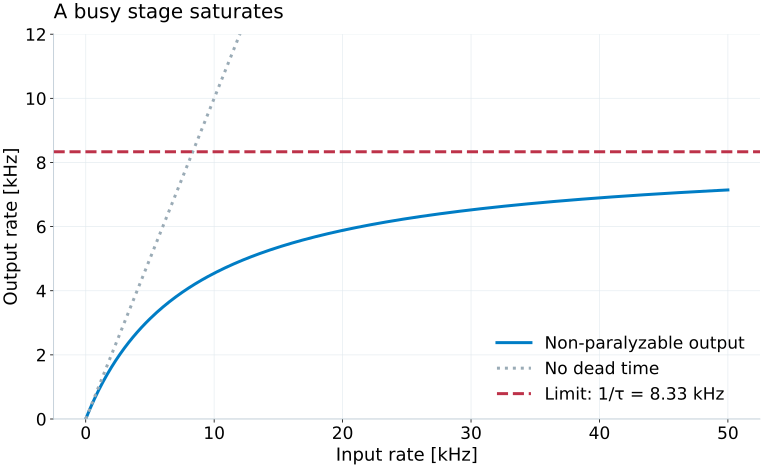

::: {.plot-caption}
Asymptotic capacity 1/τ; finite input always gives a lower output.
:::
:::
:::::

::::

::: {.notes}
Optional derivation. After fixed busy time τ, the memoryless Poisson process has mean wait 1/R until the next accepted arrival. In burst mode the instantaneous rate is time-dependent; do not apply the formula with the average rate as an exact prediction. Definition and model are original teaching additions to Neufeld/Stahl.
Original analytic rate plot. Derivation: mean interval between accepts =τ+1/R. The graph is not the prediction for the two-stage buffered or burst model.
:::

## Backup · More memory does not create capacity {visibility="uncounted"}

::: {.slide-refs}
Original teaching model
:::

:::: {.slide-body}

::::: {.picture-layout}
::: {.picture-copy}
Try **0 → 8 → 32** slots.

Then raise input from **8 to 15 kHz**.

What limit does the red curve approach?
:::

::: {.picture-visual}
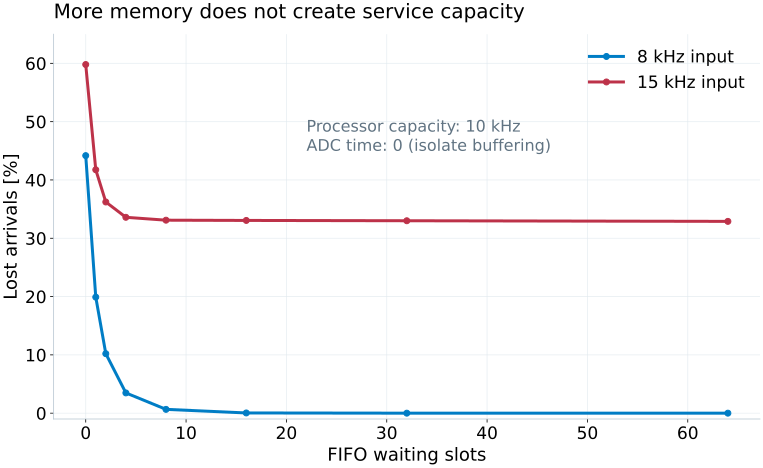

::: {.plot-caption}
Same queue model; 2 s runs; steady Poisson arrivals; ADC time = 0.
:::
:::
:::::

::::

::: {.notes}
2 minutes. Capacity of the processor is 10 kHz, ADC capacity at default 20 µs is 50 kHz, but Poisson arrivals still cause ADC-busy losses. At 15 kHz there is sustained pressure; no finite FIFO can guarantee indefinite loss-free operation. Keep the same seed to compare. In burst mode the arrival intensity is 4R for 20% of each 20 ms period and R/4 for the rest; the time-average remains R.
Original sweep from the widget model. At 15 kHz input and 10 kHz service, the large-buffer long-run lost fraction approaches at least 1−10/15≈33.3% when counting departures and accounting for pending events. A finite observation window shifts exact percentages. This plot isolates service overload; default demo includes ADC conversion too.
:::

## Backup · An event is assembled from fragments {visibility="uncounted"}

::: {.slide-refs}
Original teaching model
:::

:::: {.slide-body}

::::: {.picture-layout}
::: {.picture-copy}
Three detector systems produce fragments.

Match **event IDs and timestamps**, not arrival order.

When is event 1042 complete?
:::

::: {.picture-visual}
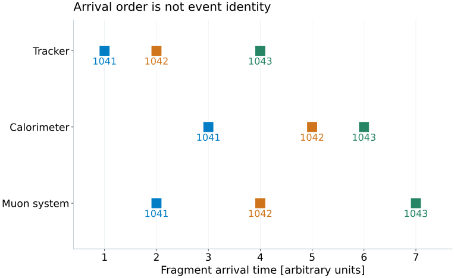

::: {.plot-caption}
Colours identify events; each square is one fragment.
:::
:::
:::::

::::

::: {.notes}
4 minutes. Toy fragment schema; not an experiment data format. Ask what happens if the calorimeter fragment for 1041 arrives after tracker fragment 1042. Arrival order is insufficient; synchronization, identifiers and completeness matter. Missing or corrupt fragments require monitoring and explicit policies. Source: Stahl L08 pp8,15.
Original illustrative arrival raster. Event 1042 is complete at t=5 arbitrary units, after its calorimeter fragment arrives. Event 1041 completes at t=3. One acquisition event may contain several interactions; retain the discussion of synchronization and missing fragments.
:::

## Backup · Latency and throughput {visibility="uncounted"}

::: {.slide-refs}
Original teaching model
:::

:::: {.slide-body}

::::: {.picture-layout}
::: {.picture-copy}
Follow **event A** across three stages.

Latency: **3 time units**.

After filling, throughput: **1 event per time unit**.
:::

::: {.picture-visual}


::: {.plot-caption}
Each colour follows one event; each stage takes one time unit.
:::
:::
:::::

::: {.take-home}
A long latency can coexist with a high throughput.
:::

::::

::: {.notes}
2 minutes. For a single serial processor of fixed service time τ, capacity is 1/τ. A real pipelined system is not restricted to that inverse end-to-end latency. Distinguish decision latency from throughput; raw data may be retained in a pipeline while waiting for a trigger decision. About 33 minutes elapsed.
Original pipeline timing diagram. Events A–D enter at t=0,1,2,3; three equal-duration stages. Bars have small visual gaps only for readability; stage duration is one unit. Distinguish latency 3 from initiation interval 1.
:::

## Backup · A day of data {visibility="uncounted"}

::: {.slide-refs}
Original teaching model
:::

:::: {.slide-body}

::::: {.picture-layout}
::: {.picture-copy}
At **1 GB/s**:

**86.4 TB** in 24 hours.

5 kHz × 200 kB per event = ?
:::

::: {.picture-visual}


::: {.plot-caption}
Continuous recording; decimal units; no overhead.
:::
:::
:::::

::::

::: {.notes}
4 minutes including student calculation. Answer 1 GB/s, hence 86.4 TB/day for uninterrupted acquisition. Accelerator duty cycle and actual run conditions matter in reality. Ask whether reducing event size by ten is as powerful as reducing event rate by ten for the storage budget: yes for bandwidth, but with different physics consequences.
Original V=Bt curves. At 0.2 GB/s the 24-hour total is 17.28 TB. Show that slope is the bandwidth, not just a number on a slide.
:::

## Backup · DAQ must keep the experiment coherent {visibility="uncounted"}

::: {.slide-refs}
Original teaching model
:::

:::: {.slide-body}

::::: {.picture-layout}
::: {.picture-copy}
A constant energy input can appear to drift.

Record **gain, timing and detector conditions** alongside event data.
:::

::: {.picture-visual}


::: {.plot-caption}
Toy example: 100 GeV input; gain increases 2.5% per hour.
:::
:::
:::::

::: {.take-home}
A recorded event needs its calibration context.
:::

::::

::: {.notes}
3 minutes. Slow control and data-quality monitoring are part of the system, not physics triggers. Give a temperature or high-voltage example. Source: Stahl L08 p8. Backup only.
Original teaching calculation: measured response =100 GeV×(1+0.025t/h), divided by known gain for correction. No detector stability claim; no noise added so the role of calibration is isolated.
:::

## Backup · Timing is a measurement: time of flight {visibility="uncounted"}

::: {.slide-refs}
Original teaching model
:::

:::: {.slide-body}

::::: {.picture-layout}
::: {.picture-copy}
Same momentum, different mass → **different speed**.

$$t=\frac{L}{c}\sqrt{1+\left(\frac{mc}{p}\right)^{2}}$$

$$m^2=\frac{p^2}{c^2}\left[\left(\frac{ct}{L}\right)^{2}-1\right]$$

Needs a **TDC** and a start time $t_0$ from the crossing clock.
:::

::: {.picture-visual}


::: {.plot-caption}
Separation falls roughly as $1/p^2$: TOF identifies particles at low momentum.
:::
:::
:::::

::::

::: {.notes}
4 minutes. Time of flight was not covered in the PID lecture; place it here because it is a direct use of digitized timing. Momentum p comes from tracking, path length L from the track and geometry, t from a fast detector (scintillator, MRPC, LGAD) read out by a TDC, with t₀ from the accelerator clock or a start counter. Worked example: L=5 m, p=2 GeV/c gives t(π)≈16.72 ns, t(K)≈17.18 ns, so Δt≈0.46 ns; with σ_t=100 ps this is about 4.6σ. For p≫mc, Δt≈(L/2pc²)(m₁²−m₂²)c², so separation falls as 1/p² and grows with L. Resolution budget: detector time resolution, t₀ uncertainty, path-length and momentum errors. Ask: why does a longer flight path help, and why does TOF stop working at high momentum? (Cherenkov/RICH and dE/dx cover other ranges.) Link to the next lecture: m² from TOF is a reconstructed quantity, not a raw measurement.
Figure: original analytic calculation, Gaussian timing response σ_t=100 ps, L=5 m (a GlueX-like flight path), exact momenta and paths. Real detectors add tails and momentum/path uncertainties.
:::

## Backup · Efficiency, acceptance and purity {visibility="uncounted"}

::: {.slide-refs}
Original teaching model
:::

:::: {.slide-body}

::::: {.picture-layout}
::: {.picture-copy}
$$R_{\mathrm{out}}=\epsilon_S R_S+\epsilon_B R_B$$

A useful cut keeps signal and rejects background.

**Purity also depends on input rates.**
:::

::: {.picture-visual}


::: {.plot-caption}
Analytic toy spectra; signal 100 Hz, background 100 kHz.
:::
:::
:::::

::::

::: {.notes}
3 minutes. These equations assume labelled signal/background categories and one event counted once. Real trigger lines overlap; their rates cannot simply be summed without correcting overlaps. In the demo equal sample sizes are used to estimate conditional efficiencies, then reweighted by different physical input rates. Signal fraction is undefined if total selected rate is zero.
Analytic curves corresponding to the demo distributions: nonnegative N(8,2²) signal and exponential mean 1.5 background. Unlike the finite sample in the demo, these are smooth theoretical expectations. Green is S/(S+B), not signal efficiency. Define each efficiency as kept/input within its class.
:::

## Backup · Measuring efficiency: tag and probe {visibility="uncounted"}

::: {.slide-refs}
[CMS · HLT performance, Run 2 (2024)](https://cms-results.web.cern.ch/cms-results/public-results/publications/TRG-19-001/)
:::

:::: {.slide-body}

::::: {.picture-layout}
::: {.picture-copy}
Use a known resonance: $Z\to\mu^+\mu^-$.

**Tag:** a muon that fired the trigger.

**Probe:** the other muon, not required to fire.

$$\epsilon=\frac{N_{\mathrm{pass}}}{N_{\mathrm{pass}}+N_{\mathrm{fail}}}$$

Fit signal in each sample; repeat in $(p_T,\eta)$ bins.
:::

::: {.picture-visual}
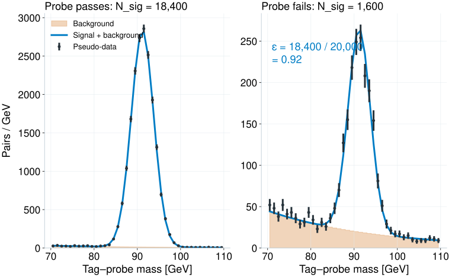

::: {.plot-caption}
Toy pseudo-data: the mass peak counts real probes; background is subtracted in both samples.
:::
:::
:::::

::::

::: {.notes}
3 minutes. Explain why counting only already-triggered probes gives a biased denominator. Tag selection and correlations matter; independence must be checked rather than assumed. A resonance mass fit can estimate signal yields separately in pass and fail samples. The scale factor εdata/εMC corrects simulated yields within the validated phase space. This is a methodological bridge to data analysis.
Figure: original toy, seed 91. Gaussian Z peak (σ=2.6 GeV) on exponential background; 18,400 passing and 1,600 failing signal probes, 600 and 900 background pairs. Point out that the failing sample has relatively more background, so simply counting pairs would bias ε downward.
:::

## Backup · The saved sample is biased {visibility="uncounted"}

::: {.slide-refs}
Original teaching model
:::

:::: {.slide-body}

::::: {.picture-layout}
::: {.picture-copy}
A hard threshold removes the low-momentum part of a spectrum.

**Efficiency depends on kinematics.**

Correct the selected yield within a stated measurement model.
:::

::: {.picture-visual}


::: {.plot-caption}
Kept spectrum is not renormalized: its area is the efficiency.
:::
:::
:::::

::::

::: {.notes}
2 minutes. Simplified yield equation for a specified process and fiducial definition; branching fractions, backgrounds, acceptance and reconstruction factors may be needed. Efficiency generally depends on kinematics; it is not a universal constant. This is the bridge to analysis, not a full statistical treatment. About 68 minutes elapsed.
Analytic Gaussian-like illustration from the same signal model. Retain the displaced-track/decay-time analogy verbally. Simplified yield relation N_kept=L_int σ ε_total; include branching fractions, acceptance and backgrounds as appropriate.
:::

## Backup · A menu serves many physics programmes {.landmark visibility="uncounted"}

::: {.slide-refs}
[CMS · HLT performance, Run 2 (2024)](https://cms-results.web.cern.ch/cms-results/public-results/publications/TRG-19-001/)
:::

:::: {.slide-body}

::::: {.picture-layout}
::: {.picture-copy}
Electron, muon, jet, missing-energy and specialised paths run together.

**One event may pass several paths.**

Why can we not simply add the inclusive rates?
:::
:::: {.picture-visual}
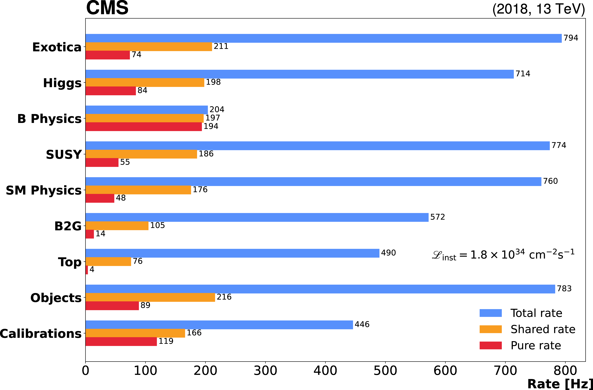

::: {.plot-caption}
CMS Run-2 menu: inclusive, exclusive and shared group rates.
:::
::::
:::::

::::

::: {.notes}
3 minutes. Fig.2, menu deployed September 2018. Total is inclusive per physics group; pure means unique to that group; shared allocates a path rate among its owning groups. It is an accounting convention, not a new selection probability. Explain OR overlap with R(A or B)=R(A)+R(B)-R(A and B). Physics groups own/use paths; group names are not mutually exclusive event types.
:::

## Backup · Prescales and control samples {visibility="uncounted"}

::: {.slide-refs}
[ATLAS · Trigger operation, Run 2 (2020)](https://arxiv.org/abs/2007.12539)
:::

:::: {.slide-body}

::::: {.picture-layout}
::: {.picture-copy}
A prescale $P$ keeps **one in $P$** passing events.

$$R_{\mathrm{recorded}}\simeq R_{\mathrm{pass}}/P$$

**A — threshold:** changes which kinematics pass.

**B — prescale:** keeps the low-$p_T$ region, with fewer events.
:::

::: {.picture-visual}


::: {.plot-caption}
Toy power-law path rate. Control and calibration paths are typically operated like B.
:::
:::
:::::

::::

::: {.notes}
3 minutes. Formula assumes this path alone and ignores dead time. Real OR menus need overlap-aware accounting and time-dependent configuration. A prescaled path has an effective luminosity; do not blindly multiply every multi-trigger event by one P. A zero-bias trigger samples crossings without a physics-object requirement; a minimum-bias trigger still imposes a condition. Control data are needed to measure efficiency and monitor losses.
Figure: original toy, R_pass=20 kHz×(threshold/10 GeV)^-4. Option A raises the threshold to 38 GeV; option B keeps 15 GeV with P=40. Both record 100 Hz, but only B can measure the turn-on of a higher-threshold trigger or the low-pT spectrum. Ask which a cross-section measurement at 20 GeV would need.
:::

## Backup · The HLT is a reconstruction farm {.landmark visibility="uncounted"}

::: {.slide-refs}
[CMS · HLT performance, Run 2 (2024)](https://cms-results.web.cern.ch/cms-results/public-results/publications/TRG-19-001/)
:::

:::: {.slide-body}

::::: {.picture-layout}
::: {.picture-copy}
Tracking and particle reconstruction consume computing time.

$$N_{\mathrm{cores}}\gtrsim R_{\mathrm{in}}\langle t_{\mathrm{CPU}}\rangle$$

100 kHz × 0.2 CPU-s/event ≈ **20,000 cores**.

Reject cheaply before expensive reconstruction. Respect tails and headroom.
:::
:::: {.picture-visual}


::: {.plot-caption}
CMS HLT CPU-time composition; core estimate is illustrative.
:::
::::
:::::

::::

::: {.notes}
3 minutes. Fig.1: reconstruction algorithm categories and their nested subdivisions; do not teach C++ labels. The numerical core example is an independent capacity estimate, not the measured CMS farm size or timing. CPU time differs from wall latency for parallel code. Mean capacity is necessary but tails, pile-up, I/O, scheduling and resilience require margin. Link back to queue saturation.
:::

## Backup · Event rate is not bandwidth {.landmark visibility="uncounted"}

::: {.slide-refs}
[ATLAS · Trigger operation, Run 2 (2020)](https://arxiv.org/abs/2007.12539)
:::

:::: {.slide-body}

::::: {.picture-layout}
::: {.picture-copy}
Compare the **same time interval** in both panels.

Trigger-level analysis dominates the event count late in the fill, but not the bytes.

**Save smaller records → record more events.**
:::
:::: {.picture-visual}


::: {.plot-caption}
ATLAS September 2018: stream rates above, bandwidth below.
:::
::::
:::::

::::

::: {.notes}
5 minutes. Fig.7, full two-panel plot. Upper y kHz, lower y GB/s. Late-fill prescale strategy uses freed resources for lower-threshold trigger-level analysis. Only HLT jet information was saved in this Run-2 TLA stream. Rate jumps therefore need not imply comparable byte jumps. Monitoring is absent from the bandwidth stack because these events are not written to disk. Do not divide total upper by total lower to infer a single universal event size. Ask which colour dominates each panel and what information was sacrificed.
:::

## Backup · Two architectures, one event {visibility="uncounted"}

:::: {.slide-body}

::: {.compare-table}
| | ATLAS Run 2 | LHCb Run 3 |
|---|---|---|
| First decision | Hardware Level-1 (calo, muon), < 2.5 µs | GPU software (HLT1) on full readout |
| Rate after it | 40 MHz → ≤ 100 kHz | 30 MHz → ~1 MHz |
| Data wait in | Front-end pipelines, readout buffers | Disk buffer before HLT2 |
| Calibration | Mostly after recording | Real time, before HLT2 |
| Kept | Full raw events (+ TLA objects) | Mostly candidates (Turbo) |
:::

::: {.take-home}
Same goal, different place to decide: hardware limits *what* can be seen first; software needs full readout bandwidth.
:::

::::

::: {.notes}
4 minutes. Follow one b-hadron decay through each system: in ATLAS a low-pT hadronic B decay rarely fires Level-1 (no high-pT calo/muon object), whereas LHCb can reconstruct its displaced tracks in HLT1. Conversely ATLAS's hardware stage handles a much larger raw event and pile-up at lower cost. Numbers are order-of-magnitude design values from the two sources already shown (ATLAS JINST 15 P10004 Fig. 1 and text; LHCb Starterkit Run-3 data flow), not live operating values. ATLAS also runs a prompt calibration loop before bulk reconstruction; "mostly after recording" refers to the trigger decision using online calibrations. TLA = trigger-level analysis (previous section).
:::

## Backup · What do we keep? {visibility="uncounted"}

::: {.slide-refs}
Original teaching model
:::

:::: {.slide-body}

At a fixed **200 MB/s** to storage:

| Stored record | Size | Max rate | Can we redo later? |
|---|---:|---:|---|
| Raw detector data | 1 MB | 200 Hz | Reconstruction, calibration, selection |
| Full reconstructed event | 100 kB | 2 kHz | Selection, most physics objects |
| Selected candidate only | 10 kB | 20 kHz | Only the final analysis |

::: {.take-home}
Smaller records buy rate; discarded information cannot be recovered.
:::

::::

::: {.notes}
4 minutes. LHCb Turbo/selective persistence is the concrete example: most physics streams keep the trigger candidate and chosen related objects. Saving a reduced record shifts more responsibility to online reconstruction, calibration and monitoring. Do not imply all events use the same persistence choice; real experiments mix all three rows. Sizes are illustrative round numbers, decimal units, no overhead, not an operational LHCb or ATLAS allocation. Sources: LHCb Starterkit sections on selective persistency; Stahl L08 pp12–13. About 84 minutes elapsed.
:::

## Backup · What must remain reproducible? {visibility="uncounted"}

:::: {.slide-body}

**Event data:** raw detector measurements or selected reconstructed objects.

**Conditions:** calibration, alignment and detector status.

**Selection record:** trigger decisions, menu version and prescales.

**Exposure:** luminosity, live time and data-quality intervals.

A physics result needs all four, not just a file of candidates.

::::

::: {.notes}
2 minutes. Synthesis. Selective persistence can close future analysis options; retained conditions and selection provenance are needed even for a fully reconstructed stream. Link to Lecture 7 calibration and next lecture reconstruction/statistics.
:::

## Backup · Preview: hits are not yet tracks {.full-figure visibility="uncounted"}

::: {.slide-refs}
[ACTS · Tracking in a nutshell](https://acts.readthedocs.io/en/latest/tracking.html)
:::

:::: {.slide-body}

::: {.visual}
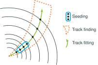
:::

::: {.take-home}
Reconstruction associates measurements with particle trajectories.
:::

::::

::: {.notes}
4 minutes. Use the supplied overview to distinguish seed candidates, extension and final fit. Ask where measurement errors and multiple scattering enter. Do not derive Kalman matrices or list many algorithms here. Source: ACTS documentation, Tracking in a nutshell; original SVG retrieved 7 November 2026. This is the next lecture’s starting point; show it as a preview and skip the discussion if time is short.
:::

## Backup · Reference material {.references visibility="uncounted"}

:::: {.slide-body}

H. Geiger, W. Müller, Naturwiss. 16 (1928) 617 — the Geiger–Müller counter.

W. Bothe, W. Kolhörster, Z. Phys. 56 (1929) 751 — coincidences of two counters; nature of cosmic rays.

B. Rossi, Nature 125 (1930) 636 — electronic coincidence circuit for many counters.

P. M. S. Blackett, G. P. S. Occhialini, Proc. R. Soc. A 139 (1933) 699 — counter-controlled cloud chamber.

[W. J. Stirling, LHC physics lecture (2010)](https://indico.cern.ch/event/94815/contributions/1282690/attachments/1106827/1579062/LBLMIT_Stirling_v2.pdf) — cross-section hierarchy.

[CMS luminosity public results](https://twiki.cern.ch/twiki/bin/view/CMSPublic/LumiPublicResults) — Run-2 pile-up distribution.

[CMS Collaboration, JINST 19 P11021 (2024)](https://cms-results.web.cern.ch/cms-results/public-results/publications/TRG-19-001/) — HLT performance: turn-on, menu rates, CPU budget.

[N. Neufeld, DAQ/trigger lecture (2009)](https://indico.cern.ch/event/43007/contributions/1065030/attachments/927884/1313738/trigger-daq-analysis-esi09-neufeld1.pdf) — elementary DAQ, busy time, buffers.

[ATLAS Collaboration, JINST 15 P10004 (2020)](https://arxiv.org/abs/2007.12539) — Run-2 trigger architecture, stream rates and bandwidth.

[LHCb Starterkit, Run-3 data flow](https://lhcb.github.io/starterkit-lessons/first-analysis-steps/dataflow-run3.html) — software trigger and selective persistence.

[LHCb trigger performance, CHEP 2024](https://indico.cern.ch/event/1338689/contributions/6015396/attachments/2951324/5187948/CHEP24_LHCb_Run3_trigger_performance.pdf) — Run-3 operation.

[ACTS documentation](https://acts.readthedocs.io/en/latest/tracking.html) — reconstruction overview.

Course source: Marian Stahl, Lecture 8, WS 2025/26.

::::

::: {.notes}
Full local asset provenance and model assumptions are in SOURCES.md. No links to the internal reference archive are embedded in the student deck.
:::
