## Lecture 9 {.title-card}

:::: {.slide-body}

::: {.subtitle}
DAQ and Trigger
:::

Mikhail Mikhasenko · KT1 · Winter semester 2026/27

::::

::: {.notes}
90-minute session. Follows Lecture 7 (tracking, light, charge) and Lecture 8 (accelerators, luminosity, synchrotron radiation); section 1 and the synchrotron-radiation slide now overlap Lecture 8 and should be shortened to a recap. Follow the section budget in README: rates 0–21, acquisition 21–38, dead time 38–50, trigger performance 50–68, menu 68–80, real-time analysis 80–90. The two demos are paced explorations, not additional topics.
:::

## The lecture in six questions

:::: {.slide-body}

1. **Physics rates:** why can we not save everything?
2. **Acquisition:** what constitutes an event?
3. **Buffers:** what happens while we are busy?
4. **Selection:** how do we measure trigger performance?
5. **Operation:** how do many triggers share resources?
6. **Analysis:** what information must survive?

::::

::: {.notes}
2 minutes. Return to the corresponding question at each section boundary. By the end students should interpret the landmark figures, not memorize hardware acronyms.
:::

## 1 · Physics rates {.section-title}

:::: {.slide-body}

Which collisions are worth recording?

::: {.subtle}
Cross sections · luminosity · bunch crossings · pile-up
:::

::::

::: {.notes}

:::

## The cross-section hierarchy {.landmark .tall-figure}

::: {.slide-refs}
[W. J. Stirling · 2010 lecture, p22](https://indico.cern.ch/event/94815/contributions/1282690/attachments/1106827/1579062/LBLMIT_Stirling_v2.pdf)
:::

:::: {.slide-body}

::::: {.picture-layout}
::: {.picture-copy}
Read vertically at one collider energy.

**Strong production dominates; rare processes sit many orders below.**

$$R=\mathcal{L}\sigma$$

Why would random recording be inefficient?
:::
:::: {.picture-visual}

::: {.plot-caption}
Stirling’s classic hierarchy; historical predictions (WJS2009).
:::
::::
:::::

::::

::: {.notes}
5 minutes. Read x as centre-of-mass energy and left y as cross section in nb, both logarithmic. Right y converts to rates only at L=10^33 cm^-2 s^-1. Locate total, b, W/Z, top and Higgs at the LHC marker. Higgs curves assume masses 120, 200 and 500 GeV: historical predictions, not the measured 125 GeV cross section. Curves mix inclusive processes and jets with different cuts, so they are not disjoint event categories. The key is the scale hierarchy, not current numerical predictions.
:::

## Luminosity turns probability into rate

:::: {.slide-body}

$$N=\sigma\int\mathcal{L}(t)\,dt,\qquad R(t)=\mathcal{L}(t)\sigma$$

At an illustrative $\mathcal{L}=10^{34}\,\mathrm{cm}^{-2}\mathrm{s}^{-1}$:

| Cross section | Production rate |
|---|---:|
| 80 mb | $8\times10^8\ \mathrm{s}^{-1}$ |
| 1 nb | $10\ \mathrm{s}^{-1}$ |
| 1 pb | $0.01\ \mathrm{s}^{-1}$ |

**Production is not recording:** branching fractions, acceptance, trigger efficiency and live time enter next.

::::

::: {.notes}
3 minutes. Arithmetic examples, not a list of measured process cross sections. 1 barn=10^-24 cm². Distinguish instantaneous from integrated luminosity. A rare production process may have a still rarer observable decay.
:::

## Why the LHC collides protons

::: {.slide-refs}
Original teaching model
:::

:::: {.slide-body}

::::: {.picture-layout}
::: {.picture-copy}
A bent charge radiates: **synchrotron radiation**.

$$\Delta E_{\mathrm{turn}}\propto\frac{\gamma^4}{\rho}=\frac{1}{\rho}\left(\frac{E}{mc^2}\right)^{4}$$

Same $E$ and ring: protons lose $(m_e/m_p)^4\approx10^{-13}$ as much.

Price: composite beams, **pile-up and huge rates**.
:::

::: {.picture-visual}

::: {.plot-caption}
$\Delta E[\mathrm{GeV}]=8.85\times10^{-5}\,E^4[\mathrm{GeV}^4]/\rho[\mathrm{m}]$ for electrons; protons scaled by $(m_e/m_p)^4$.
:::
:::
:::::

::::

::: {.notes}
3 minutes. Synchrotron radiation was not covered earlier; introduce it here as the reason hadron colliders reach the energy frontier. Radiated power P=(e²c/6πε₀)β⁴γ⁴/ρ², energy loss per turn ΔE=(e²/3ε₀)β³γ⁴/ρ. LEP2 at 104.5 GeV with ρ≈3.1 km lost about 3.4 GeV per turn, replaced by RF cavities; the LHC at 7 TeV loses about 6.7 keV per turn per proton. Larger rings (FCC-ee) or linear colliders are the electron answers; protons give energy reach but collide partons, with underlying event and pile-up — which is why this lecture needs triggers at all. Side remarks: synchrotron light is a background that beam pipes and masks must shield in e⁺e⁻ experiments; it is also the useful product of light sources. Hadron machines still radiate: the LHC's ~kW of synchrotron light lands on the cryogenic beam screen.
Figure: original analytic curves, electrons at ρ=3096 m (LEP) and protons at ρ=2804 m (LHC dipoles). Dotted line marks the full beam energy; above it the formula means a ring cannot hold the beam at all.
:::

## One crossing contains many interactions {.landmark}

::: {.slide-refs}
[CMS · Public luminosity plots, Run 2](https://twiki.cern.ch/twiki/bin/view/CMSPublic/LumiPublicResults)
:::

:::: {.slide-body}

::::: {.picture-layout}
::: {.picture-copy}
**25 ns spacing → 40 MHz crossing clock.**

A crossing can contain many $pp$ interactions.

More pile-up means more hits, larger events and harder reconstruction.

What exactly is on the horizontal axis?
:::
:::: {.picture-visual}
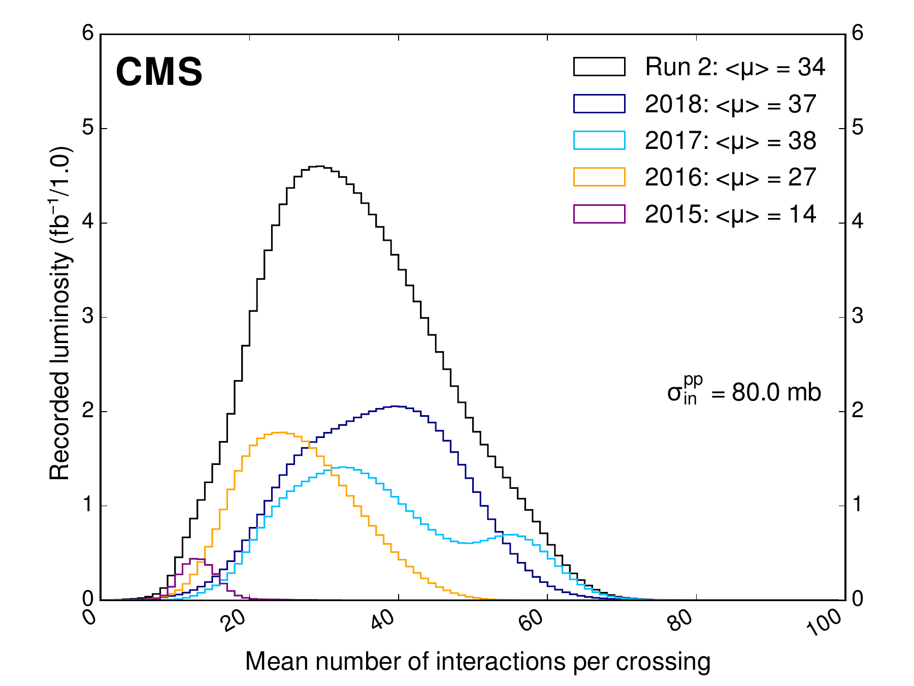

::: {.plot-caption}
CMS Run 2: recorded luminosity versus mean pile-up.
:::
::::
:::::

::::

::: {.notes}
4 minutes. The x axis is the mean interactions per crossing μ, not the measured vertex multiplicity of one event. The y axis is recorded luminosity per μ bin, not a normalized probability. Broad distributions reflect changing running conditions. Actual colliding-crossing frequency depends on the filling pattern; 40 MHz is the nominal 25 ns clock. μ=Lσinel/fcolliding; not every slot is filled. Source plot uses σinel=80 mb. Distinguish crossing, interaction and event record.
:::

## 2 · Acquiring an event {.section-title}

:::: {.slide-body}

How do detector signals become a coherent event record?

::: {.subtle}
Front end · digitization · event building · bandwidth
:::

::::

::: {.notes}

:::

## The measurement chain

::: {.slide-refs}
[N. Neufeld · ESI 2009](https://indico.cern.ch/event/43007/contributions/1065030/attachments/927884/1313738/trigger-daq-analysis-esi09-neufeld1.pdf)
:::

:::: {.slide-body}

::::: {.picture-layout}
::: {.picture-copy}
**DAQ:** collect and transport data.

**Trigger:** decide what to keep.

Sensor → ADC → processor → storage.
:::

::: {.picture-visual}
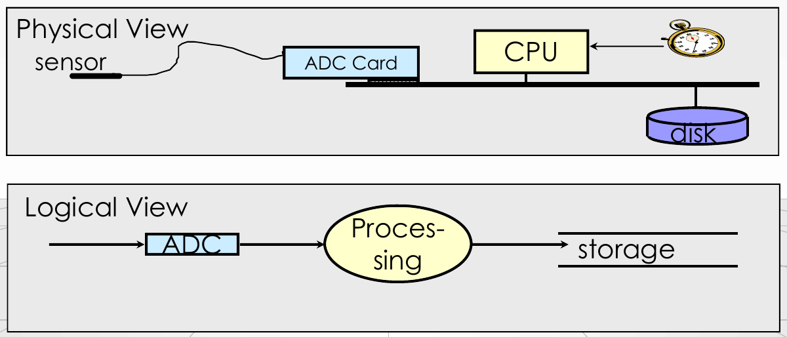

::: {.plot-caption}
Physical and logical views of a simple DAQ.
:::
:::
:::::

::: {.take-home}
Reconstruction and selection can already happen before permanent storage.
:::

::::

::: {.notes}
3 minutes including discussion. This is a logical chain, not the exact temporal ordering for every experiment. Hardware triggers may act on partial information before full readout; software triggers reconstruct before storage. Source: Stahl L08 p4. This distinction is revisited for ATLAS and LHCb.
Figure: Neufeld p16, complete physical and logical panels cropped from source. The old computer hardware is historical; the functional distinction remains useful.
:::

## Digitization

::: {.slide-refs}
Original teaching model
:::

:::: {.slide-body}

::::: {.picture-layout}
::: {.picture-copy}
**Sample** at chosen times.

**Quantize** each amplitude to a digital code.

This coarse example has only **8 levels**.
:::

::: {.picture-visual}

::: {.plot-caption}
Toy 3-bit ADC: 10 ns sample spacing, 100 mV code spacing.
:::
:::
:::::

::: {.take-home}
A digital amplitude is not yet a calibrated energy.
:::

::::

::: {.notes}
3 minutes. ADC = analogue-to-digital converter. Timing can also be digitized with a TDC; do not imply that every detector stores a sampled waveform. Zero suppression and pulse integration are alternatives. Source: Stahl L08 p8; Neufeld DAQ lecture, p16.
Figure uses the same noiseless pulse shape as the opening, sampled every 10 ns and rounded to the nearest 100 mV code (0–7). Staircase is a sample-and-hold display convention, not the continuous voltage sent by an ADC. Ask what is lost in time and amplitude. Real ADC precision is detector-dependent.
:::

## Timing is a measurement: time of flight

::: {.slide-refs}
Original teaching model
:::

:::: {.slide-body}

::::: {.picture-layout}
::: {.picture-copy}
Same momentum, different mass → **different speed**.

$$t=\frac{L}{c}\sqrt{1+\left(\frac{mc}{p}\right)^{2}}$$

$$m^2=\frac{p^2}{c^2}\left[\left(\frac{ct}{L}\right)^{2}-1\right]$$

Needs a **TDC** and a start time $t_0$ from the crossing clock.
:::

::: {.picture-visual}
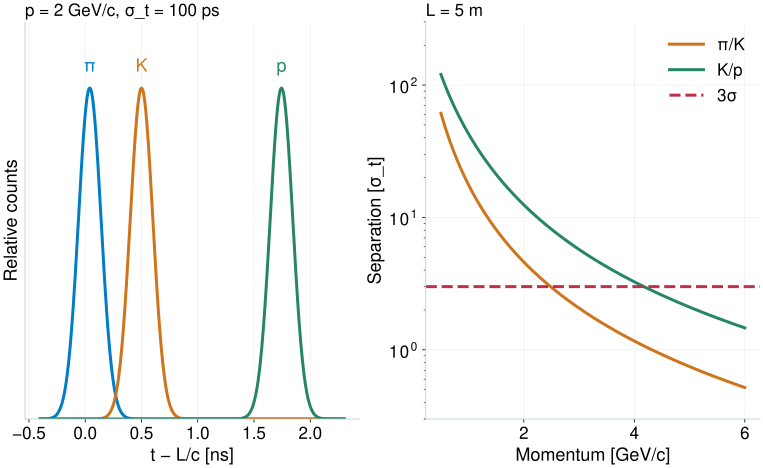

::: {.plot-caption}
Separation falls roughly as $1/p^2$: TOF identifies particles at low momentum.
:::
:::
:::::

::::

::: {.notes}
4 minutes. Time of flight was not covered in the PID lecture; place it here because it is a direct use of digitized timing. Momentum p comes from tracking, path length L from the track and geometry, t from a fast detector (scintillator, MRPC, LGAD) read out by a TDC, with t₀ from the accelerator clock or a start counter. Worked example: L=5 m, p=2 GeV/c gives t(π)≈16.72 ns, t(K)≈17.18 ns, so Δt≈0.46 ns; with σ_t=100 ps this is about 4.6σ. For p≫mc, Δt≈(L/2pc²)(m₁²−m₂²)c², so separation falls as 1/p² and grows with L. Resolution budget: detector time resolution, t₀ uncertainty, path-length and momentum errors. Ask: why does a longer flight path help, and why does TOF stop working at high momentum? (Cherenkov/RICH and dE/dx cover other ranges.) Link to the next lecture: m² from TOF is a reconstructed quantity, not a raw measurement.
Figure: original analytic calculation, Gaussian timing response σ_t=100 ps, L=5 m (a GlueX-like flight path), exact momenta and paths. Real detectors add tails and momentum/path uncertainties.
:::

## An event is assembled from fragments

::: {.slide-refs}
Original teaching model
:::

:::: {.slide-body}

::::: {.picture-layout}
::: {.picture-copy}
Three detector systems produce fragments.

Match **event IDs and timestamps**, not arrival order.

When is event 1042 complete?
:::

::: {.picture-visual}

::: {.plot-caption}
Colours identify events; each square is one fragment.
:::
:::
:::::

::::

::: {.notes}
4 minutes. Toy fragment schema; not an experiment data format. Ask what happens if the calorimeter fragment for 1041 arrives after tracker fragment 1042. Arrival order is insufficient; synchronization, identifiers and completeness matter. Missing or corrupt fragments require monitoring and explicit policies. Source: Stahl L08 pp8,15.
Original illustrative arrival raster. Event 1042 is complete at t=5 arbitrary units, after its calorimeter fragment arrives. Event 1041 completes at t=3. One acquisition event may contain several interactions; retain the discussion of synchronization and missing fragments.
:::

## Rate × event size

::: {.slide-refs}
Original teaching model
:::

:::: {.slide-body}

::::: {.picture-layout}
::: {.picture-copy}
$$B=R\,S$$

**40 MHz × 1 MB**
→ 40 TB/s.

**1 kHz × 1 MB**
→ 1 GB/s.
:::

::: {.picture-visual}
| Event rate | 20 kB | 200 kB | 1 MB |
|---|---:|---:|---:|
| 40 MHz · crossing clock | 0.8 TB/s | 8 TB/s | **40 TB/s** |
| 100 kHz · after a hardware trigger | 2 GB/s | 20 GB/s | 100 GB/s |
| 1 kHz · to storage | 20 MB/s | 200 MB/s | **1 GB/s** |

::: {.plot-caption}
Decimal units; illustrative event sizes and rates, not one experiment’s specification.
:::
:::
:::::

::::

::: {.notes}
4 minutes. Have students perform the multiplication before revealing the second row verbally. 40 MHz is a reference bunch-crossing clock, not automatically the rate of filled crossings or interactions. Encoding, event content, compression and protocol overhead affect S. Source: Stahl L08 p9 motivates the rate challenge; numbers here are explicit arithmetic examples.
Original B=RS grid. Ask students to fill one empty cell before revealing the row. Each row moves down by a factor of 400 or 100 in rate; each column changes the event content. The 40 MHz row is a scale example, not a claim about every filled crossing or real event size.
:::

## Latency and throughput

::: {.slide-refs}
Original teaching model
:::

:::: {.slide-body}

::::: {.picture-layout}
::: {.picture-copy}
Follow **event A** across three stages.

Latency: **3 time units**.

After filling, throughput: **1 event per time unit**.
:::

::: {.picture-visual}
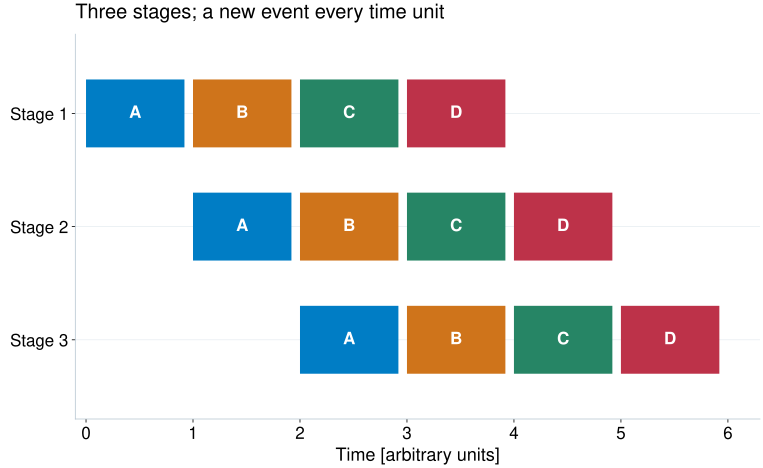

::: {.plot-caption}
Each colour follows one event; each stage takes one time unit.
:::
:::
:::::

::: {.take-home}
A long latency can coexist with a high throughput.
:::

::::

::: {.notes}
2 minutes. For a single serial processor of fixed service time τ, capacity is 1/τ. A real pipelined system is not restricted to that inverse end-to-end latency. Distinguish decision latency from throughput; raw data may be retained in a pipeline while waiting for a trigger decision. About 33 minutes elapsed.
Original pipeline timing diagram. Events A–D enter at t=0,1,2,3; three equal-duration stages. Bars have small visual gaps only for readability; stage duration is one unit. Distinguish latency 3 from initiation interval 1.
:::

## A trigger decision arrives later

::: {.slide-refs}
[ATLAS · Trigger operation, Run 2 (2020)](https://arxiv.org/abs/2007.12539)
:::

:::: {.slide-body}

::::: {.picture-layout}
::: {.picture-copy}
A new crossing every **25 ns**; the decision takes longer.

Store each crossing in a **pipeline buffer**.

$$N_{\mathrm{pipeline}}\gtrsim\frac{\text{latency}}{25\ \mathrm{ns}}$$

$2.5\ \mu\mathrm{s}$ → at least **100 slots**.
:::

::: {.picture-visual}

::: {.plot-caption}
Accept: read out the slot. Reject: release it. Accepts enlarged in frequency for visibility.
:::
:::
:::::

::::

::: {.notes}
3 minutes. ATLAS Run-2 L1 latency is less than 2.5 μs; 100 slots is a conceptual lower bound for that latency, not a specification of every real detector buffer. Add implementation margins and readout requirements. Distinguish this fixed-latency pipeline from the FIFO of complete events in the next section. A pipelined trigger need not wait idle for each decision.
Figure: original illustration. Each line is one crossing stored from its arrival until its decision 2.5 µs later; the vertical dashed line crosses 100 stored crossings. Accepted crossings (blue) are far more frequent here than the real ~1 in 400 Level-1 accept fraction, for visibility only.
:::

## ATLAS Run 2 {.full-figure}

::: {.slide-refs}
[ATLAS, JINST 15 P10004 (2020)](https://arxiv.org/abs/2007.12539)
:::

:::: {.slide-body}

::: {.visual}
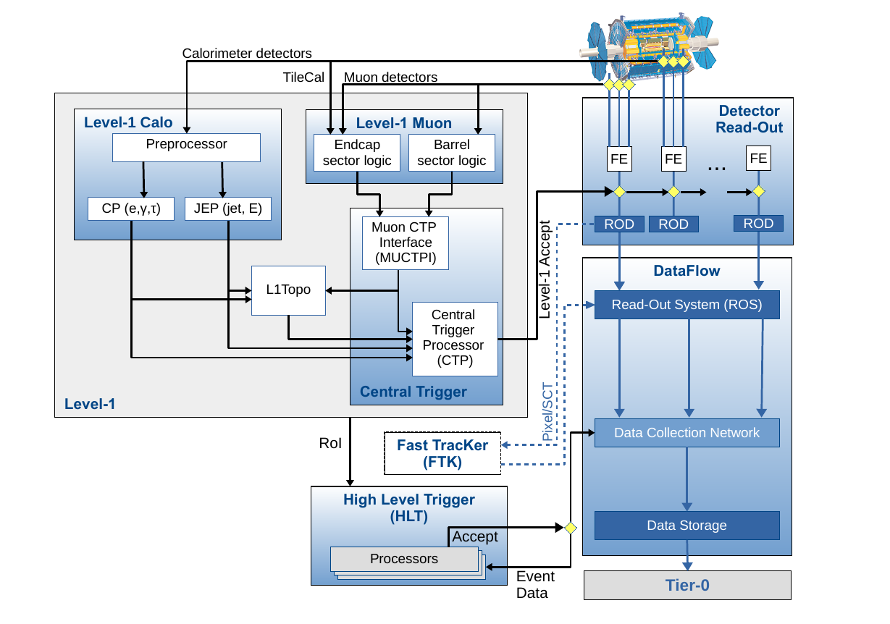
:::

::: {.take-home}
40 MHz clock → Level-1 (up to 100 kHz) → readout buffers → HLT → main physics stream (~1 kHz).
:::

::::

::: {.notes}
4 minutes. Now that the pipeline is introduced, follow it in a real system: front-end pipelines hold data while Level-1 calo/muon logic decides; Level-1 accept triggers readout into the Read-Out System; the HLT farm requests data and decides again. Do not teach every acronym. This is explicitly the 2015–2018 Run-2 architecture, not a current-run specification. Fast TracKer is drawn in the original diagram but was not used by HLT for trigger decisions in Run 2; the source text says it was under commissioning. Section 6 compares this with LHCb Run 3. Source: ATLAS Collaboration, Operation of the ATLAS trigger system in Run 2, JINST 15 P10004 (2020), arXiv:2007.12539, Fig. 1. CC BY 4.0. Cropped from source page; the printed paper caption is removed and given here instead.
:::

## 3 · Dead time and buffering {.section-title}

:::: {.slide-body}

Can finite memory make a slow system keep up?

::: {.subtle}
Busy veto · finite FIFO · burst absorption · sustained overload
:::

::::

::: {.notes}

:::

## A busy detector loses arrivals

::: {.slide-refs}
Original teaching model
:::

:::: {.slide-body}

::::: {.picture-layout}
::: {.picture-copy}
Blue: accepted. Red: lost while busy.

**Lost arrivals do not extend the busy period.**

Steady Poisson input $R$, busy time $\tau$:

$$r=\frac{R}{1+R\tau}\;\xrightarrow{R\to\infty}\;\frac{1}{\tau}$$
:::

::: {.picture-visual}

::: {.plot-caption}
Non-paralyzable toy model; τ = 2 time units.
:::
:::
:::::

::: {.take-home}
Dead-time fraction = busy time / elapsed time.
:::

::::

::: {.notes}
3 minutes. The term non-paralyzable describes a specific model; other detectors can extend the busy interval when an event arrives. For independent steady Poisson arrivals, the mean lost-arrival fraction equals time-busy fraction. This equality need not hold for correlated/burst arrivals. Derive the formula in one line: the mean interval between accepted events is τ+1/R. Live fraction r/R=1/(1+Rτ). Example: τ=120 µs saturates at 8.33 kHz (backup plot). Source: Neufeld pp17–18; added explicit model definition.
Original deterministic arrival sequence: 0.5,1,1.8,3,3.4,5.2,6,7.7,8.2. Busy intervals start at 0.5,3,5.2,7.7 and last 2 units. The sequence illustrates timing; it is not used to infer a stochastic rate.
:::

## A finite buffer absorbs bursts

::: {.slide-refs}
Original teaching model
:::

:::: {.slide-body}

::::: {.picture-layout}
::: {.picture-copy}
Compare **the same arrivals**.

Waiting slots let the processor catch up after a burst.

The output follows arrivals more closely.
:::

::: {.picture-visual}

::: {.plot-caption}
Same burst arrivals, 8 kHz mean input; 10 kHz processor; ADC time = 0.
:::
:::
:::::

::::

::: {.notes}
4 minutes. Define FIFO. The demo has one unbuffered ADC and one processor; waiting-slot capacity excludes those two active stages. ADC completion can be dropped at a full FIFO. Real front ends may use pipeline sampling, multiple banks or backpressure. The model is not a complete detector readout simulation. Source: Neufeld pp19–20; Stahl L08 p10.
Generated with the exact widget model at seed 821 for 60 ms. ADC is instantaneous here to isolate FIFO losses. Vertical gaps include both losses and events pending; labels give separately counted FIFO losses. The widget default ADC time is 20 µs and therefore adds ADC-busy losses.
:::

## Queue experiment: make a prediction

::: {.slide-refs}
Original teaching model
:::

:::: {.slide-body}

::::: {.picture-layout}
::: {.picture-copy}
Try **0 → 8 → 32** slots.

Then raise input from **8 to 15 kHz**.

What limit does the red curve approach?
:::

::: {.picture-visual}

::: {.plot-caption}
Same queue model; 2 s runs; steady Poisson arrivals; ADC time = 0.
:::
:::
:::::

::::

::: {.notes}
2 minutes. Capacity of the processor is 10 kHz, ADC capacity at default 20 µs is 50 kHz, but Poisson arrivals still cause ADC-busy losses. At 15 kHz there is sustained pressure; no finite FIFO can guarantee indefinite loss-free operation. Keep the same seed to compare. In burst mode the arrival intensity is 4R for 20% of each 20 ms period and R/4 for the rest; the time-average remains R.
Original sweep from the widget model. At 15 kHz input and 10 kHz service, the large-buffer long-run lost fraction approaches at least 1−10/15≈33.3% when counting departures and accounting for pending events. A finite observation window shifts exact percentages. This plot isolates service overload; default demo includes ADC conversion too.
:::

## Event queue demo {.demo-slide}

:::: {.slide-body}

::: {.widget data-src="widgets/queue.html" data-poster="widgets/queue-poster.png" data-alt="Interactive event queue with ADC and FIFO states, occupancy history, busy fractions and event accounting"}
:::

::::

::: {.notes}
8 minutes. Start from the completed default run so students can inspect counters, then Replay. Change buffer depth without changing the seed. Scrub time to see queued, processing and completed events. A 200 ms simulation is replayed over about 10 seconds; the display is not a detector time scale. Switch to the one-busy-stage model for the non-paralyzable special case. Reset restores all controls. Finite-run fluctuations mean empirical rates will not equal theoretical values exactly.
:::

## Pause and check

::: {.slide-refs}
Original teaching model
:::

:::: {.slide-body}

Input **12 kHz**, service **10 kHz**, buffer **10⁶ events**.

Can the buffer prevent losses forever? When does it fill?

::: {.fragment}
Backlog grows by $12-10=2\ \mathrm{kHz}$:

$$t_{\mathrm{full}}\approx\frac{10^6}{2\times10^3\ \mathrm{s}^{-1}}=500\ \mathrm{s}$$

::: {.take-home}
Buffers absorb fluctuations; only service capacity fixes a mean overload.
:::
:::

::::

::: {.notes}
5 minutes including a short pause. No. Even with no other losses, the mean backlog grows by 2000 events/s, so this idealized buffer fills in roughly 500 s from empty under constant rates. Fluctuations, bursts and upstream losses change the exact time. If needed, skip the time-to-fill calculation and keep the qualitative point. About 50 minutes elapsed.
Original deterministic fluid calculation, starting empty; the answer is a click-to-reveal fragment so students commit to a prediction first. After the buffer fills, losses settle at 2 kHz of the 12 kHz input (about 17%).
:::

## 4 · Trigger performance {.section-title}

:::: {.slide-body}

How do we keep physics while rejecting background?

::: {.subtle}
Signatures · efficiency · turn-on · calibration · bias
:::

::::

::: {.notes}

:::

## A trigger is a physics selection

:::: {.slide-body}

Fast signatures can include:

- energetic calorimeter deposits;
- muon candidates;
- displaced tracks or vertices.

::: {.take-home}
A signature useful for one measurement can reject another measurement’s signal.
:::

::::

::: {.notes}
3 minutes. Hardware triggers tend to use quickly available information; software can use reconstructed candidates. Give low-momentum hadrons versus energetic muons as contrasting needs. Prescaled or dedicated control streams can help monitor selections, but are not an automatic guarantee against all unknown signals. Sources: Stahl L08 pp9,11–13; LHCb Starterkit Run-3 data flow.
:::

## Efficiency, acceptance and purity

::: {.slide-refs}
Original teaching model
:::

:::: {.slide-body}

::::: {.picture-layout}
::: {.picture-copy}
$$R_{\mathrm{out}}=\epsilon_S R_S+\epsilon_B R_B$$

A useful cut keeps signal and rejects background.

**Purity also depends on input rates.**
:::

::: {.picture-visual}
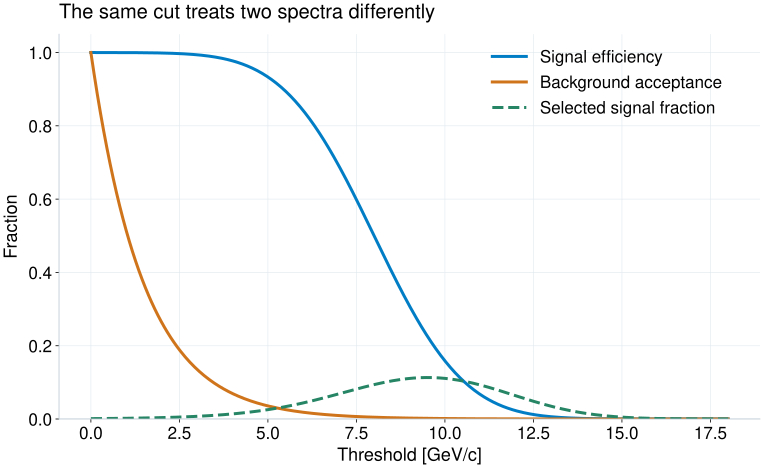

::: {.plot-caption}
Analytic toy spectra; signal 100 Hz, background 100 kHz.
:::
:::
:::::

::::

::: {.notes}
3 minutes. These equations assume labelled signal/background categories and one event counted once. Real trigger lines overlap; their rates cannot simply be summed without correcting overlaps. In the demo equal sample sizes are used to estimate conditional efficiencies, then reweighted by different physical input rates. Signal fraction is undefined if total selected rate is zero.
Analytic curves corresponding to the demo distributions: nonnegative N(8,2²) signal and exponential mean 1.5 background. Unlike the finite sample in the demo, these are smooth theoretical expectations. Green is S/(S+B), not signal efficiency. Define each efficiency as kept/input within its class.
:::

## The trigger turn-on curve {.landmark}

::: {.slide-refs}
[CMS · HLT performance, Run 2 (2024)](https://cms-results.web.cern.ch/cms-results/public-results/publications/TRG-19-001/)
:::

:::: {.slide-body}

::::: {.picture-layout}
::: {.picture-copy}
Read **threshold, turn-on, plateau** separately.

The plateau need not reach 100%.

The lower panel compares **data with simulation**.

Where would you put an offline cut?
:::
:::: {.picture-visual}
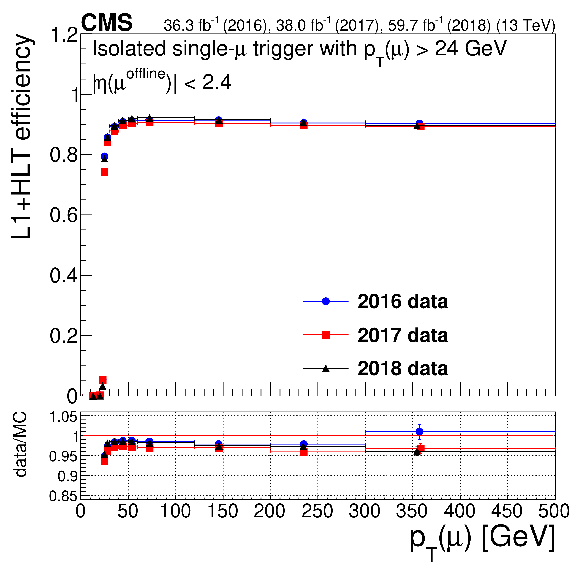

::: {.plot-caption}
CMS isolated-muon trigger: L1 + HLT efficiency, Run 2.
:::
::::
:::::

::::

::: {.notes}
5 minutes. Fig.7a, isolated single-muon trigger with pT>24 GeV, |ηoffline|<2.4. Horizontal axis is offline muon pT; vertical axis is probability of passing the full L1+HLT selection for the reference sample. Resolution makes the onset gradual; acceptance, reconstruction and isolation can lower the plateau. This differs from the toy demo with exact momentum and a hard step. Read plateau near 0.9, not 1. Data/MC is an efficiency scale-factor diagnostic, not purity. Do not use a universal offline-cut number: choose based on the measured turn-on and analysis requirements.
:::

## Measuring efficiency: tag and probe

::: {.slide-refs}
[CMS · HLT performance, Run 2 (2024)](https://cms-results.web.cern.ch/cms-results/public-results/publications/TRG-19-001/)
:::

:::: {.slide-body}

::::: {.picture-layout}
::: {.picture-copy}
Use a known resonance: $Z\to\mu^+\mu^-$.

**Tag:** a muon that fired the trigger.

**Probe:** the other muon, not required to fire.

$$\epsilon=\frac{N_{\mathrm{pass}}}{N_{\mathrm{pass}}+N_{\mathrm{fail}}}$$

Fit signal in each sample; repeat in $(p_T,\eta)$ bins.
:::

::: {.picture-visual}

::: {.plot-caption}
Toy pseudo-data: the mass peak counts real probes; background is subtracted in both samples.
:::
:::
:::::

::::

::: {.notes}
3 minutes. Explain why counting only already-triggered probes gives a biased denominator. Tag selection and correlations matter; independence must be checked rather than assumed. A resonance mass fit can estimate signal yields separately in pass and fail samples. The scale factor εdata/εMC corrects simulated yields within the validated phase space. This is a methodological bridge to data analysis.
Figure: original toy, seed 91. Gaussian Z peak (σ=2.6 GeV) on exponential background; 18,400 passing and 1,600 failing signal probes, 600 and 900 background pairs. Point out that the failing sample has relatively more background, so simply counting pairs would bias ε downward.
:::

## Threshold experiment

::: {.slide-refs}
Original teaching model
:::

:::: {.slide-body}

::::: {.picture-layout}
::: {.picture-copy}
**100 signal events/s** against **100,000 background events/s**.

200 kB/event; 200 MB/s budget.

Find a cut that fits.
:::

::: {.picture-visual}
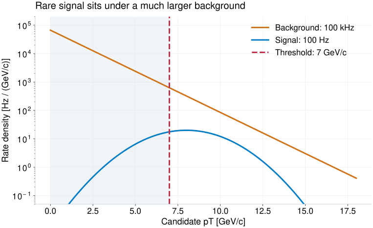

::: {.plot-caption}
Toy rate densities; grey region is rejected at 7 GeV/c.
:::
:::
:::::

::::

::: {.notes}
1 minute setup. All numbers and spectra are synthetic. At default cut 7 GeV/c the output is near the 1 kHz limit; slide the threshold, rather than claiming an exact optimum. The toy has exact observed momentum and a hard threshold; real detectors produce a smooth efficiency turn-on versus true momentum.
Analytic rate-density curves. Area under each curve gives its input rate; visible heights are not integrated counts. These are the analytic counterpart of the fixed-sample demo and are not experimental cross sections. The signal density is normalized on nonnegative momentum, as in the demo.
:::

## Trigger threshold demo {.demo-slide}

:::: {.slide-body}

::: {.widget data-src="widgets/threshold.html" data-poster="widgets/threshold-poster.png" data-alt="Interactive trigger threshold comparing signal efficiency, background acceptance, sample composition and storage bandwidth"}
:::

::::

::: {.notes}
6 minutes. First change only the threshold and compare efficiency, selected fraction and bandwidth. Then reduce event size: the bandwidth changes, selection efficiencies do not. Finally increase background input and see purity worsen without changing conditional efficiencies. Curves show rates per 0.5 GeV/c bin on a log scale; the last bin includes overflow. The fixed sample contains 30,000 candidates per class. Zero counts do not prove zero physical tail probability.
:::

## The saved sample is biased

::: {.slide-refs}
Original teaching model
:::

:::: {.slide-body}

::::: {.picture-layout}
::: {.picture-copy}
A hard threshold removes the low-momentum part of a spectrum.

**Efficiency depends on kinematics.**

Correct the selected yield within a stated measurement model.
:::

::: {.picture-visual}
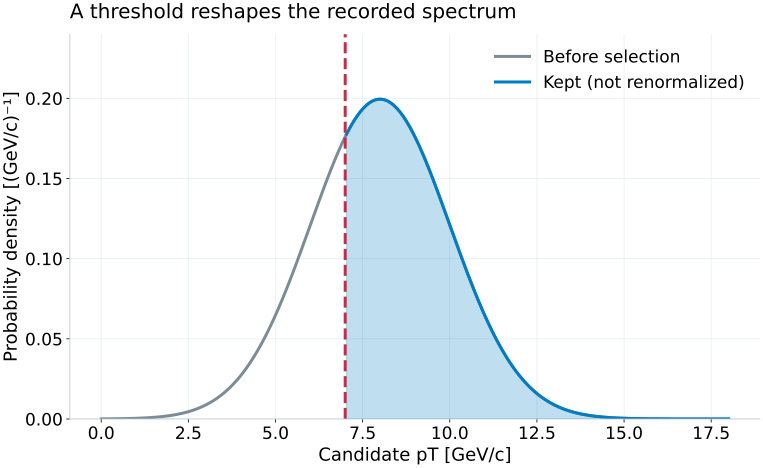

::: {.plot-caption}
Kept spectrum is not renormalized: its area is the efficiency.
:::
:::
:::::

::::

::: {.notes}
2 minutes. Simplified yield equation for a specified process and fiducial definition; branching fractions, backgrounds, acceptance and reconstruction factors may be needed. Efficiency generally depends on kinematics; it is not a universal constant. This is the bridge to analysis, not a full statistical treatment. About 68 minutes elapsed.
Analytic Gaussian-like illustration from the same signal model. Retain the displaced-track/decay-time analogy verbally. Simplified yield relation N_kept=L_int σ ε_total; include branching fractions, acceptance and backgrounds as appropriate.
:::

## 5 · Operating a trigger menu {.section-title}

:::: {.slide-body}

How does one experiment serve many physics measurements?

::: {.subtle}
OR of trigger paths · overlaps · prescales · CPU and storage
:::

::::

::: {.notes}

:::

## A menu serves many physics programmes {.landmark}

::: {.slide-refs}
[CMS · HLT performance, Run 2 (2024)](https://cms-results.web.cern.ch/cms-results/public-results/publications/TRG-19-001/)
:::

:::: {.slide-body}

::::: {.picture-layout}
::: {.picture-copy}
Electron, muon, jet, missing-energy and specialised paths run together.

**One event may pass several paths.**

Why can we not simply add the inclusive rates?
:::
:::: {.picture-visual}

::: {.plot-caption}
CMS Run-2 menu: inclusive, exclusive and shared group rates.
:::
::::
:::::

::::

::: {.notes}
3 minutes. Fig.2, menu deployed September 2018. Total is inclusive per physics group; pure means unique to that group; shared allocates a path rate among its owning groups. It is an accounting convention, not a new selection probability. Explain OR overlap with R(A or B)=R(A)+R(B)-R(A and B). Physics groups own/use paths; group names are not mutually exclusive event types.
:::

## Prescales and control samples

::: {.slide-refs}
[ATLAS · Trigger operation, Run 2 (2020)](https://arxiv.org/abs/2007.12539)
:::

:::: {.slide-body}

::::: {.picture-layout}
::: {.picture-copy}
A prescale $P$ keeps **one in $P$** passing events.

$$R_{\mathrm{recorded}}\simeq R_{\mathrm{pass}}/P$$

**A — threshold:** changes which kinematics pass.

**B — prescale:** keeps the low-$p_T$ region, with fewer events.
:::

::: {.picture-visual}
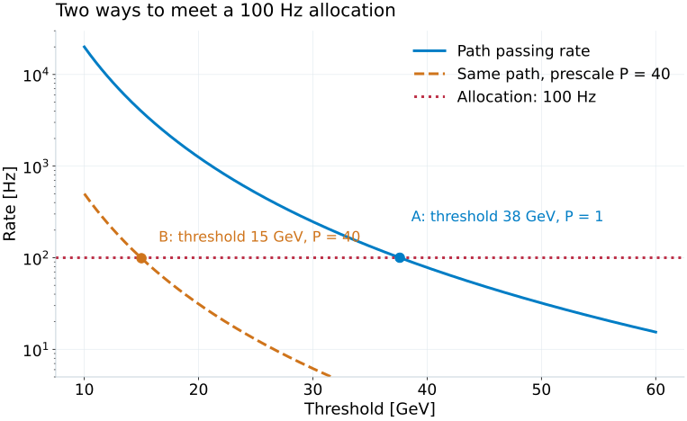

::: {.plot-caption}
Toy power-law path rate. Control and calibration paths are typically operated like B.
:::
:::
:::::

::::

::: {.notes}
3 minutes. Formula assumes this path alone and ignores dead time. Real OR menus need overlap-aware accounting and time-dependent configuration. A prescaled path has an effective luminosity; do not blindly multiply every multi-trigger event by one P. A zero-bias trigger samples crossings without a physics-object requirement; a minimum-bias trigger still imposes a condition. Control data are needed to measure efficiency and monitor losses.
Figure: original toy, R_pass=20 kHz×(threshold/10 GeV)^-4. Option A raises the threshold to 38 GeV; option B keeps 15 GeV with P=40. Both record 100 Hz, but only B can measure the turn-on of a higher-threshold trigger or the low-pT spectrum. Ask which a cross-section measurement at 20 GeV would need.
:::

## The HLT is a reconstruction farm {.landmark}

::: {.slide-refs}
[CMS · HLT performance, Run 2 (2024)](https://cms-results.web.cern.ch/cms-results/public-results/publications/TRG-19-001/)
:::

:::: {.slide-body}

::::: {.picture-layout}
::: {.picture-copy}
Tracking and particle reconstruction consume computing time.

$$N_{\mathrm{cores}}\gtrsim R_{\mathrm{in}}\langle t_{\mathrm{CPU}}\rangle$$

100 kHz × 0.2 CPU-s/event ≈ **20,000 cores**.

Reject cheaply before expensive reconstruction. Respect tails and headroom.
:::
:::: {.picture-visual}
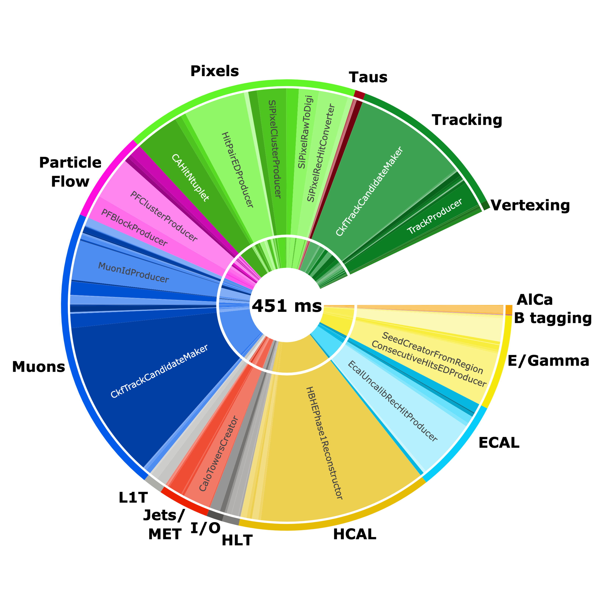

::: {.plot-caption}
CMS HLT CPU-time composition; core estimate is illustrative.
:::
::::
:::::

::::

::: {.notes}
3 minutes. Fig.1: reconstruction algorithm categories and their nested subdivisions; do not teach C++ labels. The numerical core example is an independent capacity estimate, not the measured CMS farm size or timing. CPU time differs from wall latency for parallel code. Mean capacity is necessary but tails, pile-up, I/O, scheduling and resilience require margin. Link back to queue saturation.
:::

## Event rate is not bandwidth {.landmark}

::: {.slide-refs}
[ATLAS · Trigger operation, Run 2 (2020)](https://arxiv.org/abs/2007.12539)
:::

:::: {.slide-body}

::::: {.picture-layout}
::: {.picture-copy}
Compare the **same time interval** in both panels.

Trigger-level analysis dominates the event count late in the fill, but not the bytes.

**Save smaller records → record more events.**
:::
:::: {.picture-visual}
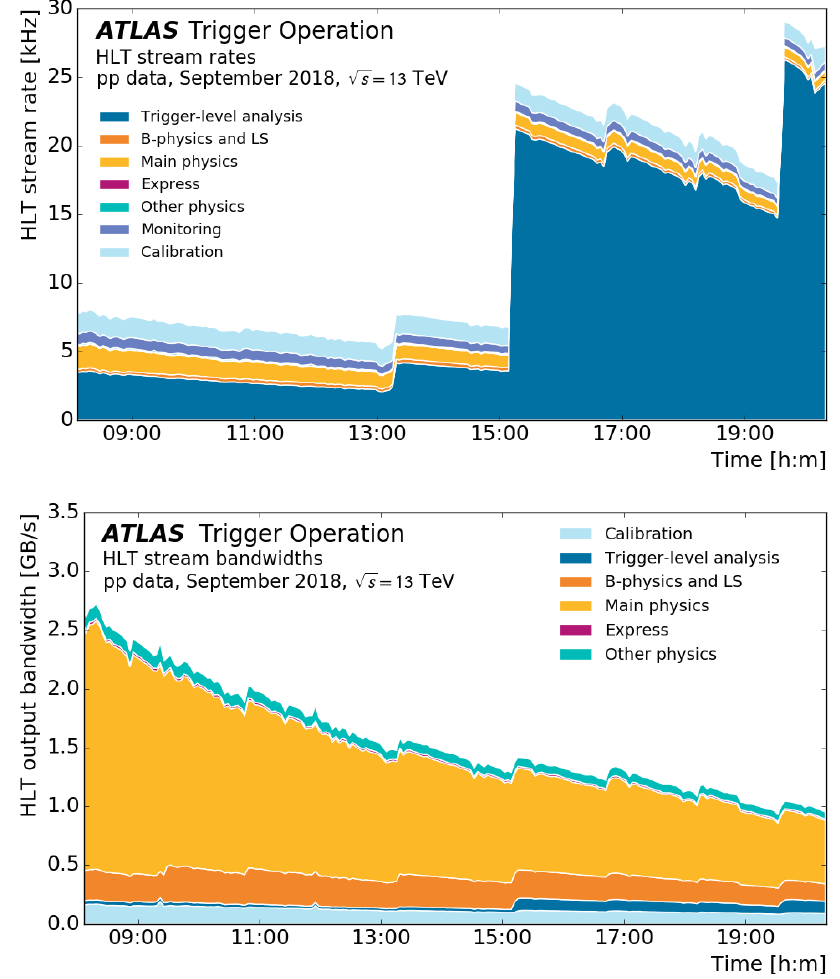

::: {.plot-caption}
ATLAS September 2018: stream rates above, bandwidth below.
:::
::::
:::::

::::

::: {.notes}
5 minutes. Fig.7, full two-panel plot. Upper y kHz, lower y GB/s. Late-fill prescale strategy uses freed resources for lower-threshold trigger-level analysis. Only HLT jet information was saved in this Run-2 TLA stream. Rate jumps therefore need not imply comparable byte jumps. Monitoring is absent from the bandwidth stack because these events are not written to disk. Do not divide total upper by total lower to infer a single universal event size. Ask which colour dominates each panel and what information was sacrificed.
:::

## 6 · Real-time analysis {.section-title}

:::: {.slide-body}

Where should reconstruction happen, and what must we retain?

::: {.subtle}
Two architectures · calibration · selective persistence · reproducibility
:::

::::

::: {.notes}

:::

## LHCb Run 3 {.full-figure}

::: {.slide-refs}
[LHCb Starterkit · Run-3 design](https://lhcb.github.io/starterkit-lessons/first-analysis-steps/dataflow-run3.html)
:::

:::: {.slide-body}

::: {.visual}
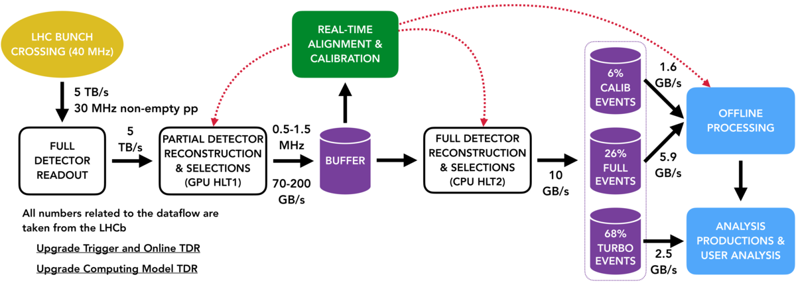
:::

::: {.take-home}
Full readout → GPU HLT1 → buffer and calibration → CPU HLT2.
:::

::::

::: {.notes}
4 minutes. The educational design diagram includes reference rates and bandwidth allocations, not a live operating dashboard. The central structural point is removal of the former L0 hardware physics selection and use of two software stages. There are still front-end electronics, timing and protective controls. Buffering allows calibration before HLT2. Sources: LHCb Starterkit Run-3 data flow and the LHCb CHEP 2024 trigger-performance presentation. Original image copied from Starterkit; no independent image license located.
:::

## Two architectures, one event

:::: {.slide-body}

::: {.compare-table}
| | ATLAS Run 2 | LHCb Run 3 |
|---|---|---|
| First decision | Hardware Level-1 (calo, muon), < 2.5 µs | GPU software (HLT1) on full readout |
| Rate after it | 40 MHz → ≤ 100 kHz | 30 MHz → ~1 MHz |
| Data wait in | Front-end pipelines, readout buffers | Disk buffer before HLT2 |
| Calibration | Mostly after recording | Real time, before HLT2 |
| Kept | Full raw events (+ TLA objects) | Mostly candidates (Turbo) |
:::

::: {.take-home}
Same goal, different place to decide: hardware limits *what* can be seen first; software needs full readout bandwidth.
:::

::::

::: {.notes}
4 minutes. Follow one b-hadron decay through each system: in ATLAS a low-pT hadronic B decay rarely fires Level-1 (no high-pT calo/muon object), whereas LHCb can reconstruct its displaced tracks in HLT1. Conversely ATLAS's hardware stage handles a much larger raw event and pile-up at lower cost. Numbers are order-of-magnitude design values from the two sources already shown (ATLAS JINST 15 P10004 Fig. 1 and text; LHCb Starterkit Run-3 data flow), not live operating values. ATLAS also runs a prompt calibration loop before bulk reconstruction; "mostly after recording" refers to the trigger decision using online calibrations. TLA = trigger-level analysis (previous section).
:::

## What do we keep?

::: {.slide-refs}
Original teaching model
:::

:::: {.slide-body}

At a fixed **200 MB/s** to storage:

| Stored record | Size | Max rate | Can we redo later? |
|---|---:|---:|---|
| Raw detector data | 1 MB | 200 Hz | Reconstruction, calibration, selection |
| Full reconstructed event | 100 kB | 2 kHz | Selection, most physics objects |
| Selected candidate only | 10 kB | 20 kHz | Only the final analysis |

::: {.take-home}
Smaller records buy rate; discarded information cannot be recovered.
:::

::::

::: {.notes}
4 minutes. LHCb Turbo/selective persistence is the concrete example: most physics streams keep the trigger candidate and chosen related objects. Saving a reduced record shifts more responsibility to online reconstruction, calibration and monitoring. Do not imply all events use the same persistence choice; real experiments mix all three rows. Sizes are illustrative round numbers, decimal units, no overhead, not an operational LHCb or ATLAS allocation. Sources: LHCb Starterkit sections on selective persistency; Stahl L08 pp12–13. About 84 minutes elapsed.
:::

## What must remain reproducible?

:::: {.slide-body}

**Event data:** raw detector measurements or selected reconstructed objects.

**Conditions:** calibration, alignment and detector status.

**Selection record:** trigger decisions, menu version and prescales.

**Exposure:** luminosity, live time and data-quality intervals.

A physics result needs all four, not just a file of candidates.

::::

::: {.notes}
2 minutes. Synthesis. Selective persistence can close future analysis options; retained conditions and selection provenance are needed even for a fully reconstructed stream. Link to Lecture 7 calibration and next lecture reconstruction/statistics.
:::

## Five figures you should be able to explain

:::: {.slide-body}

1. **Cross-section hierarchy:** why rare physics needs selective recording.
2. **Pile-up distribution:** why one crossing is not one interaction.
3. **Multilevel trigger diagram:** where data wait and where decisions happen.
4. **Turn-on curve:** efficiency, plateau and data/MC correction.
5. **Rate and bandwidth during a fill:** why event content matters.

::::

::: {.notes}
2 minutes. Ask students to explain one axis and one physical conclusion for each figure without looking at their notes.
:::

## Exit questions

:::: {.slide-body}

1. **5 kHz × 200 kB:** what bandwidth?
2. Can a finite buffer fix sustained overload?
3. Does low trigger acceptance guarantee high signal purity?
4. Why does a cross-section measurement need trigger efficiency?
5. Why can time of flight separate π and K at 1 GeV/c but not at 10 GeV/c?

::::

::: {.notes}
4 minutes. Answers: 1 GB/s in decimal units; no; no (relative input rates and efficiencies matter); the recorded sample is selected and the yield must be corrected within an explicit measurement definition; 5: Δt falls as 1/p², from about 1.8 ns to 18 ps over 5 m, below a 100 ps resolution. Use student answers to choose the opening recap of the reconstruction lecture.
:::

## Next lecture: hits are not yet tracks {.full-figure}

::: {.slide-refs}
[ACTS · Tracking in a nutshell](https://acts.readthedocs.io/en/latest/tracking.html)
:::

:::: {.slide-body}

::: {.visual}

:::

::: {.take-home}
Reconstruction associates measurements with particle trajectories.
:::

::::

::: {.notes}
4 minutes. Use the supplied overview to distinguish seed candidates, extension and final fit. Ask where measurement errors and multiple scattering enter. Do not derive Kalman matrices or list many algorithms here. Source: ACTS documentation, Tracking in a nutshell; original SVG retrieved 7 November 2026. This is the next lecture’s starting point; show it as a preview and skip the discussion if time is short.
:::

## Homework and next lecture

:::: {.slide-body}

**Homework:** design a trigger for energetic muons. Name a signal it could miss, and an efficiency you would need to measure.

**Next lecture:** hits → tracks → vertices → particle identification.

::: {.subtle}
Think about measurement uncertainties, calibration and simulation.
:::

::::

::: {.notes}
Assign verbally at the close; do not add time beyond the 90-minute exit discussion. No full statistics lecture today.
:::

## Backup · Detailed examples {.section-title}

:::: {.slide-body}

Additional derivations and exercises

::: {.subtle}
Pulse shape · calibration · storage arithmetic · non-paralyzable dead time
:::

::::

::: {.notes}

:::

## Backup · The detector has produced a signal

::: {.slide-refs}
Original teaching model
:::

:::: {.slide-body}

::::: {.picture-layout}
::: {.picture-copy}
A sensor produced charge or light.

**The front end delivers an electrical pulse.**

What information can we extract from it?
:::

::: {.picture-visual}

::: {.plot-caption}
Illustrative waveform; not recorded detector data.
:::
:::
:::::

::::

::: {.notes}
Opening recall, 2 minutes. Elicit charge, voltage, ADC samples, channel IDs, timing. Distinguish the physical signal from the particle energy inferred after calibration. Source: prior Lecture 7 p8 and Marian Stahl, Lecture 8 pp4,15.
Figure: original analytic pulse A(t)=600 u² exp(2−2u) mV for u=(t−30 ns)/22 ns>0, zero otherwise; Gaussian noise σ=9 mV, seed 8. Ask about amplitude, area, arrival time and baseline. The pulse is not a universal detector shape.
:::

## Backup · DAQ must keep the experiment coherent

::: {.slide-refs}
Original teaching model
:::

:::: {.slide-body}

::::: {.picture-layout}
::: {.picture-copy}
A constant energy input can appear to drift.

Record **gain, timing and detector conditions** alongside event data.
:::

::: {.picture-visual}
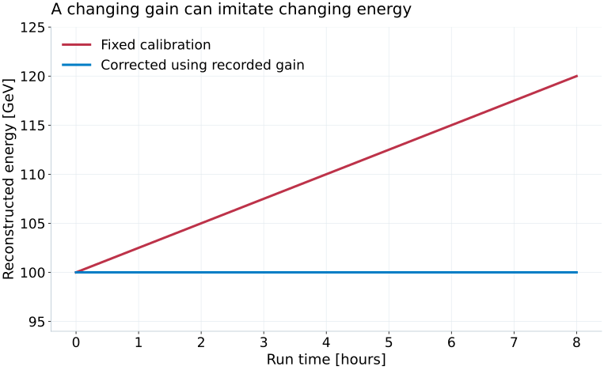

::: {.plot-caption}
Toy example: 100 GeV input; gain increases 2.5% per hour.
:::
:::
:::::

::: {.take-home}
A recorded event needs its calibration context.
:::

::::

::: {.notes}
3 minutes. Slow control and data-quality monitoring are part of the system, not physics triggers. Give a temperature or high-voltage example. Source: Stahl L08 p8. Backup only.
Original teaching calculation: measured response =100 GeV×(1+0.025t/h), divided by known gain for correction. No detector stability claim; no noise added so the role of calibration is isolated.
:::

## Backup · A day of data

::: {.slide-refs}
Original teaching model
:::

:::: {.slide-body}

::::: {.picture-layout}
::: {.picture-copy}
At **1 GB/s**:

**86.4 TB** in 24 hours.

5 kHz × 200 kB per event = ?
:::

::: {.picture-visual}
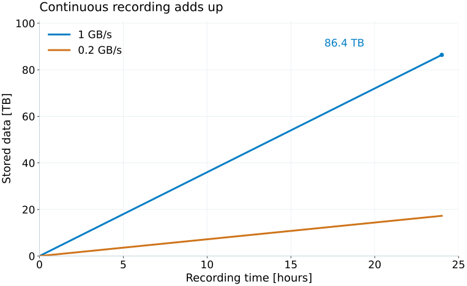

::: {.plot-caption}
Continuous recording; decimal units; no overhead.
:::
:::
:::::

::::

::: {.notes}
4 minutes including student calculation. Answer 1 GB/s, hence 86.4 TB/day for uninterrupted acquisition. Accelerator duty cycle and actual run conditions matter in reality. Ask whether reducing event size by ten is as powerful as reducing event rate by ten for the storage budget: yes for bandwidth, but with different physics consequences.
Original V=Bt curves. At 0.2 GB/s the 24-hour total is 17.28 TB. Show that slope is the bandwidth, not just a number on a slide.
:::

## Backup · Non-paralyzable dead time

::: {.slide-refs}
Original teaching model
:::

:::: {.slide-body}

::::: {.picture-layout}
::: {.picture-copy}
$$r=\frac{R}{1+R\tau}$$

At **τ = 120 µs**, the output approaches **8.33 kHz**.

Steady Poisson arrivals; one busy stage.
:::

::: {.picture-visual}

::: {.plot-caption}
Asymptotic capacity 1/τ; finite input always gives a lower output.
:::
:::
:::::

::::

::: {.notes}
Optional derivation. After fixed busy time τ, the memoryless Poisson process has mean wait 1/R until the next accepted arrival. In burst mode the instantaneous rate is time-dependent; do not apply the formula with the average rate as an exact prediction. Definition and model are original teaching additions to Neufeld/Stahl.
Original analytic rate plot. Derivation: mean interval between accepts =τ+1/R. The graph is not the prediction for the two-stage buffered or burst model.
:::

## Backup · Reference material {.references}

:::: {.slide-body}

[W. J. Stirling, LHC physics lecture (2010)](https://indico.cern.ch/event/94815/contributions/1282690/attachments/1106827/1579062/LBLMIT_Stirling_v2.pdf) — cross-section hierarchy.

[CMS luminosity public results](https://twiki.cern.ch/twiki/bin/view/CMSPublic/LumiPublicResults) — Run-2 pile-up distribution.

[CMS Collaboration, JINST 19 P11021 (2024)](https://cms-results.web.cern.ch/cms-results/public-results/publications/TRG-19-001/) — HLT performance: turn-on, menu rates, CPU budget.

[N. Neufeld, DAQ/trigger lecture (2009)](https://indico.cern.ch/event/43007/contributions/1065030/attachments/927884/1313738/trigger-daq-analysis-esi09-neufeld1.pdf) — elementary DAQ, busy time, buffers.

[ATLAS Collaboration, JINST 15 P10004 (2020)](https://arxiv.org/abs/2007.12539) — Run-2 trigger architecture, stream rates and bandwidth.

[LHCb Starterkit, Run-3 data flow](https://lhcb.github.io/starterkit-lessons/first-analysis-steps/dataflow-run3.html) — software trigger and selective persistence.

[LHCb trigger performance, CHEP 2024](https://indico.cern.ch/event/1338689/contributions/6015396/attachments/2951324/5187948/CHEP24_LHCb_Run3_trigger_performance.pdf) — Run-3 operation.

[ACTS documentation](https://acts.readthedocs.io/en/latest/tracking.html) — reconstruction overview.

Course source: Marian Stahl, Lecture 8, WS 2025/26.

::::

::: {.notes}
Full local asset provenance and model assumptions are in SOURCES.md. No links to the internal reference archive are embedded in the student deck.
:::
